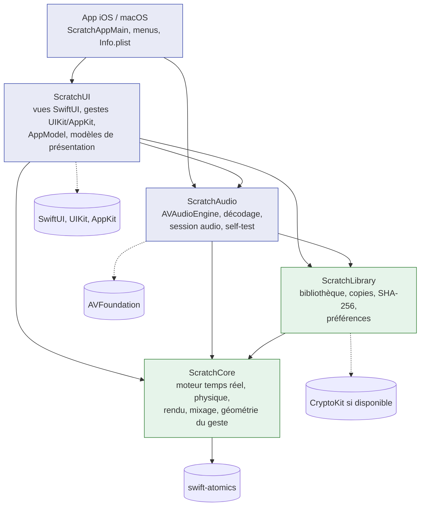
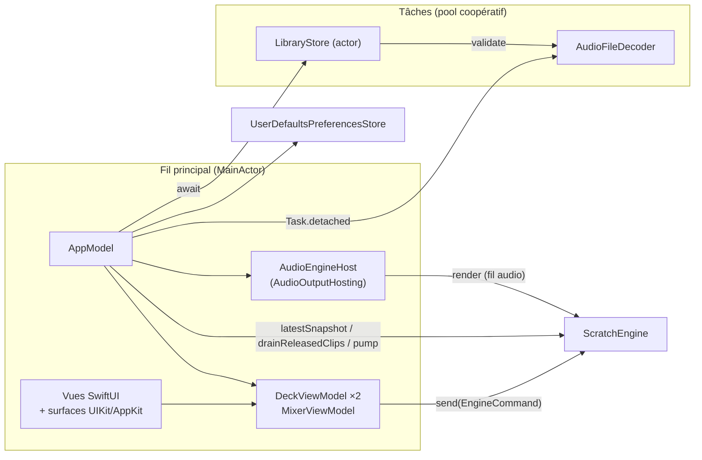
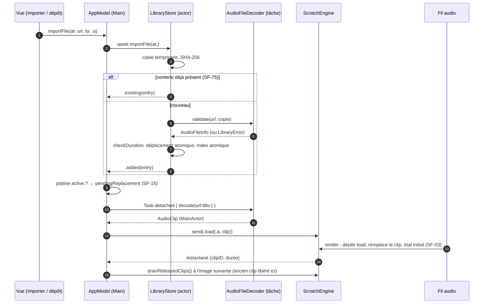
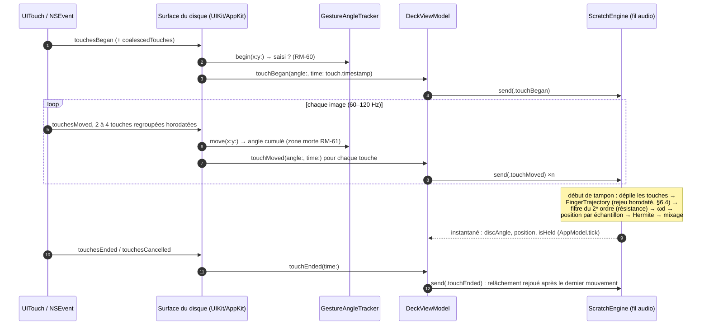

# ScratchApp — Architecture technique

- **Artefact BMAD :** Architecture (🏗️ Winston, Architect)
- **Version :** 1.0 — 14 novembre 2026
- **Statut :** proposé pour validation PO (Sarah), base des stories des épopées EP1 à EP6
- **Références :** [spécifications v2.0](../specs/scratchapp_specifications_v2_0.md) (font foi), [revue v1.9 → v2.0](../specs/REVUE_v1.9_vers_v2.0.md), [équipe BMAD](TEAM.md), [`CONTRIBUTING.md`](../../CONTRIBUTING.md)
- **Arbitrages intégrés :** IC-03 (rattrapage de la feutrine), IC-04 (changement de sortie sur Mac), IC-06 (coupure momentanée), à consigner dans la spec v2.1 par le PO.
- **Code associé :** contrats et squelettes de la story 0.2 (issue #6), compilables et testés. Les signatures de la section 5 sont celles du code.

## Sommaire

1. [Vue d'ensemble](#1-vue-densemble)
2. [Modules et composition](#2-modules-et-composition)
3. [Modèle de fils d'exécution](#3-modèle-de-fils-dexécution)
4. [Flux de données](#4-flux-de-données)
5. [Contrats publics](#5-contrats-publics)
6. [Moteur temps réel](#6-moteur-temps-réel)
7. [Modèle d'erreurs](#7-modèle-derreurs)
8. [Persistance](#8-persistance)
9. [Stratégie de test](#9-stratégie-de-test)
10. [Arborescence source cible et propriétaires](#10-arborescence-source-cible-et-propriétaires)
11. [Standards de code](#11-standards-de-code)
12. [Décisions d'architecture (ADR)](#12-décisions-darchitecture-adr)
13. [Risques techniques](#13-risques-techniques)
14. [Écarts, contradictions et points à valider](#14-écarts-contradictions-et-points-à-valider)

---

## 1. Vue d'ensemble

ScratchApp est une double platine vinyle virtuelle : deux platines A et B, une table de mixage, un scratch calculé en temps réel à partir du son chargé (spec §1). L'application cible iPhone, iPad (iOS/iPadOS 17+) et Mac (macOS 14+), avec un seul code SwiftUI.

### 1.1 Objectifs d'architecture

| # | Objectif | Exigences | Moyen principal |
|---|---|---|---|
| O1 | Son de scratch sans artefact : pas de clic, pas de vitesse « en escalier », inversions propres | SF-77, RM-08, E-06 | Physique intégrée **à chaque échantillon** dans le fil audio ; trajectoire du doigt reconstruite (§6.4) ; interpolation Hermite, fondus de 5 ms |
| O2 | Latence geste → son ≤ 20 ms visée, tampon ≤ 256 trames à 48 kHz | SF-78, PO-07 | Rendu direct dans un `AVAudioSourceNode`, tampon de 256 trames, retard de rejeu adaptatif minimal (§6.4) |
| O3 | Aucun blocage du fil audio | SF-77, `CONTRIBUTING.md` | Communication sans verrou : file SPSC, triple tampon, file de retour des clips (§3) |
| O4 | Cœur testable sans Mac | CI Linux | `ScratchCore` et `ScratchLibrary` en Swift + Foundation, sans framework Apple (§2) |
| O5 | Trois développeurs en parallèle dès la fusion | TEAM.md | Contrats publics figés (§5), squelettes compilables, fichiers attribués (§10), doubles de test (`RecordingEngine`) |
| O6 | Robustesse : interruptions, routes, fichiers invalides, sortie absente, sans plantage | SF-16, SF-18, SF-81, SF-82, RM-56 | Erreurs typées (§7), politique système centralisée dans l'hôte audio (§7.3), copie atomique (§8) |

### 1.2 Principes

1. **Le fil audio est souverain.** Il possède tout l'état sonore (positions, vitesses, gains). Le reste de l'application lui *demande* des changements (commandes) et *lit* son état (instantanés). Aucune donnée n'est partagée en écriture.
2. **Valeurs, pas références.** Commandes et instantanés sont des types valeur triviaux. Le seul objet transmis au fil audio, le clip, voyage sous forme de référence non gérée et revient par une file de retour pour être libéré ailleurs.
3. **Une seule horloge de vérité par domaine.** Horloge audio (trames rendues) pour le son ; horloge monotone de l'appelant (horodatage des événements) pour les gestes ; le pont entre les deux est fait par le rejeu du doigt (§6.4).
4. **Le cœur ne connaît pas Apple.** Physique, rendu, mixage, géométrie du geste, bibliothèque et préférences sont testés sous Linux. Les modules Apple ne font que brancher le système (AVFoundation, SwiftUI, UIKit, AppKit).
5. **Squelettes silencieux.** Un composant pas encore implémenté renvoie du silence ou une valeur neutre, jamais `fatalError` : l'application compile, se lance et passe la CI à chaque fusion.

### 1.3 Contraintes

- Swift 5.10 (mode de langage 5), Xcode 16 en CI, SwiftPM (`Package.swift`) et XcodeGen (`project.yml`).
- `ScratchCore` et `ScratchLibrary` : ni AVFoundation, ni SwiftUI, ni UIKit/AppKit ; CryptoKit seulement sous `#if canImport(CryptoKit)`.
- Dépendance externe unique : `swift-atomics` (1.2+).
- Fonctionnement entièrement hors ligne (SF-20) ; aucun service distant.

## 2. Modules et composition

### 2.1 Diagramme des modules



En vert : modules compilés et testés sous Linux. En bleu : modules Apple, vérifiés par la CI macOS.

### 2.2 Responsabilités

| Module | Contient | Ne contient pas | Épopée, dev |
|---|---|---|---|
| **ScratchCore** | `ScratchEngine` (fil audio), commandes, instantanés, files sans verrou, physique (`DeckPhysics`, `FingerTrajectory`), lecture (`DeckRenderer`), mixage (`MixerRenderer`, `CrossfaderCurve`), son de démonstration, géométrie du geste (`GestureAngleTracker`), résumé de forme d'onde | Foundation (inutile : Swift standard et `swift-atomics` suffisent), accès fichier, UI | EP1 James ; `Gesture/`, `Waveform/` : Léa |
| **ScratchLibrary** | Entrées et index de bibliothèque, import par copie atomique, SHA-256, dédoublonnage, erreurs `LibraryError`, préférences | Décodage audio (protocole seulement), UI | EP3 Hugo |
| **ScratchAudio** | Hôte `AVAudioEngine` + `AVAudioSourceNode`, décodeur `AVAudioFile`/`AVAudioConverter`, session audio iOS, politique d'interruption, self-test | État de jeu (dans `ScratchEngine`), UI | EP2 James |
| **ScratchUI** | `AppModel`, `DeckViewModel`, `MixerViewModel`, vues SwiftUI, surfaces de geste UIKit/AppKit, clavier Mac, dispositions, accessibilité | Logique DSP, accès fichier direct | EP4, EP5 Léa ; `AppModel` : Hugo (EP6) |
| **App** | Point d'entrée, scènes, menus et commandes (Fichier, Platine, Table), cycle de vie, `--selftest` | Logique métier | EP6 Hugo ; menus : Léa (EP5) |

### 2.3 Composition à l'exécution



`AppModel` est construit une seule fois par l'app (`ScratchAppMain`) avec les implémentations réelles ; tests et aperçus SwiftUI injectent des doubles (`RecordingEngine`, `InMemoryPreferencesStore`, bibliothèque factice, `host: nil`).

## 3. Modèle de fils d'exécution

### 3.1 Les fils et leurs droits

| Fil | Qui l'exécute | Fait | Peut appeler | Interdit |
|---|---|---|---|---|
| **Principal** (`@MainActor`) | SwiftUI, UIKit/AppKit, `AppModel`, modèles de présentation, minuteries d'affichage | Gestes, intentions, `tick()` une fois par image, dialogues | `engine.send`, `latestSnapshot`, `drainReleasedClips`, `pump` (hôte arrêté seulement), `host.start/stop`, `await library…` | Décoder, hacher, copier un fichier ; attendre de façon bloquante ; appeler `render` |
| **Audio** (temps réel) | Fil d'E/S Core Audio, via le bloc de rendu de l'`AVAudioSourceNode` ; ou rendu hors ligne (self-test, tests) | `ScratchEngine.render` : commandes, physique, lecture, mixage, instantané | Rien d'autre que le moteur | Voir les règles temps réel (§6.1) |
| **Tâches d'import** | Pool coopératif Swift : acteur `LibraryStore`, `Task.detached` pour le décodage et la forme d'onde | Copie, SHA-256, validation, décodage, résumé de forme d'onde | `FileManager`, `AVAudioFile`, CryptoKit | Toucher le moteur ou l'UI autrement qu'en revenant sur le `MainActor` |
| **Notifications système** | `AVAudioSession`, `AVAudioEngineConfigurationChange` (fil quelconque) | Signaler interruptions et changements de route | `Task { @MainActor in … }` uniquement | Appeler `engine.send` directement (il n'y a qu'un producteur) |

**Rôle de contrôle unique.** La file de commandes n'a qu'un producteur et le triple tampon qu'un lecteur : `send`, `latestSnapshot` et `drainReleasedClips` sont appelés par **un seul fil à la fois**, le fil principal dans l'app. En débogage, `RoleGuard` déclenche une assertion si deux fils les appellent en même temps ; de même pour `render` et `pump` côté audio.

### 3.2 Les trois canaux


1. **Commandes** (principal → audio). `send` convertit l'`EngineCommand` publique en `RenderCommand` triviale : pour `load`, le clip est retenu (+1) et voyage en `Unmanaged`. File pleine : `send` renvoie `false` et rend le +1 sur-le-champ. Capacité 1024, soit plus de 2 s de touches regroupées à 240 Hz sur les deux disques avec tous les curseurs en mouvement.
2. **Instantanés** (audio → principal). Un `EngineSnapshot` complet est publié **à la fin de chaque appel à `render`** (toutes les 5,3 ms à 256 trames). Le lecteur obtient toujours le dernier instantané complet, jamais un instantané partiel. Coût : une copie de quelques centaines d'octets et un échange atomique.
3. **Retour des clips** (audio → principal). Un clip remplacé ou déchargé est poussé dans la file de retour ; `drainReleasedClips()`, appelé à chaque image, rend le +1 sur le fil principal. Le `deinit` d'un clip (libération de plusieurs centaines de Mo) ne s'exécute donc **jamais** sur le fil audio. Le fil audio ne dépile une commande que s'il reste une place dans la file de retour : rien n'est perdu ni libéré sur place si le fil principal tarde.

### 3.3 Hôte arrêté : `pump()`

Quand aucun fil audio ne tourne (sortie indisponible SF-82, arrière-plan iOS, interruption, tests, aperçus), les commandes ne seraient jamais appliquées et la file finirait pleine. `AppModel.tick()` appelle alors `engine.pump()`, qui applique les commandes et publie un instantané **sans rendre d'audio ni avancer le temps**. Condition : `host.isRenderingAudio == false`, c'est-à-dire avant le démarrage de l'`AVAudioEngine` ou après le retour (synchrone) de `stop()`.

### 3.4 Concurrence Swift

- `AppModel`, modèles de présentation, `AudioEngineHost`, `AudioSessionController` : `@MainActor`.
- `LibraryStore` : `actor` (sérialise les imports et l'écriture de l'index).
- Décodage et forme d'onde : `Task.detached(priority: .userInitiated)`, résultat ramené sur le `MainActor`.
- `ScratchEngine`, `AudioClip`, `SPSCQueue`, `SnapshotBuffer` : `@unchecked Sendable`, la sûreté venant du protocole de fils ci-dessus.
- Aucun `DispatchQueue` dans le nouveau code, sauf pour relayer une notification système vers le fil principal.

## 4. Flux de données

### 4.1 Import et chargement d'un son



En cas d'erreur (`LibraryError`), `AppModel.lastError` est renseigné, aucune commande n'est envoyée et la platine garde son son et son état (6.1). Un refus de remplacement laisse l'entrée dans la bibliothèque (SF-15).

### 4.2 Du doigt au son



Sur Mac, `mouseDown/Dragged/Up` remplacent les touches (RM-59) ; le défilement à deux doigts est converti en angle cumulé et relâché 80 ms après le dernier événement (SF-79).

### 4.3 Lancement, préférences et image d'affichage

1. `ScratchAppMain` crée `ScratchEngine`, `AudioEngineHost`, `LibraryStore`, `UserDefaultsPreferencesStore`, `AudioFileDecoder`, puis `AppModel`.
2. `AppModel.launch()` : `preferences.load()` → `prefs.engineCommands` envoyées au moteur (vitesse, pitch, résistance, mixage, durées moteur ; **jamais** de moteur ni de chargement, SF-17, RM-10) → `await library.entries` → `host.start()`.
3. À chaque image : `AppModel.tick()` → `pump()` si l'hôte ne rend pas → `latestSnapshot()` → `DeckViewModel.apply` ×2, `MixerViewModel.apply` → `drainReleasedClips()` → état de la sortie.
4. Après un changement de réglage, `AppModel` enregistre `AppPreferences(snapshot:)` avec un délai d'une demi-seconde (regroupement), et toujours au passage en arrière-plan.

### 4.4 Interruption et arrière-plan (iOS)

`AVAudioSession.interruptionNotification` (début) → `AudioSessionController` → `AudioSystemEvent.interruptionBegan` sur le fil principal → `AudioEngineHost` : `engine.send(.stopAllMotors)`, sortie arrêtée → `pump()` reprend le relais. Fin d'interruption → la sortie redémarre, les moteurs restent à STOP (RM-10, RM-56). Passage en arrière-plan (`scenePhase`) → `AppModel.enterBackground()` → `host.suspendForBackground()` : même effet, préférences enregistrées.

## 5. Contrats publics

Conventions communes à tous les contrats :

| Grandeur | Unité et convention |
|---|---|
| Angle | Radians, **cumulé** (déplié, sans saut à ±π), positif dans le **sens horaire** = sens de lecture normal. Repère d'écran à axe y vers le bas (UIKit ; `NSView` avec `isFlipped == true`). |
| Temps d'événement | Secondes sur une horloge monotone de l'appelant (`UITouch.timestamp`, `NSEvent.timestamp`, `ProcessInfo.systemUptime`), la même pour tout un geste. |
| Position | Secondes de son, dans [−2 s ; durée] (amorce comprise, SF-72). |
| Vitesse de lecture | Signée ; 1 = vitesse de gravure (33⅓ RPM, pitch 0, RM-50) ; bornée à ±16 (SF-77). |
| Pitch | Fraction : −0,08…+0,08 (SF-11), pas de 0,001 appliqué par l'UI. |
| Résistance, crossfader, courbe, faders | 0…1. Crossfader : 0 = butée A, 1 = butée B, avant hamster. Courbe : 0 = douce, 1 = coupure franche. |
| Niveaux | Linéaires, 1 = 0 dBFS. |

Le moteur borne chaque valeur et ignore les valeurs non finies. Les contrats publics ne changent que par une story dédiée ou avec l'accord de l'architecte (TEAM.md) ; les types internes (`DeckPhysics`, `DeckRenderer`, `MixerRenderer`, `RenderCommand`) appartiennent à James et peuvent évoluer librement.

### 5.1 ScratchCore

**`TurntableConstants.swift`** — constantes partagées (`TurntableConstants`, `TurntableSpeed`, `DeckID`). Ajouts de la story 0.2 : `referenceAngularVelocity`, `antiAliasingRateThreshold`, `defaultResistance`, `defaultCrossfader`, `defaultCrossfaderCurve`, `defaultLineFader`, `gainSmoothingTime`, `hardCutRiseTime`, `jumpFadeDuration`, `trackpadReleaseDelay`, `keyboardCrossfaderStep`, `preferredBufferFrames`, `TurntableSpeed.nominalRate`.

**`DeckPair.swift`**

```swift
public struct DeckPair<Value> {
    public var a: Value
    public var b: Value
    public init(a: Value, b: Value)
    public init(repeating value: Value)
    public subscript(deck: DeckID) -> Value { get set }
    public func map<T>(_ transform: (Value) throws -> T) rethrows -> DeckPair<T>
}
// Equatable, Hashable, Sendable, Codable (clés "a", "b") si Value l'est.
```

**`Clip/AudioClip.swift`** — son décodé, immuable, stéréo Float32 désentrelacé (ADR-05).

```swift
public final class AudioClip: Identifiable, Hashable, @unchecked Sendable {
    public struct ID: Hashable, Comparable, Sendable, CustomStringConvertible { public let rawValue: UInt64 }
    public let id: ID                              // unique dans le processus (≠ UUID de bibliothèque)
    public let title: String
    public let sampleRate: Double                  // native, ≤ 48 kHz
    public let frameCount: Int
    public let left: UnsafeBufferPointer<Float>    // adresse stable jusqu'au deinit
    public let right: UnsafeBufferPointer<Float>
    public var duration: Double { get }
    public init(title: String, sampleRate: Double, frameCount: Int,
                fill: (_ left: UnsafeMutableBufferPointer<Float>,
                       _ right: UnsafeMutableBufferPointer<Float>) throws -> Void) rethrows
    public convenience init(title: String, sampleRate: Double, left: [Float], right: [Float])
    public convenience init(title: String, sampleRate: Double, mono: [Float])
}
```

**`Engine/EngineCommand.swift`** — commandes du fil principal vers le moteur.

```swift
public enum EngineCommand: Equatable, Sendable {
    // Transport (par platine)
    case load(DeckID, AudioClip)          // état initial SF-03 ; ancien clip → file de retour
    case unload(DeckID)                   // platine vidée, moteur arrêté
    case motor(DeckID, on: Bool)          // START / STOP avec rampes
    case speed(DeckID, TurntableSpeed)
    case pitch(DeckID, Double)
    // Jeu (par platine)
    case resistance(DeckID, Double)
    case touchBegan(DeckID, angle: Double, time: Double)   // ignoré si déjà tenu (RM-60)
    case touchMoved(DeckID, angle: Double, time: Double)   // chaque touche regroupée, temps croissants
    case touchEnded(DeckID, time: Double)                  // relâchement ou annulation système
    case setCue(DeckID)
    case recallCue(DeckID)                // autorisé disque tenu (6.6)
    case seek(DeckID, seconds: Double)    // needle drop, ignoré disque tenu (SF-71)
    // Réglages moteur (deux platines)
    case startDuration(Double)
    case brakeDuration(Double)
    case slipmatCatchUp(Double)           // 95 % de la vitesse du plateau (IC-03)
    // Table de mixage
    case crossfader(Double)
    case crossfaderCurve(Double)
    case hamster(Bool)
    case lineFader(DeckID, Double)
    case momentaryCut(DeckID, open: Bool) // ouverte : la voie ignore le crossfader (IC-06)
    // Système
    case stopAllMotors                    // RM-56 : STOP sans rampe, positions conservées
    case outputSampleRate(Double)         // aucun redécodage
}
```

**`Engine/EngineSnapshot.swift`** — état publié par le fil audio, type **trivial** (vérifié par `_isPOD` en débogage et par un test).

```swift
public struct DeckSnapshot: Equatable, Sendable {
    public var clipID: AudioClip.ID?
    public var durationSeconds: Double
    public var positionSeconds: Double
    public var playbackRate: Double
    public var discAngle: Double          // disque (vinyle), continue de tourner en butée
    public var platterAngle: Double       // plateau (tourne sous le disque retenu, 6.9)
    public var markerAngle: Double        // repère SF-69, voir §6.6
    public var isHeld: Bool
    public var motorOn: Bool
    public var speed: TurntableSpeed
    public var pitch: Double
    public var resistance: Double
    public var cueSeconds: Double?
    public var isAtEnd: Bool              // sillon fermé
    public var isInLeadIn: Bool           // position < 0
    public var peakLevel: Double          // VU de voie : après fader de voie, avant crossfader
    public var isLoaded: Bool { get }     // clipID != nil
    public var isActive: Bool { get }     // SF-15 : moteur, disque tenu ou |vitesse| > 0,001
    public static let initial: DeckSnapshot
}

public struct MixerSnapshot: Equatable, Sendable {
    public var crossfader: Double
    public var crossfaderCurve: Double
    public var hamster: Bool
    public var lineFaders: DeckPair<Double>
    public var momentaryCuts: DeckPair<Bool>
    public var outputPeak: Double
    public var limiterActive: Bool        // indicateur de saturation (6.8)
    public static let initial: MixerSnapshot
}

public struct EngineSnapshot: Equatable, Sendable {
    public var decks: DeckPair<DeckSnapshot>
    public var mixer: MixerSnapshot
    public var motorTimings: MotorTimings
    public var outputSampleRate: Double
    public var sampleTime: Int64          // trames rendues depuis la création
    public subscript(deck: DeckID) -> DeckSnapshot { get }
    public static let initial: EngineSnapshot
}
```

**`Engine/MotorTimings.swift`**

```swift
public struct MotorTimings: Codable, Equatable, Sendable {
    public var startDuration: Double      // 0,7 s, borné 0,1…5 s
    public var brakeDuration: Double      // 1,0 s, borné 0,1…5 s
    public var slipmatCatchUp: Double     // 60 ms, borné 0…300 ms
    public static let defaults: MotorTimings
    public func clamped() -> MotorTimings
}
extension Double { public func clamped(to range: ClosedRange<Double>, fallback: Double) -> Double }
```

**`Engine/EngineControlling.swift`** et **`Engine/ScratchEngine.swift`**

```swift
public protocol EngineControlling: AnyObject {              // fil de contrôle uniquement
    @discardableResult func send(_ command: EngineCommand) -> Bool
    func latestSnapshot() -> EngineSnapshot
    @discardableResult func drainReleasedClips() -> Int
    func pump()                                              // seulement si aucun fil audio ne rend
}

public final class ScratchEngine: EngineControlling, @unchecked Sendable {
    public static let commandCapacity: Int        // 1024
    public static let releaseCapacity: Int        // 64
    public static let maximumBlockFrames: Int     // 512 ; render découpe au-delà
    public init(outputSampleRate: Double = 48_000)
    // EngineControlling (fil de contrôle)
    // Fil audio :
    public func render(frameCount: Int, left: UnsafeMutablePointer<Float>, right: UnsafeMutablePointer<Float>)
}
```

**`Concurrency/SPSCQueue.swift`** et **`Concurrency/SnapshotBuffer.swift`** — implémentés et testés (ordre, saturation, enroulement, concurrence, ThreadSanitizer).

```swift
public final class SPSCQueue<Element>: @unchecked Sendable {
    public let capacity: Int                      // puissance de 2 ≥ minimumCapacity
    public init(minimumCapacity: Int)
    @discardableResult public func push(_ element: Element) -> Bool   // producteur
    public func pop() -> Element?                                     // consommateur
    public var availableCapacity: Int { get }                         // producteur, prudent
    public var approximateCount: Int { get }
    public var isEmpty: Bool { get }                                  // consommateur
}

public final class SnapshotBuffer<Value>: @unchecked Sendable {
    public init(initialValue: Value)
    public func write(_ value: Value)             // un seul écrivain
    public var hasNewValue: Bool { get }          // lecteur
    public func read() -> Value                   // un seul lecteur ; dernière valeur complète
}
```

**`Mixer/CrossfaderCurve.swift`** — fonction pure, publique pour que l'UI dessine la courbe (squelette : gains nuls).

```swift
public enum CrossfaderCurve {
    public static func gains(position x: Double, curve: Double) -> (a: Double, b: Double)  // x après hamster
}
```

**`Demo/DemoSound.swift`** (squelette : silence)

```swift
public enum DemoSound {
    public static let title: String               // « Son de démonstration »
    public static let duration: Double            // 8 s
    public static let sampleRate: Double          // 48 kHz
    public static func makeClip() -> AudioClip    // déterministe ; hors fil principal si possible
}
```

**`Gesture/GestureAngleTracker.swift`** (squelette : ne saisit rien) — propriétaire Léa.

```swift
public struct GestureAngleTracker: Sendable {
    public private(set) var centerX: Double, centerY: Double, radius: Double
    public let deadZoneRatio: Double              // 0,12 (RM-61)
    public private(set) var angle: Double         // cumulé, sens horaire positif
    public private(set) var isTracking: Bool
    public init(centerX: Double, centerY: Double, radius: Double,
                deadZoneRatio: Double = TurntableConstants.centerDeadZoneRatio)
    public mutating func begin(x: Double, y: Double) -> Bool      // RM-60 : saisi seulement si dans le disque
    public mutating func move(x: Double, y: Double) -> Double     // angle cumulé ; inchangé en zone morte
    public mutating func end()
    public mutating func updateGeometry(centerX: Double, centerY: Double, radius: Double)
}
```

**`Waveform/WaveformOverview.swift`** (squelette : vide) — propriétaire Léa.

```swift
public struct WaveformOverview: Equatable, Sendable {
    public let bucketDuration: Double
    public let peaks: [Float]                     // crête 0…1 par tranche, de 0 s à la fin
    public init(bucketDuration: Double, peaks: [Float])
    public static let empty: WaveformOverview
    public static func compute(from clip: AudioClip, bucketsPerSecond: Double = 200) -> WaveformOverview
}
```

**`Testing/RecordingEngine.swift`** — double de test d'`EngineControlling`.

```swift
public final class RecordingEngine: EngineControlling {
    public private(set) var sentCommands: [EngineCommand]
    public var snapshot: EngineSnapshot           // renvoyé par latestSnapshot()
    public var acceptsCommands: Bool              // false : simule une file pleine
    public private(set) var drainCount: Int, pumpCount: Int
    public init(snapshot: EngineSnapshot = .initial)
    public func clearSentCommands()
}
```

### 5.2 ScratchLibrary

**`LibraryLocations.swift`** (sprint 0, inchangé) : `soundBankDirectory`, `recordingsDirectory`, `libraryIndexURL`, `standard(fileManager:)`.

**`LibraryEntry.swift`**

```swift
public struct LibraryEntry: Codable, Equatable, Hashable, Identifiable, Sendable {
    public enum Origin: String, Codable, Sendable, CaseIterable { case imported, demo, microphone, mix }
    public let id: UUID                  // stable (RM-58)
    public var contentHash: String       // SHA-256 hexadécimal minuscule ; "" pour la démo
    public var fileName: String          // nom de la copie dans « Banque de sons » ; "" pour la démo
    public var title: String
    public var duration: Double
    public var importedAt: Date
    public var origin: Origin
    public init(id: UUID = UUID(), contentHash: String, fileName: String, title: String,
                duration: Double, importedAt: Date, origin: Origin)
    public var isDeletable: Bool { get }              // false pour la démo
    public static let demoID: UUID                    // 5C2A7C40-DE30-4D3A-9B1E-000000000001
    public static func demo(title: String, duration: Double) -> LibraryEntry
}

public enum ImportResult: Equatable, Sendable {
    case added(LibraryEntry)
    case existing(LibraryEntry)                       // même SHA-256 (SF-75)
    public var entry: LibraryEntry { get }
    public var isNew: Bool { get }
}
```

**`LibraryStoring.swift`** et **`LibraryStore.swift`** (squelette : démo seule, imports refusés)

```swift
public protocol LibraryStoring: Sendable {
    var entries: [LibraryEntry] { get async }         // démo en tête, puis imports du plus récent au plus ancien
    func importFile(at url: URL) async throws -> ImportResult
    func delete(id: UUID) async throws                // copie seule (RM-49) ; démo → demoCannotBeDeleted
    func url(for id: UUID) async -> URL?              // nil : démo ou inconnue
}

public actor LibraryStore: LibraryStoring {
    public let locations: LibraryLocations
    public init(locations: LibraryLocations, validator: any AudioFileValidating)
}
```

**`AudioFileValidating.swift`**

```swift
public struct AudioFileInfo: Equatable, Sendable {
    public var duration: Double, sampleRate: Double, channelCount: Int
}
public protocol AudioFileValidating: Sendable {
    func validate(url: URL) async throws -> AudioFileInfo   // unsupportedFormat, protectedContent, corrupted
}
```

**`LibraryError.swift`** — voir §7.2.

```swift
public enum LibraryError: Error, Equatable, Sendable {
    case insufficientStorage, unsupportedFormat, protectedContent
    case tooLong(duration: Double), tooShort(duration: Double)
    case corrupted, writeFailed(reason: String), notFound, demoCannotBeDeleted
    public var userMessage: String { get }                  // français
    public static func checkDuration(_ seconds: Double) throws   // SF-80
}
```

**`ContentHasher.swift`** (squelette : chaîne vide) — ADR-09.

```swift
public enum ContentHasher {
    public static func sha256Hex(ofFileAt url: URL) throws -> String   // lecture par blocs de 1 Mio
    public static func sha256Hex(of data: Data) -> String
}
```

**`AppPreferences.swift`**, **`PreferencesStoring.swift`**, **`UserDefaultsPreferencesStore.swift`** (squelette) — ADR-11.

```swift
public struct AppPreferences: Codable, Equatable, Sendable {
    public struct Deck: Codable, Equatable, Sendable { public var speed: TurntableSpeed; public var pitch: Double; public var resistance: Double }
    public struct Mixer: Codable, Equatable, Sendable {
        public var crossfader: Double, crossfaderCurve: Double, hamster: Bool, lineFaders: DeckPair<Double>
    }
    public var version: Int                         // 1
    public var decks: DeckPair<Deck>
    public var mixer: Mixer
    public var motor: MotorTimings
    public static let currentVersion: Int
    public static let defaults: AppPreferences
    public init(decks:mixer:motor:)                 // valeurs par défaut de la spec
    public init(snapshot: EngineSnapshot)           // ce qu'il faut enregistrer
    public func sanitized() -> AppPreferences
    public var engineCommands: [EngineCommand] { get }   // jamais motor ni load (RM-10)
}

public protocol PreferencesStoring: Sendable {
    func load() -> AppPreferences                   // jamais d'erreur ; défauts si absent ou illisible
    func save(_ preferences: AppPreferences)
}
public final class InMemoryPreferencesStore: PreferencesStoring { public init(_ preferences: AppPreferences? = nil) }
public final class UserDefaultsPreferencesStore: PreferencesStoring {
    public static let defaultKey: String            // "app.scratchapp.preferences.v1"
    public init(defaults: UserDefaults = .standard, key: String = defaultKey)
}
```

### 5.3 ScratchAudio

```swift
// AudioClipDecoding.swift
public protocol AudioClipDecoding: Sendable {
    func decode(url: URL, title: String) async throws -> AudioClip
}
extension AudioClipDecoding { public func decode(url: URL) async throws -> AudioClip }

// AudioFileDecoder.swift (squelette : refuse tout fichier) — James
public struct AudioFileDecoder: AudioClipDecoding, AudioFileValidating {
    public static let maximumClipSampleRate: Double   // 48 kHz (ADR-05)
    public init()
}

// AudioOutputStatus.swift
public struct AudioOutputInfo: Equatable, Sendable {
    public var name: String, sampleRate: Double, bufferFrames: Int, outputLatency: Double
}
public enum AudioOutputStatus: Equatable, Sendable {
    case stopped, starting, running(AudioOutputInfo), unavailable(reason: String)
    public var isRunning: Bool { get }
    public var outputInfo: AudioOutputInfo? { get }
}

// AudioSystemEvent.swift
public enum AudioSystemEvent: Equatable, Sendable {
    case interruptionBegan, interruptionEnded
    case routeChanged(previousDeviceUnavailable: Bool)
    case configurationChanged, mediaServicesReset
}

// AudioOutputHosting.swift
@MainActor public protocol AudioOutputHosting: AnyObject {
    var status: AudioOutputStatus { get }
    var isRenderingAudio: Bool { get }
    func start()                       // ne lève pas : échec → .unavailable, nouvelle tentative (SF-82)
    func stop()                        // synchrone
    func suspendForBackground()        // iOS : stopAllMotors + sortie coupée (SF-81)
    func resumeFromBackground()        // sortie relancée, jamais les moteurs (RM-10)
}

// AudioEngineHost.swift (squelette : .unavailable) — James
@MainActor @Observable public final class AudioEngineHost: AudioOutputHosting {
    public let engine: ScratchEngine
    public init(engine: ScratchEngine)
}

// AudioSessionController.swift (iOS, squelette) — James
@MainActor public final class AudioSessionController {
    public var onEvent: ((AudioSystemEvent) -> Void)?
    public init()
    public func activate() throws
    public func deactivate()
    public var currentOutputName: String { get }
}

// SelfTest.swift (sprint 0) — James, à faire évoluer (§9.3)
public enum SelfTest { public static func run(sampleRate: Double = 48_000, seconds: Double = 1.0) throws -> Report }
```

### 5.4 ScratchUI

```swift
@MainActor @Observable public final class DeckViewModel {
    public let deck: DeckID
    public private(set) var frame: DeckSnapshot          // chaque image
    public internal(set) var loadedEntry: LibraryEntry?   // renseigné par AppModel
    public private(set) var isLoaded: Bool, motorOn: Bool, speed: TurntableSpeed, pitch: Double
    public private(set) var resistance: Double, cueSeconds: Double?, isHeld: Bool
    public init(deck: DeckID, engine: any EngineControlling)
    public func toggleMotor(); public func setMotor(_ on: Bool)
    public func setSpeed(_ newSpeed: TurntableSpeed)
    public func setPitch(_ value: Double)                 // quantifié 0,1 %, borné ±8 %
    public func nudgePitch(steps: Int); public func resetPitch()
    public func setResistance(_ value: Double)
    public func setCue(); public func recallCue()
    public func needleDrop(fraction: Double)              // ignoré disque tenu
    public func touchBegan(angle: Double, time: Double)
    public func touchMoved(angle: Double, time: Double)   // chaque touche regroupée
    public func touchEnded(time: Double)
}

@MainActor @Observable public final class MixerViewModel {
    public private(set) var frame: MixerSnapshot
    public private(set) var crossfader: Double, crossfaderCurve: Double, hamster: Bool
    public private(set) var lineFaders: DeckPair<Double>, momentaryCuts: DeckPair<Bool>
    public init(engine: any EngineControlling)
    public func setCrossfader(_ value: Double); public func nudgeCrossfader(steps: Int)   // pas de 5 %
    public func moveCrossfaderToA(); public func centerCrossfader(); public func moveCrossfaderToB()
    public func setCrossfaderCurve(_ value: Double); public func setHamster(_ on: Bool)
    public func setLineFader(_ deck: DeckID, _ value: Double)
    public func setMomentaryCut(_ deck: DeckID, open: Bool)
}

public struct ReplacementRequest: Equatable, Identifiable, Sendable { public let id: UUID; public let deck: DeckID; public let entry: LibraryEntry }
public struct DeletionRequest: Equatable, Identifiable, Sendable { public let entry: LibraryEntry; public let loadedOn: [DeckID] }

@MainActor @Observable public final class AppModel {
    public let deckA: DeckViewModel, deckB: DeckViewModel, mixer: MixerViewModel
    public let engine: any EngineControlling
    public private(set) var libraryEntries: [LibraryEntry]
    public private(set) var outputStatus: AudioOutputStatus
    public private(set) var lastError: LibraryError?
    public private(set) var pendingReplacement: ReplacementRequest?
    public private(set) var pendingDeletion: DeletionRequest?
    public init(engine: any EngineControlling, host: (any AudioOutputHosting)?,
                library: any LibraryStoring, preferences: any PreferencesStoring,
                decoder: any AudioClipDecoding)
    public func deck(_ id: DeckID) -> DeckViewModel
    public func tick()                                     // une fois par image (implémenté)
    public func dismissError()
    // Squelettes (Hugo, EP6) :
    public func launch() async; public func enterBackground(); public func enterForeground(); public func savePreferences()
    public func loadDemo(on deck: DeckID) async
    public func importFile(at url: URL, to deck: DeckID) async
    public func load(_ entry: LibraryEntry, on deck: DeckID) async
    public func confirmReplacement() async; public func cancelReplacement()
    public func requestDeletion(of entry: LibraryEntry); public func confirmDeletion() async; public func cancelDeletion()
}
```

**Deux cadences d'observation (ADR-12).** `frame` change à chaque image : seules les vues qui le lisent (disque, forme d'onde, position, VU-mètres) sont redessinées à chaque image. Les autres propriétés ne sont affectées que lorsque leur valeur change ; les boutons et curseurs ne sont donc pas réévalués 120 fois par seconde. Les intentions appliquent une mise à jour optimiste, confirmée par l'instantané suivant.

**Horloge d'affichage.** `AppModel.tick()` est appelé une fois par image par un `DisplayLinkDriver` (Léa) : `CADisplayLink` sur iOS, `NSView.displayLink(target:selector:)` sur macOS 14. À défaut, un `TimelineView(.animation)` racine qui appelle `tick()` sur `onChange(of: context.date)`.

**Surfaces de geste (Léa).** Disque : `UIViewRepresentable` sur iOS (`touchesBegan/Moved/Ended/Cancelled`, `coalescedTouches(for:)`, `isMultipleTouchEnabled`, un seul toucher suivi par disque) ; `NSViewRepresentable` sur macOS (`mouseDown/Dragged/Up`, `scrollWheel` par phases, `isFlipped = true`). Clavier Mac : `NSEvent.addLocalMonitorForEvents(matching: [.keyDown, .keyUp])`, ignoré si un champ de texte est premier répondeur, répétitions automatiques ignorées pour les coupures `F`/`J`.

## 6. Moteur temps réel

### 6.1 Règles temps réel (fil audio)

Tout code exécuté par `ScratchEngine.render` (et donc `DeckPhysics`, `FingerTrajectory`, `DeckRenderer`, `MixerRenderer`, `CrossfaderCurve`) respecte ces règles. La revue QA les vérifie à chaque PR (case du modèle de PR).

1. **Aucune allocation** : pas de création ni de croissance de `Array`, `String`, `Dictionary`, `Set` ; pas de concaténation ni d'interpolation de chaîne ; pas d'instanciation de classe ; pas de closure qui capture un contexte créée à la volée ; pas d'existentiel (`any P`) ni de générique non spécialisé dans la boucle de rendu. Les tampons de travail sont alloués à la création (`RenderScratch`), la mémoire des clips au décodage.
2. **Aucun verrou ni attente** : pas de `NSLock`, `os_unfair_lock`, `DispatchQueue.sync`, sémaphore, `await`, `Task {}`, `MainActor`. Seuls les atomiques de `swift-atomics` (files, triple tampon, `RoleGuard`).
3. **Aucun appel système ni Objective-C** : pas d'AVFoundation, de `print`, `NSLog`, `os_log`, `Date()`, accès fichier, notification.
4. **Aucune libération d'objet** : le clip est tenu en `Unmanaged` et rendu par la file de retour ; les types qui traversent les files sont triviaux (`_isPOD`).
5. **Travail borné par échantillon** : coût indépendant de la durée du son ; anti-repliement à nombre de coefficients borné.
6. **Robustesse numérique** : valeurs non finies ignorées à l'application des commandes ; sorties bornées ; pas de dénormaux persistants (seuil ou décalage infime dans les filtres récursifs).
7. **Échauffement** : `ScratchEngine.init` applique les commandes et publie un instantané une première fois (`pump()`) hors du fil audio, pour instancier les métadonnées génériques avant le premier rendu ; l'échauffement s'étendra au rendu d'un bloc silencieux quand les composants DSP seront implémentés.
8. **Lisibilité** : le code qui s'exécute sur le fil audio porte la mention `Fil audio uniquement` dans sa documentation.

### 6.2 Cycle de rendu

```
render(frameCount, left, right)
 ├─ applyPendingCommands()      tant que la file de retour a de la place
 ├─ pour chaque bloc de ≤ 512 trames
 │   ├─ deckA.physics.process   → positions[], rates[]   (1 valeur par échantillon)
 │   ├─ deckA.renderer.render   → A.left[], A.right[]
 │   ├─ (idem platine B)
 │   └─ mixer.mix(A, B)         → left, right (+ crêtes, limiteur)
 ├─ sampleTime += frameCount
 └─ publishSnapshot()           un instantané complet par appel
```

Les commandes sont appliquées au début de l'appel : la granularité temporelle d'une commande est d'un tampon (5,3 ms à 256 trames). Les variations sont ensuite lissées à la fréquence audio (gains ≤ 5 ms, trajectoire du doigt, rampes moteur) ; aucune marche n'est audible.

### 6.3 Physique d'une platine (`DeckPhysics`, James)

Modèle de la spec 5.1, intégré **à chaque échantillon** (ADR-06), avec les arbitrages :

| Élément | Règle | Source |
|---|---|---|
| Plateau | `ωp → ωt = 2π × RPM/60 × (1 + pitch)` moteur actif, → 0 sinon ; pentes `ωt / startDuration` et `ωt / brakeDuration` ; START pendant le freinage repart de la vitesse courante | 5.1-1, SF-04, SF-05, 6.2 |
| Disque libre, moteur actif | 1er ordre vers `ωp`, **τ = slipmatCatchUp / 3** (95 % atteints en T) ; T = 0 → alignement immédiat | 5.1-2, SF-68, **IC-03** |
| Disque libre, moteur arrêté | décélération **linéaire** (friction constante) jusqu'à 0 en 150 ms au plus, aucune reprise motorisée | SF-10, **IC-03** |
| Disque tenu | `θd` suit `θf + gripOffset` par un filtre du 2ᵉ ordre à amortissement critique, τ = lerp(2 ms, 35 ms, résistance) ; `gripOffset = θd − θf` à la prise (aucun saut, 6.3 « saisir le disque en rotation ») ; doigt fixe → vitesse nulle | 5.1-3, RM-12, SF-22, SF-23 |
| Tête | `p += ωd / (2π) × 1,8 s × dt`, bornée à [−2 s ; durée] ; en butée le disque continue de tourner ; un mouvement inverse revient immédiatement dans le son | 5.1-4, RM-50, RM-55 |
| Vitesse de lecture | `ωd / ωref`, bornée à ±16 | RM-50, SF-77 |
| Résistance | n'affecte ni démarrage, ni freinage, ni rattrapage | RM-54 |
| STOP immédiat | `stopAllMotors` : `ωp = 0`, moteur STOP, disque libre arrêté, disque tenu inchangé | RM-56 |

### 6.4 Trajectoire du doigt (`FingerTrajectory`, ADR-07)

**Problème.** Les touches sont échantillonnées à 120 ou 240 Hz mais livrées **par lots**, une fois par image (60 ou 120 Hz), puis vues par le fil audio au début d'un tampon (5,3 ms). Appliquer chaque angle dès réception donne une vitesse en créneaux : nulle entre deux lots, très forte à chaque lot. C'est le grésillement « en escalier » que SF-77 interdit, et le filtre de résistance (2 ms à 0 %) ne suffit pas à le masquer.

**Solution retenue : rejeu horodaté à retard adaptatif.** La tête de rejeu avance sur l'horloge des événements au rythme de l'horloge audio, juste derrière le dernier événement reçu ; la cible est interpolée linéairement entre les deux événements qui l'encadrent. Toutes les touches regroupées sont utilisées, avec leur horodatage exact.

- La **marge** (dernier événement − tête) est minimale juste avant chaque lot. Une régulation douce de la cadence de rejeu (±10 % au plus, ±2 % en pratique) amène la plus petite marge des 16 derniers lots à 1,5 ms : le retard converge vers le plus petit retard sans famine, quelle que soit la cadence d'affichage, la gigue ou le rythme des touches.
- **Famine** (la tête rattrape le dernier événement) : la tête se fige jusqu'au lot suivant. La vitesse est nulle un instant, mais il n'y a jamais de saut de position ni de dépassement dans le mauvais sens ; le retard s'allonge d'autant. En pratique cela n'arrive que pendant les premières centaines de millisecondes du tout premier geste à 60 Hz.
- Le retard appris sert de point de départ au geste suivant.
- Le **relâchement** est rejoué lui aussi : `touchEnded` prend effet quand la tête atteint son horodatage. Le geste est rendu en entier (le « flick » d'un release n'est pas tronqué) et l'état tenu de l'instantané suit le son.

Alternatives écartées (prototype numérique dans les mêmes conditions pour les deux premières, analyse pour l'extrapolation) :

| Méthode | Ondulation de vitesse à vitesse de doigt constante | Retard ajouté | Défaut |
|---|---|---|---|
| Angle appliqué à réception | créneaux de 0 à plusieurs fois la vitesse | 0 | escalier audible |
| Rampe linéaire sur l'intervalle mesuré entre lots (durée = 1,25 à 2 intervalles) | ±10 % à ±30 %, trous de vitesse à 1,25 | 1,25 à 2 intervalles d'image (10 à 33 ms) | ondulation à la cadence d'image ; détail des touches regroupées perdu |
| Extrapolation corrigée | faible à vitesse constante | ≈ 0 | dépassement dans le mauvais sens à chaque inversion (baby scratch), correction audible |
| **Rejeu horodaté adaptatif** | **< 0,5 %** | **≈ 13 ms (120 Hz), ≈ 21 ms (60 Hz)** | latence d'un intervalle de livraison |

**Latence ajoutée** (mesurée par `FingerTrajectoryTests`, touches à 120 ou 240 Hz, gigue de livraison de 2 à 5 ms, tampon de 256 trames) :

| Affichage | Retard de rejeu convergé | Famines après convergence |
|---|---|---|
| 120 Hz (ProMotion, Mac 120 Hz) | 12,7 à 13,6 ms | 0 |
| 60 Hz | 20,6 à 20,9 ms | 0 (2 à 3 pendant l'adaptation du premier geste) |

Ce retard s'ajoute au tampon de sortie (5,3 ms) et à la latence tactile du système. La latence geste → son de 20 ms (SF-78) est donc hors d'atteinte sur un affichage à 60 Hz et serrée à 120 Hz : voir §14 et le risque R-03. Leviers de calibrage (PO-07) : `targetMargin`, envoi des touches prédites comme événements provisoires (non retenu en V1), réduction du tampon de sortie à 128 trames si le matériel le permet.

**Tests** (`Tests/ScratchCoreTests/FingerTrajectoryTests.swift`) : vitesse constante à 120 Hz (±5 %, aucune marche > 1 % de la vitesse par échantillon, retard ≤ 20 ms) ; adaptation à 60 Hz ; huit profils d'appareils sans famine après convergence ; doigt immobilisé → angle final exact et vitesse nulle (RM-12) ; baby scratch à 8 Hz → retour au départ à ±10 ms de son près (6.3) ; relâchement rejoué ; événements non croissants ou non finis ignorés.

### 6.5 Lecture et mixage (`DeckRenderer`, `MixerRenderer`, James)

- **Lecture** : position (s) × `clip.sampleRate` → indice fractionnaire ; interpolation **Hermite cubique** 4 points (SF-77). Le rééchantillonnage vers la sortie est implicite : l'incrément vaut `vitesse × clipRate / outputRate`, d'où l'absence de redécodage au changement de sortie (6.5, 6.15).
- **Amorce et sillon fermé** : position < 0 ou ≥ durée → silence, sans lecture hors bornes (RM-09) ; fondu de quelques millisecondes à l'entrée en butée (6.12, aucun clic).
- **Anti-repliement** : au-delà d'un rapport de décimation effectif `|vitesse| × clipRate / outputRate > 2`, filtrage passe-bas à coupure adaptée et coût borné (SF-77).
- **Sauts** (CUE, needle drop) : fondu enchaîné de 5 ms entre l'ancienne et la nouvelle position (SF-71, 6.6).
- **Mixage** (arbitrage IC-06) : `gain voie = fader de voie × (coupure momentanée ouverte ? 1 : gain crossfader de la voie)`, `x` inversé si hamster ; gains lissés à la fréquence audio (≤ 5 ms, RM-52), montée ≤ 1 ms en coupure franche et pour les coupures momentanées, bascule hamster sans clic (SF-67).
- **Sortie** : somme avec marge, limiteur doux (aucun écrêtage numérique, 6.8), `limiterActive` ; crêtes de voie (après fader de voie, avant crossfader) et de sortie pour les VU-mètres.

### 6.6 Repère (SF-69)

Le moteur calcule `markerAngle` pour que l'UI n'ait aucune règle à reproduire :

- hors butée : `markerAngle = (position − (CUE ?? 0)) × 2π / 1,8`. Le repère vaut 0 modulo 2π, c'est-à-dire qu'il passe sous la tête de lecture dessinée par l'UI, quand la tête est sur le CUE (6.11) ; il tourne exactement avec le disque ;
- en butée (amorce, sillon fermé) : il tourne avec le disque (RM-55), `markerAngle − discAngle` restant constant ;
- à la sortie de butée et à chaque saut (CUE, needle drop, chargement, SET CUE) : recalage sur la formule hors butée. Le repère peut alors sauter visuellement, ce qui est assumé : il redevient fiable pour retrouver l'attaque (E-04).

## 7. Modèle d'erreurs

### 7.1 Par couche

| Couche | Mécanisme | Exemple |
|---|---|---|
| Fil audio | **Aucune erreur** : valeurs bornées, valeurs non finies ignorées, commandes impossibles ignorées (seek disque tenu, second `touchBegan`) | `pitch(0.5)` → +8 % |
| Commandes | `send` → `Bool` (file pleine) ; l'UI garde l'état précédent | mise à jour optimiste annulée |
| Import, décodage, bibliothèque | `throws LibraryError` (typé, `Equatable`), message utilisateur `userMessage` | §7.2 |
| Sortie audio | État `AudioOutputStatus.unavailable(reason:)` + nouvelle tentative automatique ; jamais d'erreur levée vers l'UI | SF-82 |
| Préférences | Jamais d'erreur : valeurs par défaut si absentes ou illisibles, valeurs bornées (`sanitized`) | SF-17 |
| Erreurs de programmation | `precondition` à la construction (clip vide), `assert` en débogage (`RoleGuard`, types triviaux) ; jamais `fatalError` dans un chemin d'exécution normal | — |

### 7.2 `LibraryError`

| Cas | Déclencheur | Message (`userMessage`, libellés finaux : spec UX) | Spec |
|---|---|---|---|
| `insufficientStorage` | capacité libre < taille + marge, ou `ENOSPC` à l'écriture | « Espace de stockage insuffisant. » | 6.1 |
| `unsupportedFormat` | ouverture `AVAudioFile` impossible, extension non audio, dépôt d'un PDF | « Ce format audio n'est pas pris en charge… » | 6.1, 6.13 |
| `protectedContent` | `AVURLAsset.hasProtectedContent` | « Les fichiers protégés (DRM) ne sont pas pris en charge. » | 6.1 |
| `tooLong(duration:)` | durée > 600 s | « … la durée maximale est de 10 minutes. » | SF-80 |
| `tooShort(duration:)` | durée < 50 ms | « … la durée minimale est de 50 millisecondes. » | SF-80 |
| `corrupted` | fichier vide, tronqué, lecture interrompue, durée non finie | « Ce fichier est endommagé ou vide. » | 6.1 |
| `writeFailed(reason:)` | copie, déplacement ou index non écrits | « La copie du son n'a pas pu être enregistrée. » | RM-48 |
| `notFound` | entrée inconnue ou copie locale absente au chargement | « Ce son est introuvable dans la bibliothèque. » | RM-48 |
| `demoCannotBeDeleted` | suppression de la démo | « Le son de démonstration ne peut pas être supprimé. » | SF-74 |

Garantie transactionnelle de l'import (RM-48, 5.3) : sur toute erreur, la copie temporaire est supprimée, l'index est inchangé, la platine n'est pas modifiée.

### 7.3 Événements du système audio (politique de l'hôte)

La politique est appliquée **par `AudioEngineHost`** (ADR-13), pas par l'UI : c'est une invariante sonore (RM-10, RM-56).

| Événement | Plateforme | Action de l'hôte | Moteurs | Spec |
|---|---|---|---|---|
| `interruptionBegan` | iOS | `send(.stopAllMotors)`, arrêt de la sortie | STOP | SF-18, RM-56 |
| `interruptionEnded` | iOS | redémarrage de la sortie | inchangés (STOP) | RM-10 |
| `routeChanged(previousDeviceUnavailable: true)` | iOS | `send(.stopAllMotors)`, la sortie suit la nouvelle route | STOP | 6.5, **IC-04** |
| `routeChanged(previousDeviceUnavailable: false)` | iOS | la sortie suit la nouvelle route | inchangés | SF-16 |
| `configurationChanged`, périphérique par défaut changé, ancien périphérique **toujours présent** | macOS | reconstruction, `send(.outputSampleRate(new))`, redémarrage | **inchangés**, lecture continue | 6.5, **IC-04** |
| `configurationChanged`, périphérique utilisé **disparu** | macOS | `send(.stopAllMotors)`, reconstruction sur le nouveau périphérique par défaut | STOP | 6.5, **IC-04** |
| `configurationChanged` (fréquence) | iOS | reconstruction, `send(.outputSampleRate(new))` | inchangés | 6.15 |
| `mediaServicesReset` | iOS | reconstruction complète du graphe et de la session | STOP | SF-82 |
| Aucune sortie, démarrage impossible | les deux | `.unavailable`, nouvelle tentative (toutes les 2 s et à chaque changement de route) | STOP | SF-82 |
| Arrière-plan (`scenePhase`) | iOS | `suspendForBackground()` : `stopAllMotors`, sortie et session arrêtées | STOP | SF-81 |
| Fenêtre inactive | macOS | aucune | inchangés | SF-81 |

Chaque `send` issu d'une notification est d'abord ramené sur le fil principal.

### 7.4 Présentation à l'utilisateur

`AppModel.lastError` (une erreur à la fois) est affiché par l'UI dans une alerte non bloquante ; `pendingReplacement` et `pendingDeletion` pilotent les confirmations (SF-15, 6.13). « Sortie audio indisponible » est un bandeau permanent tant que `outputStatus` vaut `.unavailable`.

## 8. Persistance

| Contenu | Emplacement | Format | Écriture | Propriétaire |
|---|---|---|---|---|
| Copies des sons | `Documents/Banque de sons/<nom d'origine>` (suffixe `-2`, `-3`… avant l'extension en cas de collision, SF-60) | octets du fichier source, inchangés | fichier temporaire → validation → `moveItem` (même volume, atomique) | Hugo |
| Fichiers temporaires d'import | `Application Support/ScratchApp/Imports/<UUID>.<ext>` | idem | supprimés en fin d'import, purgés au lancement | Hugo |
| Index de bibliothèque | `Application Support/ScratchApp/library.json` | `{"version": 1, "entries": [LibraryEntry]}`, dates ISO 8601 | `Data.write(options: .atomic)` après le déplacement de la copie (RM-48) | Hugo |
| Préférences | `UserDefaults`, clé `app.scratchapp.preferences.v1` | JSON d'`AppPreferences` (un seul document), décodage tolérant | regroupée (0,5 s après un changement) et au passage en arrière-plan | Hugo |
| Son de démonstration | aucun fichier : généré par `DemoSound` | — | jamais persisté ; entrée synthétique `LibraryEntry.demo` en tête | James |
| Enregistrements du mix (P2) | `Documents/Enregistrements/` | WAV | hors V1 | — |

Règles :

1. **Import** (SF-02, RM-47) : accès au fichier source par URL à portée de sécurité (`startAccessingSecurityScopedResource`), lecture coordonnée (`NSFileCoordinator`) pour iCloud Drive, copie vers le fichier temporaire ; la source n'est jamais modifiée. Contrôle préalable de l'espace (`volumeAvailableCapacityForImportantUsage` ≥ taille + 10 Mio).
2. **Dédoublonnage** (SF-75) : SHA-256 de la copie temporaire comparé aux entrées ; si présent → `.existing(entry)`, copie temporaire supprimée.
3. **Cohérence au lancement** (RM-48) : une entrée dont la copie a disparu (par exemple supprimée depuis l'app Fichiers, `UIFileSharingEnabled`) est retirée de l'index ; un index illisible est mis de côté (`library.json.corrupt`) et remplacé par un index vide ; les fichiers de « Banque de sons » absents de l'index sont ignorés en V1.
4. **Suppression** (RM-49) : copie locale puis index ; jamais le fichier d'origine. Un son chargé peut être supprimé après confirmation : `unload` sur les platines concernées, puis suppression (6.13).
5. **Aucun état sonore persisté** : ni sons chargés (PO-12), ni START/STOP, ni positions (SF-17, RM-10).
6. **Évolution des formats** : champ `version` dans les deux documents ; décodage tolérant (clé absente → valeur par défaut) ; toute rupture fait l'objet d'une migration testée.

## 9. Stratégie de test

### 9.1 Par module

| Module | Où | Quoi | Comment |
|---|---|---|---|
| **ScratchCore** | Linux et macOS (`swift test`) | Files et triple tampon (ordre, saturation, concurrence) ; moteur (commandes → instantané, RM-51, clips rendus par la file de retour) ; trajectoire du doigt (§6.4) ; physique (rampes 6.2, feutrine 6.9, IC-03, RM-12, RM-54, RM-55) ; rendu (hauteur à 33/45 RPM, 6.15 à 22,05/44,1/48/96 kHz, absence de clic aux inversions et aux bornes, repliement au-delà de 2×) ; courbe du crossfader (tableau 6.10) ; mixage (cut-in 3 %, IC-06, hamster sans clic, limiteur 6.8) ; géométrie du geste (RM-60, RM-61) ; démo déterministe | **Rendu hors ligne** : appels directs à `render` avec des clips synthétiques (sinusoïdes, impulsions, rampes) et analyse des tampons (fréquence par passages par zéro, RMS, différence maximale entre échantillons consécutifs comme détecteur de clic, NaN). Gestes simulés par des commandes horodatées. Aucun `sleep`, aucun temps réel. |
| **ScratchLibrary** | Linux et macOS | Import (copie, temporaire, atomicité), dédoublonnage, collisions de noms, suppression (RM-49), index (format, corruption), erreurs (§7.2), SHA-256 (vecteurs NIST, les deux implémentations), préférences (défauts, aller-retour, tolérance, format) | Dossiers temporaires uniques ; validateur simulé (`AudioFileValidating`) ; espace insuffisant simulé par injection (paramètre d'initialisation de `LibraryStore`, au choix de Hugo) |
| **ScratchAudio** | macOS (`swift test`) | Décodeur : WAV, AIFF, M4A (AAC, ALAC), MP3 si l'encodeur est disponible, mono → stéréo, 5.1 → stéréo sans saturation, 96 kHz → 48 kHz, fichier tronqué, fichier vide ; hôte : rendu en mode manuel (`enableManualRenderingMode(.offline)`), changement de fréquence | Fichiers de test **générés à l'exécution** avec `AVAudioFile` (aucun binaire versionné). Le contenu protégé ne se teste qu'en recette manuelle. |
| **ScratchUI** | macOS (`swift test`, cible `ScratchUITests`) | Intentions → commandes (`RecordingEngine`), `tick()` → modèles de présentation, quantification du pitch, clavier (6.14), confirmations SF-15 et 6.13, flux d'import de l'`AppModel` avec doubles | Tests `@MainActor` ; les vues elles-mêmes sont vérifiées par la capture d'écran de la CI et la recette |
| **App** | CI macOS | Build macOS et iOS (simulateur), lancement, capture d'écran, `--selftest` | Workflow `ci.yml` existant |

Chaque test cite l'identifiant qu'il vérifie dans son nom ou sa documentation (`test…_SF03`, `/// RM-56 : …`).

### 9.2 Vérifications transverses

- **Temps réel** : revue de code (case QA du modèle de PR) sur tout fichier du fil audio ; `swift test --sanitize=thread` sur les tests de concurrence avant chaque PR qui touche `Concurrency/` ou `Engine/` ; mesure Instruments (Allocations, System Trace) sur appareil à la recette.
- **Performance** : test `measure` de rendu de 10 s sur deux platines à 16× (budget : moins de 5 % du temps réel sur le runner macOS).
- **Latence** (SF-78, PO-07) : mesure sur appareil (caméra haute vitesse ou boucle micro), consignée dans la recette.

### 9.3 Self-test de la CI (`ScratchApp --selftest`)

Le self-test du sprint 0 (sinusoïde) évolue, dans une story EP2, vers le scénario complet, exécuté dans l'app macOS en mode de rendu manuel hors ligne :

1. Chargement du son de démonstration sur A et d'une sinusoïde générée sur B ; START sur A et B.
2. Vérifications : son audible à 33⅓ puis à 45 RPM (rapport des fréquences 1,35) ; rampe de démarrage ≈ 0,7 s ; geste simulé (`touchBegan/Moved/Ended` horodatés) avant/arrière → lecture inversée, retour au point de départ ; disque tenu immobile → silence ; relâchement → vitesse nominale en ≈ 60 ms ; sillon fermé sans clic ; crossfader en coupure franche ; aucune valeur NaN ; aucune discontinuité au-delà du seuil ; limiteur sans écrêtage.
3. Rapport JSON (`checks`, `details`) et code de retour, inchangés dans leur forme.

## 10. Arborescence source cible et propriétaires

Légende : ✅ livré par la story 0.2 (implémenté) · 🧩 squelette livré par la story 0.2 · ➕ à créer · 📐 contrat partagé (modification avec l'accord de l'architecte). Un fichier n'a qu'un propriétaire ; une modification transverse est signalée dans la PR (TEAM.md).

```
Package.swift                                   📐 Winston (cibles), Hugo (CI)
project.yml                                     Hugo
App/
  Shared/ScratchAppMain.swift                   Hugo        composition, --selftest, scènes
  Shared/AppCommands.swift                    ➕ Léa         menus Fichier, Platine, Table (SF-79)
  iOS/  (Info.plist généré)                     Hugo
  macOS/ (Info.plist, entitlements générés)     Hugo
Sources/ScratchCore/
  TurntableConstants.swift                   ✅📐 James
  DeckPair.swift                             ✅📐 Winston → James
  Clip/AudioClip.swift                       ✅📐 James
  Engine/EngineCommand.swift                 ✅📐 Winston
  Engine/EngineSnapshot.swift                ✅📐 Winston
  Engine/EngineControlling.swift             ✅📐 Winston
  Engine/MotorTimings.swift                  ✅📐 Winston
  Engine/ScratchEngine.swift                   ✅ James       (minimal livré ; câblage des composants)
  Engine/RenderCommand.swift                   ✅ James       (interne)
  Concurrency/SPSCQueue.swift                ✅📐 Winston
  Concurrency/SnapshotBuffer.swift           ✅📐 Winston
  Concurrency/RoleGuard.swift                  ✅ Winston
  Physics/FingerTrajectory.swift               ✅ James       (calibrage, PO-07)
  Physics/DeckPhysics.swift                    🧩 James       moteur, feutrine, filtre, tête, repère
  Physics/CriticallyDampedFollower.swift       ➕ James       filtre du 2ᵉ ordre (résistance)
  Render/DeckRenderer.swift                    🧩 James
  Render/HermiteInterpolator.swift             ➕ James
  Render/AntiAliasingFilter.swift              ➕ James
  Mixer/CrossfaderCurve.swift                🧩📐 James
  Mixer/MixerRenderer.swift                    🧩 James
  Mixer/SmoothedGain.swift                     ➕ James
  Mixer/SoftLimiter.swift                      ➕ James
  Demo/DemoSound.swift                       🧩📐 James
  Gesture/GestureAngleTracker.swift          🧩📐 Léa
  Gesture/ScrollScratchMapper.swift            ➕ Léa         défilement trackpad → angle, relâchement 80 ms
  Gesture/KeyboardShortcutMap.swift            ➕ Léa         table 3.5 (logique pure, testée sous Linux)
  Waveform/WaveformOverview.swift            🧩📐 Léa
  Testing/RecordingEngine.swift              ✅📐 Winston → Léa
Sources/ScratchLibrary/
  LibraryLocations.swift                       ✅ Hugo
  LibraryEntry.swift                         ✅📐 Winston     (+ ImportResult)
  LibraryStoring.swift                       ✅📐 Winston
  LibraryError.swift                         ✅📐 Winston
  AudioFileValidating.swift                  ✅📐 Winston     (+ AudioFileInfo)
  AppPreferences.swift                       ✅📐 Winston → Hugo
  PreferencesStoring.swift                   ✅📐 Winston     (+ InMemoryPreferencesStore)
  LibraryStore.swift                           🧩 Hugo
  LibraryIndex.swift                           ➕ Hugo        format library.json, migration
  ContentHasher.swift                          🧩 Hugo
  SHA256.swift                                 ➕ Hugo        repli Swift pur (Linux)
  UserDefaultsPreferencesStore.swift           🧩 Hugo
Sources/ScratchAudio/
  AudioClipDecoding.swift                    ✅📐 Winston
  AudioOutputHosting.swift                   ✅📐 Winston
  AudioOutputStatus.swift                    ✅📐 Winston
  AudioSystemEvent.swift                     ✅📐 Winston
  AudioFileDecoder.swift                       🧩 James
  AudioEngineHost.swift                        🧩 James
  AudioSessionController.swift                 🧩 James       (iOS)
  SelfTest.swift                               ✅ James       (à faire évoluer, §9.3)
Sources/ScratchUI/
  RootView.swift                               ✅ Léa
  AppModel.swift                               🧩 Hugo        (tick implémenté)
  DeckViewModel.swift                          ✅ Léa
  MixerViewModel.swift                         ✅ Léa
  DisplayLinkDriver.swift                      ➕ Léa         horloge d'affichage → AppModel.tick()
  Deck/DeckView.swift                          ➕ Léa
  Deck/DiscView.swift                          ➕ Léa         disque, étiquette, repère, plateau
  Deck/DiscTouchSurface.swift                  ➕ Léa         iOS, UIViewRepresentable
  Deck/DiscMouseSurface.swift                  ➕ Léa         macOS, NSViewRepresentable
  Deck/TransportControls.swift                 ➕ Léa         START/STOP, 33/45, pitch, résistance, CUE
  Mixer/MixerView.swift                        ➕ Léa         faders, crossfader, courbe, hamster, VU
  Waveform/WaveformView.swift                  ➕ Léa         bande zoomée et aperçu (needle drop)
  Library/LibraryView.swift                    ➕ Léa         liste, charger sur A/B, supprimer
  Library/ImportButton.swift                   ➕ Léa         fileImporter, dépôt de fichier
  Settings/SettingsView.swift                  ➕ Léa         durées moteur, rattrapage, aide clavier
  Layout/AdaptiveDeckLayout.swift              ➕ Léa         dispositions 3.4
  Keyboard/KeyboardMonitor.swift               ➕ Léa         macOS, moniteur local d'événements
  Preview/PreviewAppModel.swift                ➕ Léa         AppModel d'aperçu (RecordingEngine ou moteur + pump)
Tests/
  ScratchCoreTests/        ✅ Winston (files, clip, moteur, trajectoire) ; ensuite par auteur du code testé
  ScratchLibraryTests/     ✅ Winston (entrées, erreurs, préférences) ; ensuite Hugo
  ScratchAudioTests/       James
  ScratchUITests/          ✅ Winston (modèles de présentation) ; ensuite Léa et Hugo (AppModel)
docs/bmad/architecture.md                       📐 Winston
```

## 11. Standards de code

1. **Langue** : identifiants et commentaires techniques en ligne (`//`) en anglais ; documentation des API (`///`) et libellés d'interface en français, comme le code du sprint 0. Messages de commit en français, au format `type(scope): résumé`.
2. **Swift** : Swift 5.10, mode 5, code compatible avec une future migration en mode 6 (`Sendable` déclaré, isolation `@MainActor` explicite, pas d'état global mutable).
3. **Un type principal par fichier**, nommé comme le fichier. Contrôle d'accès minimal : `public` pour les seuls contrats entre modules, `internal` par défaut, `@testable import` dans les tests.
4. **Aucun `fatalError`, `try!`, déballage forcé** dans le code de production, hors constantes vérifiées (UUID littéral) ; `precondition` réservé aux erreurs de programmation détectées à la construction.
5. **Unités dans les noms** quand elles ne sont pas les unités par défaut de §5 (`durationSeconds`, `bufferFrames`, `sampleRate` en Hz).
6. **Fil audio** : chaque type ou fonction concerné porte « Fil audio uniquement » dans sa documentation ; règles §6.1.
7. **Tests** : XCTest ; un test par critère d'acceptation testable, nommé avec l'identifiant (`testLoadResetsDeck_SF03`) ; déterministes (générateur pseudo-aléatoire à graine fixe, pas d'horloge réelle, pas de `sleep`) ; fichiers de test générés à l'exécution.
8. **Concurrence** : `@MainActor` pour l'UI et l'hôte audio, `actor` pour la bibliothèque, `Task.detached` pour les calculs longs ; aucun `DispatchQueue` dans le nouveau code hors relais de notification.
9. **Mise en forme** : 4 espaces, lignes de 120 colonnes au plus, `// MARK:` pour structurer les fichiers longs.
10. **Dépendances** : aucune nouvelle dépendance externe sans ADR.

## 12. Décisions d'architecture (ADR)

Format court : contexte → décision → conséquences. Les ADR sont numérotées et ne sont jamais réécrites ; une décision remplacée reçoit une nouvelle ADR.

**ADR-01 — Swift Package multi-modules, cœur compilable sous Linux, projet XcodeGen** (sprint 0, consigné ici). *Contexte :* trois développeurs, CI Linux rapide, deux apps. *Décision :* quatre modules SwiftPM (§2), apps générées par XcodeGen. *Conséquences :* frontières de modules = frontières de propriété ; le cœur se teste sans Mac.

**ADR-02 — Rendu en Swift dans un `AVAudioSourceNode`.** *Contexte :* il faut un rendu à faible latence, sans complexité d'extension. *Décision :* `AVAudioEngine` + `AVAudioSourceNode` dont le bloc appelle `ScratchEngine.render`, code DSP en Swift soumis aux règles §6.1. Pas d'`AUAudioUnit` ni de C++ en V1. *Conséquences :* une seule langue ; discipline temps réel stricte en Swift ; repli possible vers un noyau C si une mesure l'exige (R-01).

**ADR-03 — Commandes valeur par file SPSC sans verrou, un seul fil de contrôle.** *Contexte :* le fil audio ne doit jamais attendre. *Décision :* `EngineCommand` → `RenderCommand` triviale → `SPSCQueue` de 1024 places ; un seul producteur (fil principal), contrôlé par `RoleGuard`. Le clip voyage en `Unmanaged` déjà retenu. *Conséquences :* pas de verrou ni d'allocation à l'envoi ; ordre des commandes conservé ; une file pleine perd une commande (signalée par `false`), cas extrême mitigé par `pump()` quand l'hôte est arrêté.

**ADR-04 — État publié par triple tampon plutôt que seqlock.** *Contexte :* l'UI lit un état complet de quelques centaines d'octets à 60–120 Hz. *Décision :* triple tampon à indice atomique (`SnapshotBuffer`). Un seqlock imposerait une lecture concurrente non atomique de la charge utile, donc une course de données au sens du modèle mémoire de Swift. *Conséquences :* aucune course, aucune attente des deux côtés ; un instantané complet par tampon ; l'instantané doit rester trivial (test `_isPOD`).

**ADR-05 — Clips immuables, Float32 stéréo désentrelacé, fréquence native plafonnée à 48 kHz, libération sur le fil principal.** *Contexte :* la recommandation était la fréquence native ; un son de 10 min à 96 kHz occupe 460 Mo par platine (PO-16) et sa lecture nominale à 48 kHz est déjà une décimation par 2, qui demande un filtrage. *Décision :* fréquence native jusqu'à 48 kHz, conversion de haute qualité à 48 kHz au décodage au-delà (`AudioFileDecoder.maximumClipSampleRate`) ; rééchantillonnage à la volée vers la sortie ; clip retourné par la file de retour et libéré par `drainReleasedClips()`. *Conséquences :* mémoire bornée à ~230 Mo par son de 10 min ; aucun redécodage au changement de sortie ; hauteur nominale préservée (6.15).

**ADR-06 — Physique intégrée à chaque échantillon, par blocs.** *Contexte :* SF-77 et 5.1 imposent des paramètres lissés à la fréquence audio. *Décision :* `DeckPhysics.process` produit une position et une vitesse par échantillon dans des tampons préalloués, consommés par `DeckRenderer`. *Conséquences :* physique testable seule (trajectoires) ; coût négligeable (quelques opérations par échantillon et par platine).

**ADR-07 — Trajectoire du doigt : rejeu horodaté à retard adaptatif.** Voir §6.4. *Conséquences :* vitesse continue (< 0,5 % d'ondulation), toutes les touches regroupées utilisées, aucun dépassement aux inversions ; retard ajouté ≈ 13 ms à 120 Hz, ≈ 21 ms à 60 Hz ; touches prédites non transmises au moteur en V1 (§14).

**ADR-08 — Angles dépliés côté UI, prise relative côté moteur.** *Contexte :* la géométrie dépend de la vue (centre, rayon, repère), la continuité du disque dépend du moteur. *Décision :* `GestureAngleTracker` (logique pure) fournit un angle cumulé du doigt ; le moteur mémorise `gripOffset` à la prise. *Conséquences :* aucun saut à la saisie d'un disque en rotation ; redimensionnement sans saut ; géométrie testée sous Linux.

**ADR-09 — SHA-256 : CryptoKit si disponible, repli Swift pur.** *Contexte :* hachage de fichiers jusqu'à ~100 Mo ; CryptoKit est interdit dans le cœur hors `#if canImport`. *Décision :* `ContentHasher` utilise `CryptoKit.SHA256` sous `#if canImport(CryptoKit)`, une implémentation Swift pure sinon ; lecture par blocs de 1 Mio. *Conséquences :* rapide sur appareil (accélération matérielle), testable sous Linux ; l'implémentation pure est testée sur les deux plateformes avec les mêmes vecteurs.

**ADR-10 — Bibliothèque : acteur et index JSON à écriture atomique ; démo générée.** *Contexte :* imports concurrents possibles (glisser-déposer multiple), aucune entrée ne doit pointer vers une copie incomplète (RM-48). *Décision :* `LibraryStore` est un `actor` ; copie temporaire → déplacement atomique → index atomique ; la démo est une entrée synthétique, sans fichier. *Conséquences :* API entièrement asynchrone ; `AppModel` garde une copie observable de la liste.

**ADR-11 — Préférences : un document JSON unique dans `UserDefaults`, décodage tolérant.** *Décision :* `AppPreferences` Codable, versionné, chaque clé facultative au décodage, `sanitized()` au chargement ; conversion directe en commandes moteur et depuis un instantané. *Conséquences :* ajout d'un réglage sans migration ; aucune lecture automatique possible par construction (RM-10).

**ADR-12 — Présentation : `@Observable`, deux cadences, `tick()` par image.** *Contexte :* le disque et la forme d'onde doivent suivre le son à 60–120 i/s (SF-70) sans réévaluer toute l'interface. *Décision :* `AppModel.tick()` appelé par l'horloge d'affichage lit un instantané et le répartit ; `frame` change à chaque image, les autres propriétés seulement sur changement. *Conséquences :* coût d'affichage proportionnel aux vues animées ; UI testable sans moteur (`RecordingEngine`).

**ADR-13 — Politique du système audio dans l'hôte ; `pump()` hors rendu.** *Contexte :* RM-56 et RM-10 sont des invariants sonores ; l'UI doit rester utilisable sans sortie (SF-82). *Décision :* `AudioEngineHost` applique le tableau §7.3 ; `AppModel.tick()` appelle `pump()` quand `isRenderingAudio` est faux. *Conséquences :* une seule implémentation de la politique, testable en mode de rendu manuel ; réglages et chargements effectifs même sans sortie.

**ADR-14 — Repère calculé par le moteur.** Voir §6.6. *Conséquences :* l'UI dessine `markerAngle` tel quel ; la règle de recalage (butée, saut) est testée dans `ScratchCore`.

## 13. Risques techniques

| ID | Risque | Impact | Prob. | Mitigation | Suivi |
|---|---|---|---|---|---|
| R-01 | Allocation ou verrou caché dans le code Swift du fil audio (métadonnées génériques, existentiels, ARC, exclusivité dynamique) | Craquements sous charge | Moyenne | Règles §6.1, types triviaux vérifiés, `Unmanaged`, échauffement, revue QA, Instruments à la recette ; repli : noyau DSP en C si une mesure le justifie | James, Quinn |
| R-02 | Budget CPU : Hermite + anti-repliement à 16× sur deux platines, appareils anciens | Décrochages | Faible | Coût borné par échantillon, test `measure`, tampon de 256 trames | James |
| R-03 | Latence geste → son au-delà de 20 ms (SF-78) : rejeu du doigt (13 à 21 ms) + tampon (5,3 ms) + latence tactile du système | Sensation de retard | **Élevée** à 60 Hz | Mesure sur appareil (PO-07) ; leviers §6.4 ; à arbitrer : objectif par cadence d'affichage | PO, James |
| R-04 | Mémoire : deux sons de 10 min (≈ 460 Mo) + décodage + forme d'onde, appareils de 3 Go | Arrêt par le système | Moyenne | ADR-05 (48 kHz max), décodage direct dans le clip, PO-16 | James, PO |
| R-05 | Bluetooth : latence de sortie de 150 à 250 ms, scratch inutilisable | Mauvaise expérience | Élevée si BT | Afficher la latence annoncée (`AudioOutputInfo.outputLatency`) ; avertissement UX | Sally, James |
| R-06 | Tampon de 256 trames non accordé, fréquence matérielle imposée (44,1 kHz, 96 kHz) | Latence plus forte | Moyenne | Rééchantillonnage à la volée ; tampon obtenu affiché et consigné (SF-78) | James |
| R-07 | Changement de périphérique Mac : notification sur un fil quelconque, reconstruction du graphe | Plantage, silence | Moyenne | Relais sur le fil principal, reconstruction complète, tests en mode manuel, scénario 6.5 en recette | James |
| R-08 | Gestes : SwiftUI ne donne ni touches regroupées ni contrôle multitouch fin | SF-19, SF-78 non tenus | Élevée si SwiftUI seul | Surfaces UIKit/AppKit (§5.4) | Léa |
| R-09 | Trackpad : phases de défilement et inertie (`momentumPhase`) | Disque qui continue de tourner | Moyenne | Ignorer l'inertie, relâchement à 80 ms (SF-79), tests de `ScrollScratchMapper` | Léa |
| R-10 | Import iCloud : fichier non téléchargé, URL à portée de sécurité | Échec d'import | Moyenne | Lecture coordonnée, `startAccessingSecurityScopedResource`, message d'erreur | Hugo |
| R-11 | Détection DRM : `hasProtectedContent` ne couvre pas tous les cas | Fichier accepté mais muet | Faible | Échec de décodage → `protectedContent` ou `unsupportedFormat` ; recette manuelle | James |
| R-12 | Runners CI sans périphérique audio | Self-test impossible en temps réel | Certaine | Mode de rendu manuel hors ligne (déjà en place) | James |
| R-13 | Observation : invalidations à 120 Hz plus coûteuses que prévu | Saccades | Faible | Deux cadences (ADR-12), mesure Instruments | Léa |
| R-14 | Migration Swift 6 (concurrence stricte) | Refactorisation | Moyenne | Annotations `Sendable` et `@MainActor` dès la V1 | Tous |

## 14. Écarts, contradictions et points à valider

### 14.1 Écarts par rapport aux recommandations de l'orchestrateur

| # | Recommandation | Choix | Justification |
|---|---|---|---|
| E1 | Fréquence native du fichier | Native **plafonnée à 48 kHz** | ADR-05 (mémoire, PO-16, anti-repliement) |
| E2 | `prepare(sampleRate:maximumFrameCount:)` ou commande | **Commande** `outputSampleRate` seule | Le rendu découpe en blocs internes de 512 trames : aucune taille maximale à connaître, aucun appel concurrent au rendu |
| E3 | `load` avec clip en `Unmanaged`/boîte dans l'enum | `EngineCommand.load(DeckID, AudioClip)` public ; `Unmanaged` dans la `RenderCommand` interne | API sûre pour l'UI et les tests (`Equatable`) ; même garantie sur le fil audio |
| E4 | — | `pump()` ajouté à `EngineControlling` | Commandes effectives sans sortie audio (SF-82), tests et aperçus |
| E5 | Champs de l'instantané | Ajouts : `clipID`, `markerAngle`, `momentaryCuts`, `motorTimings`, `outputSampleRate` ; `isLoaded` calculé ; `lineFaders` en `DeckPair` | Repère SF-69 (§6.6), cohérence UI, préférences depuis l'instantané, aucun tableau dynamique |
| E6 | `touchEnded` immédiat | Relâchement **rejoué** avec le retard du doigt | Geste rendu en entier (release) ; état tenu cohérent avec le son |
| E7 | Validation des durées par le validateur | Durées appliquées par la bibliothèque (`LibraryError.checkDuration`) | Règle SF-80 testée sous Linux, un seul endroit |
| E8 | `LibraryStoring` avec `entries` synchrone | Protocole entièrement asynchrone (`entries { get async }`), implémenté par un acteur | ADR-10 |
| E9 | — | Cible de test `ScratchUITests` ajoutée à `Package.swift` | Tests des modèles de présentation dès cette PR |

### 14.2 Contradictions ou imprécisions de la spec à arbitrer

| # | Sujet | Constat | Proposition |
|---|---|---|---|
| C1 | SF-78 « touches prédites » | Les touches prédites, envoyées au moteur, provoquent des dépassements dans le mauvais sens à chaque inversion, ce qui contredit SF-77 | V1 : touches regroupées seulement ; les touches prédites restent un levier de calibrage (PO-07) |
| C2 | SF-78 « ≤ 20 ms geste → son » | Le rejeu du doigt ajoute 13 ms (120 Hz) à 21 ms (60 Hz) en plus du tampon et de la latence tactile | Objectif à reformuler par cadence d'affichage, ou à mesurer avant arbitrage (PO-07) |
| C3 | SF-69 et RM-55 (repère) | En sillon fermé le repère « continue de tourner » (RM-55) mais doit correspondre au CUE (SF-69) | Recalage à la sortie de butée (§6.6) |
| C4 | SF-15 « disque en mouvement » | Seuil non défini | `|vitesse de lecture| > 0,001` (`DeckSnapshot.isActive`) |
| C5 | 5.3 « dates » de l'index | Seule la date d'import est définie en V1 | `importedAt` ; d'autres dates au besoin en P2 (renommage) |
| C6 | SF-60 suffixe numérique | Forme non précisée | `nom-2.ext`, `nom-3.ext`… |
| C7 | Règle de langue des commentaires | `CONTRIBUTING.md` demande des commentaires techniques en anglais, le code du sprint 0 documente ses API en français | `///` en français, `//` en anglais (§11.1) ; à confirmer dans `CONTRIBUTING.md` |

### 14.3 Points ouverts techniques

- PO-07 : calibrage de `FingerTrajectory` (marge visée) et mesure de latence sur appareil.
- PO-14 : contenu du son de démonstration (le contrat fixe : déterministe, 8 s, 48 kHz, titre « Son de démonstration »).
- PO-15 : constantes de résistance 2 à 35 ms (dans `TurntableConstants`).
- PO-16 : durée maximale au regard de la mémoire (ADR-05 réduit le risque).
