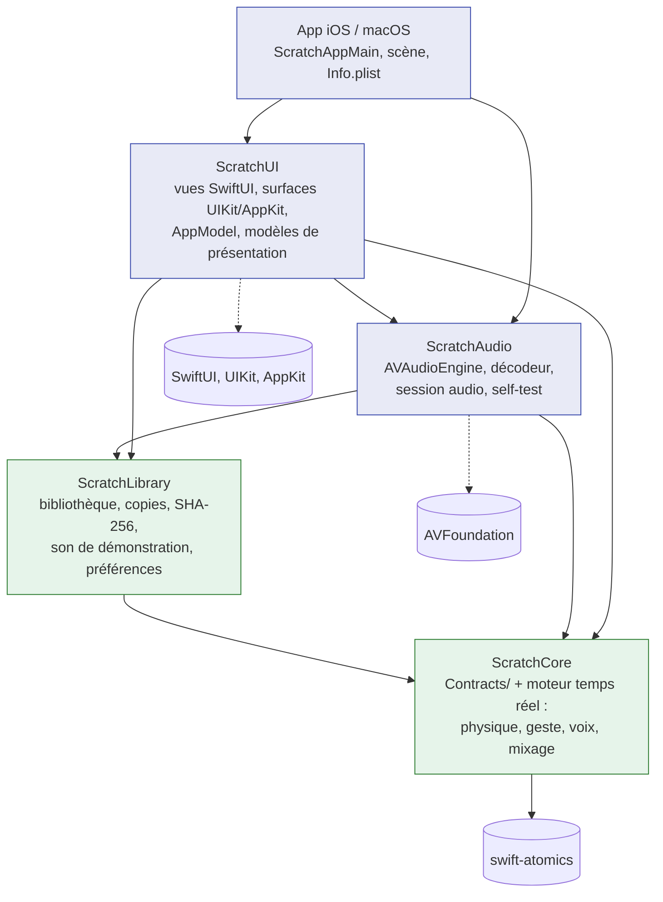
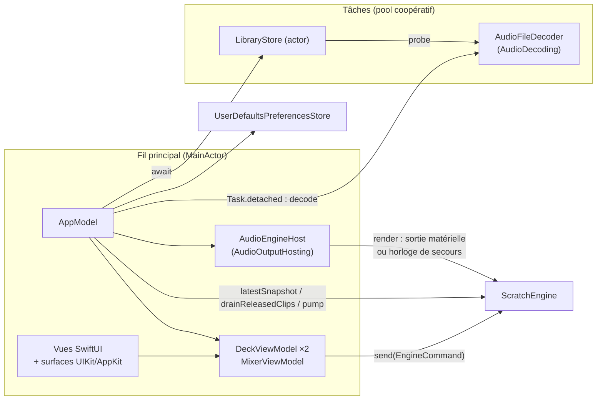
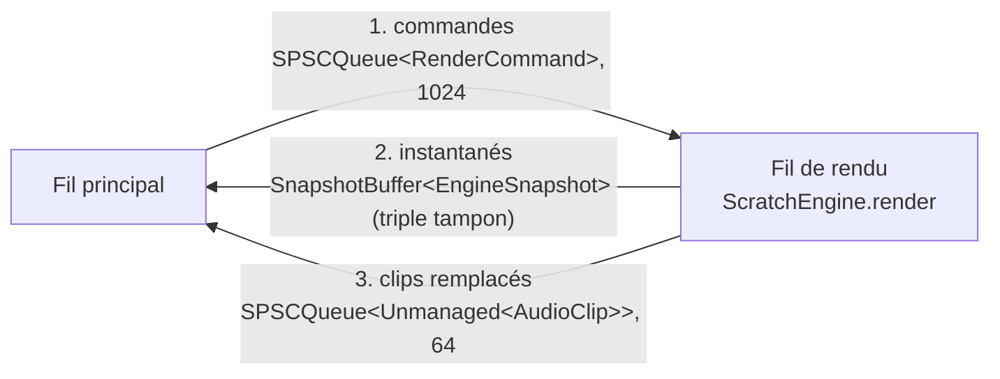
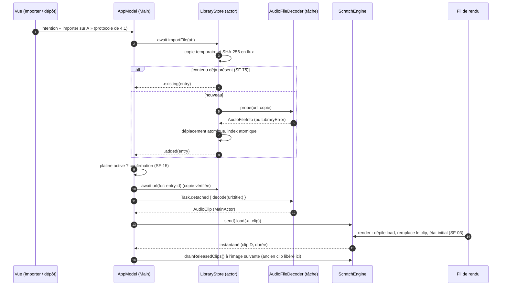
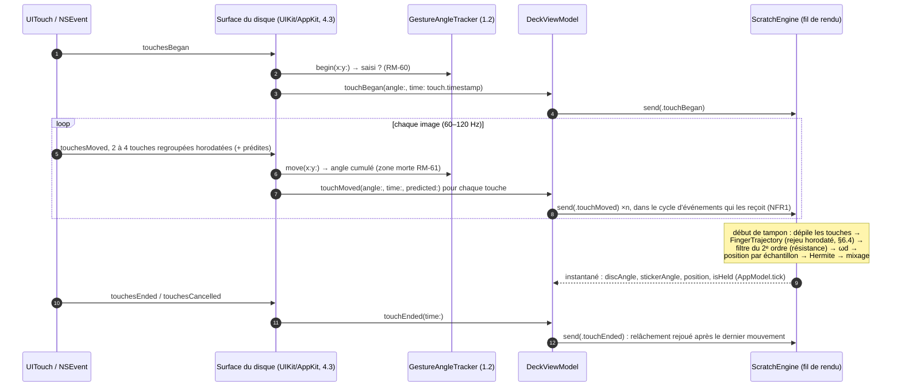

# ScratchApp — Architecture technique

- **Artefact BMAD :** Architecture (🏗️ Winston, Architect)
- **Version :** 1.2 — 14 novembre 2026 (1.1 : version proposée ; 1.2 : corrections de la validation PO)
- **Statut :** validé par le PO (Sarah, [`po-validation.md`](po-validation.md)), base des stories 1.1 à 6.3
- **Références :** [spécifications v2.1](../specs/scratchapp_specifications_v2_1.md) (font foi ; la v2.0 est archivée), [brief](project-brief.md) et [traçabilité](traceability.md) (Mary), [PRD](prd.md) (John), [spécification UX](front-end-spec.md) (Sally), [équipe BMAD](TEAM.md), [`CONTRIBUTING.md`](../../CONTRIBUTING.md)
- **Arbitrages intégrés :** IC-03 (rattrapage de la feutrine), IC-04 (changements de sortie), IC-06 (coupure momentanée), IC-09 et Q13 (repère), Q14 (horloge de secours), consignés dans la spec v2.1 (décisions D-03, D-04, D-06, D-10 et D-35 de [`po-validation.md`](po-validation.md)) ; points du PRD A1, A2, A3 et A8.
- **Code associé :** contrats et squelettes de la story 0.2 (issue #6), compilables et testés. Les signatures de la section 5 sont celles du code.

## Sommaire

1. [Vue d'ensemble](#1-vue-densemble)
2. [Modules et composition](#2-modules-et-composition)
3. [Modèle de fils d'exécution](#3-modèle-de-fils-dexécution)
4. [Flux de données](#4-flux-de-données)
5. [Contrats publics](#5-contrats-publics)
6. [Moteur temps réel](#6-moteur-temps-réel)
7. [Modèle d'erreurs](#7-modèle-derreurs)
8. [Persistance](#8-persistance)
9. [Stratégie de test](#9-stratégie-de-test)
10. [Arborescence source cible et propriétaires](#10-arborescence-source-cible-et-propriétaires)
11. [Standards de code](#11-standards-de-code)
12. [Décisions d'architecture (ADR)](#12-décisions-darchitecture-adr)
13. [Risques techniques](#13-risques-techniques)
14. [Écarts, contradictions et points à valider](#14-écarts-contradictions-et-points-à-valider)

---

## 1. Vue d'ensemble

ScratchApp est une double platine vinyle virtuelle : deux platines A et B, une table de mixage, un scratch calculé en temps réel à partir du son chargé (spec §1). L'application cible iPhone, iPad (iOS/iPadOS 17+) et Mac (macOS 14+), avec un seul code SwiftUI.

### 1.1 Objectifs d'architecture

| # | Objectif | Exigences | Moyen principal |
|---|---|---|---|
| O1 | Son de scratch sans artefact : pas de clic, pas de vitesse « en escalier », inversions propres | SF-77, RM-08, E-06 | Physique intégrée **à chaque échantillon** dans le fil audio ; trajectoire du doigt reconstruite (§6.4) ; interpolation Hermite, fondus de 5 ms |
| O2 | Latence geste → son ≤ 20 ms visée, tampon ≤ 256 trames à 48 kHz | SF-78, NFR1, PO-07 | Rendu direct dans un `AVAudioSourceNode`, tampon de 256 trames, retard de rejeu adaptatif minimal (§6.4) |
| O3 | Aucun blocage du fil audio | SF-77, NFR2 | Communication sans verrou : file SPSC, triple tampon, file de retour des clips (§3) |
| O4 | Cœur testable sans Mac | NFR9, NFR11 | `ScratchCore` et `ScratchLibrary` en Swift, Foundation et swift-atomics seulement (§2) |
| O5 | Trois développeurs en parallèle dès la fusion | PRD 5.4, 8.1 | Contrats publics figés dans `ScratchCore/Contracts/` (§5), squelettes compilables, dossiers attribués (§10), doubles de test (`RecordingEngine`, décodeur factice) |
| O6 | Robustesse : interruptions, routes, fichiers invalides, sortie absente, sans plantage | SF-16, SF-18, SF-81, SF-82, RM-56, NFR12 | Erreurs typées (§7), politique système centralisée dans l'hôte audio (§7.3), horloge de secours (§3.3), copie atomique (§8) |

### 1.2 Principes

1. **Le fil audio est souverain.** Il possède tout l'état sonore (positions, vitesses, gains). Le reste de l'application lui *demande* des changements (commandes) et *lit* son état (instantanés). Aucune donnée n'est partagée en écriture.
2. **Valeurs, pas références.** Commandes et instantanés sont des types valeur triviaux. Le seul objet transmis au fil audio, le clip, voyage sous forme de référence non gérée et revient par une file de retour pour être libéré ailleurs.
3. **Une seule horloge de vérité par domaine.** Horloge audio (trames rendues) pour le son ; horloge monotone de l'appelant (horodatage des événements) pour les gestes. Le rejeu du doigt (§6.4) fait le pont entre les deux.
4. **Le cœur ne connaît pas Apple.** Physique, rendu, mixage, géométrie du geste, contrats, bibliothèque et préférences sont testés sous Linux. Les modules Apple ne font que brancher le système (AVFoundation, SwiftUI, UIKit, AppKit).
5. **Squelettes silencieux.** Un composant pas encore implémenté renvoie du silence ou une valeur neutre, jamais `fatalError` : l'application compile, se lance et passe la CI à chaque fusion.

### 1.3 Contraintes

- Swift 5.10 (mode de langage 5), Xcode 16 en CI, SwiftPM (`Package.swift`) et XcodeGen (`project.yml`).
- `ScratchCore` et `ScratchLibrary` : Foundation et swift-atomics uniquement ; ni AVFoundation, SwiftUI, Combine, CryptoKit, UIKit ni AppKit (NFR9).
- Dépendance externe unique : `swift-atomics` (1.2+).
- Fonctionnement entièrement hors ligne, sans aucune requête réseau (SF-20, NFR6, NFR7).

## 2. Modules et composition

### 2.1 Diagramme des modules



En vert : modules compilés et testés sous Linux. En bleu : modules Apple, vérifiés par la CI macOS.

### 2.2 Responsabilités

| Module | Contient | Ne contient pas | Stories, dev |
|---|---|---|---|
| **ScratchCore** | `Contracts/` : tous les types et protocoles partagés entre développeurs (commandes, instantanés, clip, files sans verrou, protocoles de bibliothèque, de décodage et de sortie, erreurs) ; moteur `ScratchEngine` et horloge de secours ; physique (`DeckPhysics`, `FingerTrajectory`) ; suivi d'angle (`GestureAngleTracker`) ; voix de lecture (`DeckRenderer`) ; mixage (`MixerRenderer`, `CrossfaderCurve`) ; scénario hors ligne (`Diagnostics/`) | Accès fichier, UI, framework Apple. Foundation seulement dans `Contracts/` (URL, UUID, Date) | 0.2 Winston ; 1.1 à 1.5 James |
| **ScratchLibrary** | `LibraryStore` (index, import par copie atomique, dédoublonnage), `ContentHasher` (SHA-256 portable), son de démonstration (`DemoSound`), préférences (`AppPreferences`, magasins) | Décodage (protocole seulement), UI | 3.1 à 3.4 Hugo |
| **ScratchAudio** | `AudioEngineHost` (`AVAudioEngine` + `AVAudioSourceNode`, horloge de secours, politique système), `AudioFileDecoder` (`AVAudioFile`/`AVAudioConverter`), `AudioSessionController` (iOS), self-test | État de jeu (dans `ScratchEngine`), UI | 2.1 à 2.4 James |
| **ScratchUI** | `App/AppModel`, `Deck/DeckViewModel`, `Mixer/MixerViewModel`, vues SwiftUI, surfaces de saisie UIKit/AppKit (`Input/`), clavier et menus Mac (`Mac/`), forme d'onde (`Waveform/`), dispositions, bibliothèque et réglages | Logique DSP, accès fichier direct | 4.1 à 5.3 Léa ; 3.4, 3.5, 6.1, 6.2 Hugo |
| **App** | Point d'entrée, scène, `--selftest`, Info.plist et droits | Logique métier | 6.1, 6.2 Hugo |

### 2.3 Composition à l'exécution



`AppModel` est construit une seule fois par l'app (`ScratchAppMain`) avec les implémentations réelles. Tests et aperçus SwiftUI injectent des doubles : `RecordingEngine` ou le faux moteur de Léa (`ScratchUI/Preview/`, story 4.1), décodeur factice, bibliothèque en dossier temporaire, `InMemoryPreferencesStore`, `host: nil`.

## 3. Modèle de fils d'exécution

### 3.1 Les fils et leurs droits

| Fil | Qui l'exécute | Fait | Peut appeler | Interdit |
|---|---|---|---|---|
| **Principal** (`@MainActor`) | SwiftUI, UIKit/AppKit, `AppModel`, modèles de présentation, horloge d'affichage | Gestes, intentions, `tick()` une fois par image, dialogues | `engine.send`, `latestSnapshot`, `drainReleasedClips`, `pump` (si aucun fil ne rend), `host.start/stop/suspend/resume`, `await library…` | Décoder, hacher, copier un fichier ; attendre de façon bloquante ; appeler `render` |
| **Audio** (temps réel) | Fil d'E/S Core Audio, via le bloc de rendu de l'`AVAudioSourceNode` ; ou rendu hors ligne (self-test, tests) | `ScratchEngine.render` : commandes, physique, lecture, mixage, instantané | Rien d'autre que le moteur | Règles temps réel (§6.1) |
| **Horloge de secours** | File `DispatchQueue` de qualité `userInteractive` et minuterie `DispatchSourceTimer` (`FallbackRenderClock`), seulement quand la sortie est indisponible | `ScratchEngine.render` dans un tampon jetable, au rythme du temps réel | Rien d'autre que le moteur | Tourner en même temps que la sortie matérielle |
| **Tâches d'import** | Pool coopératif Swift : acteur `LibraryStore`, `Task.detached` pour le décodage et la forme d'onde | Copie, SHA-256, sonde, décodage, résumé de forme d'onde | `FileManager`, `AVAudioFile` | Toucher le moteur ou l'UI autrement qu'en revenant sur le `MainActor` |
| **Notifications système** | `AVAudioSession`, `AVAudioEngineConfigurationChange`, `NSWorkspace` (fil quelconque) | Signaler interruptions, routes, veille | `Task { @MainActor in … }` uniquement | Appeler `engine.send` directement (il n'y a qu'un producteur) |

**Un seul fil de contrôle, un seul fil de rendu.** La file de commandes n'a qu'un producteur et le triple tampon qu'un lecteur : `send`, `latestSnapshot` et `drainReleasedClips` sont appelés par un seul fil à la fois, le fil principal dans l'app. À l'autre extrémité, `render` et `pump` ne s'exécutent jamais en même temps : à tout instant, au plus un fil rend le moteur (sortie matérielle, horloge de secours ou `pump`). En débogage, `RoleGuard` déclenche une assertion si l'une de ces règles est violée.

### 3.2 Les trois canaux



1. **Commandes** (principal → rendu). `send` convertit l'`EngineCommand` publique en `RenderCommand` triviale. Pour `load`, le clip est retenu (+1) et voyage en `Unmanaged`. File pleine : `send` renvoie `false` sans bloquer et rend le +1 sur-le-champ (NFR2). Capacité 1024 : plus de 2 s de touches regroupées à 240 Hz sur les deux disques.
2. **Instantanés** (rendu → principal). Un `EngineSnapshot` complet est publié **à la fin de chaque appel à `render`** (toutes les 5,3 ms à 256 trames). Le lecteur obtient toujours le dernier instantané complet, jamais un instantané partiel. Coût : une copie de quelques centaines d'octets et un échange atomique.
3. **Retour des clips** (rendu → principal). Un clip remplacé ou déchargé est poussé dans la file de retour ; `drainReleasedClips()`, appelé à chaque image, rend le +1 sur le fil principal. Le `deinit` d'un clip (jusqu'à 230 Mo) ne s'exécute donc **jamais** sur le fil audio. Le fil de rendu ne dépile une commande que s'il reste une place dans la file de retour : rien n'est perdu ni libéré sur place si le fil principal tarde.

### 3.3 Sortie indisponible : horloge de secours, puis `pump()`

La physique est intégrée dans le fil de rendu. Sans périphérique de sortie, il faut quand même faire tourner le moteur, sinon les disques sont figés et les commandes s'entassent.

- **Horloge de secours (décision Q14, ADR-13).** Tant que l'hôte est démarré mais que l'`AVAudioEngine` ne tourne pas (aucune sortie, démarrage impossible, reconstruction en cours), `AudioEngineHost` fait tourner `FallbackRenderClock`. Toutes les 5,33 ms environ, elle appelle `ScratchEngine.render` dans un tampon jetable, pour un nombre de trames calculé d'après le temps réellement écoulé sur l'horloge monotone, plafonné à 2048. Disques, plateaux, VU-mètres et forme d'onde restent vivants, en silence ; le badge affiche « Sortie audio indisponible » (SF-82). L'hôte arrête l'horloge (`stop()` est synchrone) **avant** de démarrer l'`AVAudioEngine` et la relance après son arrêt si la sortie reste indisponible.
- **`pump()`.** Quand aucun fil ne rend (pas d'hôte dans les tests et les aperçus, hôte arrêté, app suspendue en arrière-plan), `AppModel.tick()` appelle `engine.pump()`. Il applique les commandes et publie un instantané, sans rendre d'audio ni avancer le temps. Condition : `host?.isRenderingAudio != true`. `isRenderingAudio` est vrai dès que la sortie matérielle **ou** l'horloge de secours peut rendre, jusqu'au retour de `stop()` ou de `suspend()`.

### 3.4 Concurrence Swift

- `AppModel`, modèles de présentation, `AudioEngineHost`, `AudioSessionController`, protocole `AudioOutputHosting` : `@MainActor`.
- `LibraryStore` : `actor` (sérialise les imports et l'écriture de l'index).
- Décodage et forme d'onde : `Task.detached(priority: .userInitiated)`, annulables, résultat ramené sur le `MainActor`.
- `ScratchEngine`, `AudioClip`, `SPSCQueue`, `SnapshotBuffer`, `FallbackRenderClock` : `@unchecked Sendable`, la sûreté venant des règles de fils ci-dessus.
- Pas de `DispatchQueue` dans le nouveau code, sauf l'horloge de secours et le relais d'une notification système vers le fil principal.

## 4. Flux de données

### 4.1 Import et chargement d'un son



En cas d'erreur (`LibraryError`), l'`AppModel` affiche le message, n'envoie aucune commande, et la platine garde son son et son état (6.1, RM-48). Un refus de remplacement laisse l'entrée dans la bibliothèque (SF-15).

### 4.2 Du doigt au son



Sur Mac, `mouseDown/Dragged/Up` remplacent les touches (RM-59) ; le défilement à deux doigts est converti en angle cumulé et relâché 80 ms après le dernier événement (SF-79, UX §6.3).

### 4.3 Lancement, préférences et image d'affichage

1. `ScratchAppMain` crée `ScratchEngine`, `AudioEngineHost`, `LibraryStore`, `UserDefaultsPreferencesStore`, `AudioFileDecoder`, puis `AppModel`.
2. Au lancement (6.1, 3.4) : `preferences.load()` → `prefs.engineCommands` envoyées au moteur (vitesse, pitch, résistance, mixage, durées moteur ; **jamais** de moteur ni de chargement, SF-17, RM-10) → `await library.entries` → `host.start()`.
3. À chaque image : `AppModel.tick()` → `pump()` si aucun fil ne rend → `latestSnapshot()` → `DeckViewModel.apply` ×2, `MixerViewModel.apply` → `drainReleasedClips()` → état de la sortie. Quand `snapshot.isIdle`, l'UI peut suspendre sa boucle d'affichage (UX §10.1).
4. Après un changement de réglage, `AppModel` enregistre `AppPreferences(snapshot:)` par écritures regroupées (0,5 s), et toujours au passage en arrière-plan (3.4 critère 5).

### 4.4 Interruption et arrière-plan (iOS)

`AVAudioSession.interruptionNotification` (début) → `AudioSessionController` → `AudioSystemEvent.interruptionBegan` sur le fil principal → `AudioEngineHost` : `engine.send(.stopAllMotors)`, sortie arrêtée, horloge de secours lancée. Fin d'interruption → la sortie redémarre, les moteurs restent à STOP (RM-10, RM-56). Passage en arrière-plan (`scenePhase`) → `host.suspend()` : `stopAllMotors`, sortie et horloge arrêtées, préférences enregistrées ; `pump()` prend le relais. Retour → `host.resume()`, sans lecture.

## 5. Contrats publics

Conventions communes à tous les contrats :

| Grandeur | Unité et convention |
|---|---|
| Angle | Radians, **cumulé** (déplié, sans saut à ±π), positif dans le **sens horaire** = sens de lecture normal, 0 = midi (repère de lecture fixe de l'UX, §5.1). Repère d'écran à axe y vers le bas (UIKit ; `NSView` avec `isFlipped == true`). |
| Temps d'événement | Secondes sur une horloge monotone de l'appelant (`UITouch.timestamp`, `NSEvent.timestamp`, `ProcessInfo.systemUptime`), la même pour tout un geste. |
| Temps du moteur | Trames rendues (`EngineSnapshot.sampleTime`), à la fréquence de sortie. |
| Position | Secondes de son, dans [−2 s ; durée] (amorce comprise, SF-72). |
| Vitesse de lecture | Signée ; 1 = vitesse de gravure (33⅓ RPM, pitch 0, RM-50) ; bornée à ±16 (SF-77). |
| Pitch | Fraction : −0,08…+0,08 (SF-11), pas de 0,001 appliqué par l'UI. |
| Résistance, crossfader, courbe, faders | 0…1. Crossfader : 0 = butée A, 1 = butée B, avant hamster. Courbe : 0 = douce, 1 = coupure franche. |
| Niveaux | Linéaires, 1 = 0 dBFS ; réduction du limiteur en dB. |

Le moteur borne chaque valeur et ignore les valeurs non finies. Les fichiers de `Sources/ScratchCore/Contracts/` appartiennent à l'architecte : ils ne changent que par une story dédiée ou avec son accord (PRD 5.4, TEAM.md). Les types internes (`DeckPhysics`, `DeckRenderer`, `MixerRenderer`, `RenderCommand`) appartiennent à James et peuvent évoluer librement.

### 5.1 ScratchCore — `Contracts/`

**`DeckPair.swift`**

```swift
public struct DeckPair<Value> {
    public var a: Value
    public var b: Value
    public init(a: Value, b: Value)
    public init(repeating value: Value)
    public subscript(deck: DeckID) -> Value { get set }
    public func map<T>(_ transform: (Value) throws -> T) rethrows -> DeckPair<T>
}
// Equatable, Hashable, Sendable, Codable (clés "a", "b") si Value l'est.
```

**`AudioClip.swift`** — son décodé, immuable, stéréo Float32 désentrelacé (ADR-05).

```swift
public final class AudioClip: Identifiable, Hashable, @unchecked Sendable {
    public struct ID: Hashable, Comparable, Sendable, CustomStringConvertible { public let rawValue: UInt64 }
    public let id: ID                              // unique dans le processus (≠ UUID de bibliothèque)
    public let title: String
    public let sampleRate: Double                  // native, ≤ 48 kHz
    public let frameCount: Int
    public let left: UnsafeBufferPointer<Float>    // adresse stable jusqu'au deinit
    public let right: UnsafeBufferPointer<Float>
    public var duration: Double { get }
    public init(title: String, sampleRate: Double, frameCount: Int,
                fill: (_ left: UnsafeMutableBufferPointer<Float>,
                       _ right: UnsafeMutableBufferPointer<Float>) throws -> Void) rethrows
    public convenience init(title: String, sampleRate: Double, left: [Float], right: [Float])
    public convenience init(title: String, sampleRate: Double, mono: [Float])
}
```

**`EngineCommand.swift`** — commandes du fil principal vers le moteur (PRD 5.3 point 2).

```swift
public enum EngineCommand: Equatable, Sendable {
    // Transport (par platine)
    case load(DeckID, AudioClip)          // état initial SF-03 ; ancien clip → file de retour
    case unload(DeckID)                   // platine vidée, moteur arrêté
    case motor(DeckID, on: Bool)          // START / STOP avec rampes
    case speed(DeckID, TurntableSpeed)
    case pitch(DeckID, Double)
    // Jeu (par platine)
    case resistance(DeckID, Double)
    case touchBegan(DeckID, angle: Double, time: Double)                          // ignoré si déjà tenu (RM-60)
    case touchMoved(DeckID, angle: Double, time: Double, predicted: Bool = false)  // chaque touche regroupée
    case touchEnded(DeckID, time: Double)                                         // relâchement ou annulation
    case setCue(DeckID)
    case recallCue(DeckID)                // autorisé disque tenu : ré-ancre le geste (6.6)
    case seek(DeckID, seconds: Double)    // needle drop, ignoré disque tenu (SF-71)
    // Réglages moteur (deux platines)
    case startDuration(Double)
    case brakeDuration(Double)
    case slipmatCatchUp(Double)           // 95 % de la vitesse du plateau (IC-03)
    // Table de mixage
    case crossfader(Double)
    case crossfaderCurve(Double)
    case hamster(Bool)
    case lineFader(DeckID, Double)
    case momentaryCut(DeckID, open: Bool) // ouverte : la voie ignore le crossfader (IC-06)
    // Système
    case stopAllMotors                    // RM-56 : STOP sans rampe, positions conservées
    case outputSampleRate(Double)         // aucun redécodage
}
```

**`EngineSnapshot.swift`** — état publié par le fil de rendu (PRD 5.3 point 3, UX §10.1), type **trivial** (vérifié par `_isPOD` en débogage et par un test).

```swift
public struct DeckSnapshot: Equatable, Sendable {
    public var clipID: AudioClip.ID?
    public var durationSeconds: Double
    public var positionSeconds: Double
    public var playbackRate: Double
    public var discAngle: Double          // étiquette ; ≡ 2π·position/1,8 hors butée, recalé (IC-09)
    public var platterAngle: Double       // plateau (tourne sous le disque retenu, 6.9)
    public var stickerAngle: Double       // repère = discAngle − 2π·(CUE ?? 0)/1,8 (§6.6)
    public var isHeld: Bool
    public var motorOn: Bool
    public var speed: TurntableSpeed
    public var pitch: Double
    public var resistance: Double
    public var cueSeconds: Double?
    public var isAtEnd: Bool              // sillon fermé
    public var isInLeadIn: Bool           // position < 0
    public var peakLevel: Double          // VU de voie : après fader de voie, avant crossfader (UX Q15)
    public var isLoaded: Bool { get }     // clipID != nil
    public var isActive: Bool { get }     // SF-15 : moteur, disque tenu ou |vitesse| > 0,001
    public static let initial: DeckSnapshot
}

public struct MixerSnapshot: Equatable, Sendable {
    public var crossfader: Double
    public var crossfaderCurve: Double
    public var hamster: Bool
    public var lineFaders: DeckPair<Double>
    public var momentaryCuts: DeckPair<Bool>
    public var channelGains: DeckPair<Double>     // gains effectifs lissés
    public var outputPeak: Double                 // après limiteur
    public var limiterReduction: Double           // dB
    public var limiterActive: Bool { get }        // réduction ≥ 1 dB (UX §5.16)
    public var isClipping: Bool { get }           // crête ≥ 0 dBFS
    public static let initial: MixerSnapshot
}

public struct EngineSnapshot: Equatable, Sendable {
    public var decks: DeckPair<DeckSnapshot>
    public var mixer: MixerSnapshot
    public var motorTimings: MotorTimings
    public var outputSampleRate: Double
    public var sampleTime: Int64                  // trames rendues depuis la création
    public subscript(deck: DeckID) -> DeckSnapshot { get }
    public var isIdle: Bool { get }               // boucle d'affichage suspendable (UX §10.1)
    public static let initial: EngineSnapshot
}
```

La partie « sortie » de PRD 5.3 point 3 (nom, état, fréquence, tampon effectif) n'est pas produite par le fil de rendu : elle est publiée par l'hôte (`AudioOutputHosting.status`) et relayée par `AppModel.outputStatus`.

**`MotorTimings.swift`**

```swift
public struct MotorTimings: Codable, Equatable, Sendable {
    public var startDuration: Double      // 0,7 s, borné 0,1…5 s
    public var brakeDuration: Double      // 1,0 s, borné 0,1…5 s
    public var slipmatCatchUp: Double     // 60 ms, borné 0…300 ms
    public static let defaults: MotorTimings
    public func clamped() -> MotorTimings
}
extension Double { public func clamped(to range: ClosedRange<Double>, fallback: Double) -> Double }
```

**`EngineControlling.swift`** — façade moteur de l'UI (PRD 5.2). `ScratchEngine` (dans `Engine/`) l'implémente et ajoute l'API de rendu.

```swift
public protocol EngineControlling: AnyObject {              // fil de contrôle uniquement
    @discardableResult func send(_ command: EngineCommand) -> Bool
    func latestSnapshot() -> EngineSnapshot
    @discardableResult func drainReleasedClips() -> Int
    func pump()                                              // seulement si aucun fil ne rend
}

public final class ScratchEngine: EngineControlling, @unchecked Sendable {   // Engine/ScratchEngine.swift
    public static let commandCapacity: Int        // 1024
    public static let releaseCapacity: Int        // 64
    public static let maximumBlockFrames: Int     // 512 ; render découpe au-delà
    public init(outputSampleRate: Double = 48_000)
    public func render(frameCount: Int, left: UnsafeMutablePointer<Float>, right: UnsafeMutablePointer<Float>)
}

public final class FallbackRenderClock: @unchecked Sendable {                 // Engine/FallbackRenderClock.swift
    public let engine: ScratchEngine
    public let sampleRate: Double, framesPerTick: Int, maximumFramesPerTick: Int
    public init(engine: ScratchEngine, sampleRate: Double = 48_000,
                framesPerTick: Int = TurntableConstants.preferredBufferFrames)
    public var isRunning: Bool { get }
    public func start()                           // fil de contrôle
    public func stop()                            // synchrone : plus aucun rendu après le retour
}
```

**`Concurrency/SPSCQueue.swift`** et **`Concurrency/SnapshotBuffer.swift`** — implémentés et testés (ordre, saturation, enroulement, concurrence, ThreadSanitizer).

```swift
public final class SPSCQueue<Element>: @unchecked Sendable {
    public let capacity: Int                      // puissance de 2 ≥ minimumCapacity
    public init(minimumCapacity: Int)
    @discardableResult public func push(_ element: Element) -> Bool   // producteur
    public func pop() -> Element?                                     // consommateur
    public var availableCapacity: Int { get }                         // producteur, prudent
    public var approximateCount: Int { get }
    public var isEmpty: Bool { get }                                  // consommateur
}

public final class SnapshotBuffer<Value>: @unchecked Sendable {
    public init(initialValue: Value)
    public func write(_ value: Value)             // un seul écrivain
    public var hasNewValue: Bool { get }          // lecteur
    public func read() -> Value                   // un seul lecteur ; dernière valeur complète
}
```

**`LibraryEntry.swift`**, **`LibraryStoring.swift`** — protocole de bibliothèque (PRD 5.2, 5.3 point 6), implémenté par `LibraryStore` (ScratchLibrary).

```swift
public struct LibraryEntry: Codable, Equatable, Hashable, Identifiable, Sendable {
    public enum Origin: String, Codable, Sendable, CaseIterable { case imported, demo, microphone, mix }
    public let id: UUID                  // stable (RM-58)
    public var contentHash: String       // SHA-256 hexadécimal minuscule ; "" pour la démo
    public var fileName: String          // nom de la copie dans « Banque de sons » ; "" pour la démo
    public var fileSize: Int64           // octets ; copie de taille différente → entrée écartée (IC-10)
    public var title: String
    public var duration: Double
    public var importedAt: Date
    public var origin: Origin
    public init(id: UUID = UUID(), contentHash: String, fileName: String, fileSize: Int64, title: String,
                duration: Double, importedAt: Date, origin: Origin)
    public var isDeletable: Bool { get }              // false pour la démo
    public static let demoID: UUID                    // 5C2A7C40-DE30-4D3A-9B1E-000000000001
    public static func demo(title: String, duration: Double) -> LibraryEntry
}

public enum ImportResult: Equatable, Sendable {
    case added(LibraryEntry)
    case existing(LibraryEntry)                       // même SHA-256 (SF-75)
    public var entry: LibraryEntry { get }
    public var isNew: Bool { get }
}

public protocol LibraryStoring: Sendable {
    var entries: [LibraryEntry] { get async }         // démo en tête, puis imports du plus récent au plus ancien
    func importFile(at url: URL) async throws -> ImportResult
    func delete(id: UUID) async throws                // copie seule (RM-49) ; démo → demoCannotBeDeleted
    func url(for id: UUID) async throws -> URL        // copie vérifiée ; absente → entrée écartée, notFound
}
```

**`AudioDecoding.swift`** — protocole de décodage (PRD 5.2, 5.3 point 5), implémenté par `AudioFileDecoder` (ScratchAudio), simulé dans les tests Linux.

```swift
public struct AudioFileInfo: Equatable, Sendable {
    public var duration: Double, sampleRate: Double, channelCount: Int
}
public protocol AudioDecoding: Sendable {
    func probe(url: URL) async throws -> AudioFileInfo          // sonde rapide, durées SF-80 comprises
    func decode(url: URL, title: String) async throws -> AudioClip
}
extension AudioDecoding { public func decode(url: URL) async throws -> AudioClip }
```

**`LibraryError.swift`** — erreurs typées de l'import et du décodage, voir §7.2.

```swift
public enum LibraryError: Error, Equatable, Sendable {
    case insufficientStorage, unsupportedFormat, protectedContent
    case tooLong(duration: Double), tooShort(duration: Double)
    case corrupted, writeFailed(reason: String), notFound, demoCannotBeDeleted
    public var userMessage: String { get }                       // français
    public static func checkDuration(_ seconds: Double) throws   // SF-80, appelé par la sonde
}
```

**`AudioOutputStatus.swift`**, **`AudioSystemEvent.swift`**, **`AudioOutputHosting.swift`** — sortie audio vue par l'`AppModel` et l'UI (PRD 2.1, 2.3).

```swift
public struct AudioOutputInfo: Equatable, Sendable {
    public var name: String, sampleRate: Double, bufferFrames: Int, outputLatency: Double
}
public enum AudioOutputStatus: Equatable, Sendable {
    case stopped, starting, running(AudioOutputInfo), unavailable(reason: String)
    public var isRunning: Bool { get }
    public var outputInfo: AudioOutputInfo? { get }
}
public enum AudioSystemEvent: Equatable, Sendable {
    case interruptionBegan, interruptionEnded
    case routeChanged(previousDeviceUnavailable: Bool)
    case configurationChanged, mediaServicesReset
    case systemWillSleep, systemDidWake
}
@MainActor public protocol AudioOutputHosting: AnyObject {
    var status: AudioOutputStatus { get }
    var isRenderingAudio: Bool { get }  // sortie matérielle ou horloge de secours
    func start()                        // ne lève pas : échec → .unavailable + horloge de secours (SF-82)
    func stop()                         // synchrone
    func suspend()                      // iOS arrière-plan : stopAllMotors, plus aucun rendu (SF-81)
    func resume()                       // relance la sortie, jamais les moteurs (RM-10)
}
```

**`Testing/RecordingEngine.swift`** — double de test d'`EngineControlling`.

```swift
public final class RecordingEngine: EngineControlling {
    public private(set) var sentCommands: [EngineCommand]
    public var snapshot: EngineSnapshot           // renvoyé par latestSnapshot()
    public var acceptsCommands: Bool              // false : simule une file pleine
    public private(set) var drainCount: Int, pumpCount: Int
    public init(snapshot: EngineSnapshot = .initial)
    public func clearSentCommands()
}
```

**Hors `Contracts/`, partagés mais propriété de leur développeur :**

- `TurntableConstants.swift` (James) : constantes de la spec. Ajouts de la story 0.2 : `referenceAngularVelocity`, `antiAliasingRateThreshold`, `defaultResistance`, `defaultCrossfader`, `defaultCrossfaderCurve`, `defaultLineFader`, `gainSmoothingTime`, `hardCutRiseTime`, `jumpFadeDuration`, `trackpadReleaseDelay`, `keyboardCrossfaderStep`, `preferredBufferFrames`, `TurntableSpeed.nominalRate`.
- `Mixer/CrossfaderCurve.swift` (James, squelette) : `public static func gains(position x: Double, curve: Double) -> (a: Double, b: Double)`, publique pour que l'UI dessine la courbe.
- `Gesture/GestureAngleTracker.swift` (James, squelette ; consommé par Léa en 4.3) : `begin(x:y:) -> Bool`, `move(x:y:) -> Double`, `end()`, `updateGeometry(centerX:centerY:radius:)`, `angle`, `isTracking`. La story 1.2 l'étend : attribution des contacts, touches prédites, défilement trackpad, sortie en `EngineCommand`.

### 5.2 ScratchLibrary, ScratchAudio, ScratchUI

```swift
// ScratchLibrary — Hugo
public actor LibraryStore: LibraryStoring {                       // squelette : démo seule
    public let locations: LibraryLocations
    public init(locations: LibraryLocations, decoder: any AudioDecoding)
}
public enum ContentHasher {                                        // squelette, SHA-256 portable (ADR-09)
    public static func sha256Hex(ofFileAt url: URL) throws -> String
    public static func sha256Hex(of data: Data) -> String
}
public enum DemoSound {                                            // squelette : silence (story 3.3)
    public static let title: String                                // « Son de démonstration »
    public static let duration: Double                             // 8 s
    public static let sampleRate: Double                           // 48 kHz
    public static func makeClip() -> AudioClip                     // déterministe
}
public struct AppPreferences: Codable, Equatable, Sendable {      // livré et testé par 0.2 (ADR-11)
    public struct Deck: Codable, Equatable, Sendable { public var speed: TurntableSpeed; public var pitch: Double; public var resistance: Double }
    public struct Mixer: Codable, Equatable, Sendable {
        public var crossfader: Double, crossfaderCurve: Double, hamster: Bool, lineFaders: DeckPair<Double>
    }
    public var version: Int; public var decks: DeckPair<Deck>; public var mixer: Mixer; public var motor: MotorTimings
    public static let currentVersion: Int, defaults: AppPreferences
    public init(decks:mixer:motor:)
    public init(snapshot: EngineSnapshot)                          // ce qu'il faut enregistrer
    public func sanitized() -> AppPreferences
    public var engineCommands: [EngineCommand] { get }             // jamais motor ni load (RM-10)
}
public protocol PreferencesStoring: Sendable {
    func load() -> AppPreferences                                  // jamais d'erreur ; défauts si absent ou illisible
    func save(_ preferences: AppPreferences)
}
public final class InMemoryPreferencesStore: PreferencesStoring { public init(_ preferences: AppPreferences? = nil) }
public final class UserDefaultsPreferencesStore: PreferencesStoring {   // squelette (story 3.4)
    public static let defaultKey: String                           // "app.scratchapp.preferences.v1"
    public init(defaults: UserDefaults = .standard, key: String = defaultKey)
}

// ScratchAudio — James
public struct AudioFileDecoder: AudioDecoding {                    // squelette : refuse tout (story 2.2)
    public static let maximumClipSampleRate: Double                // 48 kHz (ADR-05)
    public init()
}
@MainActor @Observable public final class AudioEngineHost: AudioOutputHosting {   // squelette (2.1, 2.3)
    public let engine: ScratchEngine
    public init(engine: ScratchEngine)                             // aujourd'hui : .unavailable + horloge de secours
}
@MainActor public final class AudioSessionController {             // iOS, squelette (2.3)
    public var onEvent: ((AudioSystemEvent) -> Void)?
    public init(); public func activate() throws; public func deactivate()
    public var currentOutputName: String { get }
}

// ScratchUI — Léa (Deck/, Mixer/), Hugo (App/)
@MainActor @Observable public final class DeckViewModel {          // base, complétée en 4.1 et 4.5
    public let deck: DeckID
    public private(set) var frame: DeckSnapshot                    // chaque image
    public var loadedEntry: LibraryEntry?                          // renseigné par l'AppModel
    public private(set) var isLoaded: Bool, motorOn: Bool, speed: TurntableSpeed, pitch: Double
    public private(set) var resistance: Double, cueSeconds: Double?, isHeld: Bool
    public init(deck: DeckID, engine: any EngineControlling)
    public func toggleMotor(); public func setMotor(_ on: Bool); public func setSpeed(_ newSpeed: TurntableSpeed)
    public func setPitch(_ value: Double)                          // quantifié 0,1 %, borné ±8 %
    public func nudgePitch(steps: Int); public func resetPitch(); public func setResistance(_ value: Double)
    public func setCue(); public func recallCue(); public func needleDrop(fraction: Double)
    public func touchBegan(angle: Double, time: Double)
    public func touchMoved(angle: Double, time: Double, predicted: Bool = false)
    public func touchEnded(time: Double)
}
@MainActor @Observable public final class MixerViewModel {         // base, complétée en 4.2 et 5.1
    public private(set) var frame: MixerSnapshot
    public private(set) var crossfader: Double, crossfaderCurve: Double, hamster: Bool
    public private(set) var lineFaders: DeckPair<Double>, momentaryCuts: DeckPair<Bool>
    public init(engine: any EngineControlling)
    public func setCrossfader(_ value: Double); public func nudgeCrossfader(steps: Int)   // pas de 5 %
    public func moveCrossfaderToA(); public func centerCrossfader(); public func moveCrossfaderToB()
    public func setCrossfaderCurve(_ value: Double); public func setHamster(_ on: Bool)
    public func setLineFader(_ deck: DeckID, _ value: Double); public func setMomentaryCut(_ deck: DeckID, open: Bool)
}
@MainActor @Observable public final class AppModel {               // squelette (story 6.1)
    public let deckA: DeckViewModel, deckB: DeckViewModel, mixer: MixerViewModel
    public let engine: any EngineControlling, host: (any AudioOutputHosting)?
    public let library: any LibraryStoring, preferences: any PreferencesStoring, decoder: any AudioDecoding
    public private(set) var outputStatus: AudioOutputStatus
    public init(engine:host:library:preferences:decoder:)
    public func deck(_ id: DeckID) -> DeckViewModel
    public func tick()                                             // une fois par image (implémenté)
}
```

**Protocole d'intentions de l'interface.** Il est défini par Léa en story 4.1 (importer sur une platine, charger la démo, importer un fichier déposé, ouvrir la bibliothèque ou les réglages) et implémenté par l'`AppModel` en 6.1 (PRD 5.4). Il ne figure pas dans les contrats 0.2. L'`AppModel` y ajoute en 6.1 : chargement d'une entrée, déchargement, platines qui portent une entrée, confirmations de remplacement (SF-15) et de suppression (SF-74), erreur courante.

**Deux cadences d'observation (ADR-12).** `frame` change à chaque image : seules les vues feuilles qui le lisent (couches du disque, forme d'onde, position, VU-mètres, SAT) sont redessinées à chaque image (UX §10.2). Les autres propriétés ne sont affectées que lorsque leur valeur change ; les commandes ne sont donc pas réévaluées 120 fois par seconde. Les intentions appliquent une mise à jour optimiste, confirmée par l'instantané suivant.

**Horloge d'affichage.** `AppModel.tick()` est appelé une fois par image : `CADisplayLink` sur iOS (avec `CADisableMinimumFrameDurationOnPhone`, plage 80 à 120 Hz), `NSView.displayLink(target:selector:)` sur macOS 14, ou un `TimelineView(.animation)` racine (UX §10.1). Boucle suspendue quand `snapshot.isIdle`.

**Surfaces de geste (Léa, 4.3).** Disque : `UIViewRepresentable` sur iOS (`touchesBegan/Moved/Ended/Cancelled`, `coalescedTouches(for:)`, `predictedTouches(for:)`, multitouch, un seul contact propriétaire par disque) ; `NSViewRepresentable` sur macOS (`mouseDown/Dragged/Up`, `scrollWheel` par phases, `isFlipped = true`). Chaque événement part vers le moteur dans le cycle d'événements qui le reçoit (NFR1). Clavier Mac (5.1) : `NSEvent.addLocalMonitorForEvents(matching: [.keyDown, .keyUp])`, codes de touche physiques QWERTY (UX Q6), ignoré si un champ de texte a le focus.

## 6. Moteur temps réel

### 6.1 Règles temps réel (fil de rendu)

Tout code exécuté par `ScratchEngine.render` (`DeckPhysics`, `FingerTrajectory`, `DeckRenderer`, `MixerRenderer`, `CrossfaderCurve`) respecte ces règles (NFR2). La revue QA les vérifie à chaque PR (case du modèle de PR) et le test de comptage d'allocations de la story 1.5 les contrôle.

1. **Aucune allocation** : pas de création ni de croissance de `Array`, `String`, `Dictionary`, `Set` ; pas de concaténation ni d'interpolation de chaîne ; pas d'instanciation de classe ; pas de closure qui capture un contexte créée à la volée ; pas d'existentiel (`any P`) ni de générique non spécialisé dans la boucle de rendu. Les tampons de travail sont alloués à la création (`RenderScratch`), la mémoire des clips au décodage.
2. **Aucun verrou ni attente** : pas de `NSLock`, `os_unfair_lock`, `DispatchQueue.sync`, sémaphore, `await`, `Task {}`, `MainActor`. Seuls les atomiques de `swift-atomics` (files, triple tampon, `RoleGuard`).
3. **Aucun appel système ni Objective-C** : pas d'AVFoundation, de `print`, `NSLog`, `os_log`, `Date()`, accès fichier, notification.
4. **Aucune libération d'objet** : le clip est tenu en `Unmanaged` et rendu par la file de retour ; les types qui traversent les files sont triviaux (`_isPOD`).
5. **Travail borné par échantillon** : coût indépendant de la durée du son ; anti-repliement à nombre de coefficients borné ; charge ≤ 30 % de la durée du tampon (NFR3).
6. **Robustesse numérique** : valeurs non finies ignorées à l'application des commandes ; sorties bornées ; pas de dénormaux persistants (seuil ou décalage infime dans les filtres récursifs).
7. **Échauffement** : `ScratchEngine.init` applique les commandes et publie un instantané une première fois (`pump()`) hors du fil audio, pour instancier les métadonnées génériques avant le premier rendu ; l'échauffement s'étendra au rendu d'un bloc silencieux avec les composants DSP.
8. **Déterminisme** (NFR11) : aucune source de hasard ni d'horloge dans le rendu ; un même flux de commandes, appliqué aux mêmes frontières de tampon, produit la même sortie à l'échantillon près.
9. **Lisibilité** : le code qui s'exécute sur le fil de rendu porte la mention « Fil audio uniquement » dans sa documentation.

### 6.2 Cycle de rendu

```
render(frameCount, left, right)
 ├─ applyPendingCommands()      tant que la file de retour a de la place
 ├─ pour chaque bloc de ≤ 512 trames
 │   ├─ deckA.physics.process   → positions[], rates[]   (1 valeur par échantillon)
 │   ├─ deckA.renderer.render   → A.left[], A.right[]
 │   ├─ (idem platine B)
 │   └─ mixer.mix(A, B)         → left, right (+ gains, crêtes, limiteur)
 ├─ sampleTime += frameCount
 └─ publishSnapshot()           un instantané complet par appel
```

Les commandes sont appliquées au début de l'appel : la granularité temporelle d'une commande est d'un tampon (5,3 ms à 256 trames). Les variations sont ensuite lissées à la fréquence audio (gains ≤ 5 ms, trajectoire du doigt, rampes moteur) ; aucune marche n'est audible.

### 6.3 Physique d'une platine (`DeckPhysics`, story 1.1)

Modèle de la spec 5.1, intégré **à chaque échantillon** (ADR-06), avec les arbitrages :

| Élément | Règle | Source |
|---|---|---|
| Plateau | `ωp → ωt = 2π × RPM/60 × (1 + pitch)` moteur actif, → 0 sinon ; pentes `ωt / startDuration` et `ωt / brakeDuration` ; START pendant le freinage repart de la vitesse courante | 5.1-1, SF-04, SF-05, 6.2 |
| Disque libre, moteur actif | 1er ordre vers `ωp`, **τ = slipmatCatchUp / 3** (95 % atteints en T) ; T = 0 → alignement immédiat | 5.1-2, SF-68, **IC-03**, PRD A1 |
| Disque libre, moteur arrêté | décélération **linéaire** (friction constante) jusqu'à 0 en 150 ms au plus, aucune reprise motorisée | SF-10, **IC-03** |
| Disque tenu | `θd` suit `θf + gripOffset` par un filtre du 2ᵉ ordre à amortissement critique, τ = lerp(2 ms, 35 ms, résistance) ; à la prise, filtre initialisé sur l'angle et la vitesse courants et `gripOffset = θd − θf` (aucun saut) ; doigt fixe → vitesse nulle | 5.1-3, RM-12, SF-22, SF-23 |
| Tête | `p += ωd / (2π) × 1,8 s × dt`, bornée à [−2 s ; durée] ; en butée le disque continue de tourner ; un mouvement inverse revient immédiatement dans le son | 5.1-4, RM-50, RM-55 |
| Recalage du disque | après un saut (CUE, needle drop, chargement) et à la sortie de butée : `discAngle += correction` (≤ ±π) pour que `discAngle ≡ 2π·p/1,8` ; disque tenu, `gripOffset` reçoit la même correction (pas de saut de son, le disque reste sous le doigt) ; CUE disque tenu ré-ancre le geste sur le CUE | **IC-09**, UX Q13, PRD 1.5 critères 5 et 7 |
| Vitesse de lecture | `ωd / ωref`, bornée à ±16 | RM-50, SF-77 |
| Résistance | n'affecte ni démarrage, ni freinage, ni rattrapage | RM-54 |
| STOP immédiat | `stopAllMotors` : `ωp = 0`, moteur STOP, disque libre arrêté, disque tenu inchangé | RM-56 |

### 6.4 Trajectoire du doigt (`FingerTrajectory`, ADR-07)

**Problème.** Les touches sont échantillonnées à 120 ou 240 Hz mais livrées **par lots**, une fois par image (60 ou 120 Hz), puis vues par le fil de rendu au début d'un tampon (5,3 ms). Appliquer chaque angle dès réception donne une vitesse en créneaux : nulle entre deux lots, très forte à chaque lot. C'est le grésillement « en escalier » que SF-77 interdit, et le filtre de résistance (2 ms à 0 %) ne suffit pas à le masquer.

**Solution retenue : rejeu horodaté à retard adaptatif.** La tête de rejeu avance sur l'horloge des événements au rythme de l'horloge audio, juste derrière le dernier événement reçu ; la cible est interpolée linéairement entre les deux événements qui l'encadrent. Toutes les touches regroupées sont utilisées, avec leur horodatage exact.

- La **marge** (dernier événement − tête) est minimale juste avant chaque lot. Une régulation douce de la cadence de rejeu (±10 % au plus, ±2 % en pratique) amène la plus petite marge des 16 derniers lots à 1,5 ms. Le retard converge ainsi vers le plus petit retard sans famine, quelle que soit la cadence d'affichage, la gigue ou le rythme des touches.
- **Famine** (la tête rattrape le dernier événement) : la tête se fige jusqu'au lot suivant. La vitesse est nulle un instant, mais il n'y a jamais de saut de position ni de dépassement dans le mauvais sens ; le retard s'allonge d'autant. En pratique, cela n'arrive que pendant les premières centaines de millisecondes du tout premier geste à 60 Hz.
- Le retard appris sert de point de départ au geste suivant.
- Le **relâchement** est rejoué lui aussi : `touchEnded` prend effet quand la tête atteint son horodatage. Le geste est rendu en entier (le « flick » d'un release n'est pas tronqué) et l'état tenu de l'instantané suit le son.
- **Touches prédites** : le contrat les transporte (`touchMoved(…, predicted: true)`, PRD 1.2 critère 6, NFR1). Le moteur les ignore pour l'instant ; la story 1.2 décide de leur emploi pour combler les famines (extrapolation provisoire remplacée par les touches réelles, avec correction lissée), ce qui réduirait le retard d'environ une image (PO-07).

Alternatives écartées (prototype numérique dans les mêmes conditions pour les deux premières, analyse pour la troisième) :

| Méthode | Ondulation de vitesse à vitesse de doigt constante | Retard ajouté | Défaut |
|---|---|---|---|
| Angle appliqué à réception | créneaux de 0 à plusieurs fois la vitesse | 0 | escalier audible |
| Rampe linéaire sur l'intervalle mesuré entre lots (durée = 1,25 à 2 intervalles) | ±10 % à ±30 %, trous de vitesse à 1,25 | 1,25 à 2 intervalles d'image (10 à 33 ms) | ondulation à la cadence d'image ; détail des touches regroupées perdu |
| Extrapolation corrigée | faible à vitesse constante | ≈ 0 | dépassement dans le mauvais sens à chaque inversion (baby scratch), correction audible |
| **Rejeu horodaté adaptatif** | **< 0,5 %** | **≈ 13 ms (120 Hz), ≈ 21 ms (60 Hz)** | latence d'un intervalle de livraison |

**Latence ajoutée** (mesurée par `FingerTrajectoryTests` : touches à 120 ou 240 Hz, gigue de livraison de 2 à 5 ms, tampon de 256 trames) :

| Affichage | Retard de rejeu convergé | Famines après convergence |
|---|---|---|
| 120 Hz (ProMotion, Mac 120 Hz) | 12,7 à 13,6 ms | 0 |
| 60 Hz | 20,6 à 20,9 ms | 0 (2 à 3 pendant l'adaptation du premier geste) |

Ce retard s'ajoute au tampon de sortie (5,3 ms) et à la latence tactile du système. La latence geste → son de 20 ms (SF-78, NFR1) est donc hors d'atteinte sur un affichage à 60 Hz et serrée à 120 Hz : voir §14 et le risque R-03. Le PO a reformulé l'objectif par cadence d'affichage (D-15) : ≤ 20 ms sur écran 120 Hz, ≤ 30 ms sur écran 60 Hz, mesurés de l'horodatage de l'événement à la sortie du son. Leviers de calibrage (PO-07) : `targetMargin`, touches prédites (ci-dessus), tampon de sortie de 128 trames si le matériel le permet.

**Tests** (`Tests/ScratchCoreTests/FingerTrajectoryTests.swift`) : vitesse constante à 120 Hz (±5 %, aucune marche > 1 % de la vitesse par échantillon, retard ≤ 20 ms) ; adaptation à 60 Hz ; huit profils d'appareils sans famine après convergence ; doigt immobilisé → angle final exact et vitesse nulle (RM-12) ; baby scratch à 8 Hz → retour au départ à ±10 ms de son près (6.3) ; relâchement rejoué ; événements non croissants ou non finis ignorés. Le critère spectral de la story 1.3 (énergie > 8 kHz ≤ −50 dBFS sur une sinusoïde scratchée) le complète en bout de chaîne.

### 6.5 Voix de lecture et mixage (`DeckRenderer` story 1.3, `MixerRenderer` story 1.4)

- **Voix** : position (s) × `clip.sampleRate` → indice fractionnaire ; interpolation **Hermite cubique** 4 points (SF-77). Le rééchantillonnage vers la sortie est implicite : l'incrément vaut `vitesse × clipRate / outputRate`, d'où l'absence de redécodage au changement de sortie (point A8 du PRD, 6.5, 6.15).
- **Amorce et sillon fermé** : position < 0 ou ≥ durée → silence, sans lecture hors bornes, y compris pour les points d'interpolation voisins des bornes (RM-09) ; fondu de quelques millisecondes à l'entrée en butée (6.12, aucun clic).
- **Anti-repliement** : au-delà d'un rapport de décimation effectif `|vitesse| × clipRate / outputRate > 2`, filtrage passe-bas à coupure adaptée et coût borné (SF-77). Seuil de SF-77 (IC-11, D-13) : une sinusoïde de 12 kHz lue à 3× (sortie à 48 kHz) ne produit que des composantes repliées inférieures d'au moins 40 dB au niveau du signal ; seuils d'interpolation et de lissage du PRD (1.3 critères 3 et 5) inchangés.
- **Sauts** (CUE, needle drop) : fondu enchaîné de 5 ms entre l'ancienne et la nouvelle position (SF-71, 6.6).
- **Mixage** (IC-06) : `gain voie = fader de voie × (coupure momentanée ouverte ? 1 : gain crossfader de la voie)`, `x` inversé si hamster ; gains lissés à la fréquence audio (≤ 5 ms, RM-52), montée ≤ 1 ms en coupure franche et pour les coupures momentanées, bascule hamster sans clic (SF-67).
- **Sortie** : somme avec marge, limiteur doux (crête ≤ −0,1 dBFS, 6.8), `limiterReduction` en dB ; gains effectifs ; crêtes de voie (après fader de voie, avant crossfader) et de sortie pour les VU-mètres et l'indicateur SAT.

### 6.6 Repère (SF-69, IC-09, UX Q13)

Le moteur publie trois angles, dans le repère d'écran (0 = midi, sens horaire) :

- `platterAngle` : le plateau et ses marques stroboscopiques ;
- `discAngle` : l'étiquette. Hors butée, `discAngle ≡ 2π × position / 1,8 (mod 2π)`. Le moteur **recale** cette relation par la plus petite correction (au plus ±π) après chaque saut de position (CUE, needle drop, chargement) et à la sortie d'une butée. En butée (amorce, sillon fermé), le disque continue de tourner (RM-55) ;
- `stickerAngle = discAngle − 2π × (CUE ?? 0) / 1,8` : le repère, **calculé et jamais cumulé**. Il est solidaire de l'étiquette, vaut 0 modulo 2π quand la tête est sur le CUE (le repère passe sous le repère de lecture de midi, 6.11), tourne avec le disque en butée et reste juste après chaque recalage.

Au recalage, l'étiquette et le repère sautent ensemble d'un angle (UX §5.1). Disque tenu, le recalage ne déplace pas le disque sous le doigt et ne fait aucun saut de son. Le squelette 0.2 applique déjà le recalage aux sauts et publie `stickerAngle` (test `testStickerIsUnderThePlayheadAtCueAfterJumps_SF69_IC09`) ; la story 1.1 l'applique à la sortie de butée et au geste.

## 7. Modèle d'erreurs

### 7.1 Par couche

| Couche | Mécanisme | Exemple |
|---|---|---|
| Fil de rendu | **Aucune erreur** : valeurs bornées, valeurs non finies ignorées, commandes sans objet ignorées (seek disque tenu, second `touchBegan`) | `pitch(0.5)` → +8 % |
| Commandes | `send` → `Bool` (file pleine, sans blocage) ; l'UI garde l'état précédent | mise à jour optimiste annulée |
| Import, décodage, bibliothèque | `throws LibraryError` (typé, `Equatable`), message utilisateur `userMessage` | §7.2 |
| Sortie audio | État `AudioOutputStatus.unavailable(reason:)`, horloge de secours, nouvelle tentative automatique ; jamais d'erreur levée vers l'UI | SF-82 |
| Préférences | Jamais d'erreur : valeurs par défaut si absentes ou illisibles, valeurs bornées (`sanitized`) | SF-17 |
| Erreurs de programmation | `precondition` à la construction (clip vide), `assert` en débogage (`RoleGuard`, types triviaux) ; jamais `fatalError` dans un chemin d'exécution normal | — |

### 7.2 `LibraryError`

| Cas | Déclencheur | Message (`userMessage` ; libellés finaux : UX §8.3) | Spec |
|---|---|---|---|
| `insufficientStorage` | capacité libre < taille + marge (fournisseur d'espace injectable), ou `ENOSPC` à l'écriture | « Espace de stockage insuffisant. » | 6.1 |
| `unsupportedFormat` | ouverture `AVAudioFile` impossible, extension non audio, dépôt d'un PDF | « Ce format audio n'est pas pris en charge… » | 6.1, 6.13 |
| `protectedContent` | `AVURLAsset.hasProtectedContent` | « Les fichiers protégés (DRM) ne sont pas pris en charge. » | 6.1 |
| `tooLong(duration:)` | durée > 600 s, dès la sonde | « … la durée maximale est de 10 minutes. » | SF-80 |
| `tooShort(duration:)` | durée < 50 ms, dès la sonde | « … la durée minimale est de 50 millisecondes. » | SF-80 |
| `corrupted` | fichier vide, tronqué, lecture interrompue, durée non finie | « Ce fichier est endommagé ou vide. » | 6.1 |
| `writeFailed(reason:)` | copie, déplacement ou index non écrits | « La copie du son n'a pas pu être enregistrée. » | RM-48 |
| `notFound` | entrée inconnue, démo (pas de fichier), copie absente ou de taille différente au chargement | « Ce son est introuvable dans la bibliothèque. » | RM-48, IC-10 |
| `demoCannotBeDeleted` | suppression de la démo | « Le son de démonstration ne peut pas être supprimé. » | SF-74 |

Garantie transactionnelle de l'import (RM-48, 5.3) : sur toute erreur, la copie temporaire est supprimée, l'index est inchangé, la platine n'est pas modifiée.

### 7.3 Événements du système audio (politique de l'hôte)

La politique est appliquée **par `AudioEngineHost`** (ADR-13), pas par l'UI : c'est une invariante sonore (RM-10, RM-56). Règle unique (IC-04, PRD A2) : un choix volontaire de sortie garde l'état des moteurs ; la perte d'une sortie, une interruption ou la veille les mettent à STOP.

| Événement | Plateforme | Action de l'hôte | Moteurs | Spec |
|---|---|---|---|---|
| `interruptionBegan` | iOS | `send(.stopAllMotors)`, sortie arrêtée, horloge de secours | STOP | SF-18, RM-56 |
| `interruptionEnded` | iOS | horloge arrêtée, sortie redémarrée | inchangés (STOP) | RM-10 |
| `routeChanged(previousDeviceUnavailable: true)` | iOS | `send(.stopAllMotors)` avant toute sortie sur le haut-parleur, puis nouvelle route | STOP | 6.5, **IC-04** |
| `routeChanged(previousDeviceUnavailable: false)` | iOS | la sortie suit la nouvelle route | inchangés | SF-16 |
| `configurationChanged`, nouveau périphérique par défaut, ancien **toujours présent** | macOS | reconstruction, `send(.outputSampleRate(new))`, redémarrage ; hauteur, vitesse et positions inchangées | **inchangés**, lecture continue | 6.5, **IC-04** |
| `configurationChanged`, périphérique utilisé **disparu** | macOS | `send(.stopAllMotors)`, reconstruction sur le nouveau périphérique par défaut | STOP | 6.5, **IC-04** |
| `configurationChanged` (fréquence) | iOS | reconstruction, `send(.outputSampleRate(new))` | inchangés | 6.15 |
| `mediaServicesReset` | iOS | reconstruction complète du graphe et de la session | STOP | SF-82 |
| `systemWillSleep` / `systemDidWake` | macOS | `send(.stopAllMotors)` / sortie relancée | STOP / inchangés | 0.3, PRD 2.3 |
| Aucune sortie, démarrage impossible | les deux | `.unavailable`, **horloge de secours** (disques vivants, silence), nouvel essai toutes les 2 s et à chaque changement de route ; à la réussite, horloge arrêtée puis sortie démarrée | inchangés | SF-82, **Q14** |
| Arrière-plan (`scenePhase`) | iOS | `suspend()` : `stopAllMotors`, sortie, session et horloge arrêtées | STOP | SF-81 |
| Fenêtre inactive | macOS | aucune | inchangés | SF-81 |

Chaque `send` issu d'une notification est d'abord ramené sur le fil principal. La logique « événement → action » est isolée et testée sur macOS avec des événements simulés (PRD 2.3 critère 8).

### 7.4 Présentation à l'utilisateur

L'`AppModel` (6.1) expose une erreur courante, affichée dans une alerte non bloquante, et les confirmations de remplacement (SF-15) et de suppression (6.13). « Sortie audio indisponible » est un badge permanent tant que `outputStatus` vaut `.unavailable` (UX §5.17).

## 8. Persistance

| Contenu | Emplacement | Format | Écriture | Propriétaire |
|---|---|---|---|---|
| Copies des sons | `Documents/Banque de sons/<nom d'origine>` (suffixe `_2`, `_3`… avant l'extension en cas de collision, PRD A3, D-12) | octets du fichier source, inchangés | fichier temporaire du même volume → sonde → `moveItem` (atomique) | Hugo |
| Fichiers temporaires d'import | `Application Support/ScratchApp/Imports/<UUID>.<ext>` | idem | supprimés en fin d'import, purgés au lancement | Hugo |
| Index de bibliothèque | `Application Support/ScratchApp/library.json` | `{"version": 1, "entries": [LibraryEntry]}`, dates ISO 8601 | `Data.write(options: .atomic)` après le déplacement de la copie (RM-48) | Hugo |
| Préférences | `UserDefaults`, clé `app.scratchapp.preferences.v1` | JSON d'`AppPreferences` (un seul document), décodage tolérant | regroupée (0,5 s après un changement) et au passage en arrière-plan | Hugo |
| Son de démonstration | aucun fichier : généré par `DemoSound` | — | jamais persisté ; entrée synthétique `LibraryEntry.demo` en tête | Hugo |
| Enregistrements du mix (P2) | `Documents/Enregistrements/` | WAV | hors V1 | — |

Règles :

1. **Import** (SF-02, RM-47, PRD 6.1 critère 2) : accès au fichier source par URL à portée de sécurité (`startAccessingSecurityScopedResource`) le temps de la copie seulement, lecture coordonnée (`NSFileCoordinator`) pour iCloud Drive ; la source n'est jamais modifiée et aucun signet n'est conservé.
2. **Empreinte et dédoublonnage** (SF-75, RM-58) : SHA-256 portable calculé en flux pendant la copie ; si l'empreinte existe déjà → `.existing(entry)`, copie temporaire supprimée.
3. **Réconciliation** (RM-48, IC-10, D-11) : au lancement et avant chaque chargement (`url(for:)`), toute entrée dont la copie est absente ou de taille différente de `fileSize` est retirée de l'index ; l'entrée demandée lève `notFound` et les entrées retirées sont rendues à l'`AppModel`, qui en informe l'utilisateur (opération à ajouter à `LibraryStoring` en story 3.1, par exemple `reconcile() async -> [LibraryEntry]`) ; un index illisible est mis de côté (`library.json.corrupt`) et la bibliothèque repart vide avec un message ; les fichiers de « Banque de sons » absents de l'index sont ignorés en V1.
4. **Suppression** (RM-49) : copie locale puis index ; jamais le fichier d'origine. Un son chargé peut être supprimé après confirmation : `unload` sur les platines concernées, puis suppression (3.5).
5. **Aucun état sonore persisté** : ni sons chargés (PO-12), ni START/STOP, ni positions (SF-17, RM-10).
6. **Évolution des formats** : champ `version` dans les deux documents ; décodage tolérant (clé absente → valeur par défaut) ; toute rupture fait l'objet d'une migration testée.

## 9. Stratégie de test

### 9.1 Par module

| Module | Où | Quoi | Comment |
|---|---|---|---|
| **ScratchCore** | Linux et macOS (`swift test`) | Contrats (formats JSON, erreurs, durées) ; files et triple tampon (ordre, saturation, concurrence) ; moteur (commandes → instantané, RM-51, clips rendus par la file de retour, repère) ; horloge de secours ; trajectoire du doigt (§6.4) ; physique (1.1) ; suivi d'angle (1.2) ; voix (1.3 : hauteur, interpolation, repliement, bornes sous AddressSanitizer) ; mixage (1.4 : tableau 6.10, cut-in, IC-06, limiteur) ; moteur complet et scénario hors ligne (1.5) | **Rendu hors ligne** : appels directs à `render` avec des clips synthétiques et analyse des tampons (fréquence, RMS, énergie spectrale, différence maximale entre échantillons comme détecteur de clic, NaN). Gestes simulés par des commandes horodatées. Pas d'horloge réelle, sauf le test de l'horloge de secours (bornes larges). |
| **ScratchLibrary** | Linux et macOS | Index (format, atomicité, corruption, réconciliation), import (copie, temporaire, sonde, dédoublonnage, collisions, espace insuffisant simulé), suppression (RM-49), SHA-256 (vecteurs officiels), démo (déterminisme, crête, durée), préférences (défauts, aller-retour, tolérance, format) | Dossiers temporaires uniques (`LibraryLocations` injecté), décodeur factice (`AudioDecoding`), fournisseur d'espace injectable |
| **ScratchAudio** | macOS (`swift test`) | Décodeur : WAV, AIFF, AAC, ALAC, court MP3 libre de droits versionné, mono → stéréo, 5.1 → stéréo, 96 kHz → 48 kHz, fichiers tronqués et vides, DRM par double de détection ; hôte : horloge de secours, suspension, rendu en mode manuel, politique §7.3 avec événements simulés | Fichiers générés à l'exécution avec `AVAudioFile` (2.2 critère 8). Le contenu protégé réel ne se teste qu'en recette. |
| **ScratchUI** | macOS (`swift test`, cible `ScratchUITests`) | Intentions → commandes (`RecordingEngine`), `tick()` → modèles de présentation, quantification du pitch, clavier (6.14), formats d'affichage, parcours de chargement de l'`AppModel` avec doubles (6.1) | Tests `@MainActor` ; vues vérifiées par la capture d'écran de la CI et la recette (pas de tests d'interface en V1) |
| **App** | CI macOS | Build macOS et iOS (simulateur), lancement, capture d'écran, `--selftest`, absence d'API réseau (6.2) | Workflow `ci.yml` existant |

Chaque test cite l'identifiant qu'il vérifie dans son nom ou sa documentation (`test…_SF03`, `/// RM-56 : …`).

### 9.2 Vérifications transverses

- **Temps réel** (NFR2) : test de comptage d'allocations de la story 1.5 (10 000 rendus, deux platines à ±16×, flux continu de commandes, sous Linux et macOS) ; revue QA ; `swift test --sanitize=thread` sur les tests de concurrence avant chaque PR qui touche `Contracts/Concurrency/` ou `Engine/` ; Instruments (Allocations, System Trace) sur appareil à la recette.
- **Charge** (NFR3) : rendu de 256 trames, deux platines à 16×, ≤ 30 % de la durée du tampon sur Mac Apple Silicon (mesure indicative en CI).
- **Latence** (SF-78, PO-07) : tampon effectif publié par l'hôte ; latence geste → son mesurée et consignée en recette (6.3).
- **Mémoire** (NFR4) : deux sons distincts de 10 min, empreinte relevée en recette.

### 9.3 Self-test de la CI (`ScratchApp --selftest`, story 2.4)

Le self-test du sprint 0 (sinusoïde) évolue vers le scénario complet de la story 2.4 : graphe réel (`AVAudioSourceNode` et `ScratchEngine`) en rendu manuel hors ligne à 48 kHz par tranches de 256 trames ; scénario de `ScratchCore/Diagnostics/` (1.5) joué avec le son de démonstration (3.3) sur A et B ; vérifications nommées dans le rapport JSON (vitesse nominale dans la durée de démarrage, silence et plateau en rotation pendant la tenue, signe de la vitesse, absence de clic aux inversions, rattrapage, coupures ≤ −60 dBFS et ouvertes en 1 ms, crête ≤ 0 dBFS, aucune valeur NaN, retour du baby scratch à ±10 ms) ; code de retour non nul en cas d'échec ; moins de 30 s.

## 10. Arborescence source cible et propriétaires

Propriété des dossiers selon PRD 5.4. Légende : ✅ livré et testé par la story 0.2 · 🧩 squelette livré par 0.2 · ➕ à créer. Un fichier n'a qu'un propriétaire ; une modification hors de ses dossiers se signale dans la PR.

```
Package.swift                                         🏗️ Winston (architecte)
project.yml, App/, .github/workflows/                 💻 Hugo
Sources/ScratchCore/
  Contracts/                                          🏗️ Winston — changements par story dédiée ou avec son accord
    AudioClip.swift  DeckPair.swift  MotorTimings.swift                         ✅
    EngineCommand.swift  EngineSnapshot.swift  EngineControlling.swift          ✅
    LibraryEntry.swift  LibraryStoring.swift  LibraryError.swift                ✅
    AudioDecoding.swift                                                         ✅
    AudioOutputStatus.swift  AudioSystemEvent.swift  AudioOutputHosting.swift   ✅
    Concurrency/SPSCQueue.swift  Concurrency/SnapshotBuffer.swift  Concurrency/RoleGuard.swift   ✅
    Testing/RecordingEngine.swift                                               ✅
  TurntableConstants.swift                            💻 James   ✅ (constantes partagées)
  Engine/ScratchEngine.swift                          💻 James   ✅ minimal → 1.5
  Engine/RenderCommand.swift                          💻 James   ✅ (interne)
  Engine/FallbackRenderClock.swift                    💻 James   ✅ (Q14)
  Physics/DeckPhysics.swift                           💻 James   🧩 → 1.1
  Physics/FingerTrajectory.swift                      💻 James   ✅ (calibrage 1.2, PO-07)
  Physics/CriticallyDampedFollower.swift              💻 James   ➕ 1.1
  Gesture/GestureAngleTracker.swift                   💻 James   🧩 → 1.2
  Gesture/ScrollGestureMapper.swift                   💻 James   ➕ 1.2 (trackpad, relâchement 80 ms)
  Voice/DeckRenderer.swift                            💻 James   🧩 → 1.3
  Voice/HermiteInterpolator.swift, Voice/AntiAliasingFilter.swift   💻 James   ➕ 1.3
  Mixer/CrossfaderCurve.swift, Mixer/MixerRenderer.swift            💻 James   🧩 → 1.4
  Mixer/SmoothedGain.swift, Mixer/SoftLimiter.swift                 💻 James   ➕ 1.4
  Diagnostics/ScratchScenario.swift                   💻 James   ➕ 1.5 (réutilisé par 2.4)
Sources/ScratchLibrary/                               💻 Hugo
  LibraryLocations.swift                              ✅ (sprint 0)
  LibraryStore.swift                                  🧩 → 3.1, 3.2
  LibraryIndex.swift                                  ➕ 3.1 (format library.json, réconciliation)
  ContentHasher.swift                                 🧩 → 3.1 ; SHA256.swift ➕ 3.1
  StorageCapacityProviding.swift                      ➕ 3.2 (espace injectable)
  Demo/DemoSound.swift                                🧩 → 3.3
  AppPreferences.swift, PreferencesStoring.swift      ✅ (0.2)
  UserDefaultsPreferencesStore.swift                  🧩 → 3.4
Sources/ScratchAudio/                                 💻 James
  AudioEngineHost.swift                               🧩 → 2.1, 2.3
  AudioFileDecoder.swift                              🧩 → 2.2
  AudioSessionController.swift                        🧩 → 2.3 (iOS)
  SelfTest.swift                                      ✅ (sprint 0) → 2.4
Sources/ScratchUI/
  RootView.swift                                      💻 Léa   ✅ (sprint 0) → 4.1
  Deck/DeckViewModel.swift                            💻 Léa   ✅ base → 4.1, 4.5
  Deck/  (DeckView, TurntableView, TransportControls, DropZone…)   💻 Léa   ➕ 4.1, 4.5, 5.2
  Mixer/MixerViewModel.swift                          💻 Léa   ✅ base → 4.2
  Mixer/ (MixerView, CrossfaderView, VUMeter, OutputBadge…)        💻 Léa   ➕ 4.2
  Input/ (DiscTouchSurface iOS, DiscMouseSurface macOS)            💻 Léa   ➕ 4.3
  Layout/, Waveform/ (pics multirésolution, vues), Mac/ (clavier, Commands, aide), Preview/ (faux moteur, DisplayLinkDriver)   💻 Léa   ➕ 4.1 à 5.3
  App/AppModel.swift                                  💻 Hugo  🧩 → 6.1, 6.2
  Library/, Settings/                                 💻 Hugo  ➕ 3.5, 3.4
Tests/
  ScratchCoreTests/      ✅ Winston (contrats, files, clip, moteur, horloge, trajectoire) ; ensuite James
  ScratchLibraryTests/   ✅ Winston (préférences, squelette de la bibliothèque) ; ensuite Hugo
  ScratchAudioTests/     ✅ Winston (hôte) ; ensuite James
  ScratchUITests/        ✅ Winston (modèles de présentation) ; ensuite Léa et Hugo
docs/bmad/architecture.md                             🏗️ Winston
```

## 11. Standards de code

1. **Langue** : identifiants et commentaires techniques en ligne (`//`) en anglais ; documentation des API (`///`) et libellés d'interface en français, comme le code du sprint 0 (confirmé par le PO, D-42 ; `CONTRIBUTING.md`). Messages de commit en français, au format `type(scope): résumé`.
2. **Swift** : Swift 5.10, mode 5, code compatible avec une future migration en mode 6 (`Sendable` déclaré, isolation `@MainActor` explicite, pas d'état global mutable).
3. **Un type principal par fichier**, nommé comme le fichier. Contrôle d'accès minimal : `public` pour les seuls contrats entre modules, `internal` par défaut, `@testable import` dans les tests.
4. **Aucun `fatalError`, `try!` ni déballage forcé** dans le code de production, hors constantes vérifiées (UUID littéral) ; `precondition` réservé aux erreurs de programmation détectées à la construction.
5. **Unités dans les noms** quand elles diffèrent des unités par défaut de §5 (`durationSeconds`, `bufferFrames`, `limiterReduction` en dB).
6. **Fil de rendu** : chaque type ou fonction concerné porte « Fil audio uniquement » dans sa documentation ; règles §6.1.
7. **Tests** : XCTest ; un test par critère d'acceptation testable, nommé avec l'identifiant (`testLoadResetsDeck_SF03`) ; déterministes (générateur pseudo-aléatoire à graine fixe, pas d'horloge réelle hors test d'horloge, pas de `sleep` superflu) ; fichiers de test générés à l'exécution.
8. **Concurrence** : `@MainActor` pour l'UI et l'hôte audio, `actor` pour la bibliothèque, `Task.detached` pour les calculs longs ; pas de `DispatchQueue` dans le nouveau code hors horloge de secours et relais de notification.
9. **Mise en forme** : 4 espaces, lignes de 120 colonnes au plus, `// MARK:` pour structurer les fichiers longs.
10. **Dépendances** : aucune nouvelle dépendance externe sans ADR.

## 12. Décisions d'architecture (ADR)

Format court : contexte → décision → conséquences. Une décision remplacée reçoit une nouvelle ADR.

**ADR-01 — Swift Package multi-modules, cœur compilable sous Linux, projet XcodeGen** (sprint 0, consigné ici). *Contexte :* trois développeurs, CI Linux rapide, deux apps. *Décision :* quatre modules SwiftPM (§2), apps générées par XcodeGen. *Conséquences :* frontières de modules alignées sur la propriété des dossiers ; le cœur se teste sans Mac.

**ADR-02 — Rendu en Swift dans un `AVAudioSourceNode`.** *Contexte :* il faut un rendu à faible latence, sans complexité d'extension. *Décision :* `AVAudioEngine` + `AVAudioSourceNode` dont le bloc appelle `ScratchEngine.render`, code DSP en Swift soumis aux règles §6.1. Pas d'`AUAudioUnit` ni de C++ en V1. *Conséquences :* une seule langue ; discipline temps réel stricte en Swift ; repli possible vers un noyau C si une mesure l'exige (R-01).

**ADR-03 — Commandes valeur par file SPSC sans verrou, un seul fil de contrôle.** *Contexte :* le fil audio ne doit jamais attendre. *Décision :* `EngineCommand` → `RenderCommand` triviale → `SPSCQueue` de 1024 places ; un seul producteur (fil principal), contrôlé par `RoleGuard`. Le clip voyage en `Unmanaged` déjà retenu. *Conséquences :* ni verrou ni allocation à l'envoi ; ordre des commandes conservé ; une file pleine perd une commande (signalée par `false`), cas extrême mitigé par l'horloge de secours et `pump()`.

**ADR-04 — État publié par triple tampon plutôt que seqlock.** *Contexte :* l'UI lit un état complet de quelques centaines d'octets à 60–120 Hz. *Décision :* triple tampon à indice atomique (`SnapshotBuffer`). Un seqlock imposerait une lecture concurrente non atomique de la charge utile, donc une course de données au sens du modèle mémoire de Swift. *Conséquences :* aucune course, aucune attente des deux côtés ; un instantané complet par tampon ; l'instantané doit rester trivial (test `_isPOD`).

**ADR-05 — Clips immuables, Float32 stéréo désentrelacé, fréquence native plafonnée à 48 kHz, libération sur le fil principal.** *Contexte :* la recommandation initiale était la fréquence native ; un son de 10 min à 96 kHz occupe 460 Mo (NFR4 vise ≈ 230 Mo par son, PO-16) et sa lecture nominale à 48 kHz est déjà une décimation par 2, qui demande un filtrage. *Décision :* fréquence native jusqu'à 48 kHz, conversion de haute qualité à 48 kHz au décodage au-delà (`AudioFileDecoder.maximumClipSampleRate`) ; rééchantillonnage à la volée vers la sortie (PRD A8) ; clip retourné par la file de retour et libéré par `drainReleasedClips()`. *Conséquences :* mémoire bornée à ≈ 230 Mo par son de 10 min ; aucun redécodage au changement de sortie ; hauteur nominale préservée (6.15).

**ADR-06 — Physique intégrée à chaque échantillon, par blocs.** *Contexte :* SF-77 et 5.1 imposent des paramètres lissés à la fréquence audio. *Décision :* `DeckPhysics.process` produit une position et une vitesse par échantillon dans des tampons préalloués, consommés par `DeckRenderer`. *Conséquences :* physique testable seule (trajectoires) ; coût négligeable.

**ADR-07 — Trajectoire du doigt : rejeu horodaté à retard adaptatif.** Voir §6.4. *Conséquences :* vitesse continue (< 0,5 % d'ondulation), toutes les touches regroupées utilisées, aucun dépassement aux inversions ; retard ajouté ≈ 13 ms à 120 Hz, ≈ 21 ms à 60 Hz ; touches prédites transportées par le contrat, exploitées en 1.2 si le calibrage le justifie.

**ADR-08 — Angles dépliés côté geste, prise relative côté moteur.** *Contexte :* la géométrie dépend de la vue (centre, rayon, repère), la continuité du disque dépend du moteur. *Décision :* `GestureAngleTracker` (logique pure, 1.2) fournit un angle cumulé du doigt ; le moteur mémorise `gripOffset` à la prise et le corrige au recalage. *Conséquences :* aucun saut à la saisie d'un disque en rotation ; redimensionnement sans saut ; géométrie testée sous Linux.

**ADR-09 — SHA-256 portable en Swift pur.** *Contexte :* la recommandation initiale autorisait CryptoKit sous `#if canImport` ; le PRD (5.1, 3.1 critère 4) et NFR9 l'excluent. *Décision :* une seule implémentation Swift pure, calculée en flux par blocs de 1 Mio, testée avec les vecteurs officiels sous Linux et macOS. *Conséquences :* un seul code à vérifier ; hachage d'un fichier de 100 Mo de l'ordre de la seconde en optimisé, invisible derrière l'indicateur de chargement ; CryptoKit reste une optimisation possible par une nouvelle ADR si une mesure l'exige.

**ADR-10 — Bibliothèque : acteur et index JSON à écriture atomique ; démo générée.** *Contexte :* imports concurrents possibles (glisser-déposer), aucune entrée ne doit pointer vers une copie incomplète ou absente (RM-48, IC-10). *Décision :* `LibraryStore` est un `actor` ; copie temporaire → déplacement atomique → index atomique ; réconciliation par taille de copie ; la démo est une entrée synthétique, sans fichier. *Conséquences :* API entièrement asynchrone ; l'`AppModel` garde une copie observable de la liste.

**ADR-11 — Préférences : un document JSON unique dans `UserDefaults`, décodage tolérant.** *Décision :* `AppPreferences` Codable, versionné, chaque clé facultative au décodage, `sanitized()` au chargement ; conversion directe en commandes moteur et depuis un instantané. *Conséquences :* ajout d'un réglage sans migration ; aucune lecture automatique possible par construction (RM-10).

**ADR-12 — Présentation : `@Observable`, deux cadences, `tick()` par image.** *Contexte :* le disque et la forme d'onde suivent le son à 60–120 i/s (SF-70, NFR13) sans réévaluer toute l'interface (UX §10.2). *Décision :* `AppModel.tick()` appelé par l'horloge d'affichage lit un instantané et le répartit ; `frame` change à chaque image, les autres propriétés seulement sur changement ; boucle suspendue quand `isIdle`. *Conséquences :* coût d'affichage proportionnel aux vues animées ; UI testable sans moteur (`RecordingEngine`, faux moteur).

**ADR-13 — Politique système dans l'hôte, horloge de secours, `pump()`.** *Contexte :* RM-56 et RM-10 sont des invariants sonores ; sans sortie, la physique (intégrée au rendu) serait figée alors que l'UI doit rester vivante (SF-82, décision Q14). *Décision :* `AudioEngineHost` applique le tableau §7.3 ; quand la sortie est indisponible, il fait tourner `FallbackRenderClock` (rendu silencieux au rythme du temps réel, un seul fil de rendu à la fois) ; `AppModel.tick()` appelle `pump()` seulement quand aucun fil ne rend. *Conséquences :* disques, plateaux et commandes vivants sans périphérique ; politique testable en mode manuel et avec événements simulés ; coût CPU de l'horloge de secours négligeable, nul en arrière-plan.

**ADR-14 — Repère : `stickerAngle` calculé à partir de `discAngle` recalé.** Voir §6.6 (IC-09, Q13). *Conséquences :* l'UI dessine l'étiquette à `discAngle` et le repère à `stickerAngle` sans aucune règle propre ; la règle de recalage est testée dans `ScratchCore`.

**ADR-15 — Contrats partagés regroupés dans `ScratchCore/Contracts/`.** *Contexte :* la recommandation initiale plaçait les protocoles de bibliothèque dans ScratchLibrary et de décodage dans ScratchAudio ; le PRD (5.2, 5.4) les veut dans le cœur, sous la propriété de l'architecte. *Décision :* tous les types et protocoles utilisés par plus d'un développeur sont dans `Contracts/` (Foundation autorisé pour `URL`, `UUID`, `Date`) ; les implémentations restent dans le module de leur propriétaire. *Conséquences :* propriété nette, doubles de test disponibles sous Linux ; ScratchLibrary et ScratchAudio ne dépendent l'un de l'autre que par ScratchCore.

## 13. Risques techniques

| ID | Risque | Impact | Prob. | Mitigation | Suivi |
|---|---|---|---|---|---|
| R-01 | Allocation ou verrou caché dans le code Swift du fil audio (métadonnées génériques, existentiels, ARC, exclusivité dynamique) | Craquements sous charge | Moyenne | Règles §6.1, types triviaux vérifiés, `Unmanaged`, échauffement, test de comptage d'allocations (1.5), revue QA, Instruments ; repli : noyau DSP en C si une mesure le justifie | James, Quinn |
| R-02 | Budget CPU : Hermite + anti-repliement à 16× sur deux platines | Décrochages | Faible | Coût borné par échantillon, mesure NFR3 | James |
| R-03 | Latence geste → son au-delà de 20 ms (SF-78) : rejeu du doigt (13 à 21 ms) + tampon (5,3 ms) + latence tactile du système | Sensation de retard | **Élevée** à 60 Hz | Mesure sur appareil (PO-07) ; leviers §6.4 (touches prédites, marge, tampon de 128 trames) ; objectif reformulé par cadence d'affichage (D-15 : ≤ 20 ms à 120 Hz, ≤ 30 ms à 60 Hz) | PO, James |
| R-04 | Mémoire : deux sons de 10 min (≈ 460 Mo) + décodage + forme d'onde, appareils de 3 Go | Arrêt par le système | Moyenne | ADR-05 (48 kHz max), décodage direct dans le clip, pic ≤ 1,5 × (NFR4), PO-16 | James, PO |
| R-05 | Bluetooth et AirPlay : latence de sortie de 150 à 250 ms | Scratch injouable | Élevée si BT | Latence annoncée publiée (`AudioOutputInfo.outputLatency`) ; avertissement envisagé en V1.1 (UX Q21) | Sally, James |
| R-06 | Tampon de 256 trames non accordé, fréquence matérielle imposée (44,1 ou 96 kHz) | Latence plus forte | Moyenne | Rééchantillonnage à la volée ; tampon obtenu publié et consigné (SF-78) | James |
| R-07 | Changement de périphérique Mac : notification sur un fil quelconque, reconstruction du graphe, alternance sortie ↔ horloge de secours | Plantage, silence, deux fils de rendu | Moyenne | Relais sur le fil principal, `FallbackRenderClock.stop()` synchrone avant `AVAudioEngine.start()`, `RoleGuard`, tests avec événements simulés | James |
| R-08 | Gestes : SwiftUI ne donne ni touches regroupées ni contrôle multitouch fin | SF-19, SF-78 non tenus | Élevée si SwiftUI seul | Surfaces UIKit/AppKit (§5.2) | Léa |
| R-09 | Trackpad : phases de défilement et inertie (`momentumPhase`) | Disque qui continue de tourner | Moyenne | Inertie ignorée (UX Q8), relâchement à 80 ms sur horloge injectée (1.2) | James, Léa |
| R-10 | Import iCloud : fichier non téléchargé, URL à portée de sécurité | Échec d'import | Moyenne | Lecture coordonnée, accès à portée de sécurité le temps de la copie, message d'erreur | Hugo |
| R-11 | Détection DRM : `hasProtectedContent` ne couvre pas tous les cas | Fichier accepté mais muet | Faible | Échec de décodage → `protectedContent` ou `unsupportedFormat` ; recette manuelle | James |
| R-12 | Runners CI sans périphérique audio | Self-test impossible en temps réel | Certaine | Mode de rendu manuel hors ligne (en place) ; horloge de secours pour l'app lancée en CI | James |
| R-13 | Observation : invalidations à 120 Hz plus coûteuses que prévu | Saccades | Faible | Deux cadences (ADR-12), vues feuilles, budget de 4 ms par image (UX §10.2) | Léa |
| R-14 | Horloge de secours : gigue de la minuterie, consommation | Physique irrégulière sans sortie | Faible | Trames calculées d'après le temps écoulé, plafond de 2048, arrêt en arrière-plan | James |
| R-15 | Migration Swift 6 (concurrence stricte) | Refactorisation | Moyenne | Annotations `Sendable` et `@MainActor` dès la V1 | Tous |

## 14. Écarts, contradictions et points à valider

> **Décisions du PO** ([`po-validation.md`](po-validation.md)) : E1 (ADR-05) et E8 (ADR-09) acceptés (D-21, D-22, D-43) ; E14 confirmé (D-10) ; C1 → D-16 ; C2 → D-15 ; C3 → D-40 ; C4 → D-41 ; C5 → D-36 ; C6 → D-42 ; PO-14 clos (D-20 : 8 s). Les autres écarts de 14.1 sont acceptés.

### 14.1 Écarts par rapport aux recommandations de l'orchestrateur et au PRD

| # | Recommandation | Choix | Justification |
|---|---|---|---|
| E1 | Fréquence native du fichier | Native **plafonnée à 48 kHz** | ADR-05 (mémoire, NFR4, PO-16, anti-repliement) |
| E2 | `prepare(sampleRate:maximumFrameCount:)` ou commande | **Commande** `outputSampleRate` seule | Le rendu découpe en blocs internes de 512 trames : aucune taille maximale à connaître, aucun appel concurrent au rendu |
| E3 | `load` avec clip en `Unmanaged`/boîte dans l'enum | `EngineCommand.load(DeckID, AudioClip)` public ; `Unmanaged` dans la `RenderCommand` interne | API sûre pour l'UI et les tests (`Equatable`) ; même garantie sur le fil audio |
| E4 | — | `pump()` dans `EngineControlling`, en plus de l'horloge de secours | Tests, aperçus et app suspendue, sans aucun fil de rendu |
| E5 | Champs de l'instantané | Ajouts : `clipID`, `stickerAngle`, `momentaryCuts`, `channelGains`, `limiterReduction`, `motorTimings`, `outputSampleRate` ; calculés : `isLoaded`, `isActive`, `limiterActive`, `isClipping`, `isIdle` ; `lineFaders` en `DeckPair` | PRD 5.3, UX §5.16 et §10.1, préférences depuis l'instantané, aucun tableau dynamique |
| E6 | `touchEnded` immédiat | Relâchement **rejoué** avec le retard du doigt | Geste rendu en entier (release) ; état tenu cohérent avec le son |
| E7 | `AudioClipDecoding` (ScratchAudio), `AudioFileValidating`, `LibraryStoring`, `LibraryEntry` (ScratchLibrary) | Un protocole `AudioDecoding` (sonde + décodage) et les contrats de bibliothèque dans `ScratchCore/Contracts/` | PRD 5.2, 5.3 point 5, 5.4 (ADR-15) |
| E8 | SHA-256 par CryptoKit sous `#if canImport` | Swift pur seulement | PRD 5.1, NFR9 (ADR-09) |
| E9 | `entries` synchrone, `url(for:) -> URL?` | Protocole asynchrone (acteur) ; `url(for:)` lève `notFound` et écarte l'entrée | ADR-10, PRD 3.1 critère 3 (IC-10) ; `fileSize` ajouté à l'entrée |
| E10 | `DemoSound` dans ScratchCore (James) | ScratchLibrary/`Demo/` (Hugo) | PRD 3.3 |
| E11 | Dépliage d'angle « côté UI » | `GestureAngleTracker` dans `ScratchCore/Gesture/` (James, 1.2), consommé par Léa (4.3) | PRD 5.4, 1.2 |
| E12 | `AppModel` avec intentions | Composition et `tick()` seulement | Le protocole d'intentions est défini par Léa en 4.1 (PRD 5.4) |
| E13 | `suspendForBackground` | `suspend()` / `resume()` | PRD 2.1 critère 8 |
| E14 | Formule de Q13 : `stickerAngle = discAngle − 2π·(position − cue)/1,8` | `stickerAngle = discAngle − 2π·cue/1,8`, avec `discAngle` recalé sur `2π·position/1,8` (UX §5.1) | Avec la position dans la formule, le repère serait immobile en lecture normale (les deux termes avancent ensemble). La forme retenue donne le comportement demandé par Q13 : repère sous la tête au CUE, cohérent après le sillon fermé, le CUE et le needle drop. **Confirmé par le PO (D-10).** |
| E15 | — | Cible de test `ScratchUITests` ajoutée à `Package.swift` | Tests des modèles de présentation dès cette PR |

### 14.2 Contradictions ou imprécisions de la spec à arbitrer

| # | Sujet | Constat | Proposition |
|---|---|---|---|
| C1 | SF-78 « touches prédites » | Envoyées telles quelles au moteur, elles provoquent des dépassements dans le mauvais sens aux inversions, contraires à SF-77 | Contrat prêt (`predicted`) ; emploi limité au comblement des famines, décidé en 1.2 (PO-07) |
| C2 | SF-78 et NFR1 « ≤ 20 ms geste → son » | Le rejeu du doigt ajoute 13 ms (120 Hz) à 21 ms (60 Hz), plus le tampon et la latence tactile | Objectif à reformuler par cadence d'affichage, ou à mesurer avant arbitrage (PO-07) |
| C3 | SF-15 « disque en mouvement » | Seuil non défini | `|vitesse de lecture| > 0,001` (`DeckSnapshot.isActive`) |
| C4 | 5.3 « dates » de l'index | Seule la date d'import est définie en V1 | `importedAt` ; d'autres dates en P2 (renommage) |
| C5 | UX Q18 : origine « Intégré » pour la démo | Libellé d'affichage seulement | `LibraryEntry.Origin.demo`, libellé « Intégré » côté UI |
| C6 | Langue des commentaires | `CONTRIBUTING.md` et NFR14 demandent des commentaires techniques en anglais ; le code du sprint 0 documente ses API en français | `///` en français, `//` en anglais (§11.1) ; à confirmer dans `CONTRIBUTING.md` |

### 14.3 Points ouverts techniques

- PO-07 : calibrage de `FingerTrajectory` (marge visée, touches prédites) et mesure de latence sur appareil.
- PO-14 : clos (D-20) : son généré, déterministe, 8 s, stéréo, 48 kHz, titre « Son de démonstration ».
- PO-15 : constantes de résistance 2 à 35 ms (`TurntableConstants`).
- PO-16 : durée maximale au regard de la mémoire (ADR-05 réduit le risque).
