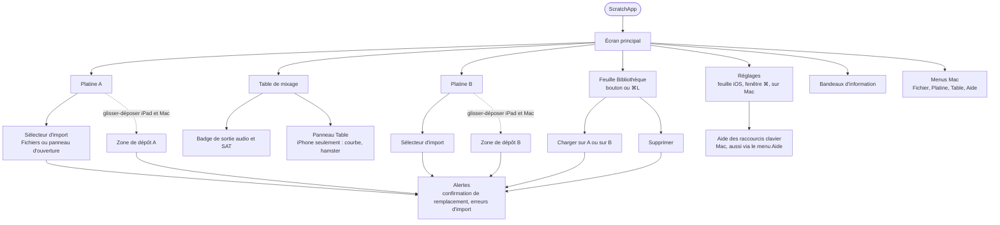
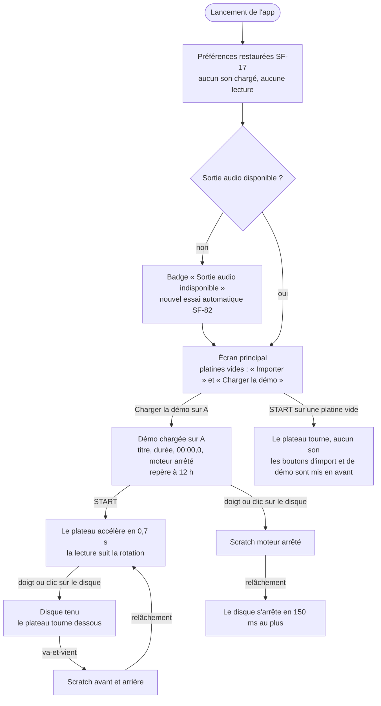
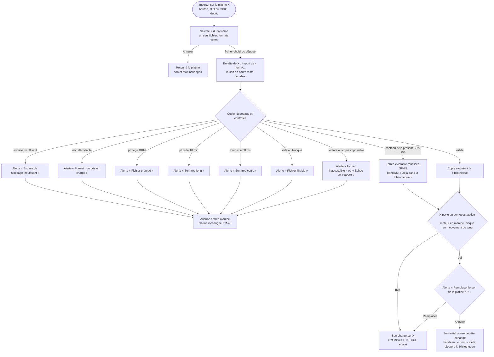
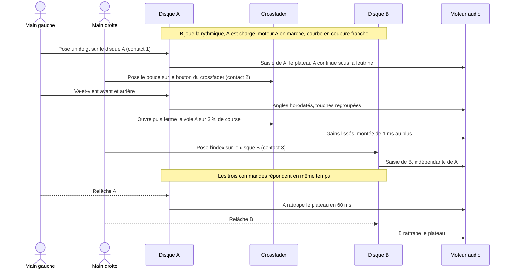
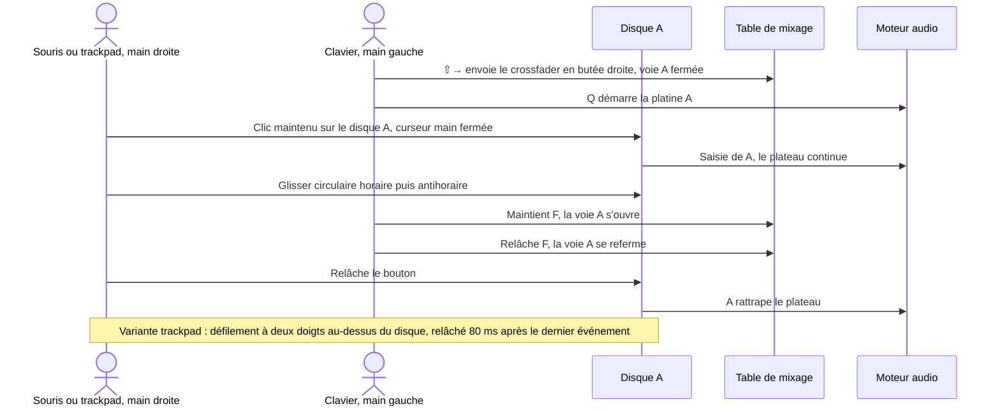
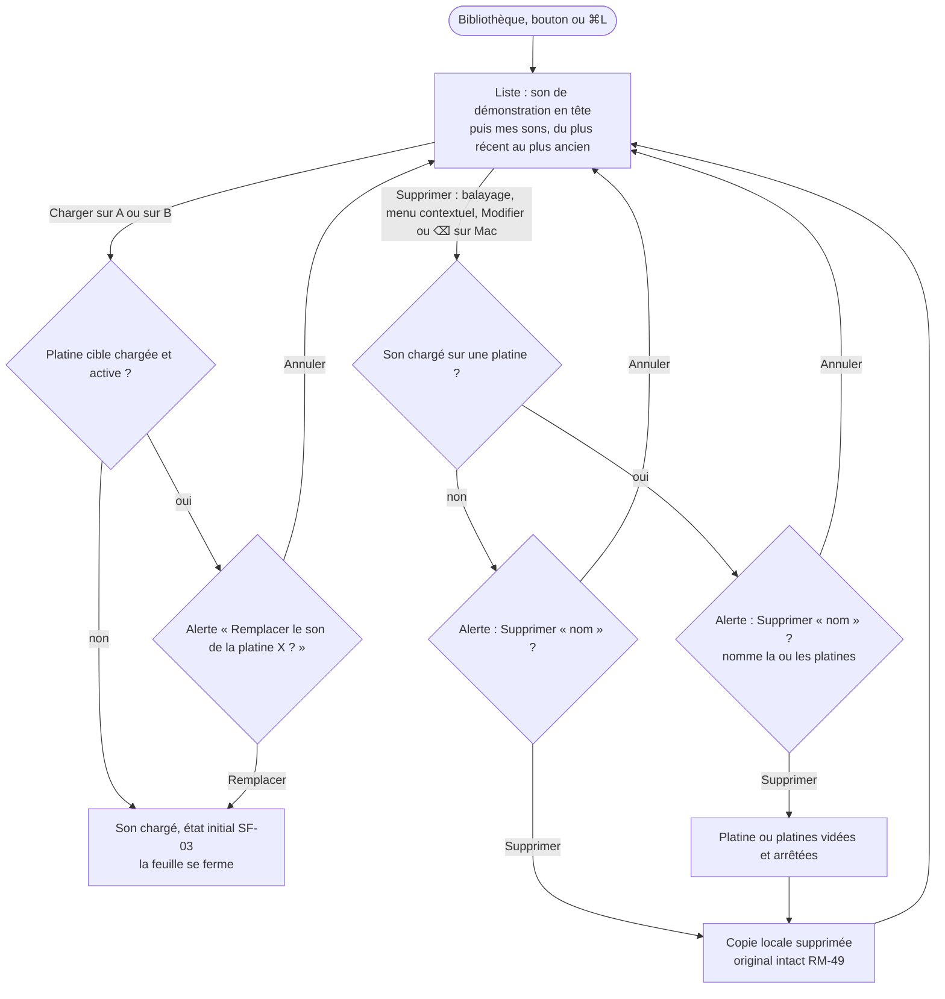
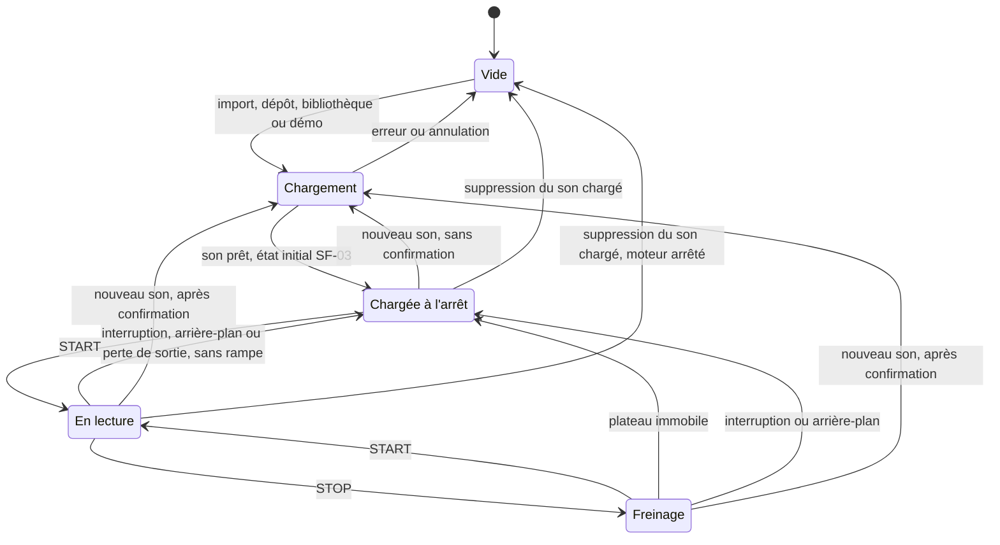

# ScratchApp — Spécification UI/UX

| | |
|---|---|
| **Document** | `docs/bmad/front-end-spec.md` (« UI/UX Specification » BMAD) |
| **Version** | 1.1 |
| **Date** | 14 novembre 2026 |
| **Auteur** | 🎨 Sally, UX Expert BMAD |
| **Statut** | Validée par 📝 Sarah (PO) le 14 novembre 2026 : questions de la section 14 tranchées dans [`po-validation.md`](po-validation.md) |
| **Référence** | [`scratchapp_specifications_v2_1.md`](../specs/scratchapp_specifications_v2_1.md), section 3 (fait foi ; la v2.0 est archivée) et [`REVUE_v1.9_vers_v2.0.md`](../specs/REVUE_v1.9_vers_v2.0.md) ; artefacts fusionnés : [brief](project-brief.md) (IC-05, IC-07, IC-08, IC-09) et [PRD](prd.md) (point A10, stories EP4 et EP5) |
| **Destinataires** | 💻 Léa (EP4 Interface, EP5 Commandes Mac et accessibilité), 🏗️ Winston (instantané moteur), 💻 Hugo (import, bibliothèque), 🧪 Quinn (recette), 🏃 Bob (stories) |

## Journal des modifications

| Date | Version | Description | Auteur |
|---|---|---|---|
| 2026-11-14 | 1.0 | Première version : principes, architecture de l'information, parcours, dispositions iPhone/iPad/Mac, composants, gestes, états, textes, style, animation, accessibilité, questions pour le PO ; réponses aux points délégués par le brief (IC-05, IC-07, IC-08, IC-09) et le PRD (A10). | Sally |
| 2026-11-14 | 1.1 | Validation PO : propositions de la section 14 retenues ; corrections ciblées de 5.10 (titre, D-12), 5.19 (durée de la démo, D-20), 7.3 (sortie indisponible, D-35 ; changement de périphérique, D-04), 8.3 et 8.5 (réconciliation de la bibliothèque, D-11) ; références vers la spec v2.1. | Sarah (PO) |

## Sommaire

1. [Objectifs UX et principes](#1-objectifs-ux-et-principes)
2. [Architecture de l'information](#2-architecture-de-linformation)
3. [Parcours utilisateurs](#3-parcours-utilisateurs)
4. [Dispositions](#4-dispositions)
5. [Inventaire des composants](#5-inventaire-des-composants)
6. [Interactions et gestes](#6-interactions-et-gestes)
7. [États](#7-états)
8. [Textes d'interface](#8-textes-dinterface)
9. [Style visuel](#9-style-visuel)
10. [Animation et performance](#10-animation-et-performance)
11. [Accessibilité (SF-83)](#11-accessibilité-sf-83)
12. [Traçabilité vers la spec](#12-traçabilité-vers-la-spec)
13. [Prochaines étapes et remise à Léa](#13-prochaines-étapes-et-remise-à-léa)
14. [Questions pour le PO](#14-questions-pour-le-po)

### Conventions de lecture

- **Cadre.** Ce document précise la section 3 de la spec v2.1 (PO-10 délégué à la spécification UX). Il n'ajoute **aucune fonctionnalité**. Les choix qui interprètent la spec sont marqués **[Choix UX]** et repris, avec ceux qui demandent un arbitrage, en [section 14](#14-questions-pour-le-po).
- **Unités.** Toutes les dimensions sont en **points** (pt). « ≥ 44 » désigne la zone tactile minimale, qui peut déborder du visuel.
- **Notations du disque.** **P** = diamètre du plateau (cadre carré du composant disque) ; **D** = diamètre du vinyle = 0,92 × P ; **R** = D / 2 (rayon du disque au sens de RM-61).
- **Exigences.** « doit » = obligatoire pour la recette ; « devrait » = recommandé, écart possible avec justification dans la PR.
- **Renvois.** « spec 3.5 » ou « spec 6.14 » désigne une section ou un scénario Gherkin de la spec v2.1 ; un numéro seul (« 5.12 », « 6.4 ») désigne une section de ce document ; « Qn » renvoie à la [section 14](#14-questions-pour-le-po).
- **Identifiants.** Les identifiants SF, RM, PO et E sont ceux de la spec (inchangés en v2.1). Les noms de composants Swift sont en anglais, les libellés en français.
- **Hors V1.** Aucune commande P2 (REVERSE, crépitement, REC, banque de sons complète, pointeurs, retour haptique, MIDI) n'apparaît dans l'interface V1, même désactivée.

---

## 1. Objectifs UX et principes

### 1.1 Utilisateurs cibles

| Profil | Ce qu'il attend | Conséquence UX |
|---|---|---|
| **DJ scratch confirmé** (platines réelles, table de scratch) | Retrouver ses réflexes : retenir le disque, le lâcher sur le repère, couper au crossfader en coupure franche, hamster. | Feutrine visible (plateau qui tourne sous le disque), repère sur l'étiquette, crossfader long et sans saut, faders qui ne bougent jamais par accident. |
| **Curieux débutant** | Essayer tout de suite, sans fichier ni réglage. | « Charger la démo » sur chaque platine vide, valeurs par défaut jouables, textes courts et explicites. |
| **Utilisateur Mac sans écran tactile** | Scratcher à la souris ou au trackpad et couper au clavier. | Clic-glisser circulaire, défilement à deux doigts, coupures momentanées `F`/`J`, aide des raccourcis. |
| **Utilisateur de VoiceOver ou du clavier** | Identifier et régler chaque commande. | Libellé et valeur sur chaque commande, actions d'ajustement, interaction directe sur le disque, ordre de focus A → table → B. |

### 1.2 Objectifs d'utilisabilité (mesurables en recette)

| # | Objectif | Mesure |
|---|---|---|
| U-1 | Premier scratch rapide | Depuis le premier lancement : « Charger la démo » → START → doigt sur le disque, en **3 actions** et moins de 30 s pour un débutant. |
| U-2 | Aucune lecture involontaire | Aucun son au lancement, au retour au premier plan, après une interruption ou un chargement (SF-01, SF-17, RM-10). |
| U-3 | Geste fiable | Aucun saut de position à la saisie d'un disque en rotation, au relâchement, au passage par la zone centrale ou au redimensionnement (RM-60, RM-61, spec 6.14). |
| U-4 | Simultanéité | Trois contacts indépendants sur iPad (disque A, disque B, crossfader) ; souris + clavier sur Mac (SF-19, SF-79). |
| U-5 | Lisibilité en jeu | Titre, position, vitesse et état moteur lisibles d'un coup d'œil à 60 cm (iPad, Mac) ou bras tendu (iPhone) ; contraste WCAG AA. |
| U-6 | Fluidité | Disque, plateau et forme d'onde rafraîchis à la fréquence de l'écran (60 ou 120 Hz) sans image perdue pendant un scratch (SF-70). |
| U-7 | Pas d'erreur coûteuse en performance | Aucun fader ne saute au toucher (sauf le crossfader, voir 5.12) ; une platine active n'est jamais remplacée sans confirmation (SF-15). |

### 1.3 Principes de conception

1. **Le geste prime.** Le disque et le crossfader sont les instruments : ils occupent la plus grande surface, reçoivent les touches en priorité (RM-03) et ne sont jamais recouverts par une commande secondaire. Un contact reste attaché à la commande sur laquelle il a commencé.
2. **Latence minimale perçue.** Les commandes de performance (START/STOP, SET CUE, CUE, coupures clavier) agissent **à l'appui**, pas au relâchement. Le suivi tactile exploite les touches regroupées (SF-78). L'affichage lit l'instantané du moteur à chaque image, sans animation ajoutée.
3. **Lisible en situation de jeu.** Thème sombre, chiffres en SF Mono à chasse fixe, deux couleurs de platine **toujours accompagnées des lettres A et B**, aucune information portée par la seule couleur.
4. **Rien ne joue sans vous.** Pas de lecture automatique, pas de rechargement de session (SF-17, PO-12). Après une interruption, l'état arrêté est visible et la reprise passe par START (RM-56).
5. **Deux platines identiques.** Même anatomie, même ordre de lecture, mêmes raccourcis en miroir ; seules la lettre et la couleur changent (SF-64, RM-51).
6. **Le réel comme référence, la plateforme comme règle.** On reprend les conventions des platines (repère, plateau stroboscopique, 33⅓/45) tant qu'elles ne contredisent pas les conventions Apple (sens des curseurs, VoiceOver, menus Mac).

---

## 2. Architecture de l'information

### 2.1 Inventaire des écrans et surfaces

| Surface | Type | iPhone | iPad | Mac | Contenu |
|---|---|---|---|---|---|
| **Écran principal** | Vue racine, ne défile jamais | 1 platine (portrait) ou 2 (paysage) | 2 platines | 2 platines | Platine A, table de mixage, platine B, badge de sortie, accès Bibliothèque et Réglages |
| **Bibliothèque** | Feuille | Plein écran (`.large`) | Feuille de formulaire | Feuille attachée à la fenêtre | Son de démonstration, sons importés ; charger sur A ou B, supprimer (SF-74) |
| **Réglages** | Feuille (iOS), fenêtre Réglages standard (Mac, ⌘,) | Feuille | Feuille de formulaire | Fenêtre `Settings` | Durées de démarrage et de freinage, rattrapage de la feutrine ; aide des raccourcis (Mac) (spec 3.3) |
| **Panneau Table** | Popover | Oui (bouton « Table ») | Non | Non | Courbe du crossfader et hamster, faute de place sur iPhone [Choix UX, Q3] |
| **Sélecteur d'import** | Système | Fichiers | Fichiers | Panneau d'ouverture (Finder) | Un seul fichier, filtré sur WAV, AIFF, MP3, M4A (SF-02) |
| **Alertes** | Système (`.alert`) | Oui | Oui | Feuille d'alerte | Confirmations (remplacement, suppression) et erreurs d'import (section 8) |
| **Bandeaux d'information** | Superposition non modale | Oui | Oui | Oui | Messages brefs sans décision (dédoublonnage, interruption, sortie) |
| **Aide des raccourcis** | Fenêtre auxiliaire | — | — | Oui | Tableau 3.5 de la spec, touches affichées selon la disposition du clavier |
| **Menus** | Barre des menus | — | — | Oui | Fichier, Platine, Table, Aide (SF-79) |

### 2.2 Carte de l'information



### 2.3 Navigation

- **Pas de pile de navigation** sur l'écran principal : tout est visible ou à un geste. Les feuilles se ferment par « OK » (iOS), par balayage vers le bas (iOS) ou par Échap (Mac).
- **Pendant qu'une feuille ou une alerte est ouverte**, les platines continuent de jouer ; leurs commandes et les raccourcis de performance sont inactifs (6.4).
- **iPhone portrait :** le **sélecteur de platine** (A | B) en haut à gauche bascule la platine affichée ; la table reste en bas (spec 6.8 « Passer d'une platine à l'autre »).
- **Mac :** barre d'outils (bouton Bibliothèque), menus et raccourcis ; **une seule fenêtre principale** (pas de « Nouvelle fenêtre ») [Choix UX, Q22]. Fermer la fenêtre quitte l'app (SF-81).

### 2.4 Menus Mac (SF-79, spec 3.5)

| Menu | Éléments (raccourci) |
|---|---|
| **ScratchApp** | À propos de ScratchApp · Réglages… (⌘,) · Masquer, Quitter (⌘Q) : éléments standard |
| **Fichier** | Importer sur la platine A… (⌘O) · Importer sur la platine B… (⇧⌘O) · — · Bibliothèque (⌘L) · Afficher la bibliothèque dans le Finder · — · Fermer la fenêtre (⌘W). « Nouvelle fenêtre » est retiré. |
| **Platine** | Section « Platine A » : START/STOP (`Q`) · 33⅓ tours · 45 tours · SET CUE (`A`) · CUE (`S`) · Pitch −0,1 % (`Z`) · Pitch +0,1 % (`X`) · Pitch à 0 %. Section « Platine B » : START/STOP (`P`) · 33⅓ tours · 45 tours · SET CUE (`L`) · CUE (`K`) · Pitch −0,1 % (`,`) · Pitch +0,1 % (`.`) · Pitch à 0 %. |
| **Table** | Crossfader vers la gauche (`←`) · Crossfader vers la droite (`→`) · Crossfader en butée gauche (`⇧←`) · Crossfader au centre (`⇧↓`) · Crossfader en butée droite (`⇧→`) · — · Hamster (coche). |
| **Présentation** | Entrer en plein écran : élément standard. |
| **Aide** | Raccourcis clavier de ScratchApp (ouvre l'aide des raccourcis). L'élément d'aide système par défaut, sans contenu en V1, est retiré. |

Les coupures momentanées `F` et `J` (maintien) ne figurent pas dans les menus : un menu ne sait pas « maintenir ». Elles figurent dans l'aide des raccourcis [Choix UX, Q12]. Les éléments à touche simple sont **désactivés** quand un champ de texte a le focus ou qu'une feuille est ouverte (6.4). Les intitulés « butée gauche / droite » suivent la position physique, voir Q5.

---

## 3. Parcours utilisateurs

### 3.1 Premier lancement et son de démonstration

**Objectif :** scratcher en moins de 30 s sans fichier (U-1). **Exigences :** SF-01, SF-03, SF-04, SF-76, SF-82, RM-01, spec 6.1 « Premier lancement » et « Charger le son de démonstration », spec 6.2 « Démarrer sans fichier ».



Cas limites :

- **Aucune sortie audio** : l'écran principal reste utilisable (chargement, réglages) ; voir 7.3 et Q14.
- **Charger la démo sur B alors qu'elle est sur A** : permis (RM-57), chaque platine a sa position, son moteur, son CUE.
- **iPhone portrait** : la platine A est affichée au premier lancement ; la platine B est vide et propose les mêmes actions quand on la sélectionne.

### 3.2 Import sur une platine (avec confirmation SF-15)

**Objectif :** copier un fichier et le charger sur la platine d'où part l'import. **Exigences :** SF-02, SF-03, SF-15, SF-73, SF-75, SF-80, RM-47, RM-48, spec 6.1, 6.5 et 6.13.

Points d'entrée : bouton « Importer » de la platine, menu Fichier › Importer sur la platine A… (⌘O) ou B… (⇧⌘O), dépôt d'un fichier sur la platine (iPad, Mac).



Règles précisées :

- **Ordre des opérations.** La copie et les contrôles précèdent la confirmation : si l'utilisateur refuse le remplacement, le nouveau son est déjà dans la bibliothèque (spec 6.5 « Refuser le remplacement »).
- **Moment de l'évaluation « active ».** L'état de la platine est évalué **à la fin de la copie**, pas au lancement de l'import : une platine arrêtée entre-temps est remplacée sans confirmation.
- **Platine vide dont le plateau tourne** (START sans son) : aucune confirmation (rien à remplacer) ; le chargement arrête le moteur (SF-03) [Choix UX, Q24].
- **Pendant l'import**, le bouton « Importer » de la platine concernée est désactivé ; l'autre platine reste libre (deux imports en parallèle possibles, un par platine).
- **Dépôt refusé au survol** (type non audio, plusieurs fichiers) : la zone de dépôt l'indique avant le lâcher (5.9). Un fichier audio indécodable après le dépôt suit la branche « non décodable ».

### 3.3 Session de scratch sur iPad (trois contacts)

**Objectif :** scratcher A sur la rythmique de B en coupant au crossfader, puis tenir les deux disques. **Exigences :** SF-06, SF-10, SF-19, SF-64, SF-68, RM-53, RM-60, spec 6.4 « Scratch avec coupure rythmique » et 6.8 « Trois contacts simultanés ».



Ce que l'interface garantit pendant la session :

- chaque contact reste attaché à la commande où il a commencé ; un doigt qui glisse du crossfader vers un disque ne le saisit pas (RM-60) ;
- un second doigt sur un disque déjà tenu est ignoré ; il n'agit pas non plus sur les commandes voisines tant qu'il n'a pas commencé sur elles ;
- l'anneau « tenu » de chaque disque et le plateau stroboscopique qui continue de tourner montrent l'état de la feutrine ;
- les gestes système du bord inférieur sont différés (6.2) pour qu'un crossfader manipulé près du bord ne renvoie pas à l'écran d'accueil.

### 3.4 Scratch sur Mac (souris et clavier)

**Objectif :** tenir le disque à la souris (ou au trackpad) et rythmer au clavier. **Exigences :** SF-79, RM-59, spec 3.5 et 6.14.



Cas limites : redimensionnement de la fenêtre pendant la saisie (le disque reste tenu jusqu'au relâchement, sans saut, 4.6) ; fenêtre qui perd le focus pendant que `F` est maintenue (la voie se referme, 6.3) ; touche tapée dans un champ de texte (aucun effet sur les platines, 6.4).

### 3.5 Bibliothèque : charger sur A ou B, supprimer

**Exigences :** SF-74, SF-15, SF-75, RM-49, RM-57, spec 6.13.



- L'action « Supprimer » **n'est pas proposée** pour le son de démonstration (ni balayage, ni menu, ni mode Modifier).
- **iPhone portrait :** après un chargement, la feuille se ferme et la platine affichée devient la platine cible [Choix UX].
- **iPad, Mac :** la feuille se ferme aussi après un chargement (comportement identique sur toutes les plateformes) ; on la rouvre avec ⌘L ou le bouton pour charger l'autre platine.

---

## 4. Dispositions

### 4.1 Règles communes

**Choix de la disposition.** La disposition dépend de la **taille disponible de la fenêtre**, pas du modèle d'appareil. Appliquée en plein écran, la règle redonne exactement le tableau 3.4 de la spec :

| Ordre | Condition | Disposition | Cas couverts |
|---|---|---|---|
| 1 | macOS | **Côte à côte** | Mac, toute taille ≥ 960 × 600 |
| 2 | largeur < 600 | **Une platine** | iPhone portrait ; iPad en Slide Over ou Split View étroit (Q2) |
| 3 | hauteur < 500 | **Côte à côte compacte** | iPhone paysage |
| 4 | largeur < hauteur | **Empilée** | iPad portrait (Q1) |
| 5 | sinon | **Côte à côte** | iPad paysage, fenêtres Stage Manager larges |

**Arrangements de platine.** Le composant `DeckView` existe en deux arrangements, avec les mêmes sous-composants :

- **Colonne** (une platine, côte à côte, compacte, Mac) : en-tête, forme d'onde zoomée, aperçu, puis [plateau P | 8 | fader de pitch 44], rangée de transport, curseur de résistance.
- **Bande** (empilée) : [plateau P | 8 | pitch 44] | 16 | [panneau ≥ 280 : en-tête, forme d'onde, aperçu, transport en grille 2 × 2, résistance]. La platine B est en **miroir** (panneau à gauche, plateau à droite) : les deux disques sont en diagonale, un par main.

**Taille du disque.** P = min(largeur disponible pour le plateau, hauteur disponible pour le plateau, 560). La table de mixage a une largeur fixée par disposition et les platines prennent le reste ; en iPhone paysage, c'est l'inverse : les platines prennent la largeur dont elles ont besoin et la table le reste (au moins 180). L'excédent est réparti en marges ; les formes d'onde prennent toute la largeur de leur colonne.

**Grille et marges.** Grille de 4 pt. Gouttières latérales : 16 (iPhone, Mac), 20 (iPad), en plus des zones sûres. L'écran principal **ne défile jamais** et ne contient aucune vue défilante autour du disque.

**Zones tactiles.** Toute commande a une zone tactile ≥ 44 × 44, y compris si son visuel est plus petit ; deux zones tactiles ne se chevauchent jamais, sauf au-dessus d'un élément non interactif (forme d'onde zoomée, libellé).

**Éléments globaux.** Le badge de sortie et l'indicateur SAT appartiennent à la table de mixage (spec 3.2, PRD 6.2) dans toutes les dispositions. Les boutons Bibliothèque et Réglages sont en tête de la table, sauf en iPhone portrait (barre supérieure) et sur Mac (barre d'outils et menu ScratchApp › Réglages…).

**Pitch à droite du disque**, comme sur une platine réelle, dans toutes les dispositions ; les deux platines ont la même anatomie (pas de miroir des commandes, sauf l'arrangement en bande).

**Gestes système.** Sur iPhone et iPad, l'écran principal diffère les gestes système du bord inférieur (`defersSystemGestures(on: .bottom)`) pour protéger le crossfader et les faders proches du bord. Les feuilles ne les diffèrent pas.

**Rotation et redimensionnement (iOS).** Le changement de disposition annule les touches en cours : les disques tenus sont relâchés (RM-60). La transition est l'animation système de rotation, sans animation propre.

### 4.2 iPhone portrait : une platine

Référence : iPhone 15/16, 393 × 852, zones sûres 59 (haut) et 34 (bas). Le sélecteur A | B choisit la platine affichée ; la table de mixage est en bas, sous le pouce.

```text
┌─────────────────────────────────────────────────┐
│ [ A● | B○ ]                     [Bibl.] [Régl.] │  44  barre supérieure
├─────────────────────────────────────────────────┤
│ A  voix_funk.wav                    [Importer]  │  44  en-tête de platine
│    00:12,3 / 03:45,0                            │
│ ▁▂▅▇▆▃▁▂▄▇█▆▃▁▂▅▇▆▃▂▁│▃▅▇▆▄▂▁▂▃▅▆▇▅▃▂▁▂▄▆▇▅▃▂▁  │  48  forme d'onde zoomée (±1,8 s)
│ ▂▃▄▅▆▅▄▃▂▃▄▅▆▇▆▅|▄▃▂▁▂▃▄▅▆▅▄▃▂▁▂▃▄▅▲▄▃▂▁▂▃▄▅▄   │  28  aperçu (zone tactile 44)
│         oooooo▼ooooooo               ┌─PITCH─┐  │  ▼ repère de lecture fixe (12 h)
│      ooo░░░░░░░░░░░░░░ooo            │ +0,0 %│  │
│    oo░░░░░░░░░░░░░░░░░░░░oo          │  +8   │  │
│  oo░░░░░░░░░░░░░░░░░░░░░░░░oo        │   ┃   │  │
│ oo░░░░░░░░░░      ░░░░░░░░░░oo       │   ┃   │  │
│ oo░░░░░░░░    ▮     ░░░░░░░░oo       │   ┃   │  │
│ o░░░░░░░░░    A     ░░░░░░░░░o       │  ━╋━  │  │  P = 309 (plateau), D = 284 (vinyle)
│ oo░░░░░░░░          ░░░░░░░░oo       │   ┃   │  │
│ oo░░░░░░░░░░      ░░░░░░░░░░oo       │   ┃   │  │
│  oo░░░░░░░░░░░░░░░░░░░░░░░░oo        │  −8   │  │
│    oo░░░░░░░░░░░░░░░░░░░░oo          │  [0]  │  │
│      ooo░░░░░░░░░░░░░░ooo            └───────┘  │  fader de pitch 44 × 309
│         oooooooooooooo                          │
│ [ START ]  [ 33⅓ | 45 ]  [ SET CUE ]  [ CUE ]   │  44  transport
│ Résistance du vinyle                      50 %  │  44  résistance
│ Léger ━━━━━━━━━━━━━━━●━━━━━━━━━━━━━━━━━ Lourd   │
├─────────────────────────────────────────────────┤
│ SAT ○   Haut-parleur                            │  24  en-tête de table : SAT, badge de sortie
│ VOIE A ━━━━━━━━━━━━━━━━━━━━━━━━━━━● 100 %  [≡]  │  44  fader de voie (platine affichée), [≡] = Table
│ A ▮ ├─·──────────────────●──────────────·─┤ ▮ B │  56  crossfader, course 305
└─────────────────────────────────────────────────┘
```

| Zone (haut → bas) | Hauteur | Largeur | Détail |
|---|---|---|---|
| Barre supérieure | 44 | 361 | Sélecteur A \| B (2 × 56 × 36, tactile 44) à gauche ; Bibliothèque et Réglages (44 × 44 chacun) à droite |
| En-tête de platine | 44 | 361 | Lettre, titre, « Importer » (44 × 44, icône seule), position / durée |
| Forme d'onde zoomée | 48 | 361 | ±1,8 s autour de la tête |
| Aperçu (needle drop) | 28 visuel, 44 tactile | 361 | La zone tactile déborde de 16 vers le haut, au-dessus de la forme d'onde zoomée |
| Plateau + pitch | **P = 309** | 309 + 8 + 44 | D = 284, étiquette 94, zone centrale de rayon 17, zone de saisie de rayon 148 |
| Transport | 44 | 361 | START 80, 33⅓ / 45 96 (2 × 48), SET CUE 88, CUE 64, espacements 11 |
| Résistance | 44 | 361 | Libellé et valeur (14), piste (30) |
| Séparateur | 12 | — | Filet `stroke.subtle` |
| En-tête de table | 24 | 361 | Indicateur SAT, badge de sortie (capsule de 24, jusqu'à 280 de large) |
| Fader de voie | 44 | 361 | « VOIE A » 52, piste 197, valeur 44, bouton Table 44 × 44 |
| Crossfader | 56 | 361 | Lettre + VU-mètre 28 de chaque côté, **course 305** |
| Marge basse | 8 | — | Au-dessus de l'indicateur d'accueil (gestes différés) |

Espacements : 8 entre blocs ; 4 entre forme d'onde et aperçu, entre en-tête de table et fader de voie, et entre fader de voie et crossfader. Sur 393 × 852, la hauteur permettrait P = 311 : c'est la largeur qui fixe P = 309.

**Variante compacte** (hauteur utile < 700 pt, iPhone SE) : forme d'onde 36, aperçu 24, espacements 6. P = 229.

| Appareil | Taille | P | D |
|---|---|---|---|
| iPhone SE (3e gén.) | 375 × 667 | 229 (compacte) | 211 |
| iPhone 13 mini | 375 × 812 | 280 | 258 |
| iPhone 15/16 | 393 × 852 | 309 | 284 |
| iPhone 16 Pro | 402 × 874 | 318 | 293 |
| iPhone 16 Pro Max | 440 × 956 | 356 | 328 |

**Ergonomie.** iPhone posé ou tenu à deux mains : la main droite (ou le pouce droit) sur le disque, le pouce gauche sur le crossfader, qui occupe toute la largeur en bas ; un gaucher fait l'inverse sans changement de disposition. Le bas du disque est à environ 220 pt du crossfader : on scratche d'une main et on coupe de l'autre sans croiser les mains. Le fader de pitch, voisin du bord droit du disque, ne se saisit que par son bouton (5.4) : un scratch au bord du disque ne le décale pas.

**Contacts simultanés.** En portrait, les trois contacts de SF-19 sont : disque affiché, crossfader, fader de voie (Q4). La platine masquée continue de jouer ; son VU-mètre et son état restent visibles (VU-mètre à l'extrémité du crossfader, pastille du sélecteur).

### 4.3 iPhone paysage : deux platines réduites

Référence : iPhone 15/16, 852 × 393, zones sûres 59 à gauche et à droite, 21 en bas, barre d'état masquée. Colonnes : platine A 236 | 8 | table 246 | 8 | platine B 236.

```text
┌──────────────────────────────────────────────────────────────────────────────────────┐
│ A voix_funk.wav  00:12,3   │ [Bibl.]  [≡ Table]  [Régl.]│ B beat_90.wav  01:02,7     │  28 en-têtes
│ ▁▂▅▇▆▃▁▂▄▇█│▆▃▁▂▅▇▆▃▂▁▃    │      Haut-parleur          │ ▁▂▅▇▆▃▁▂▄▇█│▆▃▁▂▅▇▆▃▂▁▃    │  28 zoom
│ ▂▃▄▅▆▅▄▃▂▃▄|▅▆▇▆▅▄▃▂▁▂     │      SAT ○                 │ ▂▃▄▅▆▅▄▃▂▃▄|▅▆▇▆▅▄▃▂▁▂     │  20 aperçu
│     ooo░▼░░ooo      +0,0%  │   VOIE A      VOIE B       │     ooo░▼░░ooo      +0,0%  │
│   o░░░░░░░░░░░░o     +8    │  ▮ ━╋━          ━╋━ ▮      │   o░░░░░░░░░░░░o     +8    │
│ oo░░░░░░▮░░░░░░░oo    ┃    │  ▮  ┃            ┃  ▮      │ oo░░░░░░▮░░░░░░░oo    ┃    │
│ o░░░░░  A   ░░░░░o   ━╋━   │  ▮  ┃            ┃  ▮      │ o░░░░░  B   ░░░░░o   ━╋━   │  P = 174
│ o░░░░░      ░░░░░o    ┃    │  ▮  ┃            ┃  ▮      │ o░░░░░      ░░░░░o    ┃    │
│ oo░░░░░░░░░░░░░░oo   −8    │  ▮  ┃            ┃  ▮      │ oo░░░░░░░░░░░░░░oo   −8    │
│   o░░░░░░░░░░░░o     [0]   │     ┃            ┃         │   o░░░░░░░░░░░░o     [0]   │
│     ooo░░░░ooo             │   100 %        100 %       │     ooo░░░░ooo             │
│ [START][33⅓|45][SET][CUE]  │                            │ [START][33⅓|45][SET][CUE]  │  44 transport | crossfader 56
│ Résistance ━━━●━━━  50 %   │ A ├─·──────●──────·─┤ B    │ Résistance ━━━●━━━  50 %   │  44 résistance
└──────────────────────────────────────────────────────────────────────────────────────┘
```

| Zone d'une colonne de platine | Hauteur | Détail |
|---|---|---|
| En-tête | 28 | Une ligne : lettre, titre tronqué, position. « Importer » 44 × 44 dont la zone déborde sur la forme d'onde |
| Forme d'onde zoomée | 28 | |
| Aperçu | 20 visuel, 44 tactile | Débordement vers le haut |
| Plateau + pitch | **P = 174** | D = 160, étiquette 53, zone centrale de rayon 10 ; libellé « PITCH » omis, valeur et « 0 » conservés |
| Transport | 44 | START 48, 33⅓ / 45 88 (2 × 44), SET CUE 44 (libellé sur deux lignes), CUE 44, espacements 4 |
| Résistance | 44 | Libellé court « Résistance », valeur |

| Zone de la table (246 de large) | Hauteur | Détail |
|---|---|---|
| Boutons | 44 | Bibliothèque, Table, Réglages (44 × 44) |
| Badge de sortie et SAT | 24 + 20 | |
| Faders de voie A et B | ≈ 174 | Verticaux, piste ≈ 154, VU-mètre de 6 de large à l'extérieur de chaque fader |
| Crossfader | 56 | **Course 190**, aligné en bas sur la rangée de résistance |

| Appareil | Taille | P | Course du crossfader |
|---|---|---|---|
| iPhone SE (3e gén.) | 667 × 375 | 177 (table réduite à 180) | 125 |
| iPhone 15/16 | 852 × 393 | 174 | 190 |
| iPhone 16 Pro Max | 956 × 440 | 221 | 218 |

**Ergonomie.** iPhone tenu à deux mains : un pouce par disque ; le crossfader, en bas au centre, est atteint par l'un ou l'autre pouce. iPhone posé : une main sur un disque, l'autre sur le crossfader. Disposition « réduite » au sens de la spec 3.4 : les disques sont petits (≈ 27 mm), le portrait reste la disposition de référence pour scratcher sur iPhone.

### 4.4 iPad portrait : platines empilées

Référence : iPad (10e gén.), 820 × 1180, zones sûres 24 et 20. Haut → bas : bande de la platine A 456, table 176 (12 au-dessus et au-dessous), bande de la platine B 456. Pas de barre supérieure : les éléments globaux sont dans la table.

```text
┌──────────────────────────────────────────────────────────────────────────────────┐
│            ooooooo▼oooooo            PITCH    A  voix_funk.wav        [Importer] │
│        oooo░░░░░░░░░░░░░░oooo        +0,0 %      00:12,3 / 03:45,0               │
│     ooo░░░░░░░░░░░░░░░░░░░░░░ooo       +8     ▁▂▅▇▆▃▁▂▄▇█▆▃▁▂│▅▇▆▃▂▁▃▅▇▆▄▂▁▂▃    │
│   ooo░░░░░░░░░░░░░░░░░░░░░░░░░░ooo      ┃     ▂▃▄▅▆▅▄▃▂▃▄▅▆▇▆|▅▄▃▂▁▂▃▄▅▲▄▃▂▁▂    │
│  oo░░░░░░░░░░░░░░░░░░░░░░░░░░░░░░oo     ┃                                        │
│ ooo░░░░░░░░░░░        ░░░░░░░░░░░ooo    ┃     [   START   ]  [ 33⅓ | 45  ]       │
│ oo░░░░░░░░░░      ▮     ░░░░░░░░░░oo   ━╋━                                       │
│ oo░░░░░░░░░░      A     ░░░░░░░░░░oo    ┃     [  SET CUE  ]  [    CUE    ]       │
│ oo░░░░░░░░░░            ░░░░░░░░░░oo    ┃                                        │
│ ooo░░░░░░░░░░░        ░░░░░░░░░░░ooo    ┃     Résistance du vinyle     50 %      │
│  oo░░░░░░░░░░░░░░░░░░░░░░░░░░░░░░oo    −8     Léger ━━━━━━━●━━━━━━━━ Lourd       │
│   ooo░░░░░░░░░░░░░░░░░░░░░░░░░░ooo     [0]                                       │
│     ooo░░░░░░░░░░░░░░░░░░░░░░ooo                                                 │
│        oooo░░░░░░░░░░░░░░oooo                                                    │
│            oooooooooooooo                                                        │
├──────────────────────────────────────────────────────────────────────────────────┤
│ [Bibliothèque]               SAT ○   Haut-parleur                   [Réglages]   │
│ A ▮▮▮▮▮▯▯ VOIE A ━━━━━━━━━● 100%        VOIE B ━━━━━━━━● 100% ▮▮▮▯▯▯ B           │
│ Courbe ━━━━━━━● Franche    A ├─·───────●───────·─┤ B    Hamster (○  )            │
├──────────────────────────────────────────────────────────────────────────────────┤
│ B  beat_90.wav          [Importer]             ooooooo▼oooooo            PITCH   │
│    01:02,7 / 03:45,0                       oooo░░░░░░░░░░░░░░oooo        +0,0 %  │
│ ▁▂▅▇▆▃▁▂▄▇█▆▃▁▂│▅▇▆▃▂▁▃▅▇▆▄▂▁▂▃         ooo░░░░░░░░░░░░░░░░░░░░░░ooo       +8    │
│ ▂▃▄▅▆▅▄▃▂▃▄▅▆▇▆|▅▄▃▂▁▂▃▄▅▲▄▃▂▁▂       ooo░░░░░░░░░░░░░░░░░░░░░░░░░░ooo      ┃    │
│                                      oo░░░░░░░░░░░░░░░░░░░░░░░░░░░░░░oo     ┃    │
│ [   START   ]  [ 33⅓ | 45  ]        ooo░░░░░░░░░░░        ░░░░░░░░░░░ooo    ┃    │
│                                     oo░░░░░░░░░░      ▮     ░░░░░░░░░░oo   ━╋━   │
│ [  SET CUE  ]  [    CUE    ]        oo░░░░░░░░░░      B     ░░░░░░░░░░oo    ┃    │
│                                     oo░░░░░░░░░░            ░░░░░░░░░░oo    ┃    │
│ Résistance du vinyle     50 %       ooo░░░░░░░░░░░        ░░░░░░░░░░░ooo    ┃    │
│ Léger ━━━━━━━●━━━━━━━━ Lourd         oo░░░░░░░░░░░░░░░░░░░░░░░░░░░░░░oo    −8    │
│                                       ooo░░░░░░░░░░░░░░░░░░░░░░░░░░ooo     [0]   │
│                                         ooo░░░░░░░░░░░░░░░░░░░░░░ooo             │
│                                            oooo░░░░░░░░░░░░░░oooo                │
│                                                oooooooooooooo                    │
└──────────────────────────────────────────────────────────────────────────────────┘
```

| Zone | Dimensions | Détail |
|---|---|---|
| Bande de platine | 780 × 456 | A : [plateau **P = 432** \| 8 \| pitch 44] 16 [panneau 280]. B : miroir [panneau 280] 16 [plateau \| 8 \| pitch] |
| Panneau | 280 | En-tête 52, forme d'onde 56, aperçu 32 (tactile 44), grille 2 × 2 de boutons 136 × 56 (START/STOP, 33⅓ / 45, SET CUE, CUE), résistance 44 |
| Table, ligne 1 | 780 × 44 | « Bibliothèque » (icône + texte) · SAT · badge de sortie · « Réglages » |
| Table, ligne 2 | 780 × 44 | « A », VU-mètre 80 × 8, VOIE A (piste 140, valeur 44) · VOIE B · VU-mètre · « B » |
| Table, ligne 3 | 780 × 56 | Courbe (libellé 52, curseur 150) · **crossfader 360, course 312** · Hamster (libellé 64, interrupteur 51) |

| Appareil | Taille | P | D |
|---|---|---|---|
| iPad (6e gén.) | 768 × 1024 | 380 | 350 |
| iPad mini (6e gén.) | 744 × 1133 | 356 | 328 |
| iPad (10e gén.), iPad Air 11" | 820 × 1180 | 432 | 397 |
| iPad Pro 13" | 1032 × 1376 | 554 | 510 |

**Ergonomie.** Les deux disques sont en diagonale : main gauche sur A (en haut à gauche), main droite sur B (en bas à droite) ; le crossfader, au centre de l'écran, est atteint par le pouce de l'une ou l'autre main. Pour scratcher A et couper : main gauche sur A, main droite sur le crossfader. Trois contacts (A, B, crossfader) sont possibles (SF-19).

### 4.5 iPad paysage : A | table | B

Référence : iPad (10e gén.), 1180 × 820. Colonnes : platine A 414 | 16 | table 280 | 16 | platine B 414. Pas de barre supérieure : Bibliothèque, Réglages, badge et SAT sont en tête de la table.

```text
┌────────────────────────────────────────────────────────────────────────────────────────────────────────────────┐
│ A  voix_funk.wav            [Importer]   │ [Bibl.]          [Régl.] │ B  beat_90.wav              [Importer]   │
│    00:12,3 / 03:45,0                     │ Haut-parleur      SAT ○  │    01:02,7 / 03:45,0                     │
│ ▁▂▅▇▆▃▁▂▄▇█▆▃▁▂▅▇│▆▃▂▁▃▅▇▆▄▂▁▂▃▅▆▇       │                          │ ▁▂▅▇▆▃▁▂▄▇█▆▃▁▂▅▇│▆▃▂▁▃▅▇▆▄▂▁▂▃▅▆▇       │
│ ▂▃▄▅▆▅▄▃▂▃▄▅▆▇▆▅▄|▃▂▁▂▃▄▅▆▅▄▃▂▁▲▃▄       │    VOIE A      VOIE B    │ ▂▃▄▅▆▅▄▃▂▃▄▅▆▇▆▅▄|▃▂▁▂▃▄▅▆▅▄▃▂▁▲▃▄       │
│          ooooo▼oooooo           PITCH    │  ▮▮ ━╋━          ━╋━ ▮▮  │          ooooo▼oooooo           PITCH    │
│      ooo░░░░░░░░░░░░░░ooo       +0,0 %   │  ▮▮  ┃            ┃  ▮▮  │      ooo░░░░░░░░░░░░░░ooo       +0,0 %   │
│    ooo░░░░░░░░░░░░░░░░░░ooo       +8     │  ▮▮  ┃            ┃  ▮▮  │    ooo░░░░░░░░░░░░░░░░░░ooo       +8     │
│   oo░░░░░░░░░░░░░░░░░░░░░░oo       ┃     │  ▮▮  ┃            ┃  ▮▮  │   oo░░░░░░░░░░░░░░░░░░░░░░oo       ┃     │
│  oo░░░░░░░░░░░  ░░░░░░░░░░░oo      ┃     │  ▮▮  ┃            ┃  ▮▮  │  oo░░░░░░░░░░░  ░░░░░░░░░░░oo      ┃     │
│ oo░░░░░░░░░   ▮    ░░░░░░░░░oo     ┃     │  ▮▮  ┃            ┃  ▮▮  │ oo░░░░░░░░░   ▮    ░░░░░░░░░oo     ┃     │
│ oo░░░░░░░░    A     ░░░░░░░░oo     ┃     │  ▮▮  ┃            ┃  ▮▮  │ oo░░░░░░░░    B     ░░░░░░░░oo     ┃     │
│ oo░░░░░░░░          ░░░░░░░░oo    ━╋━    │      ┃            ┃      │ oo░░░░░░░░          ░░░░░░░░oo    ━╋━    │
│ oo░░░░░░░░░        ░░░░░░░░░oo     ┃     │      ┃            ┃      │ oo░░░░░░░░░        ░░░░░░░░░oo     ┃     │
│  oo░░░░░░░░░░░  ░░░░░░░░░░░oo      ┃     │    100 %       100 %     │  oo░░░░░░░░░░░  ░░░░░░░░░░░oo      ┃     │
│   oo░░░░░░░░░░░░░░░░░░░░░░oo       ┃     │                          │   oo░░░░░░░░░░░░░░░░░░░░░░oo       ┃     │
│    ooo░░░░░░░░░░░░░░░░░░ooo        ┃     │ Courbe                   │    ooo░░░░░░░░░░░░░░░░░░ooo        ┃     │
│      ooo░░░░░░░░░░░░░░ooo         −8     │ Douce ━━━━━━━━━● Franche │      ooo░░░░░░░░░░░░░░ooo         −8     │
│          oooooooooooo             [0]    │                          │          oooooooooooo             [0]    │
│                                          │ Hamster         (○   )   │                                          │
│                                          │                          │                                          │
│ [  START  ] [33⅓ | 45] [SET CUE] [ CUE ] │ A ├─·──────●──────·─┤ B  │ [  START  ] [33⅓ | 45] [SET CUE] [ CUE ] │
│ Résistance du vinyle             50 %    │                          │ Résistance du vinyle             50 %    │
│ Léger ━━━━━━━━━━━●━━━━━━━━━━━━ Lourd     │                          │ Léger ━━━━━━━━━━━●━━━━━━━━━━━━ Lourd     │
└────────────────────────────────────────────────────────────────────────────────────────────────────────────────┘
```

| Zone | Dimensions | Détail |
|---|---|---|
| Colonne de platine | 414 de large | En-tête 52, forme d'onde 64, aperçu 32 (tactile 44), plateau **P = 362** + pitch 44, transport 56, résistance 44, espacements 12 |
| Transport | 414 × 56 | START 104, 33⅓ / 45 112 (2 × 56), SET CUE 104, CUE 70, espacements 8 |
| Table | 280 de large | Bibliothèque et Réglages 44, badge de sortie et SAT 28, faders de voie verticaux (piste ≈ 300) avec VU-mètres 8 de large à l'extérieur, valeurs, courbe 44, hamster 44, **crossfader 56, course 212**, aligné sur la rangée de transport |

| Appareil | Taille | P | Course du crossfader |
|---|---|---|---|
| iPad (6e gén.) | 1024 × 768 | 284 | 212 |
| iPad mini (6e gén.) | 1133 × 744 | 338 | 212 |
| iPad (10e gén.), iPad Air 11" | 1180 × 820 | 362 | 212 |
| iPad Pro 13" | 1376 × 1032 | 448 | 235 (table 303) |

La table mesure `clamp(0,22 × largeur, 280, 320)`.

**Ergonomie.** iPad posé : main gauche sur A, main droite sur le crossfader (ou l'inverse pour B). Le crossfader est au centre, en bas, comme sur une table de scratch ; les faders de voie au-dessus restent hors de la trajectoire du pouce.

### 4.6 Mac : fenêtre redimensionnable

Taille minimale de la **zone de contenu** : **960 × 600** (barre de titre et barre d'outils en plus) [Choix UX, Q22] ; taille par défaut 1200 × 760 ; plein écran pris en charge. Disposition côte à côte en toute taille (spec 3.4). Les réglages s'ouvrent dans la fenêtre Réglages (⌘,).

```text
┌────────────────────────────────────────────────────────────────────────────────────────────────────────────────┐
│ ● ● ●   ScratchApp                                                                       [Bibliothèque]        │
├────────────────────────────────────────────────────────────────────────────────────────────────────────────────┤
│ A  voix_funk.wav            [Importer]   │                          │ B  beat_90.wav              [Importer]   │
│    00:12,3 / 03:45,0                     │ Haut-parleurs Ma…  SAT ○ │    01:02,7 / 03:45,0                     │
│ ▁▂▅▇▆▃▁▂▄▇█▆▃▁▂▅▇│▆▃▂▁▃▅▇▆▄▂▁▂▃▅▆▇       │                          │ ▁▂▅▇▆▃▁▂▄▇█▆▃▁▂▅▇│▆▃▂▁▃▅▇▆▄▂▁▂▃▅▆▇       │
│ ▂▃▄▅▆▅▄▃▂▃▄▅▆▇▆▅▄|▃▂▁▂▃▄▅▆▅▄▃▂▁▲▃▄       │    VOIE A      VOIE B    │ ▂▃▄▅▆▅▄▃▂▃▄▅▆▇▆▅▄|▃▂▁▂▃▄▅▆▅▄▃▂▁▲▃▄       │
│          ooooo▼oooooo           PITCH    │  ▮▮ ━╋━          ━╋━ ▮▮  │          ooooo▼oooooo           PITCH    │
│      ooo░░░░░░░░░░░░░░ooo       +0,0 %   │  ▮▮  ┃            ┃  ▮▮  │      ooo░░░░░░░░░░░░░░ooo       +0,0 %   │
│    ooo░░░░░░░░░░░░░░░░░░ooo       +8     │  ▮▮  ┃            ┃  ▮▮  │    ooo░░░░░░░░░░░░░░░░░░ooo       +8     │
│   oo░░░░░░░░░░░░░░░░░░░░░░oo       ┃     │  ▮▮  ┃            ┃  ▮▮  │   oo░░░░░░░░░░░░░░░░░░░░░░oo       ┃     │
│  oo░░░░░░░░░░░  ░░░░░░░░░░░oo      ┃     │  ▮▮  ┃            ┃  ▮▮  │  oo░░░░░░░░░░░  ░░░░░░░░░░░oo      ┃     │
│ oo░░░░░░░░░   ▮    ░░░░░░░░░oo     ┃     │  ▮▮  ┃            ┃  ▮▮  │ oo░░░░░░░░░   ▮    ░░░░░░░░░oo     ┃     │
│ oo░░░░░░░░    A     ░░░░░░░░oo     ┃     │  ▮▮  ┃            ┃  ▮▮  │ oo░░░░░░░░    B     ░░░░░░░░oo     ┃     │
│ oo░░░░░░░░          ░░░░░░░░oo    ━╋━    │      ┃            ┃      │ oo░░░░░░░░          ░░░░░░░░oo    ━╋━    │
│ oo░░░░░░░░░        ░░░░░░░░░oo     ┃     │      ┃            ┃      │ oo░░░░░░░░░        ░░░░░░░░░oo     ┃     │
│  oo░░░░░░░░░░░  ░░░░░░░░░░░oo      ┃     │    100 %       100 %     │  oo░░░░░░░░░░░  ░░░░░░░░░░░oo      ┃     │
│   oo░░░░░░░░░░░░░░░░░░░░░░oo       ┃     │                          │   oo░░░░░░░░░░░░░░░░░░░░░░oo       ┃     │
│    ooo░░░░░░░░░░░░░░░░░░ooo        ┃     │ Courbe                   │    ooo░░░░░░░░░░░░░░░░░░ooo        ┃     │
│      ooo░░░░░░░░░░░░░░ooo         −8     │ Douce ━━━━━━━━━● Franche │      ooo░░░░░░░░░░░░░░ooo         −8     │
│          oooooooooooo             [0]    │                          │          oooooooooooo             [0]    │
│                                          │ Hamster         (○   )   │                                          │
│                                          │                          │                                          │
│ [  START  ] [33⅓ | 45] [SET CUE] [ CUE ] │ A ├─·──────●──────·─┤ B  │ [  START  ] [33⅓ | 45] [SET CUE] [ CUE ] │
│ Résistance du vinyle             50 %    │                          │ Résistance du vinyle             50 %    │
│ Léger ━━━━━━━━━━━●━━━━━━━━━━━━ Lourd     │                          │ Léger ━━━━━━━━━━━●━━━━━━━━━━━━ Lourd     │
└────────────────────────────────────────────────────────────────────────────────────────────────────────────────┘
```

| Élément | 960 × 600 (minimum) | 1200 × 760 (défaut) | Règle |
|---|---|---|---|
| Table de mixage M | 240 | 240 | `clamp(0,2 × largeur, 240, 320)` |
| Colonne de platine C | 328 | 448 | (largeur − 32 − M − 32) / 2 |
| Plateau P | **276** (D = 254) | **396** (D = 364) | min(C − 52, hauteur − 32 − 274, 560) |
| Forme d'onde zoomée | 328 × 56 | 448 × 56 | Toute la largeur de la colonne |
| Transport | 44 | 44 | START 80, 33⅓ / 45 96, SET CUE 80, CUE 48 à la taille minimale |
| Course du crossfader | 172 | 172 | M − 68 (jusqu'à 252) |

**Redimensionnement.**

- La disposition est recalculée à chaque étape du redimensionnement, sans animation ; le Mac ne change jamais de disposition.
- P croît avec la fenêtre jusqu'à 560 ; au-delà, le contenu de chaque colonne est centré et seules les formes d'onde s'élargissent. L'excédent vertical est réparti au-dessus et au-dessous du contenu (centrage vertical).
- **Une saisie en cours survit au redimensionnement** (spec 6.14) : le centre du disque est relu à chaque événement et l'angle du pointeur est recalé pour que l'angle virtuel du doigt reste continu (aucun saut).
- La fenêtre ne peut pas descendre sous 960 × 600 (`.frame(minWidth: 960, minHeight: 600)` et `.windowResizability(.contentMinSize)`).

**Ergonomie.** Main droite sur la souris ou le trackpad (disque), main gauche sur le clavier : `F` (coupure A), `Q` (START A), `A`/`S` (CUE A). La barre d'outils porte le bouton « Bibliothèque » ; le badge de sortie et SAT sont en tête de la table de mixage.

### 4.7 Multitâche iPad

Split View, Slide Over et Stage Manager suivent la règle de 4.1 : en dessous de 600 pt de large, l'app passe en disposition « Une platine » (identique à l'iPhone portrait, sélecteur A | B compris) ; une fenêtre plus haute que large passe en disposition empilée. La recette V1 sur ces modes est à confirmer (Q2).

---

## 5. Inventaire des composants

### 5.0 Vue d'ensemble et règles communes

| Composant | Nom Swift proposé | Story du PRD | Exigences |
|---|---|---|---|
| Disque (platine) | `TurntableView` | 4.1, 4.3 | SF-06 à SF-10, SF-69, RM-53, RM-55, RM-60, RM-61 |
| START/STOP | `StartStopButton` | 4.1 | SF-04, SF-05, PO-01 |
| Sélecteur 33⅓ / 45 | `SpeedSelector` | 4.1 | SF-04, RM-02, RM-50 |
| Fader de pitch | `PitchFader` | 4.5 | SF-11 |
| Curseur de résistance | `ResistanceSlider` | 4.5 | SF-21 à SF-24 |
| SET CUE, CUE | `CueButtons` | 4.5 | SF-13 |
| Forme d'onde zoomée | `ZoomedWaveformView` | 4.6 | SF-70 |
| Aperçu complet | `WaveformOverviewView` | 4.6 | SF-70, SF-71 |
| Zone de dépôt | `DeckDropZone` | 5.2 | SF-73 |
| En-tête de platine | `DeckHeaderView` | 4.1 | spec 3.1, SF-03 |
| Fader de voie | `ChannelFader` | 4.2 | SF-65 |
| Crossfader | `CrossfaderView` | 4.2 | SF-12, SF-66, SF-67 |
| Courbe | `CrossfaderCurveControl` | 4.2 | SF-66 |
| Hamster | `HamsterToggle` | 4.2 | SF-67 |
| VU-mètre | `VUMeterView` | 4.2 | SF-65 |
| Indicateur de saturation | `SaturationIndicator` | 4.2 | SF-65 |
| Badge de sortie | `OutputBadge` | 4.2, 6.2 | SF-16, SF-82 |
| Sélecteur de platine (iPhone) | `DeckSelector` | 4.4 | spec 2 et 6.8 |
| Feuille et lignes de bibliothèque | `LibrarySheet`, `LibraryRow` | 3.5 (Hugo) | SF-74 |
| Réglages | `SettingsView` | 3.4 (Hugo) | spec 3.3, SF-68 |
| Bandeau d'information | `ToastView` | 4.1, 6.1 | SF-18, SF-75, SF-82 |
| Aide des raccourcis (Mac) | `KeyboardHelpView` | 5.1 | spec 3.3 et 3.5 |
| Panneau Table (iPhone) | `MixerSettingsPopover` | 4.2, 4.4 | spec 3.2 et 3.4 |
| Conteneurs | `MainLayoutView`, `DeckView`, `MixerView` | 4.1, 4.4 | spec 3.4 |

**Règles communes aux faders** (pitch, résistance, voies, courbe) :

- **Saisie par le bouton seulement** : un toucher sur la piste hors du bouton ne fait rien (pas de saut). La zone de saisie du bouton fait au moins 44 × 44 et s'allonge de 8 pt de part et d'autre dans l'axe.
- **Déplacement relatif** : la valeur suit le déplacement du doigt depuis le point de saisie ; le bouton ne « saute » pas sous le doigt.
- Exception : le **crossfader** (5.12), commande de performance.
- Les valeurs s'affichent en SF Mono ; elles se mettent à jour pendant le geste.
- Sur Mac, mêmes règles à la souris ; un fader qui a le focus clavier se règle aux flèches (6.4).

**Règles communes aux boutons de performance** (START/STOP, SET CUE, CUE) : action **à l'appui** (toucher, clic, touche enfoncée), sans annulation par glissement ; les autres boutons (33⅓/45, Importer, bibliothèque, réglages) agissent au relâchement, comme d'habitude sur iOS et macOS.

**Libellés VoiceOver** : forme « `<commande>, platine A` » pour les commandes de platine, pour que chaque élément se comprenne hors contexte (rotor, Contrôle vocal). Chaque platine est aussi un conteneur d'accessibilité nommé « Platine A » ou « Platine B ».

### 5.1 TurntableView : disque, sillons, étiquette, repère, plateau

**Rôle.** Instrument principal : afficher la rotation du disque et du plateau, recevoir la saisie (doigt, clic, défilement).

**Anatomie** (couches, du fond vers le dessus ; dimensions relatives à P et D) :

| Couche | Dimensions | Rendu | Mouvement |
|---|---|---|---|
| Plateau | Ø P | `color.platter` ; anneau visible entre D et P (≈ 4 % de P de chaque côté) portant **16 marques stroboscopiques** (`color.strobe`, traits de 3 pt de large et 0,03 P de long) | Tourne à l'angle du **plateau** (`platterAngle`) |
| Feutrine | Ø D | `color.slipmat`, anneau imprimé et lettre de platine | Visible seulement sur une platine vide ; tourne avec le plateau |
| Vinyle | Ø D = 0,92 P | `color.vinyl`, sillons concentriques fins (`color.groove`, un filet tous les 3 pt entre 0,36 R et 0,97 R), plage d'entrée et de sortie lisses ; reflet radial **fixe** (lumière de la pièce) | Le vinyle est de révolution : sa rotation se lit sur l'étiquette et le repère |
| Étiquette | Ø 0,33 D | `color.deck.a.label` / `color.deck.b.label` ; lettre de platine (gras, 0,12 D) ; titre sur deux lignes (0,035 D, `text.primary`) | Tourne à l'angle du **disque** (`discAngle`) |
| Repère (autocollant) | 0,035 D × 0,10 D, de 0,06 D à 0,16 D du centre | `color.cue`, contour 1 pt `bg.app`, coins arrondis | Tourne avec le disque, décalé de l'angle du CUE (ci-dessous) |
| Axe | Ø 0,025 D | `color.knob` | Fixe |
| Repère de lecture | Triangle 12 × 8 (pour P ≥ 300, proportionnel en dessous) | `text.primary`, posé sur l'anneau du plateau à **12 h**, pointe vers le centre | **Fixe** : c'est la « position de lecture » du scénario spec 6.11 |
| Anneau « tenu » | Trait de 3 pt sur le bord du vinyle | Couleur de la platine | Opacité 1 quand le disque est tenu (apparition immédiate, disparition en 80 ms) |
| Superpositions | Ø D | État vide (boutons), chargement (indicateur), dépôt (5.9) | — |

**Angles.** Sens horaire positif (une platine tourne dans le sens horaire vu du dessus ; avancer = horaire). L'étiquette est dessinée à l'angle du disque publié (`discAngle`) et le repère à l'angle du repère publié (contrat 0.2, PRD 5.3), soit `discAngle − 2π × cue / 1,8 s` avec `cue = 0` sans CUE. Règle attendue du moteur (IC-09) : `discAngle` vaut `2π × position / 1,8 s` à une constante près, et cette constante est **recalée après chaque saut de position** (CUE, needle drop, chargement, retour depuis le sillon fermé ou la butée d'amorce), de sorte que **le repère passe toujours sous le repère de lecture quand la tête est au CUE** (SF-69, spec 6.11). En sillon fermé ou en butée d'amorce, le disque et le repère continuent de tourner (RM-55). Au recalage, l'étiquette et le repère sautent d'un angle ; un disque tenu reste sous le doigt sans saut de son (Q13).

**Zones de saisie.** Cercle de rayon `min(R + 6, P / 2)` ; zone centrale (RM-61) de rayon `0,12 × R`. Les coins du cadre carré et l'anneau du plateau au-delà de R + 6 ne saisissent pas le disque.

| P | D | Étiquette | Zone centrale (rayon) | Zone de saisie (rayon) |
|---|---|---|---|---|
| 174 (iPhone paysage) | 160 | 53 | 10 | 86 |
| 229 (iPhone SE) | 211 | 70 | 13 | 111 |
| 309 (iPhone 15) | 284 | 94 | 17 | 148 |
| 362 (iPad paysage) | 333 | 110 | 20 | 172 |
| 396 (Mac par défaut) | 364 | 120 | 22 | 188 |
| 432 (iPad portrait) | 397 | 131 | 24 | 205 |

**États.**

| État | Rendu |
|---|---|
| Vide, moteur arrêté | Plateau et feutrine immobiles ; boutons « Importer » et « Charger la démo » centrés ; sur iPad et Mac, « ou déposez un fichier ici » |
| Vide, moteur en marche | Plateau et feutrine tournent ; mêmes boutons ; aucun son (PO-01) |
| Chargement | Vinyle sans étiquette, indicateur d'activité au centre (après 150 ms seulement) |
| Chargé à l'arrêt | Vinyle, étiquette, repère à 12 h (tête au CUE ou à 0 s) |
| En lecture / freinage | Étiquette, repère et marques du plateau tournent ensemble |
| Tenu | Anneau « tenu » ; l'étiquette suit le doigt ; les marques du plateau continuent si le moteur tourne (feutrine, spec 6.9) |
| Sillon fermé, butée d'amorce | Le disque continue de tourner ; l'en-tête affiche « Fin du son » (7.2) |
| Survol (Mac) | Curseur main ouverte sur la zone de saisie d'un disque chargé ; main fermée pendant la saisie |

**Interactions.** Voir 6.1 (saisie), 6.3 (souris, trackpad). Le disque d'une platine vide n'est pas saisissable (il n'y a pas de vinyle). Clic secondaire : sans effet.

**VoiceOver.** Libellé « Disque, platine A ». Valeur : état du moteur et position (PRD 5.3), ex. « en rotation, 33 tours un tiers, position 12,3 secondes », « à l'arrêt, position 0 seconde », « tenu, position 8,2 secondes », « fin du son », « vide ». Valeur lue au focus, **sans** trait « mise à jour fréquente » (pas d'annonces continues pendant le jeu). Trait **interaction directe** (`.allowsDirectInteraction`) pour scratcher au doigt avec VoiceOver actif. Indication : « Interaction directe. Posez un doigt pour retenir le disque, tournez pour scratcher. »

**Clavier Mac.** Aucun raccourci propre ; le disque n'est pas dans la boucle de tabulation.

### 5.2 Bouton START/STOP

- **Rôle.** Démarrer ou arrêter le moteur (SF-04, SF-05) ; permis sur une platine vide (le plateau tourne sans son, PO-01).
- **Dimensions.** 80 × 44 (iPhone portrait), 48 × 44 (iPhone paysage), 136 × 56 (iPad portrait), 104 × 56 (iPad paysage), 80 × 44 (Mac minimum). Coins 8.
- **Visuel.** Fond `bg.raised` ; texte 13 pt gras capitales ; témoin rond de 8 pt en haut à gauche.
- **États.** Moteur commandé à l'arrêt : texte « START », témoin éteint (`vu.off`). Moteur commandé en marche : texte « STOP », témoin `state.on`. Le témoin suit la **commande**, pas la vitesse réelle : pendant le freinage, « START » est affiché (un appui réaccélère, spec 6.2) ; pendant l'accélération, « STOP ». Enfoncé : fond `bg.pressed`, échelle 0,97. Jamais désactivé.
- **Interaction.** Action à l'appui. Utilisable d'un autre doigt pendant que le disque est tenu (spec 6.2 « Appuyer sur STOP pendant que je retiens le disque »).
- **Platine vide.** Un appui sur START fait tourner le plateau et met en avant les boutons de l'état vide (pulsation 1,0 → 1,05 → 1,0 en 300 ms, supprimée avec « Réduire les animations ») ; VoiceOver annonce « Aucun son chargé sur la platine A. Importez un fichier ou chargez la démo. »
- **VoiceOver.** Libellé « START, platine A » ou « STOP, platine A » (libellé = action, comme Lecture/Pause dans Musique) ; valeur « moteur arrêté » ou « moteur en marche » ; trait bouton. Libellés de Contrôle vocal : « START », « STOP ».
- **Clavier Mac.** `Q` (A), `P` (B) ; répétition automatique ignorée.

### 5.3 Sélecteur 33⅓ / 45

- **Rôle.** Vitesse nominale de la platine, 33⅓ au premier lancement (RM-02), mémorisée (SF-17).
- **Dimensions.** Contrôle segmenté de deux segments ≥ 44 × 44 : 2 × 48 (iPhone portrait), 2 × 44 (iPhone paysage), 2 × 56 (iPad, Mac).
- **États.** Segment choisi : fond couleur de la platine, texte `text.onAccent` ; autre segment : `bg.raised`, `text.secondary`. Changement pendant la lecture permis : le moteur rejoint progressivement la nouvelle vitesse (spec 6.2).
- **Interaction.** Au relâchement. Pas de raccourci dans la spec 3.5 ; éléments « 33⅓ tours » et « 45 tours » dans le menu Platine.
- **VoiceOver.** Deux boutons : « 33 tours un tiers, platine A » et « 45 tours, platine A » ; trait « sélectionné » sur le segment actif.

### 5.4 Fader de PITCH

- **Rôle.** Vitesse nominale de −8 % à +8 % par pas de 0,1 % (SF-11), mémorisée (SF-17).
- **Anatomie** (colonne de 44 × P à droite du plateau) : libellé « PITCH » (11 pt, omis en iPhone paysage) ; valeur « +5,3 % » (SF Mono 13, toujours signée, « 0,0 % » à zéro) ; graduation +8 / 0 / −8 avec traits à ±2, ±4, ±6 ; piste de 4 pt (`stroke.strong`) ; bouton 36 × 20 (`color.knob`, trait central) ; témoin « 0 » (`state.on`) allumé quand le pitch vaut exactement 0 % ; bouton « 0 » (visuel 44 × 32, tactile 44 × 44).
- **Sens.** **« + » en haut** (convention iOS et VoiceOver : balayer vers le haut augmente) [Choix UX, Q9].
- **Interactions.**
  - Glisser le bouton : déplacement relatif ; parcourir toute la course fait varier le pitch de 16 points (de −8 % à +8 %), valeur arrondie au pas de 0,1 %. Course utile ≈ P − 72 (≈ 237 pt sur iPhone 15, soit ≈ 1,5 pt par pas).
  - **Cran à 0 %** (devrait) : en traversant 0, la valeur reste à 0 sur 6 pt de déplacement du doigt.
  - **Double-toucher** n'importe où sur le fader (piste ou bouton) : retour à 0 % (spec 6.6). Le moteur rejoint progressivement la vitesse nominale.
  - Bouton « 0 » : retour à 0 % (spec 3.1).
  - Toucher la piste hors du bouton : aucun effet (protège des contacts accidentels au bord du disque).
- **États.** Normal, saisi (bouton éclairci), valeur nulle (témoin « 0 » allumé). Toujours actif, même sur une platine vide.
- **VoiceOver.** « Pitch, platine A », valeur « +5,3 % », ajustable par pas de 0,1 % (spec 6.16) ; action personnalisée « Remettre à zéro ». Bouton « 0 » : « Remettre le pitch à zéro, platine A ».
- **Clavier Mac.** `Z` / `X` (A), `,` / `.` (B), répétition automatique acceptée ; avec le focus clavier, flèches ±0,1 %. Menu Platine › « Pitch à 0 % ».

### 5.5 Curseur de RÉSISTANCE DU VINYLE

- **Rôle.** Lourdeur du disque de 0 à 100 %, 50 % par défaut, réglable pendant le scratch (SF-21, SF-23), mémorisée (SF-24).
- **Anatomie.** Ligne de 44 : libellé « Résistance du vinyle » (« Résistance » en iPhone paysage) et valeur « 50 % » sur 14 pt ; piste horizontale sur 30 pt avec bornes « Léger » et « Lourd » (11 pt, `text.secondary`) ; bouton 20 × 32, zone 44 × 44.
- **Interactions.** Règles communes des faders ; pas de 1 % au doigt. Utilisable d'un autre doigt pendant un scratch (spec 6.7).
- **VoiceOver.** « Résistance du vinyle, platine A », valeur « 50 % », ajustable par pas de 5 %.
- **Clavier Mac.** Pas de raccourci dans la spec 3.5 ; avec le focus clavier, flèches ±5 %.

### 5.6 Boutons SET CUE et CUE

- **Rôle.** SET CUE mémorise la position de la tête ; CUE y ramène la tête sans changer l'état du moteur ; sans CUE, CUE ramène à 0 s ; CUE effacé au chargement d'un autre son (SF-13).
- **Dimensions.** SET CUE 88 × 44 et CUE 64 × 44 (iPhone portrait) ; 44 × 44 chacun en iPhone paysage (« SET / CUE » sur deux lignes, 10 pt) ; 136 × 56 (iPad portrait) ; 104 × 56 et 70 × 56 (iPad paysage) ; 80 × 44 et 48 × 44 (Mac minimum).
- **Visuel.** SET CUE : contour 1,5 pt `color.cue`, texte `color.cue`. CUE : fond `bg.raised`, texte `text.primary`, **témoin `color.cue` allumé quand un CUE est défini** (éteint : CUE ramène à 0 s).
- **Interactions.** Action à l'appui ; utilisables d'un autre doigt pendant que le disque est tenu (spec 6.6). Après SET CUE : le repère se place à 12 h (la tête est au CUE), le marqueur CUE se déplace sur les formes d'onde, bref éclat de 150 ms du marqueur. Après CUE : forme d'onde et repère sautent au CUE ; un disque tenu reste sous le doigt et repart de la nouvelle position.
- **États.** Désactivés sur une platine vide.
- **VoiceOver.** « Mémoriser le point CUE, platine A » (Contrôle vocal : « SET CUE ») ; annonce « Point CUE mémorisé à 12,3 secondes ». « Revenir au point CUE, platine A » (Contrôle vocal : « CUE »), valeur « CUE à 12,3 secondes » ou « aucun CUE, retour au début ».
- **Clavier Mac.** `A` / `S` (A), `L` / `K` (B), répétition ignorée.

### 5.7 Forme d'onde zoomée

- **Rôle.** Montrer le son autour de la tête et suivre le scratch sans retard visible (SF-70).
- **Fenêtre.** ±1,8 s autour de la tête (un tour de disque de chaque côté), soit 3,6 s sur toute la largeur. **Tête fixe au centre** ; le son défile de droite à gauche en lecture avant, de gauche à droite en arrière.
- **Rendu.** Fond `bg.inset` ; enveloppe min/max symétrique, une barre par point, couleur de la platine ; tête : trait blanc de 2 pt sur toute la hauteur ; CUE : trait `color.cue` de 2 pt avec fanion triangulaire de 6 pt en haut ; amorce [−2 s ; 0[ et zone après la fin : hachures à 45° (`stroke.subtle`, pas de 4 pt), sans enveloppe.
- **Hauteurs.** 48 (iPhone portrait), 36 (compacte), 28 (iPhone paysage), 56 (iPad portrait, Mac), 64 (iPad paysage).
- **États.** Vide : ligne médiane `text.disabled`. Chargement : enveloppe absente, ligne médiane.
- **Interactions.** **Aucune** (affichage seul) ; elle peut recevoir le débordement de la zone tactile de l'aperçu ou du bouton « Importer ».
- **Accessibilité.** Masquée pour VoiceOver (décorative ; la position est dans l'en-tête).

### 5.8 Aperçu complet et needle drop

- **Rôle.** Vue du son entier, position de la tête et du CUE ; toucher place la tête (SF-71).
- **Plage.** [−2 s ; durée] sur toute la largeur : l'amorce est représentée au début par une zone hachurée proportionnelle (PRD 4.6) ; en sillon fermé, la tête est au bord droit. Un toucher dans la zone hachurée place la tête dans l'amorce.
- **Rendu.** Enveloppe couleur de la platine : opaque à gauche de la tête, à 50 % à droite ; tête : trait blanc de 2 pt ; CUE : triangle `color.cue` de 8 pt sur le bord inférieur.
- **Hauteurs.** Visuel 28 (iPhone portrait), 24 (compacte), 20 (iPhone paysage), 32 (iPad), 28 (Mac) ; **zone tactile 44** (débordement vers le haut).
- **Interaction** [Choix UX, Q11] :
  1. Appui : une **tête fantôme** (trait pointillé `text.primary`) et une bulle de temps (« 01:23,4 », SF Mono 13 sur `bg.raised`, au-dessus du doigt, maintenue dans l'écran) apparaissent sous le doigt.
  2. Glisser : la tête fantôme suit.
  3. Relâcher dans la zone : la tête se place à la position fantôme, lissage moteur ≤ 5 ms, état du moteur inchangé.
  4. Sortir de la zone de plus de 44 pt verticalement avant de relâcher : annulation.
  5. **Disque de cette platine tenu** au moment de l'appui ou du relâchement : geste ignoré, aucune tête fantôme, position inchangée (SF-71).
  - Mac : même comportement au clic ; au survol, trait fin et bulle de temps (devrait).
- **États.** Désactivé (platine vide ou en chargement) : enveloppe absente, aucun geste.
- **VoiceOver.** « Aperçu du son, platine A », valeur « position 12,3 secondes sur 3 minutes 45 secondes, CUE à 4 secondes » (ou « aucun CUE ») (PRD 4.6) ; ajustable : ±5 % de la durée par balayage (needle drop accessible) ; sans effet pendant que le disque est tenu.

### 5.9 Zone de dépôt

- **Rôle.** Importer en déposant un fichier sur une platine (iPad depuis Fichiers, Mac depuis le Finder) (SF-73).
- **Étendue.** Toute la surface de la platine (colonne ou bande), en-tête compris ; la table de mixage n'est pas une cible.
- **Types acceptés.** WAV, AIFF, MP3, M4A (`UTType` audio correspondants) ; **un seul fichier** [Choix UX, Q17].
- **États.**

| État | Rendu | Texte |
|---|---|---|
| Inactif | Invisible | — |
| Survol accepté | Bordure pointillée 2 pt couleur de la platine, voile de la couleur à 12 %, icône | « Déposer pour charger sur la platine A » |
| Survol refusé : type | Bordure `danger`, voile `danger` à 8 % | « Format non pris en charge » |
| Survol refusé : plusieurs fichiers | Idem | « Un seul fichier à la fois » |
| Survol refusé : import en cours | Idem | « Import en cours… » |
| Déposé | Disparition (120 ms) ; l'import suit 3.2 | — |

- **Interaction.** Le dépôt suit 3.2 (copie, contrôles, confirmation si la platine est active). Un dépôt refusé ne modifie pas la platine (spec 6.13).
- **Accessibilité.** Le texte du survol est annoncé. L'import reste possible sans glisser-déposer (bouton « Importer », ⌘O).

### 5.10 En-tête de platine

- **Rôle.** Identifier la platine et le son ; titre, durée, position mm:ss,d (spec 3.1, SF-03).
- **Anatomie.** Ligne 1 : pastille de lettre 24 × 24 (fond couleur de la platine, lettre `text.onAccent` 15 gras) ; titre (`deck.title`, une ligne, troncature au milieu pour garder l'extension) ; bouton « Importer » (icône `square.and.arrow.down`, texte affiché si la largeur de colonne ≥ 320). Ligne 2 : position (`time.position`, ex. « 00:12,3 »), « / » et durée (`time.duration`, ex. « 03:45,0 ») ; pastilles d'état.
- **Hauteurs.** 44 (iPhone portrait), 28 sur une ligne (iPhone paysage, sans durée), 52 (iPad, Mac).
- **Titre.** Nom de l'entrée de bibliothèque, c'est-à-dire le nom de sa copie locale : nom de fichier d'origine, extension comprise, avec le suffixe `_2`, `_3`… en cas de collision (SF-02, SF-60, D-12) ; pour la démo, « Son de démonstration » [Choix UX, Q25].
- **Position.** Intervalle [−2 s ; durée] : « −00:01,2 » dans l'amorce (signe moins U+2212), « 03:45,0 » en fin de son. Mise à jour à chaque image, le texte ne change que lorsque le dixième change.
- **Pastilles d'état.** `Fin du son` (sillon fermé, `text.secondary` sur `bg.raised`) ; `Import de « nom »…` avec indicateur d'activité ; `Chargement…`.
- **Vide.** Titre « Aucun son » (`text.secondary`), position « --:--,- ».
- **VoiceOver.** Élément combiné : libellé `Platine A, « voix_funk.wav »`, valeur `position 12,3 secondes sur 3 minutes 45 secondes` (ou `aucun son`). Bouton : `Importer, platine A`.

### 5.11 Fader de voie

- **Rôle.** Volume propre à la voie, 0–100 %, 100 % par défaut (SF-65), mémorisé (SF-17).
- **Orientation.** Vertical dans les dispositions côte à côte (piste ≈ 300 iPad paysage, ≈ 240 Mac, ≈ 154 iPhone paysage) ; horizontal en iPhone portrait (piste 197, voie de la platine affichée) et iPad portrait (piste 140).
- **Anatomie.** Libellé « VOIE A » (11 pt gras capitales, couleur de la platine) ; piste 4 pt ; bouton 36 × 20 (vertical) ou 20 × 36 (horizontal) ; valeur « 100 % ».
- **Interactions.** Règles communes des faders. Peut servir à couper (SF-19 « ou un fader de voie ») : sa saisie est aussi indépendante que celle du crossfader.
- **VoiceOver.** « Fader de voie A », valeur « 100 % », ajustable par pas de 5 %.
- **Clavier Mac.** Pas de raccourci dans la spec 3.5 ; avec le focus clavier, flèches ±5 %.

### 5.12 Crossfader

- **Rôle.** Répartir le son entre A (gauche) et B (droite), position initiale au centre (spec 3.2), mémorisée (SF-17). Ne change jamais la position de lecture (RM-06).
- **Dimensions.** Hauteur de commande 56 (iOS), 44 (Mac). Course : 305 (iPhone 15 portrait), 190 (iPhone 15 paysage), 312 (iPad portrait), 212 (iPad paysage), 172 à 252 (Mac). Bouton 28 × 44 (`color.knob`, rainure centrale), zone de saisie 44 × hauteur de la commande.
- **Anatomie.** Piste 4 pt (`stroke.strong`) ; lettres d'extrémité « A » et « B » (15 gras, couleurs des platines), **inversées quand le hamster est actif** ; en iPhone portrait, VU-mètre de 6 × 36 à côté de chaque lettre. **Repères de cut-in** : deux traits courts à la position `w` (où B atteint le plein niveau, trait couleur de B) et `1 − w` (où A atteint le plein niveau, trait couleur de A), `w = lerp(1 ; 0,03 ; courbe)`, affichés quand `w ≤ 0,2` (à 3 % des butées en coupure franche).
- **Interactions** (exception aux règles des faders, commande de performance) :
  - toucher **dans la zone du bouton** : saisie relative, sans saut (un toucher décentré de 10 pt n'ouvre pas une voie fermée) ;
  - toucher **ailleurs sur la piste** : le bouton vient immédiatement sous le doigt, puis le suit (coupure rapide vers une butée) ;
  - position continue (non quantifiée) ; touches regroupées traitées pour ne pas perdre de coupure rapide ;
  - le crossfader se manipule pendant que les disques sont tenus (SF-19).
- **Coupure momentanée (Mac).** Pendant que `F` (ou `J`) est maintenue, la lettre « A » (ou « B ») devient une pastille pleine couleur de la platine (« voie ouverte ») ; le bouton du crossfader ne bouge pas.
- **VoiceOver.** « Crossfader », valeur « 50 %, centre » ; à 0 % « butée gauche, voie A » (« voie B » avec hamster) ; à 100 % « butée droite, voie B » ; ajustable par pas de 5 % (vers la droite en augmentant) ; actions personnalisées « Butée gauche », « Centre », « Butée droite ».
- **Clavier Mac.** `←` / `→` ±5 % (répétition acceptée) ; `⇧←` butée gauche, `⇧↓` centre, `⇧→` butée droite (position physique, Q5). Le bouton se place sans animation ; le lissage est assuré par le moteur (RM-52).

### 5.13 Réglage de courbe

- **Rôle.** Courbe continue de « douce » (puissance constante, −3 dB au centre) à « coupure franche », coupure franche par défaut (SF-66), mémorisée.
- **Anatomie.** Libellé « Courbe » ; curseur horizontal (≥ 150 de piste) avec bornes « Douce » et « Franche » ; valeur « Coupure franche » (1,0), « Douce » (0,0), sinon « 60 % ». Mini-graphique 44 × 28 des gains A et B (devrait), recalculé seulement quand la valeur change.
- **Emplacement.** Table de mixage (iPad, Mac) ; panneau Table sur iPhone (Q3).
- **VoiceOver.** « Courbe du crossfader », valeur « coupure franche », ajustable par pas de 10 %.

### 5.14 Interrupteur Hamster

- **Rôle.** Inverser le sens du crossfader, désactivé par défaut (SF-67), mémorisé.
- **Visuel.** Interrupteur système, libellé « Hamster ». À l'activation, les lettres d'extrémité du crossfader s'échangent (fondu 150 ms) ; le bouton ne bouge pas (spec 6.10 : la butée gauche correspond désormais à la voie B).
- **Emplacement.** Table de mixage (iPad, Mac) ; panneau Table sur iPhone (Q3) ; menu Table › Hamster sur Mac.
- **VoiceOver.** « Hamster, inversion du crossfader », valeur « activé » ou « désactivé ».

### 5.15 VU-mètre

- **Rôle.** Niveau de chaque voie (SF-65).
- **Source.** Niveau de la voie après le fader de voie, avant le crossfader [Choix UX, Q15] : une voie fermée au crossfader garde un VU-mètre actif, ce qui aide à préparer un son.
- **Anatomie.** 12 segments : −48, −42, −36, −30, −24, −18, −12, −9, −6, −3, −1, 0 dBFS ; segments 1–7 `vu.low`, 8–10 `vu.mid`, 11–12 `vu.high` ; segments éteints `vu.off`. Dimensions : 8 × longueur du fader (vertical), 80 × 8 (iPad portrait), 6 × 36 (iPhone portrait, au bout du crossfader).
- **Dynamique.** Montée instantanée, descente de 20 dB/s, maintien de crête 1 s. Calcul à partir de la crête fournie par l'instantané (pas de traitement du signal côté interface).
- **VoiceOver.** « Niveau de la voie A », valeur arrondie à 3 dB (« −12 dB », « silence ») ; trait « mise à jour fréquente ».

### 5.16 Indicateur de saturation

- **Rôle.** Indiquer l'action du limiteur de sortie et un éventuel écrêtage (SF-65, spec 6.8).
- **Visuel.** Témoin rond de 10 pt et libellé « SAT » (11 pt gras capitales). Éteint : `vu.off`. **Limiteur actif** (réduction ≥ 1 dB) : `warning`. **Écrêtage** (crête ≥ 0 dBFS après limiteur, ne devrait pas arriver) : `danger`. Maintien 1 s.
- **Emplacement.** Table de mixage, à côté du badge de sortie, dans toutes les dispositions.
- **VoiceOver.** « Saturation de la sortie », valeur « aucune », « limiteur actif » ou « écrêtage ».

### 5.17 Badge de sortie audio

- **Rôle.** Afficher la sortie active (spec 3.2, SF-16) et l'état « Sortie audio indisponible » (SF-82).
- **Visuel.** Capsule de 28 de haut (24 sur iPhone), icône 15 + nom 13 semi-gras, fond `bg.raised` ; largeur maximale 280 (iPhone portrait), 200 (iPhone paysage), 240 (iPad, Mac) ; troncature en fin. Placée en tête de la table de mixage (4.1). Non interactif ; sur Mac, bulle d'aide avec le nom complet.
- **Libellés.**

| Sortie | iOS / iPadOS | macOS | Icône |
|---|---|---|---|
| Haut-parleur intégré | « Haut-parleur » | Nom fourni par le système (ex. « Haut-parleurs MacBook Pro ») | `speaker.wave.2` |
| Casque filaire | « Casque » | Nom fourni par le système | `headphones` |
| Bluetooth | Nom de l'appareil (ex. « AirPods Pro ») | Nom de l'appareil | `headphones` |
| USB | « <nom> (USB) » (ex. « MPC Sample (USB) ») | « <nom> (USB) » | `cable.connector` |
| HDMI, AirPlay | « <nom> (HDMI) », « <nom> (AirPlay) » | Idem | `tv`, `airplayaudio` |
| Indisponible | « Sortie audio indisponible » | Idem | `speaker.slash` |

- **État indisponible.** Fond `danger.deep`, texte `text.primary` (9,2:1), icône `danger` ; en iPhone paysage, le libellé peut passer sur deux lignes (12 pt).
- **VoiceOver.** « Sortie audio », valeur = libellé ; changement annoncé par le bandeau (5.21).

### 5.18 Sélecteur de platine (iPhone portrait)

- **Rôle.** Choisir la platine affichée (spec 2, 3.4 et 6.8).
- **Dimensions.** Contrôle segmenté 2 × 56 × 36, zone tactile 44 de haut.
- **Segments.** Lettre « A » / « B » (17 gras) et pastille d'état de 6 pt : aucune (platine vide), cercle vide (son chargé, moteur arrêté), cercle plein couleur de la platine (moteur en marche). Segment choisi : fond `bg.raised`, soulignement 2 pt couleur de la platine, lettre couleur de la platine.
- **Interaction.** Toucher : bascule immédiate (fondu enchaîné 150 ms ; instantané avec « Réduire les animations »). Pas de balayage horizontal (conflit avec le disque). La platine masquée continue de jouer. Un disque tenu sur la platine masquée est relâché (touche annulée, RM-60).
- **VoiceOver.** « Platine A », valeur « affichée, moteur en marche » / « son chargé, à l'arrêt » / « vide » ; trait « sélectionné ». Visionneuse de grand contenu (`accessibilityShowsLargeContentViewer`).

### 5.19 Bibliothèque : feuille et lignes

- **Feuille.** Titre « Bibliothèque » ; bouton « OK » (iOS) ; « Modifier » (iOS, mode suppression) ; Mac : feuille de 560 × 480 minimum, redimensionnable, fermée par « OK » ou Échap.
- **Sections.** « Démonstration » (le son de démonstration, toujours en tête, spec 6.13) puis « Mes sons », du plus récent au plus ancien (date d'import).
- **Ligne** (hauteur ≥ 60, s'agrandit avec la taille du texte) :
  - icône 28 (`waveform`, ou `sparkles` pour la démo) ;
  - nom (`body`, deux lignes au plus, troncature au milieu) ;
  - sous-titre (`footnote`, `text.secondary`) : « 3:45 · 14 nov. 2026 · Import » ; pour la démo « 8,0 s · Intégré » (D-20) ;
  - pastilles « Sur A » / « Sur B » (couleurs des platines) si le son est chargé ;
  - boutons **« A »** et **« B »** (44 × 44, contour couleur de la platine) sur iPhone ; **« Charger sur A »** et **« Charger sur B »** sur iPad et Mac.
- **Supprimer.** Balayage vers la gauche « Supprimer » (rouge), mode « Modifier », menu contextuel (appui long ou clic secondaire : « Charger sur A », « Charger sur B », « Supprimer… ») ; Mac : touche ⌫ sur la ligne sélectionnée. Jamais pour la démo. Confirmation obligatoire (8.4).
- **Vide.** Pied de la section « Mes sons » : `Aucun son importé. Touchez « Importer » sur une platine.` (iPhone) ; `Aucun son importé. Touchez « Importer » ou déposez un fichier sur une platine.` (iPad) ; `Aucun son importé. Cliquez sur « Importer » ou déposez un fichier sur une platine.` (Mac).
- **VoiceOver.** Ligne : libellé `« voix_funk.wav », 1 minute 12 secondes, importé le 14 novembre 2026`, valeur `chargé sur la platine A` le cas échéant ; actions personnalisées `Charger sur la platine A`, `Charger sur la platine B`, `Supprimer` (sauf démo). Boutons : `Charger sur la platine A`.

### 5.20 Réglages

- **Présentation.** iOS : feuille, formulaire groupé, titre « Réglages », bouton « OK ». Mac : fenêtre Réglages standard (⌘,), un seul panneau. Valeurs appliquées immédiatement et mémorisées (SF-17), communes aux deux platines.

| Section | Réglage | Plage | Pas | Défaut | Affichage |
|---|---|---|---|---|---|
| Moteur | Durée de démarrage | 0,1 à 5,0 s | 0,1 s | 0,7 s | « 0,7 s » |
| Moteur | Durée de freinage | 0,1 à 5,0 s | 0,1 s | 1,0 s | « 1,0 s » |
| Feutrine | Temps de rattrapage | 0 à 300 ms | 10 ms | 60 ms | « 60 ms » |
| Clavier (Mac) | Bouton « Afficher les raccourcis clavier » | — | — | — | Ouvre l'aide (5.22) |

- **Contrôles.** iOS : curseur et valeur. Mac : curseur, champ numérique (« 0,7 ») avec unité et stepper ; une saisie hors plage est ramenée à la borne, une saisie invalide restaure la valeur précédente.
- **Pieds de section.** Moteur : « S'applique aux deux platines. Démarrage : temps pour atteindre la vitesse après START. Freinage : temps pour s'arrêter après STOP. » Feutrine : « Temps mis par le disque relâché pour rejoindre la vitesse du plateau. »
- **VoiceOver.** « Durée de démarrage », valeur « 0,7 seconde » ; « Durée de freinage », « 1 seconde » ; « Temps de rattrapage de la feutrine », « 60 millisecondes ».

### 5.21 Bandeau d'information

- **Rôle.** Message bref, sans décision ni blocage.
- **Visuel.** Capsule `bg.raised` (95 %), filet `stroke.subtle`, icône + texte 15 (deux lignes au plus), largeur ≤ 480 (iPhone : largeur − 32), en haut de l'écran principal (sous la barre supérieure en iPhone portrait), au-dessus des en-têtes de platine.
- **Comportement.** 4 s (6 s au-delà de 80 caractères), toucher pour fermer ; un seul à la fois, le plus récent remplace le précédent ; n'intercepte aucune touche hors de son cadre et ne recouvre jamais un disque. Entrée et sortie en 200 ms (glissement + fondu, fondu seul avec « Réduire les animations »). Annoncé par VoiceOver.

### 5.22 Aide des raccourcis clavier (Mac)

- **Fenêtre** « Raccourcis clavier » de 560 × 440, ouverte par Aide › Raccourcis clavier de ScratchApp ou depuis les Réglages.
- **Contenu.** Tableau 3.5 de la spec en trois groupes (Platine A, Platine B, Global) ; touches dessinées en touches de clavier (SF Mono 13 sur `bg.raised`, coins 4), avec le caractère que produit la touche **dans la disposition de clavier active** (Q6).
- **Pied.** « Maintenez F ou J pour ouvrir la voie A ou B (coupure momentanée). Les raccourcis sont inactifs pendant la saisie de texte et quand une fenêtre de dialogue est ouverte. »

### 5.23 Panneau Table (iPhone)

- **Rôle.** Courbe et hamster sur iPhone, faute de place à l'écran (Q3).
- **Présentation.** Popover ancré sur le bouton « Table » (`slider.horizontal.3`), conservé en popover (`presentationCompactAdaptation(.popover)`), 280 de large ; contient la courbe (5.13) et le hamster (5.14). Fermé par un toucher à l'extérieur.
- **VoiceOver.** Bouton : « Réglages de la table de mixage ».

---

## 6. Interactions et gestes

### 6.1 Saisie du disque (RM-60, RM-61, 5.1)

| Étape | Règle |
|---|---|
| **Début** | Un contact saisit le disque seulement s'il **commence** dans la zone de saisie (rayon `min(R + 6, P / 2)`) d'un disque chargé. Un contact qui entre dans le disque en glissant ne le saisit pas (RM-60). |
| **Un seul doigt** | Le premier contact devient le « doigt du disque ». Tout autre contact commencé sur ce disque est ignoré jusqu'au relâchement du premier (spec 6.3 « Deuxième doigt sur le même disque »). |
| **Angle** | `atan2` du doigt autour du centre du disque, **déplié** (pas de saut à ±π), sens horaire positif, gain 1:1 (un tour de doigt = un tour de disque, 5.1 de la spec). |
| **Saisie d'un disque en rotation** | L'angle virtuel du doigt est initialisé à l'angle courant du disque : le disque suit le doigt **depuis la position courante**, sans saut (spec 6.3 « Saisir le disque en rotation »). |
| **Zone centrale** | Rayon < 0,12 R : le doigt retient le disque sans le faire tourner. En sortant de la zone, le suivi reprend depuis l'angle courant, sans saut (RM-61). Un doigt qui entre dans la zone en cours de geste gèle l'angle de la même façon. |
| **Hors du disque** | Un doigt qui sort du disque en cours de geste garde la saisie ; l'angle reste calculé autour du centre. |
| **Fin** | Relâchement du doigt : disque relâché (rattrapage du plateau ou ralentissement, SF-10). **Toucher annulé** par le système (geste système, notification, rotation, changement de disposition, passage en arrière-plan, sélecteur de platine) : traité comme un relâchement (RM-60). |
| **Événements** | Chaque toucher **regroupé** (`coalescedTouches`) est transmis au moteur avec son horodatage ; l'usage des touchers **prédits** (`predictedTouches`) pour l'audio est arbitré par l'architecture (SF-78). |
| **Retour visuel** | L'anneau « tenu » apparaît à la saisie. L'étiquette affiche l'angle du disque **simulé** (instantané du moteur), pas celui du doigt (SF-22). |

Implémentation : vue UIKit dédiée (`UIViewRepresentable`) avec `isMultipleTouchEnabled = true` et `isExclusiveTouch = false` sur iOS ; `NSView` dédiée sur macOS. Les gestes SwiftUI ne donnent ni le suivi par toucher ni les touches regroupées.

### 6.2 Multitouch simultané (SF-19)

- **Contacts indépendants.** Disque A, disque B, crossfader, faders de voie, pitch, résistance et boutons de performance suivent chacun leurs propres contacts ; aucun geste parent n'englobe deux commandes. Un contact reste attaché à la commande où il a commencé.
- **Combinaisons à garantir** (tests de recette) :

| Disposition | Contacts simultanés |
|---|---|
| iPad (toutes orientations), iPhone paysage | Disque A + disque B + crossfader ; disque + crossfader + fader de voie |
| iPhone portrait | Disque affiché + crossfader + fader de voie (Q4) |
| Toutes | Disque tenu + START/STOP, SET CUE, CUE, pitch ou résistance d'un autre doigt (spec 6.2, 6.6, 6.7) |

- **Gestes système.** Bord inférieur différé sur l'écran principal (4.1). La barre d'état n'est pas masquée en portrait.
- **Verrouillage automatique.** L'écran ne se met pas en veille tant qu'un moteur tourne ou qu'un disque est tenu (`isIdleTimerDisabled`) [Choix UX, Q20].
- **Pointeur sur iPad** (trackpad, souris) : un clic maintenu sur le disque se comporte comme un doigt ; le défilement sur le disque n'est pas requis en V1.

### 6.3 Souris, trackpad et clavier sur Mac (SF-79, RM-59, spec 3.5)

**Commandes clavier** (configuration par défaut de la spec) :

| Action | Platine A | Platine B | Global | Déclenchement |
|---|---|---|---|---|
| START / STOP | `Q` | `P` | — | Appui ; répétition ignorée |
| SET CUE / CUE | `A` / `S` | `L` / `K` | — | Appui ; répétition ignorée |
| Coupure momentanée (maintenir = ouvrir la voie) | `F` | `J` | — | Appui ouvre, relâchement ferme ; répétition ignorée |
| Pitch −/+ 0,1 % | `Z` / `X` | `,` / `.` | — | Appui ; répétition acceptée |
| Crossfader : pas de 5 % | — | — | `←` / `→` | Appui ; répétition acceptée |
| Crossfader : butée gauche / centre / butée droite | — | — | `⇧←` / `⇧↓` / `⇧→` | Appui ; répétition ignorée |
| Importer sur A / sur B | — | — | `⌘O` / `⇧⌘O` | Menu |
| Bibliothèque | — | — | `⌘L` | Menu |

Règles :

- **Modificateurs.** Les touches simples n'agissent que **sans** ⌘, ⌥ ni ⌃ (⌘Q quitte, ⌘L ouvre la bibliothèque) ; ⇧ ne sert qu'avec les flèches ; le verrouillage majuscule est ignoré.
- **Disposition du clavier.** Les touches de la spec 3.5 forment un dessin en miroir sur un clavier QWERTY (`Q`/`P` en haut, `A S F` / `J K L` au milieu, `Z X` / `, .` en bas). Proposition : **correspondance par position physique** (code de touche), le caractère affiché dans l'aide et les menus étant celui de la disposition active ; sur AZERTY, `.` exige ⇧ et le dessin serait cassé (Q6).
- **Coupure momentanée.** Pendant que `F` est maintenue, le gain du crossfader de la voie A est forcé à 1 ; au relâchement, il revient à la valeur du crossfader. `F` et `J` peuvent être maintenues ensemble. **Sécurité :** si la fenêtre perd le focus, si l'app passe en arrière-plan ou si une feuille s'ouvre pendant le maintien, la voie se referme comme au relâchement.
- **Simultanéité.** Le clavier et la souris (ou le trackpad) agissent en même temps (spec 6.14) ; une touche ne relâche jamais le disque.

**Souris.**

| Geste | Effet |
|---|---|
| Survol d'un disque chargé | Curseur main ouverte |
| Clic maintenu dans la zone de saisie | Saisie (équivaut à un doigt posé, RM-59), curseur main fermée |
| Glisser circulaire | Angle `atan2` autour du centre, mêmes règles qu'en 6.1 (dépliement, zone centrale) ; le suivi continue hors du disque et hors de la fenêtre |
| Relâcher le bouton | Relâchement du disque, où que soit le pointeur |
| Clic secondaire | Sans effet sur le disque |
| Clic, glisser sur un fader, le crossfader, l'aperçu | Comme au doigt (5.0, 5.8, 5.12) ; double-clic sur le pitch = 0 % |

**Trackpad et molette.**

| Geste | Effet |
|---|---|
| Défilement à deux doigts **commencé** au-dessus de la zone de saisie (phase « began ») | Saisie du disque par un doigt virtuel. Un défilement commencé ailleurs ne saisit pas le disque, même s'il passe dessus (RM-60). |
| Défilement (phase « changed ») | Rotation : la surface du disque sous le pointeur suit le mouvement des doigts. Avec `r` le vecteur centre → pointeur et `d` le déplacement des doigts (corrigé du réglage « défilement naturel »), `Δθ = (rx·dy − ry·dx) / (‖r‖ × max(‖r‖, 0,5 R))`, sens horaire positif. Pointeur dans la zone centrale : `r` est pris en haut du disque à 0,5 R (déplacement vers la droite = sens horaire). |
| Fin du défilement | **Relâchement 80 ms après le dernier événement** (SF-79) |
| Inertie (événements de « momentum ») | Ignorée : elle ne fait pas tourner le disque et ne prolonge pas la saisie [Choix UX, Q8] |
| Molette classique (sans phases) | Chaque cran tourne le disque de 15° ; relâchement 80 ms après le dernier cran |

### 6.4 Focus clavier et raccourcis inactifs pendant une saisie de texte

- **Les raccourcis à touche simple et les flèches sont inactifs** quand : un champ de texte a le focus (Réglages Mac), une feuille, une alerte, un popover ou le panneau d'ouverture est au premier plan, ou la fenêtre principale n'est pas la fenêtre active (spec 6.14 « Raccourcis inactifs pendant la saisie de texte »). Les éléments de menu correspondants sont alors désactivés, si bien que la touche parvient au champ.
- **Focus clavier sur une commande réglable** (accès clavier complet) : la commande qui a le focus (pitch, résistance, fader, courbe, crossfader, aperçu) reçoit **toutes** les flèches, avec ou sans ⇧ ; Échap (ou Tab vers une commande non réglable) rend les flèches au crossfader [Choix UX, Q7]. Les lettres de performance restent actives.
- **Espace et Retour** activent le bouton qui a le focus (comportement système), jamais START/STOP par défaut.
- **Ordre de tabulation** : platine A (Importer, Aperçu, START/STOP, 33⅓, 45, SET CUE, CUE, Pitch, Pitch à 0, Résistance) → table (Fader de voie A, Fader de voie B, Courbe, Hamster, Crossfader) → platine B (même ordre) → barre d'outils (spec 6.16). Le disque n'est pas dans la boucle de tabulation.
- **Anneau de focus** système, visible sur toutes les commandes.
- **Implémentation (Léa).** Traiter les touches dans un gestionnaire au niveau de la fenêtre (appui **et** relâchement, indispensable pour `F`/`J`), router les éléments de menu vers les mêmes commandes, éviter le double déclenchement et vérifier qu'un élément de menu à touche simple désactivé laisse passer la frappe au champ de texte (Q12).

### 6.5 Priorités et conflits

| Situation | Règle |
|---|---|
| Doigt sur le disque et moteur | Le geste prime ; un toucher ne change jamais l'état START/STOP (RM-03, RM-53) |
| Needle drop pendant que le disque est tenu | Ignoré (SF-71) |
| CUE pendant que le disque est tenu | Appliqué ; le disque reste sous le doigt (spec 6.6) |
| Changement de disposition (rotation, multitâche) | Touches annulées, disques relâchés |
| Feuille, alerte ou popover ouvert | Platines et table inertes au toucher, la lecture continue |
| Passage en arrière-plan (iOS) | Moteurs à STOP sans rampe, sortie coupée, touches annulées (SF-81, RM-56) |
| Deux contacts sur le crossfader | Le premier garde la commande ; le second est ignoré |

---

## 7. États

### 7.1 Cycle de vie d'une platine



« Tenu », « Amorce » et « Sillon fermé » se superposent aux états chargés (un disque peut être tenu à l'arrêt, en lecture ou en freinage). Une platine **vide** peut avoir son moteur en marche (le plateau tourne, PO-01). Pendant un chargement sur une platine qui porte déjà un son, le son précédent reste jouable jusqu'à l'échange.

### 7.2 Rendu par état

| État | Disque | En-tête | Transport | Formes d'onde | VoiceOver (valeur du disque) |
|---|---|---|---|---|---|
| **Vide** | Plateau + feutrine ; « Importer », « Charger la démo » (+ « ou déposez un fichier ici » sur iPad et Mac) ; texte d'aide « Chargez la démo, appuyez sur START, puis posez le doigt sur le disque. » | « Aucun son », « --:--,- » | START/STOP, 33⅓/45, pitch, résistance actifs ; SET CUE, CUE désactivés | Ligne médiane ; aperçu inactif | « vide » |
| **Import ou chargement** | Platine vide : indicateur au centre (après 150 ms). Platine chargée : inchangé, toujours jouable | Pastille `Import de « nom »…` ou `Chargement…` ; « Importer » désactivé | Inchangé | Inchangées (son courant) | Inchangée |
| **Chargée à l'arrêt** | Vinyle immobile, étiquette, repère à 12 h | Titre, « 00:00,0 / 03:45,0 » | « START », témoin éteint | Tête au début ; aperçu actif | « à l'arrêt » |
| **En lecture** | Étiquette, repère et marques du plateau tournent (33⅓ ou 45 tours × pitch) | Position qui avance | « STOP », témoin allumé | Défilement | « en rotation, 33 tours un tiers » |
| **Freinage** | Rotation qui ralentit | Position qui ralentit | « START », témoin éteint | Défilement qui ralentit | « en rotation » puis « à l'arrêt » |
| **Disque tenu** | Anneau « tenu » ; étiquette sous le doigt ; marques du plateau qui tournent si le moteur est en marche | Position qui suit le geste | Inchangé (un toucher ne change pas START/STOP) | Suivent le geste ; needle drop ignoré | « tenu » |
| **Amorce** (tête < 0) | Normal | « −00:01,2 » | Inchangé | Zone hachurée sous la tête | Inchangée |
| **Sillon fermé** (tête à la fin) | Le disque et le repère continuent de tourner, aucun son | « 03:45,0 » et pastille « Fin du son » | Inchangé | Zone hachurée après la fin sous la tête | « fin du son » |
| **Erreur** | Inchangé (une erreur ne modifie jamais la platine, RM-48) | Pastille d'import retirée | Inchangé | Inchangées | Alerte lue par VoiceOver |

### 7.3 États globaux

| État | Déclencheur | Rendu | Retour à la normale |
|---|---|---|---|
| **Sortie audio indisponible** (SF-82) | Aucune sortie, ou moteur audio impossible à démarrer | Badge à l'état indisponible (fond `danger.deep`) « Sortie audio indisponible » ; bandeau « Sortie audio indisponible. ScratchApp réessaiera automatiquement. » Import, bibliothèque, réglages et commandes restent utilisables ; l'horloge de secours fait vivre disques, plateaux et VU-mètres, en silence (Q14, D-35) | Dès qu'une sortie apparaît : badge normal, bandeau « Sortie audio disponible : <nom>. » ; aucun moteur ne redémarre seul |
| **Interruption système** (iOS, SF-18) | Appel, Siri, alarme | Moteurs à STOP sans rampe, témoins éteints ; bandeau « Lecture interrompue par le système. Appuyez sur START pour reprendre. » | START, manuellement (RM-10) |
| **Sortie retirée** (casque, USB) | Perte de la route | Moteurs à STOP ; badge mis à jour ; bandeau « Sortie audio déconnectée : les platines sont arrêtées. » | START, manuellement |
| **Changement de périphérique (Mac)** | Choix d'une autre sortie dans Réglages Système | Badge mis à jour ; position conservée ; moteurs inchangés si l'ancien périphérique reste connecté, à STOP s'il a disparu (spec 6.5, SF-16, D-04) | — |
| **Arrière-plan (iOS)** | Retour à l'écran d'accueil | Au retour : moteurs à STOP, sons et positions conservés, aucun bandeau | START |
| **Fenêtre inactive (Mac)** | Autre app au premier plan | La lecture et l'animation continuent ; raccourcis inactifs | — |

---

## 8. Textes d'interface

### 8.1 Conventions

- **Guillemets** français « … » avec espaces insécables (U+00A0) à l'intérieur ; espace insécable avant `:`, `%`, `?`, `!` et entre un nombre et son unité (« 0,7 s », « 60 ms »).
- **Nombres** : virgule décimale. Pitch toujours signé : « +5,3 % », « −2,0 % » (signe moins U+2212), « 0,0 % ».
- **Position et durée sur une platine** : `mm:ss,d` à chasse fixe, ex. « 00:12,3 », « −00:01,2 », « 03:45,0 » ; vide « --:--,- » [Choix UX, Q16].
- **Durées dans la bibliothèque** : `m:ss` à partir de 10 s (« 3:45 ») ; en dessous, secondes et dixièmes (« 4,2 s », « 0,2 s »). **Dates** : format moyen français (« 14 nov. 2026 »).
- **Durées dans les messages** : « 25 min 12 s ». **VoiceOver** : forme parlée (« 1 minute 12,3 secondes »).
- **Appareil** dans les messages : « cet iPhone », « cet iPad », « ce Mac ».
- **Majuscules** : capitales pour les commandes de platine reprises du matériel (START, STOP, SET CUE, CUE, PITCH, VOIE A, SAT) ; casse de phrase partout ailleurs.

### 8.2 Libellés

| Endroit | Texte exact |
|---|---|
| Platine vide | `Importer` · `Charger la démo` · `ou déposez un fichier ici` (iPad, Mac) · `Chargez la démo, appuyez sur START, puis posez le doigt sur le disque.` |
| En-tête | `Aucun son` · `Importer` · `Fin du son` · `Import de « nom »…` · `Chargement…` |
| Transport | `START` · `STOP` · `33⅓` · `45` · `SET CUE` · `CUE` |
| Pitch | `PITCH` · `+8` · `−8` · `0` |
| Résistance | `Résistance du vinyle` (`Résistance` en iPhone paysage) · `Léger` · `Lourd` |
| Table | `VOIE A` · `VOIE B` · `A` · `B` · `Courbe` · `Douce` · `Franche` · `Coupure franche` · `Hamster` · `SAT` |
| Barre supérieure, barre d'outils | `Bibliothèque` · `Réglages` · `Table` (iPhone) · libellés du badge (5.17) |
| Bibliothèque | `Bibliothèque` · `OK` · `Modifier` · `Démonstration` · `Mes sons` · `Son de démonstration` · `Intégré` · `Import` · `A` · `B` · `Charger sur A` · `Charger sur B` · `Sur A` · `Sur B` · `Supprimer` · `Supprimer…` |
| Réglages | `Réglages` · `OK` · `Moteur` · `Durée de démarrage` · `Durée de freinage` · `Feutrine` · `Temps de rattrapage` · `Clavier` · `Afficher les raccourcis clavier` |
| Zone de dépôt | `Déposer pour charger sur la platine A` · `Format non pris en charge` · `Un seul fichier à la fois` · `Import en cours…` |
| Panneau d'ouverture (Mac) | Titre `Importer sur la platine A` (ou `B`) ; bouton `Importer` |
| Aide des raccourcis | `Raccourcis clavier` · `Platine A` · `Platine B` · `Global` |

### 8.3 Messages d'erreur

Toutes les erreurs sont des alertes à un bouton « OK ». Après une erreur, la platine et la bibliothèque sont inchangées (RM-48).

| Cas | Exigence | Titre | Message |
|---|---|---|---|
| Espace insuffisant | SF-02, spec 6.1 | **Espace de stockage insuffisant** | « nom » n'a pas pu être copié dans ScratchApp. Libérez de l'espace sur cet iPhone, puis réessayez. |
| Format non pris en charge | SF-02, SF-73, spec 6.1 | **Format non pris en charge** | « nom » n'est pas un fichier audio pris en charge. Formats acceptés : WAV, AIFF, MP3 et M4A (AAC ou ALAC). |
| Fichier protégé | spec 6.1 | **Fichier protégé** | « nom » est protégé contre la copie (DRM). Les fichiers protégés ne sont pas pris en charge. |
| Trop long | SF-80, spec 6.1 | **Son trop long** | « nom » dure 25 min 12 s. La durée maximale est de 10 minutes par son. |
| Trop court | SF-80 | **Son trop court** | « nom » dure moins de 50 millisecondes, la durée minimale acceptée. |
| Corrompu ou vide | spec 6.1 | **Fichier illisible** | « nom » est vide ou endommagé. Aucun son n'a été ajouté à la bibliothèque. |
| Source illisible (non téléchargé, accès refusé) | SF-02 | **Fichier inaccessible** | « nom » n'a pas pu être lu. S'il est stocké sur iCloud Drive, vérifiez qu'il est téléchargé sur cet appareil, puis réessayez. |
| Autre échec de copie | SF-02, RM-48 | **Échec de l'import** | « nom » n'a pas pu être copié dans ScratchApp. Réessayez. |
| Copie locale absente ou endommagée au chargement | RM-48, D-11 | **Son introuvable** | La copie de « nom » a été supprimée ou modifiée en dehors de ScratchApp. Ce son a été retiré de la bibliothèque ; importez-le de nouveau. |
| Échec de suppression | RM-48 | **Suppression impossible** | « nom » n'a pas pu être supprimé. Réessayez. |

Le titre « Espace de stockage insuffisant » est le texte exact du scénario spec 6.1 « Échec de copie faute d'espace ». Dans les messages, « cet iPhone » devient « cet iPad » ou « ce Mac » selon l'appareil.

### 8.4 Confirmations

| Cas | Exigence | Titre | Message | Boutons |
|---|---|---|---|---|
| Remplacer le son d'une platine active | SF-15, spec 6.5 | **Remplacer le son de la platine A ?** | La platine A est en cours d'utilisation. « ancien » sera remplacé par « nouveau » et la platine s'arrêtera. « ancien » reste dans la bibliothèque. | **Remplacer** (par défaut, Retour) · Annuler (Échap) |
| Supprimer un son non chargé | SF-74, RM-49, spec 6.13 | **Supprimer « nom » ?** | La copie de ce son sera supprimée de ScratchApp. Le fichier d'origine n'est pas modifié. | **Supprimer** (destructif) · Annuler (par défaut) |
| Supprimer un son chargé sur une platine | spec 6.13 | **Supprimer « nom » ?** | Ce son est chargé sur la platine A : elle sera vidée et arrêtée. La copie de ce son sera supprimée de ScratchApp. Le fichier d'origine n'est pas modifié. | **Supprimer** (destructif) · Annuler (par défaut) |
| Supprimer un son chargé sur les deux platines | spec 6.13, RM-57 | **Supprimer « nom » ?** | Ce son est chargé sur les platines A et B : elles seront vidées et arrêtées. La copie de ce son sera supprimée de ScratchApp. Le fichier d'origine n'est pas modifié. | **Supprimer** (destructif) · Annuler (par défaut) |

Dans la confirmation de remplacement, « nouveau » est le nom de l'entrée de bibliothèque (le nom de l'entrée existante en cas de dédoublonnage).

### 8.5 Bandeaux d'information

| Cas | Exigence | Texte |
|---|---|---|
| Contenu déjà importé | SF-75 | Déjà dans la bibliothèque : « boucle.wav » a été chargé. |
| Remplacement refusé après un import | spec 6.5 | « nouveau.wav » a été ajouté à la bibliothèque. |
| Interruption système | SF-18 | Lecture interrompue par le système. Appuyez sur START pour reprendre. |
| Sortie retirée | spec 6.5 | Sortie audio déconnectée : les platines sont arrêtées. |
| Sortie indisponible | SF-82 | Sortie audio indisponible. ScratchApp réessaiera automatiquement. |
| Sortie retrouvée | SF-82 | Sortie audio disponible : Haut-parleur. |
| Copies disparues au lancement | RM-48, D-11 | « boucle.wav » a été retiré de la bibliothèque : sa copie a été supprimée ou modifiée en dehors de ScratchApp. (Pour plusieurs sons : « 3 sons ont été retirés de la bibliothèque : leurs copies ont été supprimées ou modifiées en dehors de ScratchApp. ») |

### 8.6 Annonces VoiceOver

| Événement | Annonce |
|---|---|
| Son chargé | Platine A : « voix_funk.wav » chargé, 3 minutes 45 secondes. |
| SET CUE | Point CUE mémorisé à 12,3 secondes. |
| START sur platine vide | Aucun son chargé sur la platine A. Importez un fichier ou chargez la démo. |
| Platine vidée par suppression | Platine A vidée. |
| Bandeaux | Texte du bandeau |
| Erreurs, confirmations | Lues par le système (alertes) |

---

## 9. Style visuel

### 9.1 Thème

Thème **sombre** imposé sur toutes les surfaces de l'app en V1 (`preferredColorScheme(.dark)`), quel que soit le réglage du système ; les jetons sont nommés pour accueillir plus tard un thème clair (Q23). Les feuilles et alertes système suivent le thème sombre.

### 9.2 Jetons de couleur

Contrastes calculés selon WCAG 2.x (rapport de luminance relative).

| Jeton | Hex | Rôle | Contraste |
|---|---|---|---|
| `color.bg.app` | `#0E0F12` | Fond de l'écran principal | — |
| `color.bg.surface` | `#17191E` | Fond des platines et de la table | — |
| `color.bg.raised` | `#22252C` | Boutons, capsules, bandeaux | — |
| `color.bg.pressed` | `#2C3038` | Bouton enfoncé | — |
| `color.bg.inset` | `#0A0B0D` | Fond des formes d'onde et des pistes | — |
| `color.stroke.subtle` | `#2E323A` | Séparateurs décoratifs, hachures | décoratif |
| `color.stroke.strong` | `#6E7480` | Pistes de faders, contours de commandes | 3,8:1 sur `surface`, 3,3:1 sur `raised` (≥ 3:1, WCAG 1.4.11) |
| `color.text.primary` | `#F2F3F5` | Texte principal, tête de lecture fantôme | 15,8:1 sur `surface`, 13,8:1 sur `raised` |
| `color.text.secondary` | `#A8AEB9` | Texte secondaire, bornes, unités | 7,9:1 sur `surface`, 6,9:1 sur `raised` |
| `color.text.disabled` | `#6B717C` | Commandes désactivées uniquement | 3,6:1 (exempté pour les commandes inactives) |
| `color.text.onAccent` | `#0E0F12` | Texte sur fond coloré | 8,2:1 sur `deck.a`, 9,4:1 sur `deck.b`, 14,7:1 sur `cue` |
| `color.deck.a` | `#4FB3F0` | Platine A (bleu ciel) : lettres, enveloppe, sélection | 7,6:1 sur `surface` |
| `color.deck.a.label` | `#1D6497` | Étiquette du disque A | ≈ 3:1 sur le vinyle ; texte `primary` 5,7:1, repère 4,9:1 |
| `color.deck.b` | `#F5A524` | Platine B (orange) | 8,6:1 sur `surface` |
| `color.deck.b.label` | `#8A5600` | Étiquette du disque B | ≈ 3:1 sur le vinyle ; texte `primary` 5,5:1, repère 4,7:1 |
| `color.cue` | `#FFE14D` | CUE (marqueur, témoin, SET CUE) et repère du disque | 13,5:1 sur `surface` |
| `color.state.on` | `#3DD68C` | Témoin moteur en marche, témoin pitch 0 % | 9,4:1 sur `surface` |
| `color.danger` | `#FF6369` | Erreurs, suppression, écrêtage, sortie indisponible | 6,1:1 sur `surface` |
| `color.danger.deep` | `#7A1F24` | Fond du badge « Sortie audio indisponible » (texte `text.primary`, jamais `danger` : 3,5:1) | texte `primary` 9,2:1 |
| `color.warning` | `#FFB224` | Limiteur actif (SAT) | 9,8:1 sur `surface` |
| `color.playhead` | `#FFFFFF` | Tête de lecture des formes d'onde | 19,7:1 sur `inset` |
| `color.knob` | `#D9DCE1` | Boutons des faders et du crossfader, axe du disque | 11,2:1 sur `raised` |
| `color.vu.low` / `mid` / `high` | `#30D158` / `#FFD60A` / `#FF453A` | Segments des VU-mètres | ≥ 5:1 sur `inset` |
| `color.vu.off` | `#2A2D33` | Segments éteints, témoins éteints | décoratif |
| `color.vinyl` | `#111214` | Vinyle | — |
| `color.groove` | `#1C1E22` | Sillons | décoratif |
| `color.platter` | `#2A2D33` | Plateau | — |
| `color.strobe` | `#8A909B` | Marques stroboscopiques | 4,3:1 sur `platter` |
| `color.slipmat` | `#1A1B1F` | Feutrine (platine vide) | — |
| Focus | Couleur d'accentuation du système | Anneau de focus clavier | système |

**Couleurs des platines.** Bleu ciel et orange forment la paire la plus robuste aux daltonismes rouge-vert. Leur différence de luminance est faible (1,1:1) : la couleur ne suffit donc jamais, **la lettre A ou B accompagne toujours la couleur** (étiquette, en-tête, voies, extrémités du crossfader, sélecteur, pastilles de bibliothèque).

**Contraste augmenté** (« Augmenter le contraste ») : `text.secondary` → `#C9CED6`, `stroke.strong` → `#8A909B`, `stroke.subtle` → `#4A505C`, contours de boutons à 1,5 pt. « Différencier sans couleur » : les états reposent déjà sur un texte ou une forme (témoins + libellés START/STOP, pastilles « Sur A »).

### 9.3 Typographie

SF Pro (police système) pour les textes ; **SF Mono** (`.monospaced`) pour tous les chiffres qui bougent. Tailles de l'écran principal fixées par la disposition (iPhone / iPad et Mac) ; les feuilles et alertes suivent Dynamic Type (11.5).

| Style | Police | iPhone | iPad, Mac | Usage |
|---|---|---|---|---|
| `deck.title` | SF Pro Text Semibold | 15 | 17 | Titre du son |
| `time.position` | SF Mono Medium | 17 | 22 | Position de lecture |
| `time.duration` | SF Mono Regular | 13 | 15 | Durée |
| `control.label` | SF Pro Text Bold, capitales, approche +0,5 | 13 | 13 | START, STOP, SET CUE, CUE, 33⅓, 45 |
| `value.readout` | SF Mono Medium | 13 | 13 | Pitch, %, valeurs de faders |
| `section.label` | SF Pro Text Bold, capitales | 11 | 11 | PITCH, VOIE A, SAT, Courbe |
| `caption` | SF Pro Text Regular | 11 | 11 | Bornes (Léger, Lourd, +8, −8), minimum absolu |
| `deck.letter` | SF Pro Rounded Bold | 15 à 17 | 17 | Pastilles A et B |
| Feuilles | Styles Dynamic Type (`body`, `footnote`, `headline`) | — | — | Bibliothèque, Réglages |

### 9.4 Iconographie (SF Symbols)

| Usage | Symbole |
|---|---|
| Importer | `square.and.arrow.down` |
| Bibliothèque | `music.note.list` |
| Réglages | `gearshape` |
| Table (iPhone) | `slider.horizontal.3` |
| Supprimer | `trash` |
| Son de démonstration | `sparkles` |
| Son importé | `waveform` |
| Sorties | `speaker.wave.2`, `headphones`, `cable.connector`, `airplayaudio`, `tv`, `speaker.slash` |
| Raccourcis clavier | `keyboard` |
| Bandeaux | `info.circle`, `exclamationmark.triangle` |

### 9.5 Espacements, formes, profondeur

- Grille 4 pt ; espacements usuels 4, 8, 12, 16, 20, 24.
- Rayons : boutons et capsules 8 ; panneaux 12 ; touches de clavier 4 ; badges en capsule.
- Pas d'ombre portée sur l'écran principal (lisibilité, coût de rendu) ; séparation des zones par `bg.surface` sur `bg.app` et filets `stroke.subtle`.
- Zones de platine : fond `bg.surface`, rayon 12, marge interne 12 (iPad, Mac) ou 0 (iPhone).

---

## 10. Animation et performance

### 10.1 Boucle d'affichage pilotée par l'instantané du moteur

- Le moteur publie un **instantané atomique** par platine et pour la table (CONTRIBUTING : audio → interface par instantané atomique). L'interface le lit **une fois par image** et n'anime rien d'autre que ce qu'il contient.
- **Champs attendus** (à formaliser par Winston, contrat 0.2) : par platine `discAngle`, `platterAngle`, angle du repère, `position`, `cuePosition` (optionnelle), `isHeld`, `motorCommandedOn`, `isAtEnd`, `isInLeadIn`, `peakLevel` ; pour la table `crossfaderPosition` (si pilotée par le clavier), `limiterReduction`, `clipped`, état de la sortie.
- **Horloge.** `TimelineView(.animation)` (ou `CADisplayLink`) synchronisé sur l'écran : 60 Hz, **120 Hz** sur les écrans ProMotion (iPhone Pro, iPad Pro, MacBook Pro). Sur iPhone, la clé `CADisableMinimumFrameDurationOnPhone` est requise dans l'Info.plist (Hugo). Plage demandée : 80 à 120 Hz pendant une rotation ou un geste.
- **Repos.** Quand aucun moteur ne tourne, qu'aucun disque n'est tenu ni en mouvement et que les VU-mètres sont à zéro, la boucle est suspendue (économie d'énergie) ; elle reprend au premier événement.
- **Rotation.** `discAngle` et `platterAngle` sont appliqués par transformation (`rotationEffect`) sur des couches déjà rendues, **sans animation SwiftUI** (transaction sans animation) : aucune interpolation n'ajoute de retard.

### 10.2 Ce qui est permis à chaque image

| Permis | Interdit |
|---|---|
| Lire l'instantané (une lecture, sans verrou) | Allouer des tableaux ou des chemins proportionnels à la durée du son |
| Mettre à jour deux angles de rotation par platine | Recalculer l'enveloppe de la forme d'onde |
| Translater la forme d'onde zoomée (tuiles pré-rendues) | Redessiner le vinyle, les sillons ou l'étiquette |
| Changer le texte de position **si le dixième a changé** | Mettre en forme des dates ou des durées longues |
| Mettre à jour les VU-mètres et SAT | Invalider l'arbre de vues de toute la fenêtre |
| Dessiner la tête fantôme de l'aperçu pendant un geste | Mettre à jour les valeurs VoiceOver en continu |

- **Pré-calculs au chargement** (hors fil principal) : enveloppe min/max à environ 300 points par seconde de son (≈ 180 000 points pour 10 min, ≈ 1,4 Mo par platine en `Float32`), réduite pour l'aperçu à chaque changement de largeur ; **tuiles** de forme d'onde de 512 pt pré-rendues, deux ou trois affichées à la fois ; image du vinyle et des sillons par taille de P (mise à l'échelle pendant un redimensionnement, recalculée à sa fin, jamais à chaque image) ; étiquette rendue une fois par son.
- **Isolation.** Seules les vues feuilles (couches du disque, forme d'onde, position, VU-mètres, SAT) observent l'horloge ; les commandes ne se redessinent qu'à un changement d'état.
- **Budget.** ≤ 4 ms de travail sur le fil principal par image à 120 Hz (sur 8,3 ms) ; aucune image perdue pendant un scratch (mesure Instruments, recette).

### 10.3 Stroboscope du plateau

**16 marques** régulières (22,5°). Même à 30 Hz (mode économie d'énergie, « Limiter la fréquence d'images »), le plateau avance au plus de 9,7° par image (45 tours, pitch +8 %), moins de la moitié de l'espacement : pas d'effet de roue qui tourne à l'envers.

### 10.4 Animations d'interface

| Animation | Durée | « Réduire les animations » |
|---|---|---|
| Rotation du disque et du plateau | Pilotée par l'instantané | **Conservée** (information fonctionnelle) |
| Anneau « tenu » | Apparition immédiate, disparition 80 ms | Conservée |
| Bascule A ↔ B (iPhone) | Fondu enchaîné 150 ms | Instantanée |
| Échange des lettres du crossfader (hamster) | Fondu 150 ms | Instantané |
| Éclat du marqueur CUE | 150 ms | Supprimé |
| Mise en avant des boutons de l'état vide | 300 ms | Supprimée |
| Zone de dépôt | Fondu 120 ms | Fondu |
| Bandeau | Glissement + fondu 200 ms | Fondu seul |
| Feuilles, alertes, rotation | Système | Système |

---

## 11. Accessibilité (SF-83)

### 11.1 Cible

- **VoiceOver** (iOS, iPadOS, macOS) : chaque commande porte un libellé et une valeur ; pitch, résistance, faders, crossfader (et courbe) sont ajustables par les actions d'accessibilité (SF-83, spec 6.16).
- **Clavier sur Mac** : accès clavier complet (tabulation, flèches, Espace), raccourcis de la spec 3.5.
- **Contraste** : WCAG 2.2 niveau AA pour les libellés (4,5:1, 3:1 pour le grand texte) et 3:1 pour les contours de commandes (9.2).
- **Contrôle vocal** : libellés de saisie pour les commandes dont le texte visible diffère du libellé.

### 11.2 Récapitulatif par commande

| Commande | Libellé | Valeur | Ajustement / actions |
|---|---|---|---|
| Conteneur de platine | Platine A | — | Regroupe les commandes de la platine |
| En-tête | Platine A, « titre » | position 12,3 secondes sur 3 minutes 45 secondes | — |
| Importer | Importer, platine A | — | Bouton |
| Charger la démo | Charger le son de démonstration, platine A | — | Bouton |
| Disque | Disque, platine A | vide / à l'arrêt / en rotation, 33 tours un tiers / tenu / fin du son | **Interaction directe** |
| Aperçu | Aperçu du son, platine A | position … sur … | Ajustable ±5 % de la durée (needle drop) |
| START/STOP | START, platine A · STOP, platine A | moteur arrêté / en marche | Bouton ; Contrôle vocal « START », « STOP » |
| Vitesse | 33 tours un tiers, platine A · 45 tours, platine A | sélectionné | Boutons |
| SET CUE | Mémoriser le point CUE, platine A | — | Bouton ; Contrôle vocal « SET CUE » |
| CUE | Revenir au point CUE, platine A | CUE à 12,3 secondes / aucun CUE, retour au début | Bouton ; Contrôle vocal « CUE » |
| Pitch | Pitch, platine A | +5,3 % | Ajustable ±0,1 % ; action « Remettre à zéro » |
| Pitch à 0 | Remettre le pitch à zéro, platine A | — | Bouton |
| Résistance | Résistance du vinyle, platine A | 50 % | Ajustable ±5 % |
| Fader de voie | Fader de voie A | 100 % | Ajustable ±5 % |
| VU-mètre | Niveau de la voie A | −12 dB / silence | Mise à jour fréquente |
| Crossfader | Crossfader | 50 %, centre | Ajustable ±5 % ; actions « Butée gauche », « Centre », « Butée droite » |
| Courbe | Courbe du crossfader | coupure franche / douce / 60 % | Ajustable ±10 % |
| Hamster | Hamster, inversion du crossfader | activé / désactivé | Interrupteur |
| SAT | Saturation de la sortie | aucune / limiteur actif / écrêtage | Mise à jour fréquente |
| Badge | Sortie audio | Haut-parleur | — |
| Sélecteur (iPhone) | Platine A · Platine B | affichée, moteur en marche… | Sélectionné ; visionneuse de grand contenu |
| Bibliothèque, Réglages, Table | Bibliothèque · Réglages · Réglages de la table de mixage | — | Boutons ; visionneuse de grand contenu |
| Ligne de bibliothèque | « nom », durée, importé le … | chargé sur la platine A | Actions « Charger sur la platine A », « Charger sur la platine B », « Supprimer » |
| Réglages | Durée de démarrage · Durée de freinage · Temps de rattrapage de la feutrine | 0,7 seconde · 1 seconde · 60 millisecondes | Ajustables (0,1 s ; 10 ms) |

### 11.3 Ordre de lecture et de focus

- **VoiceOver, iPad, iPhone paysage et Mac** : platine A (en-tête, Importer, disque, aperçu, START/STOP, 33⅓, 45, SET CUE, CUE, pitch, pitch à 0, résistance) → table (Bibliothèque, Réglages ou Table, badge, SAT, fader A, VU A, fader B, VU B, courbe, hamster, crossfader) → platine B (même ordre) ; sur Mac, la barre d'outils en dernier.
- **VoiceOver, iPhone portrait** : barre supérieure (sélecteur, Bibliothèque, Réglages) → platine affichée → table (SAT, badge, fader de voie, Table, crossfader).
- **Tabulation sur Mac** : voir 6.4 (A → table → B, conforme à la spec 6.16).

### 11.4 Interaction directe sur le disque

Le trait d'interaction directe permet de scratcher au doigt sans désactiver VoiceOver ; les autres commandes restent pilotées par les gestes VoiceOver. L'indication du disque explique ce mode. Les tests de recette vérifient qu'un utilisateur VoiceOver peut charger la démo, démarrer, scratcher et régler le crossfader.

### 11.5 Taille du texte

- Feuilles (Bibliothèque, Réglages), alertes et bandeaux : **Dynamic Type complet**, y compris les tailles d'accessibilité (lignes de bibliothèque sur plusieurs lignes, boutons « A » et « B » passant sous le nom).
- Écran principal : tailles fixées par la disposition (une surface de jeu qui ne défile pas) ; **visionneuse de grand contenu** sur les boutons à icône et le sélecteur ; texte gras du système respecté.

### 11.6 Identifiants pour les tests UI (Quinn)

| Élément | `accessibilityIdentifier` |
|---|---|
| Commandes de platine | `deck.a.disc`, `deck.a.import`, `deck.a.loadDemo`, `deck.a.title`, `deck.a.position`, `deck.a.overview`, `deck.a.startStop`, `deck.a.speed33`, `deck.a.speed45`, `deck.a.setCue`, `deck.a.cue`, `deck.a.pitch`, `deck.a.pitchReset`, `deck.a.resistance` (idem `deck.b.*`) |
| Table | `mixer.channelFader.a`, `mixer.channelFader.b`, `mixer.vu.a`, `mixer.vu.b`, `mixer.crossfader`, `mixer.curve`, `mixer.hamster`, `mixer.saturation`, `mixer.settingsButton` (iPhone) |
| Global | `output.badge`, `deckSelector`, `deckSelector.a`, `deckSelector.b`, `library.open`, `settings.open`, `toast` |
| Bibliothèque | `library.sheet`, `library.row.demo`, `library.row.<uuid>`, `library.row.<uuid>.loadA`, `library.row.<uuid>.loadB`, `library.done` |
| Réglages | `settings.startDuration`, `settings.brakeDuration`, `settings.catchUp`, `settings.keyboardHelp` |

---

## 12. Traçabilité vers la spec

| Exigence | Sections |
|---|---|
| SF-01, SF-76, RM-01 | 3.1, 5.1, 7.2, 8.2 |
| SF-64, RM-51 | 1.3, 4.1, 5.0 |
| SF-02, SF-73, SF-75, SF-80, RM-47, RM-48 | 3.2, 5.9, 8.3, 8.5 |
| SF-03, SF-13, SF-69 | 5.1, 5.6, 5.10, 7.2 |
| SF-04, SF-05, SF-68, PO-01 | 5.2, 5.20, 7.1 |
| SF-06 à SF-10, SF-22, RM-03, RM-53, RM-60, RM-61 | 5.1, 6.1, 6.5 |
| SF-11 | 5.4 |
| SF-12, SF-65 à SF-67, RM-06, RM-52 | 5.11 à 5.16 |
| SF-14, SF-72, RM-55 | 5.1, 5.7, 5.10, 7.2, Q13 |
| SF-15, RM-57 | 3.2, 3.5, 8.4 |
| SF-16, SF-82 | 5.17, 7.3, Q14 |
| SF-17, SF-24 | 3.1, 5.3 à 5.5, 5.11 à 5.14, 5.20 |
| SF-18, SF-81, RM-10, RM-56 | 6.5, 7.3 |
| SF-19 | 3.3, 4.2 à 4.5, 6.2, Q4 |
| SF-21, SF-23 | 5.5 |
| SF-70, SF-71 | 5.7, 5.8, 10 |
| SF-74, RM-49 | 3.5, 5.19, 8.4 |
| SF-78 | 1.3, 6.1, 10 |
| SF-79, RM-59, spec 3.5 | 2.4, 3.4, 4.6, 6.3, 6.4, 5.22 |
| SF-83, spec 6.16 | 5 (chaque composant), 6.4, 11 |
| spec 3.4 | 4 |

---

## 13. Prochaines étapes et remise à Léa

### 13.1 Actions immédiates

1. **Sarah (PO)** : trancher les questions de la section 14, en priorité Q5, Q6, Q13, Q14 (elles touchent le moteur ou les raccourcis).
2. **Winston** : intégrer au contrat 0.2 les champs de l'instantané (10.1), le recalage de l'angle du disque et du repère après un saut de position (5.1, Q13) et le transport des touchers horodatés (6.1).
3. **Bob** : rattacher chaque composant aux stories du PRD selon la colonne « Story du PRD » de 5.0, et citer les sections de ce document dans les critères des stories 3.4, 3.5, 4.1 à 4.6, 5.1 à 5.3 et 6.1 ; aligner les critères 4.1-4 (format de position), 5.1-1 (butées au clavier) et 5.2-4 (dépôt multiple) sur les décisions de la section 14 une fois tranchées.
4. **Hugo** : clé `CADisableMinimumFrameDurationOnPhone`, `UIFileSharingEnabled`, types de documents acceptés, scène `Window` unique et menus Mac.
5. **Quinn** : scénarios de recette multitouch (6.2), VoiceOver (11.4), raccourcis pendant une saisie (6.4), redimensionnement (4.6).

### 13.2 Liste de contrôle de remise

- [x] Parcours utilisateurs documentés (3)
- [x] Inventaire des composants avec états, interactions, dimensions et accessibilité (5)
- [x] Dispositions par appareil avec dimensions en points (4)
- [x] Exigences d'accessibilité définies (11)
- [x] Textes d'interface exacts, y compris erreurs et confirmations (8)
- [x] Jetons de couleur, typographie et iconographie (9)
- [x] Exigences de performance et d'animation (10)
- [x] Questions de la section 14 tranchées par le PO ([`po-validation.md`](po-validation.md))
- [ ] Champs de l'instantané validés par l'architecte

---

## 14. Questions pour le PO

Chaque question porte une **proposition** appliquée dans ce document en attendant l'arbitrage.

> **Arbitrage du PO** ([`po-validation.md`](po-validation.md), intégré à la spec v2.1) : toutes les propositions sont retenues, y compris les trois écarts avec le PRD (format `mm:ss,d`, butées physiques, refus du dépôt multiple), sauf celle de Q14 : l'horloge de secours, alternative citée par la question, est retenue, et les disques restent vivants (D-35). Précisions : Q19 est sans objet, la démo générée n'ayant pas de licence (D-20) ; Q25 affiche le nom de la copie, suffixe compris (D-12). Correspondance : Q1, Q2 → D-29 · Q3 → D-30 · Q4 → D-05 · Q5 → D-09 · Q6 → D-08 · Q7 → D-07 · Q8 → D-24 · Q9 → D-31 · Q10 → D-32 · Q11 → D-33 · Q12 → D-34 · Q13 → D-10 · Q14 → D-35 · Q15 → D-26 · Q16 → D-28 · Q17 → D-27 · Q18 → D-36 · Q19 → D-20 · Q20 → D-37 · Q21 → D-15 · Q22 → D-38 · Q23 → D-39 · Q24 → D-40 · Q25 → D-12.

### Réponses aux points délégués à l'UX

Le brief (IC-05, IC-07, IC-08, IC-09) et le PRD (point A10) confient ces décisions à la spec UX ; les critères cités s'y alignent.

| Point | Origine | Décision | Section |
|---|---|---|---|
| Gain du défilement trackpad → rotation | PRD A10, critère 1.2-7 | La surface du disque sous le pointeur suit les doigts (formule de 6.3) ; inertie ignorée ; molette : 15° par cran ; relâchement 80 ms après le dernier événement ; calibrage sur appareil | 6.3, Q8 |
| Flèches quand un curseur a le focus | PRD A10, critère 5.3-3 ; IC-07 | La commande réglable qui a le focus reçoit toutes les flèches ; sinon, les flèches pilotent le crossfader ; Échap les lui rend | 6.4, Q7 |
| Claviers AZERTY et QWERTY | PRD A10, critère 5.1-1 ; IC-08 | Position physique (codes de touche QWERTY) ; caractères affichés selon la disposition active | 6.3, 5.22, Q6 |
| Répétition des touches | PRD A10, critère 5.1-3 | Acceptée pour `Z`, `X`, `,`, `.`, `←`, `→` (cadence du système) ; ignorée pour `⇧←`, `⇧↓`, `⇧→`, START/STOP, SET CUE, CUE et coupures | 6.3 |
| VU-mètre avant ou après le crossfader | PRD A10, critère 1.4-8 | Après le fader de voie, avant le crossfader (identique à la proposition du PRD) | 5.15, Q15 |
| Dépôt de plusieurs fichiers | PRD A10, critère 5.2-4 | Refusé au survol, **contrairement à la proposition du PRD** (charger le premier fichier) | 5.9, Q17 |
| SF-19 en iPhone portrait | IC-05 | Trois contacts : disque affiché, crossfader, fader de voie ; deux disques en paysage et sur iPad | 4.2, 6.2, Q4 |
| Repère après un saut de position | IC-09 | Angle du repère recalé par le moteur après chaque saut (CUE, needle drop, chargement, sortie du sillon fermé) | 5.1, Q13 |

### Dispositions

| # | Question | Proposition | Réf. |
|---|---|---|---|
| Q1 | iPad portrait : « empilées ou côte à côte selon la largeur ». En plein écran, la disposition empilée donne toujours le plus grand disque (356 à 554 pt contre 284 à 448 côte à côte). | Empilée dès que la fenêtre est plus haute que large ; côte à côte sinon. | spec 3.4 ; 4.1, 4.4 |
| Q2 | Multitâche iPad (Split View, Slide Over, Stage Manager) : faut-il le prendre en charge et le recetter en V1 ? | Oui, par la règle de 4.1 (largeur < 600 → une platine), recette en « devrait ». | 4.7 |
| Q3 | Sur iPhone, la courbe et le hamster (spec 3.2) n'ont pas de place à l'écran ; la spec 3.4 ne cite que le crossfader et le fader de voie. | Panneau Table (popover) depuis la table de mixage, en portrait et en paysage. | 5.23 |
| Q4 | SF-19 en iPhone portrait : un seul disque est visible. | Les trois contacts sont disque + crossfader + fader de voie ; deux disques en paysage et sur iPad. | 4.2, 6.2 |

### Commandes et clavier

| # | Question | Proposition | Réf. |
|---|---|---|---|
| Q5 | Hamster et clavier : la spec 3.5 (et le critère PRD 5.1-1) associe `⇧←` à la « butée A ». Hamster actif, la butée A est à droite. | Les flèches suivent la **position physique** : `⇧←` butée gauche, `⇧→` butée droite, `←`/`→` déplacent le bouton dans leur sens ; idem pour les actions VoiceOver. | 5.12, 6.3 |
| Q6 | Disposition du clavier : sur AZERTY, `.` exige ⇧ et le dessin en miroir de la spec 3.5 est cassé. | Correspondance par **position physique** (codes de touche QWERTY), caractères affichés selon la disposition active dans l'aide et les menus. | 6.3, 5.22 |
| Q7 | Accès clavier complet : un curseur qui a le focus doit recevoir les flèches, qui servent aussi au crossfader (spec 3.5). | La commande réglable qui a le focus reçoit les flèches ; Échap les rend au crossfader. | 6.4 |
| Q8 | Trackpad : faut-il tenir compte de l'inertie du défilement ? Quel gain de rotation ? | Inertie ignorée ; la surface du disque suit les doigts (formule 6.3) ; molette : 15° par cran ; calibrage sur appareil. | 6.3 |
| Q9 | Sens du fader de pitch : convention iOS (« + » en haut) ou convention Technics (« + » en bas, vers soi) ? | « + » en haut, cohérent avec VoiceOver (balayer vers le haut augmente, spec 6.16). | 5.4 |
| Q10 | Raccourcis clavier sur iPad avec un clavier physique. | Hors V1 (la spec les réserve au Mac). | spec 3.5 |
| Q11 | Needle drop : la spec dit « toucher ». Faut-il agir à l'appui ou au relâchement ? | Au relâchement, avec tête fantôme et annulation possible (précision, pas de saut involontaire). | 5.8 |
| Q12 | SF-79 demande des menus « avec leurs raccourcis ». Les coupures `F`/`J` sont des maintiens. | Menus avec les raccourcis à touche simple, désactivés pendant une saisie ; `F`/`J` seulement dans l'aide des raccourcis. | 2.4, 6.4 |

### Moteur et affichage (avec Winston)

| # | Question | Proposition | Réf. |
|---|---|---|---|
| Q13 | Repère et sauts de position (IC-09) : au retour du sillon fermé (RM-55), au rappel du CUE disque tenu (spec 6.6) et au needle drop (SF-71), l'angle du disque et la position ne correspondent plus. Le repère doit-il rester solidaire du disque (et ne plus être aligné sur le CUE) ou être recalé ? | Le moteur recale l'angle publié après chaque saut de position : le repère reste aligné sur le CUE ; l'étiquette saute d'un angle (sous le doigt si le disque est tenu). | 5.1 |
| Q14 | « Sortie audio indisponible » : la physique est intégrée dans le fil de rendu audio (5.1 de la spec). Sans moteur audio, les disques ne bougent pas. « L'interface reste utilisable » suffit-il ainsi ? | Oui : commandes, import, bibliothèque et réglages fonctionnent, disques immobiles jusqu'au retour d'une sortie. Sinon, l'architecture doit prévoir une horloge de secours. | 7.3 |
| Q15 | VU-mètres : niveau avant ou après le crossfader ? | Après le fader de voie, avant le crossfader. | 5.15 |

### Contenus et comportements

| # | Question | Proposition | Réf. |
|---|---|---|---|
| Q16 | Format de position : la spec (et le critère PRD 4.1-4) écrit `mm:ss.d`. | `mm:ss,d` avec la virgule décimale française (« 00:12,3 »), comme les autres nombres de l'app. | 8.1 |
| Q17 | Dépôt de plusieurs fichiers sur une platine. Le PRD (critère 5.2-4) propose de charger le premier fichier audio et de le signaler. | **Refusé au survol** (« Un seul fichier à la fois ») : l'ordre des fichiers d'une sélection Finder n'est pas visible, charger « le premier » surprendrait. À aligner dans le critère 5.2-4. | 5.9 |
| Q18 | Valeurs de l'« origine » d'un son dans la bibliothèque (SF-74) en V1. | « Import » et « Intégré » (démo) ; « Micro » viendra avec la banque P2. | 5.19 |
| Q19 | Licence du son de démonstration (PO-14) : où l'afficher ? | Une ligne « À propos du son de démonstration » en pied des Réglages, si la licence l'exige. | 5.20 |
| Q20 | Verrouillage automatique de l'écran (iOS) pendant une session. | Désactivé tant qu'un moteur tourne ou qu'un disque est tenu. | 6.2 |
| Q21 | Sorties Bluetooth et AirPlay : leur latence (> 150 ms) rend le scratch injouable. Faut-il un avertissement ? | Pas en V1 (ce serait une fonctionnalité) ; à envisager en V1.1. | 5.17 |
| Q22 | Mac : une seule fenêtre ? Les 960 × 600 points désignent-ils la fenêtre ou la zone de contenu ? | Une seule fenêtre principale (pas de ⌘N) ; 960 × 600 pour la zone de contenu. | 2.3, 4.6 |
| Q23 | Thème clair. | Hors V1 : thème sombre imposé. | 9.1 |
| Q24 | Charger un son sur une platine vide dont le plateau tourne (START sans son). | Pas de confirmation (aucun son à remplacer) ; le moteur s'arrête au chargement (SF-03). | 3.2 |
| Q25 | « Titre » affiché (spec 3.1) : nom de fichier ou métadonnées (ID3, iTunes) ? | Nom de l'entrée de bibliothèque, c'est-à-dire le nom de fichier d'origine avec son extension (SF-60). | 5.10 |
