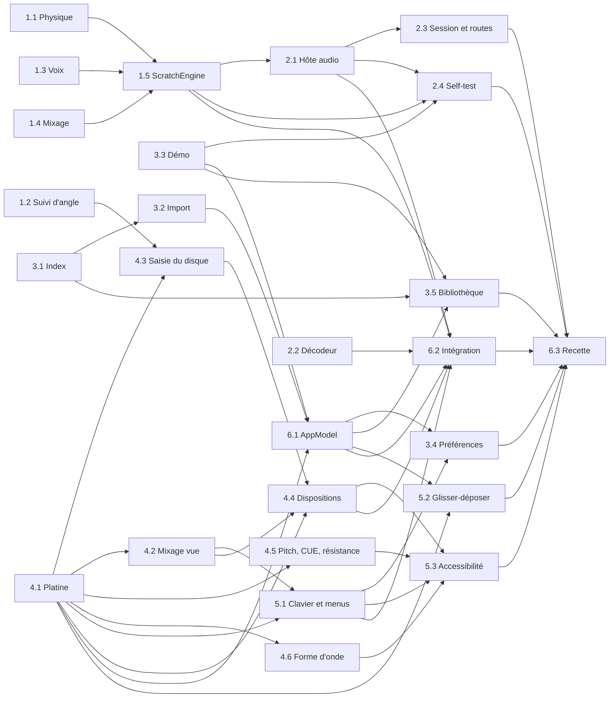

# ScratchApp — PRD (Product Requirements Document)

- **Version :** 1.2
- **Date :** 14 novembre 2026
- **Auteur :** 📋 John, Product Manager BMAD
- **Statut :** validé par 📝 Sarah (PO) le 14 novembre 2026, avec réserves : [`po-validation.md`](po-validation.md) (registre D-01 à D-47)
- **Références :** [spécifications v2.1](../specs/scratchapp_specifications_v2_1.md) (font foi ; la v2.0 est archivée), [revue v1.9 → v2.0](../specs/REVUE_v1.9_vers_v2.0.md), [charte d'équipe](TEAM.md), [`CONTRIBUTING.md`](../../CONTRIBUTING.md).
- **Artefacts liés :** [brief produit](project-brief.md) et [matrice de traçabilité](traceability.md) (Mary, fusionnés) ; spécification UX (Sally, `front-end-spec.md`) et architecture et contrats de code (Winston, `architecture.md`, story 0.2), rédigées en parallèle. Les incohérences IC-01 à IC-12 et les questions Q-01 à Q-03 renvoient au brief.

> Ce PRD ne réécrit pas la spécification : chaque exigence renvoie aux identifiants SF, RM, PO et E de la spécification (inchangés en v2.1) et aux scénarios Gherkin de sa section 6. En cas d'écart, la spécification v2.1 prime.

## 1. Objectifs et contexte

### 1.1 Objectifs

1. **Scratcher ses propres sons comme sur une double platine 33⅓ tours** : deux platines, une table de mixage et un crossfader de scratch, au doigt sur iPhone et iPad, à la souris, au trackpad et au clavier sur Mac (vision, section 1 ; E-01, E-02, E-09).
2. **Une sensation physique crédible** : moteur, feutrine, résistance du disque, rattrapage quasi immédiat au relâchement (E-03, 5.1).
3. **Un son de qualité vinyle, en temps réel** : lecture avant et arrière interpolée, sans clic, avec une latence geste→son de 20 ms au plus (E-06, SF-77, SF-78).
4. **Trois plateformes, une base de code** : iOS 17, iPadOS 17 et macOS 14, sur le package `ScratchKit`.
5. **Hors ligne et privé** : bibliothèque locale, aucune donnée envoyée (SF-20).
6. **Une qualité vérifiable à chaque PR** : cœur audio testé sous Linux, CI macOS avec self-test de scratch rendu hors ligne.
7. **Une livraison incrémentale** : le périmètre P0 donne à lui seul une app jouable sur macOS, le P1 complète la V1.

### 1.2 Contexte

La v1.9 (« Platine Scratch 33 ») décrivait une platine unique pour iPhone et iPad. La revue v2.0 corrige 22 incohérences (I-01 à I-22) et retient deux platines et une table de mixage, l'ajout de macOS, la feutrine, l'amorce et le sillon fermé, la bibliothèque minimale et le son de démonstration (E-01 à E-09, E-12). Les options P2 sont documentées mais exclues de la V1.

Le développement suit BMAD (charte `TEAM.md`) : trois développeurs travaillent en parallèle, chacun sur ses modules (💻 James : `ScratchCore` et `ScratchAudio` ; 💻 Léa : `ScratchUI` ; 💻 Hugo : `ScratchLibrary`, app et CI), sous le contrôle de 🧪 Quinn. Le squelette multiplateforme et la CI sont fusionnés (sprint 0, story 0.1, PR #1). Les contrats d'architecture (story 0.2, Winston) sont le point de départ de toutes les stories de ce PRD.

### 1.3 Indicateurs de réussite de la V1

| Indicateur | Cible |
|---|---|
| Critères de recette P0 et P1 (spec, section 7) | 100 % vérifiés et consignés dans la recette (story 6.3) |
| Latence geste→son mesurée | ≤ 20 ms sur écran 120 Hz, ≤ 30 ms sur écran 60 Hz, appareils de référence ; tampon ≤ 256 trames à 48 kHz (SF-78, D-15) |
| Self-test de scratch en CI | ✅ sur chaque PR de code et sur `main` |
| Plantages pendant la recette | 0 |
| Exigences V1 (SF, RM) rattachées à au moins une story | 100 % (section 9) |

### 1.4 Périmètre

- **V1 (P0 et P1)** : tout ce qui figure dans « Inclus en V1 » (spec, section 1), soit SF-01 à SF-24, SF-64 à SF-83, RM-01 à RM-13 et RM-47 à RM-61, et les scénarios Gherkin 6.1 à 6.16.
- **Hors V1 (P2)**, documenté dans la spec mais non planifié ici :

  | Option | Identifiants |
  |---|---|
  | Reverse motorisé (10.1) | SF-25 à SF-28, RM-14 à RM-17 |
  | Crépitement vinyle (10.2) | SF-29 à SF-34, RM-18 à RM-22, amendement de RM-01 |
  | Enregistrement du mix (10.3) | SF-35 à SF-41, RM-23 à RM-28 |
  | Gestion automatique des pointeurs (10.4) | SF-42 à SF-50, RM-29 à RM-35 |
  | Enregistrement micro, banque de sons, renommage (10.5) | SF-51 à SF-63, RM-36 à RM-46 |
  | Contrôleur MIDI, pitch ±16 % / ±50 %, retour haptique, « power down », boucle en fin de son, rechargement de session (10.7) | E-10, E-11, PO-12, PO-13 |

- **Hors périmètre** (spec, section 1) : synchronisation BPM, stems, effets complexes, export et partage avancés, plugin Logic Pro, vinyle timecode, streaming, plus de deux platines.

### 1.5 Journal des versions

| Version | Date | Auteur | Modification |
|---|---|---|---|
| 1.0 | 2026-11-14 | John (PM) | Création : objectifs, FR1 à FR32, NFR1 à NFR14, hypothèses techniques, épopées EP1 à EP6, 26 stories, plan en cinq vagues, points à arbitrer A1 à A14 (dont IC-01, IC-02, Q-01 et Q-02 du brief). |
| 1.2 | 2026-11-14 | Bob (SM) | Réaffectations de l'orchestrateur : 1.2 → Léa, 2.2 → Hugo, 5.2 → Hugo (agents en 7.1, 7.2 et 7.5, propriété des fichiers en 5.4) ; ordre de travail, chemin critique, vagues et récapitulatif mis à jour (8.1, 8.2, 8.5) avec les numéros d'issues ; stories détaillées dans `docs/stories/`. |
| 1.1 | 2026-11-14 | Sarah (PO) | Validation PO : critères des stories 1.1 à 1.4, 2.1, 2.3, 3.1 à 3.3, 4.1 à 4.3, 4.6, 5.1 à 5.3 et 6.1 à 6.3 alignés sur les décisions D-01 à D-47 (`po-validation.md`, section 5) ; NFR1 et NFR14 précisés ; références vers la spec v2.1. |

## 2. Exigences fonctionnelles

Chaque FR regroupe des exigences de la spec sans les reformuler : le texte de référence est celui des identifiants cités. La colonne « Stories » renvoie à la section 7.

| FR | Objet | Spec v2.0 | Gherkin | Prio | Stories |
|---|---|---|---|---|---|
| FR1 | Ouverture sans lecture automatique ; platine vide proposant l'import et la démo | SF-01, RM-01, RM-10 | 6.1, 6.2 | P0 | 1.5, 4.1, 6.2 |
| FR2 | Import par le sélecteur du système et copie locale durable | SF-02, RM-47, RM-48, 5.3 | 6.1 | P0 | 3.2, 6.1 |
| FR3 | Formats, canaux, fréquences et durées acceptés ; refus explicites | SF-80, SF-02 | 6.1, 6.15 | P0 (6.15 : P1) | 1.3, 2.2, 3.2 |
| FR4 | Index de bibliothèque, identité stable et empreinte | SF-74, RM-58, 5.3 | 6.13 | P0 | 3.1 |
| FR5 | Dédoublonnage par contenu | SF-75, RM-58 | 6.1 | P0 | 3.2 |
| FR6 | Son de démonstration intégré | SF-76, RM-01, E-08 | 6.1, 6.13 | P0 | 3.3, 6.1 |
| FR7 | Chargement, état initial et remplacement d'un son | SF-03, SF-15, RM-57 | 6.1, 6.5 | P0 (confirmation : P1) | 1.5, 6.1 |
| FR8 | Deux platines identiques et indépendantes | SF-64, RM-51, RM-57 | 6.8 | P0 | 1.5, 4.1 |
| FR9 | Moteur START/STOP, 33⅓ et 45 RPM | SF-04, SF-05, RM-02, RM-50 | 6.2 | P0 | 1.1, 4.1, 5.1 |
| FR10 | Feutrine, couple moteur, durées et rattrapage réglables | SF-68, RM-53, RM-54 | 6.9, 6.2 | P0 | 1.1, 3.4 |
| FR11 | Prise en main, scratch avant et arrière, vitesse du geste, relâchement | SF-06 à SF-10, RM-03 à RM-05, RM-07 | 6.3 | P0 | 1.1, 1.3, 1.5, 4.3 |
| FR12 | Géométrie et règles de saisie du geste | RM-60, RM-61, 5.1 §5 | 6.3 (« Gestes particuliers ») | P0 | 1.2, 4.3 |
| FR13 | Qualité audio du scratch | SF-09, SF-77, RM-08, E-06 | 6.3 | P0 | 1.3 |
| FR14 | Bornes, amorce silencieuse et sillon fermé | SF-14, SF-72, RM-09, RM-55, E-05 | 6.12 | P0 (SF-14) / P1 | 1.3, 4.6 |
| FR15 | Résistance du vinyle | SF-21 à SF-24, RM-11 à RM-13, RM-54 | 6.7 | P1 | 1.1, 4.5, 3.4 |
| FR16 | Pitch −8 % à +8 % et remise à zéro | SF-11 | 6.6 | P1 | 1.1, 4.5, 5.1 |
| FR17 | Points CUE (SET CUE / CUE) | SF-13 | 6.6 | P1 | 1.5, 4.5, 5.1 |
| FR18 | Table de mixage : faders, crossfader, VU-mètres, limiteur | SF-12, SF-65, RM-06, RM-52 | 6.4, 6.8 | P0 | 1.4, 4.2 |
| FR19 | Courbe du crossfader et hamster | SF-66, SF-67, 5.2, E-02 | 6.4, 6.10 | P0 (coupure franche) / P1 | 1.4, 4.2 |
| FR20 | Repère visuel, forme d'onde et needle drop | SF-69, SF-70, SF-71, E-04 | 6.11 | P1 | 1.5, 4.1, 4.6 |
| FR21 | Multitouch : deux disques et crossfader simultanés | SF-19 | 6.8 | P0 | 1.2, 4.2, 4.3 |
| FR22 | Dispositions iPhone, iPad et Mac | 3.4 | 6.8 | P0 | 4.1, 4.4 |
| FR23 | Commandes Mac : souris, trackpad, clavier et menus | SF-79, RM-59, 3.5, E-09 | 6.14, 6.1 | P0 | 1.2, 1.4, 4.3, 5.1 |
| FR24 | Glisser-déposer sur une platine | SF-73 | 6.13 | P1 | 5.2, 6.1 |
| FR25 | Sortie audio active, USB, changements de route, sortie indisponible | SF-16, SF-82 | 6.5 | P0 (sortie par défaut) / P1 | 2.1, 2.3, 4.2, 6.2 |
| FR26 | Interruptions et cycle de vie | SF-18, SF-81, RM-10, RM-56 | 6.5 | P1 (Mac : P0) | 2.1, 2.3, 6.2 |
| FR27 | Préférences conservées sans lecture automatique | SF-17, SF-24, PO-12 | 6.5, 6.7, 6.10 | P1 | 3.4 |
| FR28 | Écran Réglages et aide des raccourcis | 3.3 | 6.2, 6.9 | P1 | 3.4, 5.1 |
| FR29 | Bibliothèque : liste, chargement sur A ou B, suppression | SF-74, RM-49, E-07 | 6.13 | P1 | 3.5, 6.1 |
| FR30 | Informations affichées : titre, durée, position, sortie active | 3.1, 3.2, SF-03 | 6.1, 6.5 | P0 | 4.1, 4.2 |
| FR31 | Accessibilité de base | SF-83, E-12 | 6.16 | P1 | 4.5, 5.3 (et chaque story UI) |
| FR32 | Application vérifiée en CI : compilation, tests, self-test, lancement | Section 7 (P0, dernier critère) | — | P0 | 2.4, 6.2, 6.3 |

## 3. Exigences non fonctionnelles

| NFR | Objet | Exigence | Vérification | Stories |
|---|---|---|---|---|
| NFR1 | Latence et tampon | SF-78 : tampon de 256 trames à 48 kHz (≈ 5,3 ms) au plus quand le matériel le permet ; latence geste→son ≤ 20 ms sur écran 120 Hz et ≤ 30 ms sur écran 60 Hz, sur les appareils de référence (iPhone 13 ou plus récent, iPad à puce M1 ou plus récente, Mac Apple Silicon ; D-14), mesurée de l'horodatage système de l'événement à la sortie du son, latence de sortie annoncée incluse, hors sorties Bluetooth et AirPlay (D-15). Toutes les touches regroupées sont exploitées ; les touches prédites ne comblent que l'attente du rejeu (D-16). Les événements de geste et de crossfader partent vers le moteur dans le cycle d'événements qui les reçoit, sans attendre un rafraîchissement de l'interface. | Tampon effectif et latence de sortie publiés (2.1) ; mesure consignée en recette (6.3, PO-07) | 1.2, 2.1, 4.2, 4.3, 6.3 |
| NFR2 | Temps réel | Dans le fil de rendu : aucune allocation, aucun verrou bloquant, aucun appel Objective-C ou Swift susceptible d'allouer (journalisation, tableaux dynamiques, chaînes, closures créées à la volée), aucune entrée-sortie. Interface → audio : file SPSC sans verrou, bornée, qui ne bloque jamais quand elle est pleine. Audio → interface : instantané d'état lu sans verrou. Un clip remplacé n'est jamais libéré dans le fil de rendu. | Test de comptage d'allocations (1.5) ; revue QA de chaque PR (case du modèle de PR) | 1.1 à 1.5, 2.1 |
| NFR3 | Charge CPU | Rendu de 256 trames, deux platines à ±16× avec anti-repliement : 30 % au plus de la durée du tampon sur Mac Apple Silicon. | Mesure de performance (1.5), indicative en CI | 1.3, 1.5 |
| NFR4 | Mémoire | Deux sons distincts de 10 min (SF-80) chargés sur les deux platines sans plantage ni alerte mémoire (PCM Float32 stéréo à 48 kHz : ≈ 230 Mo par son). Un même son chargé sur A et B n'est pas dupliqué. Un son remplacé est libéré : empreinte stable après 20 remplacements. Pic de décodage ≤ 1,5 × la taille du clip. Forme d'onde ≤ 2 Mo par son. Empreinte totale cible ≤ 650 Mo. | Mesure en recette (6.3) ; alimente PO-16 | 1.5, 2.2, 4.6, 6.1, 6.3 |
| NFR5 | Plateformes | iOS 17+ et iPadOS 17+ (iPhone et iPad, une seule cible), macOS 14+ (app native, pas Catalyst) ; fenêtre Mac de 960 × 600 points au minimum (3.4). | Builds macOS et iOS (simulateur) en CI | toutes |
| NFR6 | Hors ligne | Toutes les fonctions V1 marchent sans réseau ; aucune ressource téléchargée ; son de démonstration intégré (SF-20). | Recette réseau coupé (6.3) | 3.3, 6.2 |
| NFR7 | Aucune donnée sur le réseau | Aucune requête réseau ; aucun SDK tiers d'analyse, de publicité ou de rapport de plantage ; aucun droit réseau dans le bac à sable macOS ; manifeste de confidentialité « aucun suivi, aucune donnée collectée » ; fichiers confinés au bac à sable (5.3). | Contrôle CI de l'absence d'API réseau (6.2) ; revue | 6.2 |
| NFR8 | Accessibilité | SF-83 : libellés et valeurs VoiceOver, actions d'ajustement, navigation clavier sur Mac (platine A, table, platine B), contraste WCAG AA (≥ 4,5:1) des libellés. Aucune fonction essentielle n'est réservée au geste sur le disque. | Liste de contrôle (5.3) ; recette (6.3) | 4.1 à 4.6, 5.1, 5.3 |
| NFR9 | Cœur portable | `ScratchCore` et `ScratchLibrary` compilent et passent leurs tests sous Linux (`swift:6.0-jammy`, mode de langage 5) : Foundation et swift-atomics uniquement ; ni AVFoundation, SwiftUI, Combine, CryptoKit, UIKit ni AppKit. | Job CI Linux ; `scripts/linux-test.sh` | EP1, EP3 |
| NFR10 | CI verte | Chaque PR de code passe les jobs Linux et macOS (tests, build macOS, build iOS, self-test, lancement et capture) avant fusion. Aucun test n'est désactivé pour passer. Les PR de documentation seule n'exécutent pas la CI. | Rapport CI de chaque PR | toutes |
| NFR11 | Testabilité et traçabilité | Chaque exigence testable a un test XCTest qui cite son identifiant SF ou RM. Le cœur est déterministe : un même flux de commandes horodatées à l'échantillon produit la même sortie. | Revue QA ; tests de rendu hors ligne (1.5, 2.4) | toutes |
| NFR12 | Robustesse | Aucune erreur de fichier, de stockage ou de sortie audio ne provoque de plantage (SF-82, RM-48). Écritures atomiques ; index illisible récupéré. | Tests d'erreur (2.2, 3.1, 3.2) ; recette | EP2, EP3, EP6 |
| NFR13 | Fluidité d'affichage | Disque, repère et forme d'onde à 60 i/s au moins (120 i/s sur écran ProMotion) ; lecture de l'instantané sans attente (SF-70). | Recette ; Instruments | 4.1, 4.6 |
| NFR14 | Langue | Interface et documentation en français ; identifiants et noms de types en anglais ; commentaires de documentation (`///`) en français, commentaires techniques en ligne (`//`) en anglais (`CONTRIBUTING.md`, D-42). | Revue | toutes |

## 4. Objectifs de design de l'interface

La spécification UX détaillée est rédigée par Sally (`docs/bmad/front-end-spec.md`). Elle fait foi pour le design ; ce PRD n'en fixe que les objectifs.

- **L'instrument d'abord** : l'écran principal est une installation de scratch, platine A, table de mixage, platine B. Disques et crossfader dominent la surface ; jouer ne demande aucun écran intermédiaire.
- **Manipulation directe et retour immédiat** : le disque, le plateau, le repère, les VU-mètres et la forme d'onde suivent l'instantané du moteur à la cadence d'affichage (NFR13).
- **Pas de fenêtre modale pendant le jeu**, sauf les confirmations exigées par la spec (remplacement SF-15, suppression SF-74) et les erreurs d'import.
- **Écrans** : console principale ; bibliothèque (feuille ou panneau) ; réglages ; dialogues ; état « Sortie audio indisponible ».
- **Dispositions par appareil** selon 3.4 : iPhone au pouce en portrait, deux platines en paysage, iPad et Mac en A | table | B.
- **Mac clavier d'abord** : raccourcis de 3.5, menus Fichier, Platine et Table (SF-79).
- **Accessibilité** dès la conception (NFR8).
- **Identité visuelle propre** : platine sombre, repère contrasté, valeurs lisibles (pitch, position), sans reprendre le nom ni l'apparence d'une marque de platine ou de table existante.

## 5. Hypothèses techniques

### 5.1 Socle

- **Langage et interface :** Swift 5.10 (mode de langage 5), SwiftUI et Observation (`@Observable`), iOS 17 et macOS 14 minimum.
- **Audio :** AVAudioEngine avec un `AVAudioSourceNode` qui appelle le moteur ; mode de rendu manuel hors ligne pour le self-test.
- **Package `ScratchKit`** à quatre modules (graphe du sprint 0) :
  - `ScratchCore` : physique, rendu, mixage, suivi d'angle du geste, moteur `ScratchEngine` ; Swift pur, dépend de swift-atomics ; testé sous Linux.
  - `ScratchLibrary` → `ScratchCore` : bibliothèque, copies, SHA-256, son de démonstration, préférences ; Foundation ; testé sous Linux.
  - `ScratchAudio` → `ScratchCore`, `ScratchLibrary` : hôte AVAudioEngine, décodage, session et routes, self-test ; Apple uniquement.
  - `ScratchUI` → `ScratchCore`, `ScratchLibrary`, `ScratchAudio` : vues SwiftUI, modèles de présentation, AppModel ; Apple uniquement.
- **Projet Xcode** généré par XcodeGen (`project.yml`) : cibles `ScratchApp-iOS` (iPhone et iPad, partage de fichiers activé) et `ScratchApp-macOS` (bac à sable, lecture des fichiers choisis par l'utilisateur).
- **CI GitHub Actions** : Linux (`swift test` sur `ScratchCore` et `ScratchLibrary`) et macOS 15 (`swift test`, build macOS, build iOS simulateur, `ScratchApp --selftest`, lancement et capture d'écran).
- **Dépendances tierces :** swift-atomics seulement. Toute nouvelle dépendance passe par l'architecte.
- **SHA-256 :** implémentation portable, sans CryptoKit (NFR9).
- **Préférences :** `UserDefaults` (disponible sous Linux), derrière un protocole injectable.

### 5.2 Architecture attendue

L'architecture détaillée est rédigée par Winston (`docs/bmad/architecture.md`). Le PRD suppose qu'elle repose sur :

- un moteur **`ScratchEngine`** temps réel dans `ScratchCore`, piloté par une **file de commandes SPSC** sans verrou et publiant un **instantané d'état** que l'interface lit à la cadence d'affichage ;
- un type **`AudioClip`** immuable (PCM Float32, fréquence, nombre de trames), partageable entre platines ;
- un **protocole de décodage** défini dans le cœur et implémenté dans `ScratchAudio` (AVFoundation) ; les tests Linux utilisent un décodeur factice ;
- un **protocole de bibliothèque** défini dans le cœur et implémenté dans `ScratchLibrary` ;
- une **façade moteur** (envoi de commandes, lecture de l'instantané) qui permet à l'interface d'avancer sur un faux moteur avant le branchement réel.

**Recommandation du PM, à trancher par l'architecte (point A8) :** appliquer la conversion de fréquence à la volée dans la voix de lecture (rapport fréquence du clip / fréquence de sortie), plutôt qu'au décodage. Un changement de périphérique sur Mac (6.5) ne demande alors aucun nouveau décodage.

### 5.3 Attendus de la story 0.2 « contrats d'architecture »

Toutes les stories dépendent de 0.2. Le PRD attend au minimum :

1. `AudioClip` et ses métadonnées (identifiant, titre, durée, fréquence).
2. Les commandes du moteur : chargement et déchargement, START/STOP, RPM, pitch, résistance, durées de démarrage et de freinage, rattrapage, événements de geste (saisie, angle cible horodaté, relâchement), SET CUE, CUE, positionnement, faders, crossfader, courbe, hamster, coupure momentanée, arrêt général.
3. L'instantané : par platine (chargement, durée, position, angle du disque, angle du plateau, angle du repère, état moteur, tenue, RPM, pitch, résistance, CUE) ; mixeur (gains, VU-mètres, limiteur) ; sortie (nom, état, fréquence, tampon effectif).
4. La façade moteur utilisée par l'interface, et l'API de rendu appelée par l'hôte audio.
5. Le protocole de décodage (sonde rapide et décodage complet) et ses erreurs typées (non pris en charge, protégé, corrompu ou vide, trop long, trop court).
6. Le protocole de bibliothèque (entrées, import, URL locale, suppression, entrée de démonstration) et ses erreurs (dont espace insuffisant).
7. Les unités : angles en radians, positions en secondes, temps du moteur en échantillons.

### 5.4 Propriété des fichiers

Pour paralléliser sans conflits, chaque dossier a un propriétaire. Toute modification hors de ses dossiers se signale dans la PR.

| Chemin | Propriétaire | Stories |
|---|---|---|
| `Sources/ScratchCore/Contracts/` | 🏗️ Winston (0.2) ; changements par story dédiée ou avec son accord | 0.2 |
| `Sources/ScratchCore/{Physics,Voice,Mixer,Engine,Diagnostics}/`, `TurntableConstants.swift` | 💻 James | 1.1, 1.3 à 1.5 |
| `Sources/ScratchCore/Gesture/` | 💻 Léa (réaffectation de 1.2) ; emploi des touches prédites dans `Physics/FingerTrajectory.swift` relu par James (D-16) | 1.2 |
| `Sources/ScratchAudio/` (sauf le décodeur) | 💻 James | 2.1, 2.3, 2.4 |
| `Sources/ScratchAudio/AudioFileDecoder.swift` et fichiers du décodeur, `Tests/ScratchAudioTests/AudioFileDecoderTests.swift` | 💻 Hugo (réaffectation de 2.2) | 2.2 |
| `Sources/ScratchLibrary/` | 💻 Hugo | 3.1 à 3.4 |
| `Sources/ScratchUI/{Deck,Mixer,Input,Layout,Waveform,Mac,Preview}/`, `RootView.swift` | 💻 Léa | 4.1 à 4.6, 5.1, 5.3 |
| `Sources/ScratchUI/{App,Library,Settings}/` | 💻 Hugo | 3.4, 3.5, 5.2 (zone de dépôt dans `Library/`, réaffectation), 6.1, 6.2 |
| `App/`, `project.yml`, `.github/workflows/` | 💻 Hugo | 6.1, 6.2 |
| `Package.swift` | architecte (orchestrateur) | — |
| `docs/qa/` | 🧪 Quinn | 6.3 |

Points de contact entre développeurs, tous définis par une story amont :

- le **protocole d'intentions** de l'interface (importer, charger la démo, déposer un fichier, ouvrir la bibliothèque ou les réglages) est défini par Léa en 4.1 et implémenté par Hugo en 6.1 ;
- le **suivi d'angle** (1.2, Léa depuis la réaffectation) est consommé par la saisie du disque (4.3, Léa) ; l'emploi des touches prédites par le moteur (1.2, D-16) touche `FingerTrajectory` (James), relu par lui ;
- la **zone de dépôt** (5.2, Hugo) s'applique à la vue de platine de Léa (une ligne dans `Deck/DeckView.swift`, signalée) ;
- les **commandes de menu** et la **vue d'aide des raccourcis** (5.1, Léa) sont attachées à la scène en 6.2 et intégrées aux réglages en 3.4 (Hugo) ;
- le **scénario de scratch hors ligne** (1.5, James, dans `ScratchCore/Diagnostics/`) est réutilisé par le self-test (2.4) avec le son de démonstration (3.3, Hugo).

### 5.5 Stratégie de test

- **Linux** (`ScratchCore`, `ScratchLibrary`) : tests unitaires et tests de rendu hors ligne déterministes (physique, voix, mixage, suivi d'angle, moteur, bibliothèque, démo, préférences).
- **macOS** : tests de `ScratchAudio` (décodeur sur fichiers générés, hôte en rendu manuel), tests des modèles de présentation de `ScratchUI` avec le faux moteur, self-test de l'app.
- **Non automatisé en CI** (pas de tests d'interface) : multitouch, latence tactile, interruptions, casque, USB, VoiceOver. Ces points sont vérifiés en recette (6.3) et listés quand ils exigent un appareil physique.

## 6. Liste des épopées

| Épopée | Titre | Module(s) | Dev | Objectif | Stories |
|---|---|---|---|---|---|
| EP1 | Cœur audio temps réel (physique des platines, rendu, table de mixage) | ScratchCore | 💻 James | Un moteur `ScratchEngine` déterministe, testé sous Linux, qui transforme gestes et commandes en audio stéréo conforme au modèle 5.1, à SF-77 et à 5.2, sans allocation dans le rendu. | 1.1 à 1.5 |
| EP2 | Moteur audio Apple (AVAudioEngine, décodage, session, self-test) | ScratchAudio | 💻 James | Faire sonner le cœur sur la sortie du système avec une faible latence, décoder les fichiers, gérer session et routes, et prouver tout le pipeline par un self-test de scratch en CI. | 2.1 à 2.4 |
| EP3 | Bibliothèque locale et préférences | ScratchLibrary | 💻 Hugo | Copier, vérifier, indexer, dédoublonner et retrouver les sons hors ligne ; fournir le son de démonstration ; conserver les réglages. | 3.1 à 3.5 |
| EP4 | Interface : platines, table de mixage, forme d'onde, dispositions | ScratchUI | 💻 Léa | Platines, table de mixage, saisie du disque, forme d'onde et dispositions iPhone, iPad et Mac, sur des modèles de présentation testables avec un faux moteur. | 4.1 à 4.6 |
| EP5 | Commandes Mac, glisser-déposer et accessibilité | ScratchUI, App | 💻 Léa | Scratcher au clavier et à la souris sur Mac, importer par dépôt de fichier, rendre l'app utilisable avec VoiceOver et le clavier. | 5.1 à 5.3 |
| EP6 | Intégration de l'application, cycle de vie et recette | App, ScratchUI (AppModel), CI | 💻 Hugo + 🧪 Quinn | Composer l'app autour du vrai moteur, gérer le chargement, le cycle de vie et la confidentialité, puis recetter la V1 sur macOS. | 6.1 à 6.3 |

## 7. Détail des épopées et des stories

### 7.0 Conventions

- **Numérotation** `N.n` ; fichier `docs/stories/N.n.<slug>.md`, branche `story/N.n-<slug>` (slugs proposés en 8.5).
- **Priorité** : P0 = indispensable à l'app jouable ; P1 = complément de la V1. Une story P0 peut porter, à coût marginal, un critère issu d'un scénario P1 ; c'est alors signalé (point A5).
- **Dépendances** : toutes les stories dépendent de **0.2 « contrats d'architecture »** (Winston) et du squelette 0.1 (fusionné). Seules les autres dépendances sont listées en plus.
- **Taille visée** : une PR de 300 à 900 lignes, tests compris.
- **Critères d'acceptation (CA)** : numérotés et vérifiables ; chacun cite ses identifiants SF/RM et ses scénarios Gherkin. Les seuils marqués « tolérance de test » sont des valeurs de vérification proposées par le PM, ajustables par l'architecte sans changer l'exigence.
- **Définition de « terminé »** : celle de `TEAM.md` (CA satisfaits et testés, CI ✅ Linux et macOS, gate QA, fusion).
- **Accessibilité** : chaque story d'interface livre les libellés VoiceOver de ses propres commandes ; 5.3 complète et audite l'ensemble.

### 7.1 EP1 — Cœur audio temps réel (ScratchCore) — 💻 James

Toutes les stories de l'épopée sont du Swift pur, testées sous Linux, et ne font aucune allocation dans les fonctions appelées par le rendu.

#### Story 1.1 — Modèle physique de la platine : plateau, feutrine, disque et résistance

- **Agent :** 💻 James · **Module :** ScratchCore (`Physics/`) · **Priorité :** P0 · **Taille :** ~700 lignes
- **Dépendances :** 0.2
- **Récit :** En tant que DJ, je veux que chaque platine réagisse comme une vraie platine à entraînement direct munie d'une feutrine, afin que le démarrage, le freinage, la retenue et le relâchement du disque aient une sensation et un son crédibles.
- **Critères d'acceptation :**
  1. Le plateau suit 5.1 §1 : ωp tend vers ωt = 2π × RPM/60 × (1 + pitch) moteur actif, vers 0 sinon, avec des pentes linéaires ωt / durée de démarrage et ωt / durée de freinage (SF-04, SF-05). Avec les durées par défaut, ωt est atteint en 0,7 s et l'arrêt en 1,0 s, à 1 ms près (tolérance de test) (6.2 « Démarrer la platine à 33 tours », « Arrêter la platine »).
  2. Les durées de démarrage et de freinage sont réglables de 0,1 à 5 s ; une valeur hors bornes est ramenée dans l'intervalle (SF-68 ; 6.9 « Démarrage court », 6.2 « Régler les durées de démarrage et de freinage »).
  3. Les vitesses cibles du tableau de 6.6 « Modifier le pitch » sont obtenues à 0,01 RPM près à 33⅓ et à 45 RPM ; le pitch est borné à ±8 % et quantifié au pas de 0,1 % (SF-11, RM-50). Un changement de RPM ou de pitch en rotation rejoint la nouvelle cible par une rampe, sans discontinuité de ωp (6.2 « Sélectionner 45 tours », « Modifier la vitesse pendant la lecture » ; 6.6 « Remettre le pitch à zéro »).
  4. START pendant le freinage réaccélère depuis la vitesse courante, sans discontinuité (6.2 « Appuyer sur START pendant le freinage ») ; START sans son fait tourner le plateau (6.2 « Démarrer sans fichier »).
  5. Feutrine : moteur actif, ωp et l'état START/STOP ne dépendent jamais de la tenue du disque (RM-53 ; 6.9 « Le plateau tourne sous le disque retenu »). STOP pendant la tenue : le plateau s'arrête sous le disque, qui reste tenu ; au relâchement, aucune reprise motorisée (RM-07 ; 6.2 « Appuyer sur STOP pendant que je retiens le disque »).
  6. Disque relâché moteur actif : ωd rejoint ωp selon le temps de rattrapage T réglable de 0 à 300 ms (60 ms par défaut), par une réponse du premier ordre de constante τ = T/3. Critère (D-03) : au terme de T, l'écart |ωd − ωp| est réduit à 5 % au plus de sa valeur au relâchement (95 % de ωp pour un disque relâché immobile) ; à 0 ms, la vitesse du plateau est rejointe dès le tampon suivant, sans discontinuité de position (SF-10, SF-68 ; 6.3 « Relâcher le disque moteur actif », « Lancer le son depuis le repère (release) » ; 6.9 « Rattrapage réglable », « Rattrapage plus lent »).
  7. Disque relâché moteur arrêté : un disque lancé ralentit par friction constante (décroissance linéaire de ωd, D-03) et s'arrête 150 ms au plus après le relâchement ; aucune lecture motorisée ne démarre (SF-10 ; 6.3 « Relâcher le disque moteur arrêté »).
  8. Disque tenu : θd suit θf par un filtre du second ordre à amortissement critique, de constante de temps 2 ms (résistance 0 %) à 35 ms (100 %) (5.1 §3, SF-06). Doigt fixe : ωd s'annule (à 10⁻³ de la vitesse nominale près) après cinq constantes de temps, y compris à 100 % (RM-12 ; 6.3 « Poser le doigt sur le disque », « Maintenir un disque immobile » ; 6.7 « Conserver la possibilité d'arrêter le disque »). La saisie d'un disque en rotation initialise le filtre sur l'angle et la vitesse courants, sans saut (6.3 « Saisir le disque en rotation »).
  9. Résistance (critères P1 portés par cette story, point A5) : à geste identique, la crête d'accélération de ωd est plus faible à 90 % qu'à 10 % (SF-22 ; 6.7 « Réduire la résistance », « Augmenter la résistance ») ; un geste arrière soutenu à 90 % donne ωd < 0 sans inversion parasite (RM-12 ; 6.7 « Scratcher en sens inverse avec une résistance élevée ») ; une variation de résistance pendant la tenue ne crée aucune discontinuité de θd ni de ωd (SF-23, RM-13 ; 6.7 « Modifier la résistance pendant le scratch ») ; la résistance ne modifie ni ωp, ni les durées moteur, ni le rattrapage (RM-11, RM-54 ; 6.7 « Ne pas modifier la vitesse nominale », « La résistance ne ralentit pas le rattrapage »).
  10. Le modèle avance à la fréquence audio (par échantillon ou par sous-bloc borné), sans allocation ; les tests XCTest s'exécutent sous Linux et citent leurs identifiants.

#### Story 1.2 — Suivi d'angle du geste

- **Agent :** 💻 Léa (réaffectée, v1.2) · **Module :** ScratchCore (`Gesture/`) · **Priorité :** P0 · **Taille :** ~650 lignes (touches prédites comprises, D-16)
- **Dépendances :** 0.2
- **Récit :** En tant que DJ, je veux que la rotation de mon doigt, de ma souris ou de mon trackpad soit convertie fidèlement en angle de disque, afin que le scratch suive exactement mon geste, sans saut.
- **Critères d'acceptation :**
  1. L'angle du contact est mesuré par `atan2` autour du centre du disque et déplié : un geste continu de +3 tours donne +6π rad à 10⁻⁶ près, sans saut à ±π ; gain 1:1 (5.1 §5, RM-04).
  2. Un contact ne saisit un disque que s'il commence dans son rayon ; un contact qui y entre en glissant ne le saisit pas (RM-60 ; 6.3 « Geste commencé hors du disque »).
  3. Un seul contact propriétaire par disque ; tout autre contact sur ce disque est ignoré jusqu'au relâchement (RM-60 ; 6.3 « Deuxième doigt sur le même disque »). Deux disques sont suivis indépendamment (SF-19 ; 6.8 « Scratcher les deux disques en même temps sur iPad »).
  4. Une annulation par le système vaut relâchement ; aucun état « tenu » ne subsiste (RM-60 ; 6.3 « Toucher annulé par le système »).
  5. Zone centrale (rayon < 12 % du rayon du disque) : le contact retient le disque sans le faire tourner ; en sortie de zone, le suivi reprend depuis l'angle courant, sans saut (RM-61 ; 6.3 « Doigt posé au centre du disque »).
  6. Les échantillons de contact sont horodatés et acceptés par lots (touches regroupées) ; un échantillon prédit est remplacé par l'échantillon réel correspondant, sans erreur cumulée (SF-78). Les touches prédites ne servent qu'à combler l'attente du rejeu entre deux lots, sans dépassement dans le mauvais sens aux inversions ; leur emploi est décidé et calibré dans cette story (D-16, PO-07).
  7. Défilement à deux doigts : les deltas sont convertis en rotation selon la formule de la spec UX (§6.3 : la surface du disque sous le pointeur suit les doigts) ; l'inertie du défilement est ignorée ; un cran de molette classique vaut 15° ; un défilement commencé hors du disque ne le saisit pas (D-24) ; la session est relâchée 80 ms après le dernier événement, mesurés sur une horloge injectée (SF-79 ; 6.14 « Scratcher au trackpad »).
  8. Un changement de géométrie du disque (centre, rayon) pendant un geste ne produit aucun saut d'angle (6.14 « Redimensionner la fenêtre pendant un scratch »).
  9. La sortie est la suite d'événements de geste du contrat 0.2 (saisie, angle cible horodaté, relâchement) pour une platine donnée ; aucune dépendance à UIKit ou AppKit ; tests Linux.

#### Story 1.3 — Voix de lecture : tête, bornes et interpolation

- **Agent :** 💻 James · **Module :** ScratchCore (`Voice/`) · **Priorité :** P0 · **Taille :** ~850 lignes
- **Dépendances :** 0.2
- **Récit :** En tant que DJ, je veux que le son suive la vitesse du disque dans les deux sens avec une qualité de vinyle, afin d'entendre un vrai scratch, sans clic ni grésillement.
- **Critères d'acceptation :**
  1. La tête est intégrée à la fréquence audio : p += ωd / (2π) × 1,8 s × dt (5.1 §4) ; un tour de disque déplace la tête de 1,8 s à un échantillon près (RM-04, RM-50).
  2. Lecture avant et arrière réelle du son chargé, sans son préenregistré (RM-05 ; SF-07, SF-08 ; 6.3 « Pousser le disque vers l'avant », « Faire reculer le disque », « Faire un scratch avant-arrière », « Varier la vitesse du scratch »).
  3. Interpolation au moins cubique (SF-77) : une sinusoïde de 1 kHz lue entre 0,25× et 2× s'écarte du signal analytique de −60 dB au plus (tolérance de test).
  4. Anti-repliement au-delà de 2× (SF-77, D-13) : lue à 3× avec une sortie à 48 kHz, une sinusoïde de 12 kHz, qui dépasserait la fréquence de Nyquist, ne produit que des composantes repliées inférieures d'au moins 40 dB au niveau de la sinusoïde.
  5. Vitesse de lecture bornée à ±16× ; paramètres lissés à la fréquence audio, de sorte que des angles de doigt reçus à 60–120 Hz ne produisent aucune marche de vitesse (SF-77, 5.1 §4). Test : sinusoïde de 200 Hz scratchée, énergie au-delà de 8 kHz ≤ −50 dBFS (tolérance de test).
  6. Inversions sans discontinuité : un baby scratch de huit inversions par seconde sur un quart de tour respecte le critère précédent et revient au point de départ à ±10 ms (6.3 « Enchaîner des inversions rapides (baby scratch) »).
  7. À vitesse nulle, aucun nouvel échantillon n'est parcouru et la sortie est silencieuse (6.3 « Maintenir un disque immobile »).
  8. Bornes : p reste dans [−2 s ; durée] (SF-14) ; l'amorce est un silence virtuel (SF-72) ; aucun accès hors du tampon du clip, y compris pour les points d'interpolation voisins des bornes (RM-09) ; les tests aux bornes passent aussi sous AddressSanitizer.
  9. Sillon fermé et butée d'amorce (RM-55) : en avançant au-delà de la fin, la tête reste à la fin et le son s'arrête sans clic ; un mouvement arrière revient immédiatement dans le son, sans dérouler les tours ; même comportement à −2 s en reculant ; un demi-tour arrière depuis 0 s place la tête à −0,9 s ; un son de 0,2 s scratché sur un quart de tour ne clique pas aux bornes (6.12 : les cinq scénarios).
  10. Repositionnement lissé : la primitive de saut de position (CUE, needle drop) applique un fondu enchaîné de 5 ms au plus (SF-13, SF-71).
  11. La hauteur nominale ne dépend pas de la fréquence du clip (22,05 à 96 kHz) pour une fréquence de sortie donnée, selon la stratégie de conversion fixée par 0.2 (SF-80 ; 6.15 « Lire un son à la bonne hauteur quelle que soit sa fréquence »).
  12. Rendu sans allocation ; tests Linux.

#### Story 1.4 — Table de mixage : gains, courbe, hamster, coupures et limiteur

- **Agent :** 💻 James · **Module :** ScratchCore (`Mixer/`) · **Priorité :** P0 · **Taille :** ~600 lignes
- **Dépendances :** 0.2
- **Récit :** En tant que DJ scratch, je veux une table de mixage dont le crossfader coupe net et ne touche jamais à la lecture, afin de rythmer mes scratchs entre A et B.
- **Critères d'acceptation :**
  1. Gain d'une voie = fader de voie × gain du crossfader pour cette voie (SF-65, RM-52). Valeurs initiales : faders à 100 %, crossfader au centre, courbe « coupure franche », hamster désactivé (3.2, SF-66).
  2. Courbe conforme à 5.2 : le tableau de 6.10 « Gain des voies selon la courbe » est respecté à ±0,05 ; en courbe douce, chaque voie est à −3 dB ± 0,5 dB au centre (6.4 « Crossfader en position intermédiaire avec courbe douce ») ; en coupure franche, la voie est à plein niveau en 3 % de course au plus depuis la butée opposée (SF-66 ; 6.4 « Ouvrir la voie avec un déplacement minimal (cut-in) ») ; les valeurs intermédiaires de la courbe varient de façon monotone (5.2). La courbe intermédiaire est livrée dès le P0 (D-02).
  3. Lissage à la fréquence audio : faders et crossfader en 5 ms au plus ; temps de montée de 1 ms au plus en coupure franche (RM-52, RM-08).
  4. Hamster (critère P1 porté par cette story, D-02, D-19) : le sens du crossfader est inversé ; la bascule est lissée en 5 ms au plus, sans clic (SF-67 ; 6.10 « Activer le hamster »).
  5. Coupure momentanée par platine (« transformer », 3.5) : gain de la voie = fader de voie × (coupure ouverte ? 1 : gain du crossfader) (RM-52, D-06), avec la même montée qu'en coupure franche ; un fader de voie à 0 garde la voie muette ; une voie dont le gain de crossfader vaut déjà 1 n'est pas modifiée ; `F` et `J` visent les voies A et B quel que soit le hamster (IC-06 ; 6.14 « Couper le son au clavier pendant un scratch à la souris »).
  6. Les gains n'agissent que sur le niveau : position et vitesse de chaque platine sont identiques, à l'échantillon près, avec ou sans mouvement du mixeur (SF-12, RM-06 ; 6.4 « Fermer complètement la voie A au crossfader », « Ouvrir la voie A au crossfader », « Fader de voie »).
  7. Sortie sans écrêtage numérique (marge et limiteur doux) : deux sinusoïdes à 0 dBFS, crossfader au centre en coupure franche, donnent une crête de sortie ≤ −0,1 dBFS et lèvent l'indicateur de limitation (SF-65 ; 6.8 « Pas de saturation à la somme des deux voies »).
  8. Un VU-mètre par voie et un indicateur de saturation de sortie sont publiés dans l'instantané (3.2, SF-65). Niveau de voie après le fader de voie, avant le crossfader (D-26) ; « limiteur actif » dès 1 dB de réduction (D-13).
  9. Sans allocation ; tests Linux.

#### Story 1.5 — ScratchEngine : deux platines, commandes et instantané

- **Agent :** 💻 James · **Module :** ScratchCore (`Engine/`, `Diagnostics/`) · **Priorité :** P0 · **Taille :** ~900 lignes
- **Dépendances :** 0.2, 1.1, 1.3, 1.4
- **Récit :** En tant que DJ, je veux que les deux platines et la table de mixage soient rendues ensemble en temps réel, afin de jouer A et B simultanément sans que l'une perturbe l'autre.
- **Critères d'acceptation :**
  1. `ScratchEngine` implémente le contrat 0.2 : il vide la file de commandes SPSC au début de chaque rendu, rend N trames stéréo (deux platines et mixeur) et publie l'instantané défini en 5.3.
  2. Indépendance : aucune commande d'une platine ne modifie l'autre (SF-64, RM-51 ; 6.8 « Les platines sont indépendantes », « Scratcher A pendant que B joue »).
  3. Chargement : la tête est à 0 s, le moteur arrêté, le CUE effacé et le repère aligné (SF-03, SF-13 ; 6.6 « Le CUE est propre à chaque son »). Un même clip se charge sur A et B sans copie, avec positions, moteurs et CUE propres (RM-57 ; 6.8 « Charger le même son sur les deux platines »). Une platine vide n'émet aucun son, même plateau en rotation (RM-01 ; 6.2 « Démarrer sans fichier »).
  4. Les événements de geste (1.2) pilotent la tenue et l'angle cible du disque de la platine visée ; le toucher est prioritaire sur le moteur (SF-06 à SF-10, RM-03).
  5. CUE (critères P1 portés par cette story, point A5) : SET CUE mémorise la tête ; CUE y ramène sans changer l'état du moteur ; sans CUE, retour à 0 s ; disque tenu, le rappel ré-ancre le geste sur la position du CUE, sans clic (SF-13 ; 6.6 « Mémoriser un point CUE », « Revenir au point CUE », « Rappeler CUE sans point enregistré », « Définir un CUE pendant que je retiens le disque », « Rappeler le CUE pendant que je retiens le disque »).
  6. Needle drop : la commande de positionnement est ignorée tant que le disque est tenu, lissée en 5 ms au plus sinon, et ne change pas l'état du moteur (SF-71 ; 6.11 « Positionner la tête sur l'aperçu (needle drop) », « Needle drop ignoré pendant que je retiens le disque »).
  7. Repère : l'angle de repère publié passe sous la tête quand la tête est au CUE (ou à 0 s sans CUE) et reste juste après une sortie de borne, un rappel de CUE ou un needle drop : sa place sur l'étiquette est recalculée à chaque saut de position (SF-69, RM-13, IC-09 ; 6.11 « Le repère suit le disque »). Le repère existe dès le P0 (6.3 « Lancer le son depuis le repère », IC-01).
  8. Arrêt général : une commande met immédiatement les deux moteurs à STOP, sans rampe, positions conservées (RM-56) ; utilisée par 2.1 et 2.3.
  9. Temps réel (NFR2) : 10 000 rendus de 256 trames, deux platines à ±16× et un flux continu de commandes, ne font aucune allocation (compteur d'allocations sous Linux et macOS) ; aucun verrou ; quand la file est pleine, la politique du contrat 0.2 s'applique sans bloquer ; un clip remplacé n'est jamais libéré dans le fil de rendu.
  10. Scénario hors ligne déterministe, codé dans `Diagnostics/` (hors cible de test) et paramétré par le clip pour être réutilisé par 2.4 : START → vitesse nominale → tenue immobile → scratch avant et arrière → relâchement → coupures au crossfader. Vérifications : silence pendant la tenue immobile et plateau en rotation, signe de la vitesse conforme au geste, vitesse du plateau retrouvée dans le temps de rattrapage, voie fermée ≤ −60 dBFS. Un même flux de commandes produit la même sortie à l'échantillon près (NFR11).
  11. Charge (NFR3) : un rendu de 256 trames, deux platines à 16×, prend 30 % au plus de la durée du tampon sur Mac Apple Silicon (mesure indicative).

### 7.2 EP2 — Moteur audio Apple (ScratchAudio) — 💻 James

#### Story 2.1 — Hôte AVAudioEngine et sortie temps réel

- **Agent :** 💻 James · **Module :** ScratchAudio · **Priorité :** P0 · **Taille :** ~500 lignes
- **Dépendances :** 0.2, 1.5
- **Récit :** En tant que DJ, je veux entendre le moteur sur la sortie audio du système avec une faible latence, afin de scratcher en temps réel.
- **Critères d'acceptation :**
  1. Un `AVAudioSourceNode` stéréo Float32 appelle `ScratchEngine` à la fréquence de la sortie. Le bloc de rendu se limite à écrire dans les tampons fournis : ni allocation, ni verrou, ni appel Objective-C, ni journalisation, vérifié en revue QA (NFR2).
  2. Tampon préféré de 256 trames à 48 kHz quand le matériel le permet (iOS : durée d'entrée-sortie préférée de la session ; macOS : taille de tampon du périphérique de sortie). Le tampon effectif, la fréquence et la latence de sortie sont publiés pour le diagnostic et la recette (SF-78, NFR1).
  3. iOS et iPadOS : session de catégorie « lecture », non mixable (PO-09), activée au démarrage du moteur audio.
  4. macOS : sortie sur le périphérique par défaut du système, y compris une interface USB compatible (SF-16 ; 6.5 « Brancher une interface audio USB »).
  5. Le démarrage ne lance aucune lecture (SF-01, RM-10).
  6. Si le moteur audio ne peut pas démarrer, l'état « Sortie audio indisponible » est publié, sans exception non gérée, et l'interface reste utilisable ; l'horloge de secours fait tourner le moteur en silence, disques et plateaux vivants (SF-82, D-35 ; la relance automatique relève de 2.3).
  7. Le nom de la sortie active est publié (« Haut-parleur », « Casque », nom du périphérique USB) (3.2).
  8. API de suspension : `suspend()` met immédiatement les deux moteurs à STOP sans rampe et coupe la sortie (RM-56) ; `resume()` relance la sortie sans aucune lecture (RM-10). Elle est appelée par 6.2 pour l'arrière-plan iOS (SF-81).
  9. Test macOS : le même graphe, rendu en mode manuel hors ligne, reproduit le scénario de 1.5 à l'échantillon près (base de 2.4).

#### Story 2.2 — Décodeur AVFoundation

- **Agent :** 💻 Hugo (réaffectée, v1.2) · **Module :** ScratchAudio (`AudioFileDecoder`) · **Priorité :** P0 · **Taille :** ~600 lignes
- **Dépendances :** 0.2
- **Récit :** En tant qu'utilisateur, je veux que mes fichiers WAV, AIFF, MP3 et M4A soient décodés fidèlement, ou refusés avec un message clair, afin de scratcher mes propres sons sans mauvaise surprise.
- **Critères d'acceptation :**
  1. Implémente le protocole de décodage du contrat 0.2 (sonde rapide et décodage complet) et produit un `AudioClip` immuable.
  2. Formats acceptés : WAV, AIFF, MP3, M4A (AAC) et M4A (ALAC) (SF-02 ; 6.1 « Scenario Outline: Importer un format audio compatible »).
  3. Canaux : le mono est dupliqué sur les deux canaux, la stéréo conservée, le multicanal (5.1) réduit en stéréo sans saturation (SF-80 ; 6.15 « Lire un son mono », « Lire un son multicanal »).
  4. Les fréquences de 22,05 à 96 kHz sont restituées à leur hauteur d'origine, selon la stratégie de conversion fixée par 0.2 (SF-80 ; 6.15).
  5. Durées : refus au-delà de 10 min et en deçà de 50 ms, dès la sonde, par une erreur typée (SF-80 ; 6.1 « Importer un fichier trop long »).
  6. Erreurs typées, sans plantage : format non pris en charge, contenu protégé (DRM), fichier corrompu, tronqué ou vide (6.1 « Importer un fichier incompatible », « Importer un fichier protégé », « Importer un fichier corrompu ou vide »).
  7. Décodage hors du fil principal et du fil audio, annulable. Objectifs : un MP3 de 10 min décodé en 3 s au plus sur Mac Apple Silicon ; pic mémoire ≤ 1,5 × la taille du clip final (NFR4).
  8. Tests macOS sur des fichiers générés pendant le test (WAV, AIFF, AAC, ALAC) et un court MP3 libre de droits versionné (quelques Ko, licence notée) ; le cas DRM est vérifié par un double de test de la détection de contenu protégé.

#### Story 2.3 — Session audio, interruptions et changements de sortie

- **Agent :** 💻 James · **Module :** ScratchAudio · **Priorité :** P1 · **Taille :** ~600 lignes
- **Dépendances :** 2.1
- **Récit :** En tant que DJ, je veux que l'app réagisse proprement aux appels, aux débranchements et aux changements de périphérique, afin de ne jamais entendre de son inattendu ni subir de plantage.
- **Critères d'acceptation :**
  1. iOS et iPadOS, interruption de session : les deux moteurs passent immédiatement à STOP, positions conservées ; à la fin de l'interruption, rien ne reprend et START est nécessaire (SF-18, RM-10, RM-56 ; 6.5 « Recevoir une interruption système (iPhone/iPad) »).
  2. iOS et iPadOS, casque filaire ou Bluetooth déconnecté : STOP avant toute sortie sur le haut-parleur (6.5 « Débrancher le casque (iPhone/iPad) »).
  3. Périphérique utilisé disparu (interface USB retirée ; sur iOS, raison « ancien périphérique indisponible ») : aucun plantage, la nouvelle route du système est suivie, les moteurs passent à STOP, la reprise est manuelle (RM-56, D-04 ; 6.5 « Perdre le périphérique audio »).
  4. macOS, choix d'un autre périphérique de sortie par défaut, éventuellement à une autre fréquence, l'ancien restant connecté : le moteur audio redémarre sur la nouvelle sortie ; hauteur et vitesse nominale inchangées ; positions conservées ; les moteurs gardent leur état (SF-16, D-04). Sur iOS, un changement de route autre qu'une disparition ne change pas l'état des moteurs (6.5 « Changer de périphérique de sortie sur Mac »).
  5. macOS, mise en veille : moteurs à STOP, aucune reprise au réveil (0.3, RM-56 ; 6.5 « Mettre le Mac en veille »).
  6. Aucune sortie disponible : état « Sortie audio indisponible », interface utilisable, nouvel essai automatique dès qu'une sortie apparaît, sans redémarrer l'app (SF-82 ; 6.5 « Aucune sortie audio disponible »).
  7. Le nom de la sortie publié est mis à jour à chaque changement (6.5 « Brancher une interface audio USB »).
  8. La logique « événement système → action » est isolée et testée sur macOS avec des événements simulés ; le comportement sur matériel est vérifié en recette (6.3, PO-08).

#### Story 2.4 — Self-test de scratch complet en CI

- **Agent :** 💻 James · **Module :** ScratchAudio (`SelfTest`) · **Priorité :** P0 · **Taille :** ~500 lignes
- **Dépendances :** 1.5, 2.1, 3.3
- **Récit :** En tant qu'équipe, nous voulons que chaque PR rende hors ligne un scénario de scratch complet à travers AVAudioEngine et le vérifie, afin de détecter toute régression audio avant fusion.
- **Critères d'acceptation :**
  1. `ScratchApp --selftest` remplace la sinusoïde du sprint 0 : graphe réel (`AVAudioSourceNode` et `ScratchEngine`) en rendu manuel hors ligne à 48 kHz, par tranches de 256 trames.
  2. Le scénario de 1.5 est joué avec le son de démonstration (3.3) sur A et sur B : START A → vitesse nominale → tenue immobile (plateau en rotation) → scratch avant et arrière (baby scratch, huit inversions par seconde) → relâchement → quatre ouvertures et fermetures au crossfader en coupure franche → coupure momentanée → STOP.
  3. Vérifications nommées dans le rapport JSON, toutes requises : vitesse nominale atteinte dans la durée de démarrage (SF-04) ; silence (≤ −60 dBFS) et plateau en rotation pendant la tenue immobile (SF-06, RM-53) ; vitesse de lecture du signe du geste (SF-07, SF-08) ; pas d'énergie de clic aux inversions (SF-77) ; vitesse du plateau retrouvée dans le temps de rattrapage (SF-10, SF-68) ; voie fermée ≤ −60 dBFS et pleinement ouverte en 1 ms au plus (SF-66, RM-52) ; crête ≤ 0 dBFS (SF-65) ; aucune valeur NaN ni infinie ; retour au point de départ du baby scratch à ±10 ms (6.3).
  4. Code de retour non nul si une vérification échoue ; exécution en moins de 30 s sur le runner macOS ; rapport JSON publié avec la capture sur `ci-shots/pr-<n>`.
  5. Les mêmes vérifications sont exécutées par `swift test` sur macOS pour un diagnostic détaillé.

### 7.3 EP3 — Bibliothèque locale et préférences (ScratchLibrary) — 💻 Hugo

#### Story 3.1 — Index de bibliothèque et empreinte SHA-256

- **Agent :** 💻 Hugo · **Module :** ScratchLibrary · **Priorité :** P0 · **Taille :** ~600 lignes
- **Dépendances :** 0.2
- **Récit :** En tant qu'utilisateur, je veux que les sons copiés dans l'app soient indexés de façon durable, afin de les retrouver intacts à chaque lancement, sans connexion.
- **Critères d'acceptation :**
  1. Implémente la partie index du protocole de bibliothèque (0.2) : chaque entrée porte un UUID stable, une empreinte SHA-256, le nom, la durée, la date d'import, l'origine (`.imported` ou `.demo`, affichées « Import » et « Intégré », D-36), le nom et la taille de sa copie locale (RM-58, SF-74).
  2. L'index `Application Support/ScratchApp/library.json` est écrit de façon atomique (fichier temporaire puis remplacement) (5.3). Un index illisible est mis de côté et la bibliothèque repart vide avec un message, sans plantage (NFR12).
  3. Au lancement et avant chaque chargement d'un son, l'index est réconcilié : toute entrée dont la copie est absente ou de taille différente (copie supprimée ou modifiée depuis Fichiers ou le Finder) est retirée de l'index, et la liste des entrées retirées est rendue à l'appelant pour informer l'utilisateur (RM-48, D-11 ; 6.13 « Copie supprimée en dehors de l'application », « Charger un son dont la copie a disparu »). Cela demande d'ajouter au contrat `LibraryStoring` une opération de réconciliation qui renvoie les entrées retirées, avec l'accord de l'architecte.
  4. SHA-256 portable, sans CryptoKit, calculé en flux ; vecteurs de test officiels (chaîne vide, « abc », un million de « a ») (RM-58).
  5. La suppression efface la copie de `Documents/Banque de sons/` puis l'entrée ; aucun fichier hors du bac à sable n'est touché (RM-49 ; 6.13 « Supprimer un son non chargé »).
  6. L'UUID d'une entrée ne change jamais (RM-58).
  7. La bibliothèque persiste entre les lancements (6.13 « Retrouver la bibliothèque après relancement »).
  8. Tests Linux dans des dossiers temporaires (`LibraryLocations` injecté).

#### Story 3.2 — Import : copie atomique, validation et dédoublonnage

- **Agent :** 💻 Hugo · **Module :** ScratchLibrary · **Priorité :** P0 · **Taille :** ~800 lignes
- **Dépendances :** 0.2, 3.1
- **Récit :** En tant qu'utilisateur, je veux que chaque son importé soit copié et vérifié dans l'app, afin de le recharger plus tard même si l'original disparaît.
- **Critères d'acceptation :**
  1. Chaîne de 5.3 : copie dans un fichier temporaire du même volume avec calcul de l'empreinte, validation par la sonde du protocole de décodage (décodable, non protégé, durée de 50 ms à 10 min, taille), déplacement atomique dans `Documents/Banque de sons/`, puis mise à jour de l'index (SF-02, RM-47, RM-48).
  2. Le fichier source n'est jamais modifié ; aucun signet ni chemin externe n'est conservé (SF-02 ; 6.1 « Un import ne modifie pas le fichier source »).
  3. Erreurs typées : espace insuffisant (contrôle préalable par un fournisseur d'espace injectable, puis erreur d'écriture), format non pris en charge, contenu protégé, fichier corrompu ou vide, trop long, trop court. Dans tous les cas, aucune copie n'est conservée et aucune entrée n'est ajoutée (6.1 « Échec de copie faute d'espace », « Importer un fichier incompatible », « Importer un fichier protégé », « Importer un fichier corrompu ou vide », « Importer un fichier trop long »).
  4. Dédoublonnage (critère P1 porté par cette story, D-01, D-19) : un contenu de même empreinte qu'une entrée existante ne crée pas de seconde copie ; l'entrée existante est renvoyée pour être chargée (SF-75 ; 6.1 « Importer un contenu déjà présent dans la bibliothèque »).
  5. Le nom d'origine est conservé ; en cas de collision, un suffixe `_2`, `_3`… est ajouté avant l'extension (`voix_funk_2.wav`), sans jamais écraser une copie ; le titre de l'entrée est le nom de la copie (SF-02, SF-60, RM-43, D-12 ; 6.13 « Importer deux fichiers portant le même nom »).
  6. La bibliothèque fournit l'URL locale d'une entrée ; le rechargement ne dépend jamais de la source (6.1 « Recharger un son déjà importé sans accéder à Drive »).
  7. Un échec d'import n'a aucun effet sur l'index existant (RM-48).
  8. Tests Linux avec un décodeur factice (WAV PCM générés) et un espace disque simulé.

#### Story 3.3 — Son de démonstration

- **Agent :** 💻 Hugo · **Module :** ScratchLibrary (`Demo/`) · **Priorité :** P0 · **Taille :** ~400 lignes
- **Dépendances :** 0.2
- **Récit :** En tant que nouvel utilisateur, je veux un son de démonstration intégré, afin d'essayer le scratch tout de suite, sans rien importer.
- **Critères d'acceptation :**
  1. Un générateur procédural déterministe en Swift pur produit un `AudioClip` (0.2). Décision pour PO-14 (D-20) : un « stab » à attaque franche à 0 s suivi d'une voix synthétique « ahh », 8 s, stéréo, 48 kHz ; titre « Son de démonstration » ; libre de droits par construction, sans licence tierce.
  2. Crête ≤ −1 dBFS ; aucune valeur NaN ; empreinte identique à chaque génération ; génération en 250 ms au plus.
  3. L'entrée « Démo » apparaît en tête de bibliothèque, ne peut pas être supprimée et n'a pas de copie sur disque (SF-74 ; 6.13 « Le son de démonstration ne peut pas être supprimé »).
  4. Le son n'est jamais chargé automatiquement (SF-76, RM-01 ; 6.1 « Charger le son de démonstration »).
  5. Il est réutilisé par le self-test (2.4) ; tests Linux.

#### Story 3.4 — Préférences persistantes et écran Réglages

- **Agent :** 💻 Hugo · **Module :** ScratchLibrary (préférences), ScratchUI (`Settings/`) · **Priorité :** P1 · **Taille :** ~600 lignes
- **Dépendances :** 6.1, 5.1
- **Récit :** En tant que DJ, je veux retrouver mes réglages au lancement et régler les durées du moteur et de la feutrine, afin de garder ma configuration sans lecture automatique.
- **Critères d'acceptation :**
  1. Un magasin de préférences sur `UserDefaults`, injectable et testé sous Linux, conserve : par platine, RPM, pitch et résistance ; globalement, position du crossfader, courbe, hamster, faders de voie, durées de démarrage et de freinage, temps de rattrapage (SF-17, SF-24).
  2. Valeurs du premier lancement : 33⅓ RPM, pitch 0 %, résistance 50 %, crossfader au centre, coupure franche, hamster désactivé, faders à 100 %, 0,7 s, 1,0 s et 60 ms (3.1, 3.2, SF-68 ; 6.7 « Afficher le réglage sur l'interface principale »).
  3. Une valeur hors bornes ou illisible est ramenée à sa borne ou à sa valeur par défaut (SF-11, SF-21, SF-68).
  4. Au lancement, l'AppModel applique les préférences au moteur sans lecture ni rechargement de son (SF-17, RM-10, PO-12 ; 6.5 « Restaurer les préférences », 6.7 « Restaurer le réglage mémorisé », 6.10 « Conserver les réglages de crossfader »).
  5. Chaque changement est enregistré par écritures regroupées, jamais depuis le fil audio.
  6. L'écran Réglages (3.3) propose les durées de démarrage et de freinage (0,1 à 5 s), le temps de rattrapage (0 à 300 ms) et, sur Mac, l'aide des raccourcis fournie par 5.1 (6.2 « Régler les durées de démarrage et de freinage », 6.9 « Rattrapage réglable », « Rattrapage plus lent »).
  7. Les commandes de l'écran ont des libellés VoiceOver et se règlent au clavier (SF-83).

#### Story 3.5 — Écran Bibliothèque

- **Agent :** 💻 Hugo · **Module :** ScratchUI (`Library/`) · **Priorité :** P1 · **Taille :** ~500 lignes
- **Dépendances :** 3.1, 3.3, 6.1
- **Récit :** En tant que DJ, je veux parcourir mes sons et les charger sur A ou sur B, afin de changer de son sans repasser par Fichiers ou le Finder.
- **Critères d'acceptation :**
  1. La liste affiche le son de démonstration en tête, puis les sons importés avec nom, durée, date d'import et origine (SF-74 ; 6.13 « Consulter la bibliothèque »).
  2. « Charger sur A » et « Charger sur B » passent par le parcours de chargement de 6.1 (règles SF-15) ; l'autre platine n'est pas affectée (6.13 « Charger un son de la bibliothèque sur la platine B »).
  3. « Supprimer » demande confirmation. Si le son est chargé, le message indique la ou les platines concernées ; à la confirmation, elles sont vidées et leurs moteurs arrêtés, puis la copie est supprimée ; l'original n'est jamais touché (RM-49 ; 6.13 « Supprimer un son non chargé », « Supprimer un son chargé sur une platine »).
  4. Aucune action « Supprimer » n'est proposée pour la démo (6.13 « Le son de démonstration ne peut pas être supprimé »).
  5. Ouverture par ⌘L sur Mac (commande de 5.1) et par un bouton sur iPhone et iPad ; menu « Afficher la bibliothèque dans le Finder » sur Mac (0.3).
  6. La liste se met à jour dès qu'un import ou une suppression aboutit ; chaque ligne et chaque action ont un libellé VoiceOver.

### 7.4 EP4 — Interface : platines, table de mixage, forme d'onde, dispositions (ScratchUI) — 💻 Léa

Les stories de l'épopée avancent sur la façade moteur du contrat 0.2 et sur un faux moteur ; elles ne dépendent pas du branchement réel (6.2).

#### Story 4.1 — Platine : modèle de présentation, faux moteur et disque animé

- **Agent :** 💻 Léa · **Module :** ScratchUI (`Deck/`, `Layout/`, `Preview/`) · **Priorité :** P0 · **Taille :** ~850 lignes
- **Dépendances :** 0.2
- **Récit :** En tant que DJ, je veux voir chaque platine avec son disque qui tourne, ses commandes de transport et les informations du son, afin de piloter chaque platine d'un coup d'œil.
- **Critères d'acceptation :**
  1. Un `DeckViewModel` (`@Observable`) lit l'instantané par la façade du contrat 0.2 à la cadence d'affichage et envoie les commandes. Un faux moteur (`Preview/`) simule plateau, disque et position pour les aperçus et les tests.
  2. Le disque tourne selon l'angle publié, le plateau a son propre indicateur de rotation et le repère (autocollant) suit l'angle de repère publié, à 60 i/s au moins (SF-69, SF-70, NFR13 ; 6.9 « Le plateau tourne sous le disque retenu »).
  3. Le bouton START/STOP reflète l'état du moteur ; le sélecteur 33⅓ / 45 RPM est sur 33⅓ par défaut (3.1, RM-02 ; 6.2).
  4. Titre (nom de la copie), durée et position au format `mm:ss,d` avec la virgule décimale (« 00:12,3 », « −00:01,2 » dans l'amorce, « --:--,- » sans son) (3.1, SF-03, D-28).
  5. Une platine vide propose « Importer » et « Charger la démo » ; START sans son fait tourner le plateau et met ces deux actions en avant (SF-01 ; 6.1 « Premier lancement sans fichier », 6.2 « Démarrer sans fichier »).
  6. Le protocole d'intentions de l'interface (importer sur une platine, charger la démo, importer un fichier déposé, ouvrir la bibliothèque, ouvrir les réglages) est défini ici ; l'AppModel l'implémente en 6.1.
  7. Disposition principale A | table de mixage | B pour l'iPad en paysage et le Mac, fenêtre Mac de 960 × 600 points au minimum (3.4). `RootView` affiche cette disposition sur le faux moteur jusqu'à 6.1.
  8. Chaque commande porte un libellé VoiceOver (SF-83).
  9. Tests unitaires des modèles de présentation (formats, états des boutons) ; aperçus SwiftUI ; la capture CI montre les deux platines.

#### Story 4.2 — Table de mixage (vue)

- **Agent :** 💻 Léa · **Module :** ScratchUI (`Mixer/`) · **Priorité :** P0 · **Taille :** ~500 lignes
- **Dépendances :** 4.1
- **Récit :** En tant que DJ, je veux une table de mixage à l'écran avec faders, crossfader et VU-mètres, afin de doser et couper les deux platines.
- **Critères d'acceptation :**
  1. Faders de voie A et B (0 à 100 %, 100 % par défaut) et crossfader horizontal (A à gauche, B à droite, centre par défaut) (3.2, SF-65).
  2. Réglage de courbe (douce ↔ coupure franche, coupure franche par défaut) et interrupteur Hamster (désactivé par défaut ; critère P1 porté par cette story, D-02) (3.2, SF-66, SF-67 ; 6.10). Sur iPhone, tous deux sont dans le panneau « Table » (D-30).
  3. VU-mètre par voie et indicateur de saturation ou de limitation, alimentés par l'instantané (SF-65 ; 6.8 « Pas de saturation à la somme des deux voies »).
  4. Indication de la sortie audio active et de l'état « Sortie audio indisponible » (3.2, SF-16, SF-82).
  5. Crossfader et faders restent manipulables pendant qu'un disque est tenu par un autre contact (SF-19 ; 6.4 « Scratch avec coupure rythmique »).
  6. Chaque position du crossfader part vers le moteur sans attendre un rafraîchissement de l'interface (NFR1).
  7. Libellés et valeurs VoiceOver (SF-83).

#### Story 4.3 — Saisie du disque : tactile, souris et trackpad

- **Agent :** 💻 Léa · **Module :** ScratchUI (`Input/`) · **Priorité :** P0 · **Taille :** ~700 lignes
- **Dépendances :** 1.2, 4.1
- **Récit :** En tant que DJ, je veux saisir et faire tourner chaque disque au doigt, à la souris ou au trackpad, afin de scratcher sur iPhone, iPad et Mac.
- **Critères d'acceptation :**
  1. iOS et iPadOS : une surface multitouch par disque (UIKit) transmet au suivi d'angle (1.2) les touches regroupées et prédites ; au moins trois contacts simultanés et indépendants : disque A, disque B, crossfader ou fader dans les dispositions où les deux disques sont visibles ; disque affiché, crossfader et fader de voie sur iPhone en portrait (SF-19, SF-78, D-05 ; 6.8 « Trois contacts simultanés », « Trois contacts simultanés sur iPhone en portrait »). Les touches prédites suivent la décision de 1.2 (D-16).
  2. Les règles de saisie de 1.2 s'appliquent de bout en bout : geste commencé sur le disque, deuxième doigt ignoré, annulation système = relâchement, zone centrale (RM-60, RM-61 ; 6.3 « Gestes particuliers »).
  3. Mac : clic maintenu sur le disque = doigt posé ; clic-glisser circulaire = rotation (RM-59, SF-79 ; 6.14 « Retenir et scratcher à la souris »).
  4. Mac : défilement à deux doigts au-dessus du disque = rotation, relâchée 80 ms après le dernier événement (SF-79 ; 6.14 « Scratcher au trackpad »).
  5. Mac : redimensionner la fenêtre pendant un scratch conserve le contrôle jusqu'au relâchement du bouton, sans saut (6.14 « Redimensionner la fenêtre pendant un scratch »).
  6. Chaque événement part vers le moteur dans le cycle d'événements qui le reçoit, sans passer par un rafraîchissement SwiftUI (SF-78, NFR1).
  7. Pendant la tenue d'un disque, la vue parente ne défile pas et ne déclenche aucun autre geste.
  8. Tests unitaires de la conversion des coordonnées et de l'attribution des contacts ; vérification multitouch en recette (6.3).

#### Story 4.4 — Dispositions iPhone et iPad

- **Agent :** 💻 Léa · **Module :** ScratchUI (`Layout/`) · **Priorité :** P0 · **Taille :** ~500 lignes
- **Dépendances :** 4.1, 4.2, 4.3
- **Récit :** En tant que DJ sur iPhone ou iPad, je veux une disposition adaptée à mon écran et à son orientation, afin de garder disques et crossfader sous les doigts.
- **Critères d'acceptation :**
  1. iPhone portrait : une platine plein écran avec sélecteur A/B, crossfader et fader de voie en bas, à portée de pouce (3.4) ; la platine masquée continue de tourner et de jouer ; le crossfader reste accessible (6.8 « Passer d'une platine à l'autre sur iPhone en portrait »).
  2. iPhone paysage : deux platines réduites de part et d'autre, table de mixage au centre (3.4).
  3. iPad portrait : platines empilées ou côte à côte selon la largeur, table entre les deux ; iPad paysage : A | table | B (3.4 ; 6.8 « Scratcher les deux disques en même temps sur iPad »).
  4. Une rotation de l'écran pendant un geste relâche le disque (RM-60) sans changer l'état des moteurs.
  5. Conformité aux maquettes de `docs/bmad/front-end-spec.md` ; un aperçu SwiftUI par disposition ; build iOS vert en CI.

#### Story 4.5 — Pitch, CUE et résistance

- **Agent :** 💻 Léa · **Module :** ScratchUI (`Deck/`) · **Priorité :** P1 · **Taille :** ~400 lignes
- **Dépendances :** 4.1
- **Récit :** En tant que DJ, je veux régler le pitch, mémoriser et rappeler un point CUE et régler la résistance de chaque platine, afin de préparer et de doser mes scratchs.
- **Critères d'acceptation :**
  1. Curseur PITCH de −8 % à +8 % par pas de 0,1 %, valeur affichée, remise à 0 % par double-toucher (double-clic sur Mac) ou par un bouton « 0 » (3.1, SF-11 ; 6.6 « Modifier le pitch », « Remettre le pitch à zéro »).
  2. Boutons SET CUE et CUE distincts (3.1, SF-13 ; 6.6 « Mémoriser un point CUE », « Revenir au point CUE », « Rappeler CUE sans point enregistré »).
  3. SET CUE et CUE restent utilisables pendant qu'un autre contact tient le disque (6.6 « Définir un CUE pendant que je retiens le disque », « Rappeler le CUE pendant que je retiens le disque »).
  4. Curseur RÉSISTANCE DU VINYLE (léger ↔ lourd, 0 à 100 %, 50 % par défaut), réglable pendant le scratch par un autre contact (SF-21 ; 6.7 « Afficher le réglage sur l'interface principale », « Modifier la résistance pendant le scratch »).
  5. Les valeurs affichées sont celles de l'instantané du moteur.
  6. Libellés, valeurs et actions d'ajustement VoiceOver, le pitch par pas de 0,1 % (SF-83 ; 6.16 « Régler le pitch par les actions d'accessibilité »).

#### Story 4.6 — Forme d'onde et needle drop

- **Agent :** 💻 Léa · **Module :** ScratchUI (`Waveform/`) · **Priorité :** P1 · **Taille :** ~700 lignes
- **Dépendances :** 4.1
- **Récit :** En tant que DJ scratch, je veux voir la forme d'onde autour de la tête et sur tout le son, et y poser la tête d'un geste, afin de retrouver une attaque sans la chercher à l'oreille.
- **Critères d'acceptation :**
  1. Les pics multirésolution d'un `AudioClip` sont calculés hors du fil principal : 10 min analysées en 1 s au plus sur Mac Apple Silicon, 2 Mo au plus par son (NFR4).
  2. Bande zoomée centrée sur la tête (±1,8 s), qui défile dans le sens du geste, redessinée à chaque image (60 i/s au moins, 120 i/s sur écran 120 Hz) depuis le dernier instantané, sans image perdue (SF-70, D-13 ; 6.11 « La forme d'onde suit le scratch »).
  3. Aperçu complet du son avec la position de la tête et du CUE ; l'amorce (−2 s à 0) est représentée (SF-70, SF-72).
  4. Toucher ou cliquer l'aperçu place la tête à la position correspondante, **au relâchement**, sans changer l'état du moteur ; tête fantôme et temps visé pendant l'appui ; sortir de l'aperçu avant de relâcher annule le geste ; le geste est ignoré pendant la tenue du disque (SF-71, D-33 ; 6.11 « Annuler un needle drop » ; 6.11 « Positionner la tête sur l'aperçu (needle drop) », « Needle drop ignoré pendant que je retiens le disque »).
  5. Le repère du disque passe sous la tête quand la tête est au CUE (SF-69 ; 6.11 « Le repère suit le disque » ; 6.6 « Mémoriser un point CUE »).
  6. VoiceOver annonce la position de la tête et celle du CUE.

### 7.5 EP5 — Commandes Mac, glisser-déposer et accessibilité (ScratchUI, App) — 💻 Léa

#### Story 5.1 — Clavier et menus Mac

- **Agent :** 💻 Léa · **Module :** ScratchUI (`Mac/`) · **Priorité :** P0 · **Taille :** ~700 lignes
- **Dépendances :** 4.1, 4.2
- **Récit :** En tant que DJ sur Mac, je veux piloter transport, CUE, pitch, coupures et crossfader au clavier et par les menus, afin de scratcher à la souris d'une main et de couper le son de l'autre.
- **Critères d'acceptation :**
  1. Raccourcis de 3.5 : `Q`/`P` START/STOP ; `A`/`S` et `L`/`K` SET CUE/CUE ; `F`/`J` coupure momentanée ; `Z`/`X` et `,`/`.` pitch ±0,1 % ; `←`/`→` crossfader par pas de 5 % vers la gauche ou la droite ; `⇧←`/`⇧↓`/`⇧→` butée gauche, centre, butée droite **physiques**, quel que soit le hamster (D-09) (6.14 « Piloter le transport au clavier », « Déplacer le crossfader au clavier » ; 6.10 « Butées au clavier avec le hamster (Mac) »). Les touches sont lues par position physique (code de touche, disposition QWERTY de référence), sur AZERTY comme sur QWERTY (D-08 ; 6.14 « Raccourcis sur un clavier AZERTY »).
  2. Coupure momentanée : la voie est ouverte tant que la touche est enfoncée et refermée au relâchement, y compris pendant un scratch à la souris, sans l'interrompre (3.5, SF-79 ; 6.14 « Couper le son au clavier pendant un scratch à la souris »).
  3. La répétition automatique des touches ne redéclenche ni START/STOP, ni SET CUE, ni CUE, ni les coupures, ni les butées ; elle est acceptée pour le pitch et pour `←`/`→` (D-25).
  4. Les raccourcis sont inactifs quand un champ de texte a le focus (6.14 « Raccourcis inactifs pendant la saisie de texte »).
  5. Menus Fichier (« Importer sur la platine A… » ⌘O, « Importer sur la platine B… » ⇧⌘O, « Bibliothèque » ⌘L, « Afficher la bibliothèque dans le Finder »), Platine (transport, SET CUE, CUE, 33⅓/45 par platine) et Table (crossfader, courbe, hamster), avec leurs raccourcis, et Aide (raccourcis clavier) ; les éléments à touche simple sont désactivés pendant une saisie ou un dialogue ; `F` et `J` ne figurent que dans l'aide (SF-79, D-34 ; 6.1 « Importer depuis le Finder sur Mac »). Les commandes sont livrées sous forme d'un type `Commands` que 6.2 attache à la scène.
  6. Une carte unique des raccourcis alimente le clavier, les menus et une vue d'aide des raccourcis, intégrée aux réglages en 3.4 ; l'aide et les menus affichent le caractère réel de la disposition de clavier active (D-08).
  7. Tests unitaires de la carte touche → commande et de la gestion appui/relâchement.

#### Story 5.2 — Glisser-déposer sur une platine

- **Agent :** 💻 Hugo (réaffectée, v1.2) · **Module :** ScratchUI (`Library/`, une ligne dans `Deck/`) · **Priorité :** P1 · **Taille :** ~300 lignes
- **Dépendances :** 4.1, 6.1
- **Récit :** En tant qu'utilisateur d'iPad ou de Mac, je veux déposer un fichier audio directement sur une platine, afin de le charger sans passer par le sélecteur.
- **Critères d'acceptation :**
  1. Chaque platine accepte le dépôt d'un fichier depuis Fichiers (iPad) ou le Finder (Mac), avec un retour visuel pendant le survol (SF-73).
  2. Un fichier audio déposé déclenche l'intention d'import pour cette platine : l'AppModel l'importe (SF-02) puis le charge selon SF-15 (6.13 « Déposer un fichier sur une platine »).
  3. Un fichier non audio est refusé avec un message et la platine n'est pas modifiée (6.13 « Déposer un fichier non audio »).
  4. Un dépôt de plusieurs fichiers est refusé dès le survol (« Un seul fichier à la fois ») et la platine n'est pas modifiée (SF-73, D-27 ; 6.13 « Déposer plusieurs fichiers à la fois »).
  5. Test unitaire du filtrage des types ; vérification au Finder en recette.

#### Story 5.3 — Accessibilité : VoiceOver, actions et navigation clavier

- **Agent :** 💻 Léa · **Module :** ScratchUI · **Priorité :** P1 · **Taille :** ~400 lignes
- **Dépendances :** 4.1 à 4.6, 5.1
- **Récit :** En tant qu'utilisateur de VoiceOver ou du clavier, je veux identifier et régler chaque commande, afin d'utiliser l'app sans dépendre de la vue ni du seul toucher.
- **Critères d'acceptation :**
  1. Chaque bouton, curseur et disque annonce un libellé et sa valeur ; un disque annonce sa platine, sa position et l'état de son moteur (SF-83 ; 6.16 « Libellés VoiceOver »).
  2. Pitch, résistance, faders de voie et crossfader s'ajustent par les actions d'accessibilité (incrément, décrément) avec annonce de la nouvelle valeur ; le pitch par pas de 0,1 % (SF-83 ; 6.16 « Régler le pitch par les actions d'accessibilité »).
  3. Mac, accès clavier complet : la tabulation parcourt platine A, table, platine B ; une commande réglable qui a le focus se règle aux flèches, sinon les flèches déplacent le crossfader ; Échap retire le focus (3.5, D-07 ; 6.16 « Navigation au clavier sur Mac », « Flèches sur une commande qui a le focus (Mac) »).
  4. Contraste des libellés conforme WCAG AA (≥ 4,5:1) pour les couleurs de la spec UX.
  5. START/STOP, CUE, crossfader et faders restent utilisables sans geste sur le disque (NFR8).
  6. Une liste de contrôle (Accessibility Inspector sur Mac, VoiceOver sur simulateur iOS) est jointe à la PR.

### 7.6 EP6 — Intégration de l'application, cycle de vie et recette (App, ScratchUI, CI) — 💻 Hugo + 🧪 Quinn

#### Story 6.1 — AppModel et parcours de chargement

- **Agent :** 💻 Hugo · **Module :** ScratchUI (`App/`), App · **Priorité :** P0 · **Taille :** ~800 lignes
- **Dépendances :** 3.2, 3.3, 4.1
- **Récit :** En tant qu'utilisateur, je veux importer un son ou charger la démo sur la platine de mon choix, afin de commencer à scratcher en quelques secondes.
- **Critères d'acceptation :**
  1. L'AppModel (`@Observable`) compose bibliothèque, décodeur, moteur et modèles de présentation par leurs protocoles. Il fonctionne avec le faux moteur et un décodeur factice (aperçus, tests) comme avec les composants réels ; `ScratchAppMain` affiche la vue racine qu'il compose.
  2. « Importer » ouvre le sélecteur du système pour la platine d'origine : Fichiers sur iPhone et iPad, panneau d'ouverture macOS filtré sur les formats audio. L'accès au fichier choisi (security-scoped) n'est ouvert que pendant la copie (SF-02 ; 6.1 « Importer un fichier WAV », « Importer depuis le Finder sur Mac »).
  3. Après un import réussi : entrée ajoutée à la bibliothèque, décodage hors du fil principal avec indicateur de chargement, son chargé sur la platine d'origine dans l'état SF-03 ; l'autre platine n'est pas modifiée (SF-02, SF-03, RM-57 ; 6.1).
  4. Annuler le sélecteur ne change rien (6.1 « Annuler l'importation »).
  5. Chaque erreur affiche un message en français (espace de stockage insuffisant, format non pris en charge, fichiers protégés non pris en charge, fichier corrompu ou vide, durée maximale de 10 minutes) ; le son déjà chargé et son état sont conservés (RM-48 ; 6.1). Au lancement et avant chaque chargement, l'AppModel appelle la réconciliation de 3.1 : les entrées retirées sont signalées (bandeau au lancement, alerte « Son introuvable » au chargement) et la liste est mise à jour (D-11).
  6. « Charger la démo » charge le son de démonstration sur la platine, sans lecture (SF-76 ; 6.1 « Charger le son de démonstration »).
  7. Remplacement (critère P1 porté par cette story, point A5) : platine chargée et active (moteur en marche, disque en mouvement ou tenu, `DeckSnapshot.isActive`) ⇒ confirmation ; platine à l'arrêt ⇒ remplacement direct ; platine vide, même plateau en rotation ⇒ aucune confirmation, le chargement arrête le moteur (D-40) ; refus ⇒ son et état conservés, nouveau son gardé en bibliothèque ; après remplacement, état SF-03 (SF-15 ; 6.5 « Charger un deuxième fichier sur une platine active », « Charger un deuxième fichier sur une platine à l'arrêt », « Refuser le remplacement »).
  8. L'AppModel expose le chargement d'une entrée sur une platine, le déchargement d'une platine et la liste des platines qui portent une entrée (utilisés par 3.5 et 5.2).
  9. Tests unitaires macOS avec faux moteur, décodeur factice et bibliothèque en dossier temporaire.

#### Story 6.2 — Intégration complète de l'application

- **Agent :** 💻 Hugo · **Module :** App, ScratchUI (`App/`), CI · **Priorité :** P0 · **Taille :** ~600 lignes
- **Dépendances :** 1.5, 2.1, 2.2, 4.1 à 4.4, 5.1, 6.1
- **Récit :** En tant qu'utilisateur Mac, iPhone et iPad, je veux une application qui joue réellement les deux platines, afin de scratcher avec l'ensemble des fonctions V1.
- **Critères d'acceptation :**
  1. L'AppModel utilise le vrai `ScratchEngine` (1.5) à travers l'hôte AVAudioEngine (2.1) et le décodeur AVFoundation (2.2) ; le faux moteur ne sert plus qu'aux aperçus et aux tests.
  2. Au lancement, deux platines et la table s'affichent, sans aucune lecture (SF-01, RM-10).
  3. Les menus et raccourcis de 5.1 sont attachés à la scène et reliés à l'AppModel.
  4. Cycle de vie : sur iPhone et iPad, le passage en arrière-plan appelle `suspend()` (moteurs à STOP, sortie coupée) et le retour `resume()`, sans lecture, sons et positions conservés ; l'écran de l'iPhone et de l'iPad ne se verrouille pas automatiquement tant qu'un moteur tourne ou qu'un disque est tenu (D-37) ; sur Mac, une seule fenêtre principale, la lecture continue fenêtre inactive et la fermeture de la fenêtre quitte l'app (SF-81, RM-56, D-38 ; 6.5 « Passer en arrière-plan (iPhone/iPad) », « Fenêtre inactive sur Mac »).
  5. Le nom de la sortie active et l'état « Sortie audio indisponible » s'affichent dans la table de mixage (SF-16, SF-82).
  6. Confidentialité et hors ligne : aucune requête réseau ; aucun droit réseau sur macOS ; manifeste de confidentialité (aucun suivi, aucune donnée collectée, raisons déclarées pour les API concernées) ; un contrôle CI échoue si une API réseau apparaît dans `Sources/` ou `App/` (SF-20 ; NFR6, NFR7).
  7. Le parcours P0 sur macOS est vérifié et décrit dans la PR : importer un WAV sur A, charger la démo sur B, START/STOP, scratcher à la souris et au trackpad, crossfader et coupures au clavier (spec, section 7, P0).
  8. Rapport CI ✅ : builds macOS et iOS, self-test, lancement et capture de la console complète.

#### Story 6.3 — Recette V1 sur macOS

- **Agent :** 🧪 Quinn, avec 💻 Hugo · **Module :** `docs/qa/` · **Priorité :** P0 · **Taille :** ~300 lignes (documentation et scripts de mesure)
- **Dépendances :** 2.4, 6.2 et toutes les stories P1
- **Récit :** En tant que PO, je veux une recette V1 documentée et prouvée sur macOS, afin de décider la livraison de la V1.
- **Critères d'acceptation :**
  1. `docs/qa/recette-v1.md` reprend chaque critère de la section 7 de la spec (P0 puis P1) avec son résultat, sa preuve (test XCTest, rapport de self-test, capture) et les anomalies, ouvertes en issues.
  2. Le self-test (2.4) et la CI sont ✅ sur `main` à la date de la recette.
  3. Latence : tampon effectif relevé (objectif ≤ 256 trames à 48 kHz) ; latence geste→son mesurée de l'horodatage système de l'événement à la sortie du son (latence de sortie annoncée incluse), sur les appareils de référence, puis consignée ; objectifs ≤ 20 ms sur écran 120 Hz et ≤ 30 ms sur écran 60 Hz, Bluetooth et AirPlay exclus ; un dépassement donne une gate CONCERNS et une issue de calibrage (SF-78, D-14, D-15).
  4. Mémoire : empreinte mesurée avec deux sons distincts de 10 min chargés (NFR4, PO-16).
  5. Sortie USB : essai avec une interface USB si elle est disponible (PO-08), sinon critère marqué « non testé, matériel indisponible ».
  6. iOS et iPadOS : scénarios vérifiables sur simulateur exécutés ; scénarios exigeant un appareil (trois contacts, latence tactile, interruptions, casque) listés « à recetter sur appareil » ; tant qu'ils ne sont pas recettés sur appareil, la gate est CONCERNS, documentée et acceptée par le PO pour le jalon (D-23).
  7. Décision de gate globale PASS, CONCERNS ou FAIL dans `docs/qa/gates/6.3-recette-v1.yml`.

## 8. Plan de livraison en vagues

### 8.1 Principes

- **Une story démarre dès que ses dépendances sont fusionnées.** Les vagues sont des repères de planification, pas des barrières : un développeur n'attend pas la fin de la vague pour entamer la suivante.
- **Chaque développeur reste dans ses dossiers** (5.4). Les seuls contacts entre développeurs passent par des protocoles définis dans une story amont.
- **L'interface avance sur le faux moteur** (4.1) et l'AppModel sur des doubles (6.1) ; le branchement réel n'intervient qu'en 6.2.
- **Dans chaque vague, les stories P0 passent avant les P1.** Le jalon « V1 — P0 jouable » ne dépend d'aucune story P1 : si une story P1 glisse, l'intégration 6.2 avance quand même.
- **Chemin critique :** 0.2 → 1.1 → 1.3 → 1.4 (réalisées l'une après l'autre par James) → 1.5 → 2.1 → 2.4 et 6.2 → 6.3. Pour le raccourcir, l'orchestrateur a réaffecté 1.2 à Léa, 2.2 et 5.2 à Hugo (v1.2) : James n'a plus que sept stories, toutes dans le cœur audio et l'hôte ; sa story P1 (2.3) vient en dernier.
- **Ordre de travail recommandé :** James 1.1 → 1.3 → 1.4 → 1.5 → 2.1 → 2.4 → 2.3 ; Léa 4.1 → 1.2 → 4.2 → 4.3 → 5.1 → 4.4 → 4.5 → 4.6 → 5.3 ; Hugo 3.1 → 3.3 → 2.2 → 3.2 → 6.1 → 5.2 → 3.4 → 3.5 → 6.2 ; Quinn : gate de chaque PR, puis 6.3. Une story P0 débloquée passe devant les P1 restantes du même développeur (en particulier 6.2 devant 3.4 et 3.5 si 1.5, 2.1, 4.4 et 5.1 sont fusionnées plus tôt).

### 8.2 Vagues

| Vague | Démarre quand | 💻 James | 💻 Léa | 💻 Hugo | 🧪 Quinn |
|---|---|---|---|---|---|
| 0 | — | 0.1 squelette et CI (fusionnée, #1) ; 0.2 contrats d'architecture (🏗️ Winston, fusionnée, #11) | — | — | — |
| 1 | fusion de 0.2 | 1.1 Modèle physique (#19) → 1.3 Voix de lecture (#21) | 4.1 Platine et faux moteur (#33) → 1.2 Suivi d'angle (#20) | 3.1 Index et SHA-256 (#28) → 3.3 Démo (#30) | gates |
| 2 | au fil des fusions de V1 (8.5) | 1.4 Table de mixage, cœur (#22) → 1.5 ScratchEngine (#23) | 4.2 Table de mixage, vue (#34) → 4.3 Saisie du disque (#35) | 2.2 Décodeur AVFoundation (#25) → 3.2 Import (#29) | gates |
| 3 | au fil des fusions de V2 (8.5) | 2.1 Hôte AVAudioEngine (#24) → 2.4 Self-test de scratch (#27) | 5.1 Clavier et menus (#39) → 4.4 Dispositions iPhone/iPad (#36) | 6.1 AppModel et chargement (#42) → 5.2 Glisser-déposer, P1 (#40) | gates |
| 4 | au fil des fusions de V3 (8.5) | 2.3 Session et routes, P1 (#26) | 4.5 Pitch, CUE, résistance, P1 (#37) → 4.6 Forme d'onde, P1 (#38) | 3.4 Préférences et réglages, P1 (#31) → 3.5 Bibliothèque, P1 (#32) | gates, préparation de la recette avec Hugo |
| 5 (dernière) | dépendances fusionnées ; 6.3 en dernier | appui à l'intégration et aux anomalies | 5.3 Accessibilité, P1 (#41) | 6.2 Intégration complète (#43), avancée en vague 4 si possible (8.1) | 6.3 Recette macOS (#44), après 6.2, 2.4 et les P1 |

Charge par développeur (v1.2) : James 7 stories (~4 650 lignes), Léa 9 (~5 400), Hugo 9 (~5 250) plus l'appui à la recette, Quinn 1 plus les gates de chaque PR.

Le self-test de scratch complet en CI (2.4 : rendu hors ligne de START → retenir → scratch → relâcher → coupures au crossfader, avec vérifications) arrive en vague 3, juste après l'hôte (2.1) ; la dernière vague réunit l'intégration complète dans l'app (6.2) et la recette macOS (6.3).

### 8.3 Graphe des dépendances

Toutes les stories dépendent de 0.2 ; seules les autres dépendances sont tracées.

### 8.4 Jalons

| Jalon (milestone GitHub) | Contenu | Atteint quand |
|---|---|---|
| V1 — P0 jouable | 1.1 à 1.5, 2.1, 2.2, 2.4, 3.1 à 3.3, 4.1 à 4.4, 5.1, 6.1, 6.2 (18 stories) | 6.2 et 2.4 fusionnées : app jouable sur macOS (deux platines, import et démo, START/STOP, scratch à la souris et au trackpad, crossfader et coupures au clavier) |
| V1 — P1 complète | 2.3, 3.4, 3.5, 4.5, 4.6, 5.2, 5.3 (7 stories P1) et 6.3 (recette, P0) | 6.3 fusionnée avec une gate PASS, ou CONCERNS acceptée par le PO |

### 8.5 Récapitulatif des stories

| Story | Titre | Agent | Module | Prio | Dépend de (outre 0.2) | Vague | Taille | Slug | Issue |
|---|---|---|---|---|---|---|---|---|---|
| 1.1 | Modèle physique de la platine | James | core | P0 | — | 1 | ~700 | `platter-disc-physics` | #19 |
| 1.2 | Suivi d'angle du geste | **Léa** | core | P0 | — | 1 | ~650 | `gesture-angle-tracking` | #20 |
| 1.3 | Voix de lecture | James | core | P0 | — | 1 | ~850 | `playback-voice` | #21 |
| 1.4 | Table de mixage (cœur) | James | core | P0 | — | 2 | ~600 | `mixer-core` | #22 |
| 1.5 | ScratchEngine | James | core | P0 | 1.1, 1.3, 1.4 | 2 | ~900 | `scratch-engine` | #23 |
| 2.1 | Hôte AVAudioEngine | James | audio | P0 | 1.5 | 3 | ~500 | `audio-engine-host` | #24 |
| 2.2 | Décodeur AVFoundation | **Hugo** | audio | P0 | — | 2 | ~600 | `avfoundation-decoder` | #25 |
| 2.3 | Session audio et routes | James | audio | P1 | 2.1 | 4 | ~600 | `audio-session-routes` | #26 |
| 2.4 | Self-test de scratch complet | James | audio, ci | P0 | 1.5, 2.1, 3.3 | 3 | ~500 | `scratch-selftest` | #27 |
| 3.1 | Index et SHA-256 | Hugo | library | P0 | — | 1 | ~650 | `library-index-sha256` | #28 |
| 3.2 | Import | Hugo | library | P0 | 3.1 | 2 | ~800 | `import-pipeline` | #29 |
| 3.3 | Son de démonstration | Hugo | library | P0 | — | 1 | ~400 | `demo-sound` | #30 |
| 3.4 | Préférences et réglages | Hugo | library, ui | P1 | 6.1, 5.1 | 4 | ~600 | `preferences-settings` | #31 |
| 3.5 | Écran Bibliothèque | Hugo | ui | P1 | 3.1, 3.3, 6.1 | 4 | ~500 | `library-screen` | #32 |
| 4.1 | Platine et faux moteur | Léa | ui | P0 | — | 1 | ~850 | `deck-view` | #33 |
| 4.2 | Table de mixage (vue) | Léa | ui | P0 | 4.1 | 2 | ~500 | `mixer-view` | #34 |
| 4.3 | Saisie du disque | Léa | ui | P0 | 1.2, 4.1 | 2 | ~700 | `disc-input` | #35 |
| 4.4 | Dispositions iPhone/iPad | Léa | ui | P0 | 4.1, 4.2, 4.3 | 3 | ~500 | `adaptive-layouts` | #36 |
| 4.5 | Pitch, CUE et résistance | Léa | ui | P1 | 4.1 | 4 | ~400 | `pitch-cue-resistance` | #37 |
| 4.6 | Forme d'onde et needle drop | Léa | ui | P1 | 4.1 | 4 | ~700 | `waveform-needle-drop` | #38 |
| 5.1 | Clavier et menus Mac | Léa | ui | P0 | 4.1, 4.2 | 3 | ~700 | `mac-keyboard-menus` | #39 |
| 5.2 | Glisser-déposer | **Hugo** | ui | P1 | 4.1, 6.1 | 3 | ~300 | `drag-and-drop` | #40 |
| 5.3 | Accessibilité | Léa | ui | P1 | 4.1 à 4.6, 5.1 | 5 | ~400 | `accessibility` | #41 |
| 6.1 | AppModel et chargement | Hugo | ui, app | P0 | 3.2, 3.3, 4.1 | 3 | ~800 | `app-model-loading` | #42 |
| 6.2 | Intégration complète | Hugo | app, ci | P0 | 1.5, 2.1, 2.2, 4.1 à 4.4, 5.1, 6.1 | 5 | ~600 | `app-integration` | #43 |
| 6.3 | Recette V1 sur macOS | Quinn (+ Hugo) | app | P0 | 2.4, 6.2, stories P1 | 5 | ~300 | `acceptance-macos` | #44 |

En gras : agents changés par la réaffectation (v1.2). Épopées : EP1 #13, EP2 #14, EP3 #15, EP4 #16, EP5 #17, EP6 #18. Fichiers : `docs/stories/<story>.<slug>.md` ; index : [`docs/stories/README.md`](../stories/README.md).

Total : **26 stories** — EP1 : 5, EP2 : 4, EP3 : 5, EP4 : 6, EP5 : 3, EP6 : 3 ; 19 P0 et 7 P1.

## 9. Couverture des exigences V1

### 9.1 Scénarios Gherkin

| Section | Priorité spec | Stories |
|---|---|---|
| 6.1 Lancement et import | P0 | 2.2, 3.1, 3.2, 3.3, 4.1, 5.1, 6.1 |
| 6.2 Moteur et vitesses | P0 | 1.1, 1.5, 3.4, 4.1 |
| 6.3 Scratch tactile | P0 | 1.1, 1.2, 1.3, 1.5, 4.3 |
| 6.4 Crossfader et table de mixage | P0 | 1.4, 4.2 |
| 6.5 Cycle de vie et sortie audio | P1 | 2.1, 2.3, 3.4, 6.1, 6.2 |
| 6.6 Pitch et CUE | P1 | 1.1, 1.5, 4.5, 4.6 |
| 6.7 Résistance | P1 | 1.1, 3.4, 4.5 |
| 6.8 Double platine | P0 | 1.2, 1.4, 1.5, 4.2, 4.3, 4.4 |
| 6.9 Feutrine et relâchement | P0 | 1.1, 3.4, 4.1 |
| 6.10 Courbe et hamster | P1 | 1.4, 3.4, 4.2 |
| 6.11 Repère, forme d'onde, needle drop | P1 | 1.5, 4.1, 4.6 |
| 6.12 Bornes, amorce, sillon fermé | P1 | 1.3 |
| 6.13 Bibliothèque et glisser-déposer | P1 | 3.1, 3.3, 3.5, 5.2 |
| 6.14 Commandes Mac | P0 | 1.2, 1.4, 4.3, 5.1 |
| 6.15 Formats et fréquences | P1 | 1.3, 2.2 |
| 6.16 Accessibilité | P1 | 4.5, 5.3 |
| 7 Critères de recette | P0, P1 | 2.4, 6.2, 6.3 |

### 9.2 Identifiants SF et RM

- **SF :** SF-01 (4.1, 6.2) · SF-02 (2.2, 3.2, 6.1) · SF-03 (1.5, 4.1, 6.1) · SF-04, SF-05 (1.1) · SF-06 (1.1, 1.5) · SF-07, SF-08, SF-09 (1.3) · SF-10 (1.1) · SF-11 (1.1, 4.5, 5.1) · SF-12 (1.4) · SF-13 (1.5, 4.5) · SF-14 (1.3) · SF-15 (6.1) · SF-16 (2.1, 2.3, 6.2) · SF-17 (3.4) · SF-18 (2.3) · SF-19 (1.2, 4.2, 4.3) · SF-20 (6.2) · SF-21 (3.4, 4.5) · SF-22, SF-23 (1.1) · SF-24 (3.4) · SF-64 (1.5) · SF-65 (1.4, 4.2) · SF-66, SF-67 (1.4, 4.2) · SF-68 (1.1, 3.4) · SF-69 (1.5, 4.1, 4.6) · SF-70 (4.6) · SF-71 (1.5, 4.6) · SF-72 (1.3, 4.6) · SF-73 (5.2) · SF-74 (3.1, 3.3, 3.5) · SF-75 (3.2) · SF-76 (3.3, 6.1) · SF-77 (1.3) · SF-78 (1.2, 2.1, 4.3, 6.3) · SF-79 (1.2, 4.3, 5.1) · SF-80 (1.3, 2.2, 3.2) · SF-81 (2.1, 6.2) · SF-82 (2.1, 2.3, 4.2, 6.2) · SF-83 (5.3 et chaque story d'interface).
- **RM :** RM-01 (1.5, 3.3) · RM-02 (1.1, 4.1) · RM-03 (1.5) · RM-04, RM-05 (1.3) · RM-06 (1.4) · RM-07 (1.1) · RM-08 (1.3, 1.4) · RM-09 (1.3) · RM-10 (2.1, 2.3, 3.4, 6.2) · RM-11, RM-12 (1.1) · RM-13 (1.1, 1.5) · RM-47 (3.2) · RM-48 (3.1, 3.2, 6.1) · RM-49 (3.1, 3.5) · RM-50 (1.1, 1.3) · RM-51 (1.5) · RM-52 (1.4) · RM-53, RM-54 (1.1) · RM-55 (1.3) · RM-56 (1.5, 2.1, 2.3, 6.2) · RM-57 (1.5, 6.1) · RM-58 (3.1, 3.2) · RM-59 (1.2, 4.3) · RM-60 (1.2, 4.3, 4.4) · RM-61 (1.2, 4.3).

La matrice de traçabilité complète (SF/RM → épopées) est tenue par Mary dans `traceability.md`.

## 10. Points à arbitrer par le PO

> **Tranchés par le PO** dans [`po-validation.md`](po-validation.md) : A1 → D-03, A2 → D-04, A3 → D-12, A4 → D-18, A5 → D-19, A6 → D-20, A7 → D-21, A8 → D-22, A9 → D-23, A10 → D-07, D-08, D-24 à D-27, A11 → D-01, A12 → D-02 (hamster en P1), A13 → D-14 (iPad à puce M1 ou plus récente), A14 → D-15. Les critères des stories concernées sont à jour dans ce PRD (v1.1).

| # | Sujet | Constat | Proposition du PM |
|---|---|---|---|
| A1 | Temps de rattrapage (IC-03) | **Contradiction dans la spec** : 5.1 §2 parle d'une « constante de temps » de 60 ms (≈ 95 % de la vitesse atteinte en 180 ms), alors que SF-10, 6.3 et 6.9 décrivent une durée (« rattrape la vitesse du plateau en 60 ms environ », « pendant environ 300 ms »). | Lire le réglage comme une durée : vitesse du plateau atteinte à 5 % près au terme du temps de rattrapage (CA 1.1-6). Corriger 5.1 §2 en v2.1. |
| A2 | Changements de sortie (IC-04) | 0.3 assimile sur Mac un changement de configuration à une interruption (SF-18), alors que 6.5 « Changer de périphérique de sortie sur Mac » attend que le son passe sur la nouvelle interface. | Règle unique : un choix volontaire de sortie sur Mac garde l'état des moteurs ; la perte d'une sortie (USB retiré, casque débranché), une interruption ou la veille mettent les moteurs à STOP (CA 2.3-1 à 2.3-5). |
| A3 | Nommage des copies en V1 (IC-10) | SF-60 et RM-43 (conserver le nom d'origine, suffixe en cas de collision) sont classés P2, mais la V1 doit déjà éviter les collisions dans `Banque de sons/`. | Appliquer cette règle dès la V1 (CA 3.2-5). |
| A4 | Écran Réglages | Les scénarios de réglage des durées (6.2) et du rattrapage (6.9) sont dans des features P0, mais la recette P0 (section 7) ne les cite pas. | Réglages pris en charge par le cœur dès P0 (1.1) ; écran Réglages en P1 (3.4). |
| A5 | Critères P1 dans des stories P0 | Pour éviter des stories trop petites : résistance (1.1), CUE et needle drop (1.5), confirmation de remplacement SF-15 (6.1), raccourcis pitch et CUE (5.1). | Accepter ; ces critères restent recettés en P1. |
| A6 | Son de démonstration (PO-14) | Contenu et licence ouverts. | Son généré par l'app (« stab » + « ahh », 6 à 10 s) : aucune licence tierce, déterministe pour la CI (3.3). |
| A7 | Mémoire (PO-16, R-06) | 10 min stéréo en Float32 à 48 kHz ≈ 230 Mo par son. | Décodage complet en mémoire en V1, sans lecture en flux ; stockage Float32 ou compact (Int16) au choix de l'architecte ; budget ≤ 650 Mo avec deux sons de 10 min, à confirmer par la mesure de 6.3. |
| A8 | Conversion de fréquence | Au décodage ou dans la voix : impact sur le changement de périphérique Mac. | Dans la voix (5.2) ; décision de Winston. |
| A9 | Recette iOS et iPadOS sur appareil | La CI ne construit que pour le simulateur ; multitouch, latence tactile, interruptions et casque exigent un appareil. | Recette macOS bloquante pour la V1 ; recette sur appareil iOS consignée comme réserve (gate CONCERNS) et planifiée hors de cet environnement. |
| A10 | Questions UX pour Sally | Gain du défilement trackpad → rotation ; flèches quand un curseur a le focus (IC-07) ; claviers AZERTY et QWERTY (IC-08) ; répétition des touches pitch et crossfader ; VU-mètre avant ou après crossfader ; dépôt de plusieurs fichiers. | Trancher dans `front-end-spec.md` ; les CA 1.2-7, 1.4-8, 5.1-1, 5.1-3, 5.2-4 et 5.3-3 s'y alignent. |

| A11 | Scénarios P1 dans la feature 6.1 [P0] (IC-01) | Rechargement depuis la bibliothèque, dédoublonnage, démo, fichiers refusés et durée maximale sont vérifiés par des scénarios P0 mais classés P1 ailleurs. | Arbitrage du PM : le socle reste P0 (index, copie, rechargement depuis la copie, dédoublonnage, refus explicites, démo : 2.2, 3.1, 3.2, 3.3, 6.1) ; l'écran Bibliothèque est P1 (3.5). Au P0, « Recharger un son déjà importé sans accéder à Drive » est vérifié par l'API de bibliothèque (CA 3.2-6) ; par l'écran en P1. |
| A12 | E-02 et E-06 classés P0 par la revue, mais 6.10 et la mesure de latence en P1 (IC-02) | Écart de priorité. | Arbitrage du PM : courbe et hamster livrés dès le P0 dans le cœur (1.4) et la vue (4.2) ; conception basse latence dès le P0 (2.1, 4.3) ; mesure de latence en recette (6.3). |
| A13 | Appareils de référence (Q-01) | « Récents » (SF-78) n'est pas défini. | Mac Apple Silicon (M1 ou plus récent) pour la recette V1 ; iPhone 13 ou plus récent et iPad à puce M1 ou A15 ou plus récente pour la recette sur appareil. |
| A14 | Sorties Bluetooth (Q-02) | Leur latence propre dépasse 20 ms. | Hors de l'objectif de 20 ms ; la latence de sortie publiée (2.1) est consignée telle quelle en recette. |

Restent ouverts sans effet sur le plan : PO-07 (mesure de latence, en 6.3), PO-08 (matériel USB, en 6.3), PO-15 (calibrage de la résistance sur appareil).

## 11. Prochaines étapes

### 11.1 Pour 📝 Sarah (Product Owner)

> Valide ce PRD avec la checklist PO, en le croisant avec `front-end-spec.md` (Sally) et `architecture.md` (Winston) : couverture des exigences V1 (section 9), découpage et priorités (P0 seul = app jouable sur macOS), dépendances et vagues (section 8), cohérence avec les contrats de la story 0.2 (section 5.3). Tranche les points A1 à A14 de la section 10 et consigne tes décisions dans `docs/bmad/po-validation.md`. Toute modification d'une story (critère, priorité, dépendance) se reporte dans ce PRD avant le passage à Bob.

### 11.2 Pour 🏃 Bob (Scrum Master)

> Une fois le PRD validé par Sarah, crée les 26 stories `docs/stories/N.n.<slug>.md` avec les slugs de la section 8.5. Reprends tels quels le récit, les critères d'acceptation et les dépendances ; ajoute les notes techniques issues de `architecture.md` (fichiers, types, tests à écrire) pour que chaque story soit autoportante. Ouvre une issue par story avec les labels `type:story`, `P0`/`P1`, `module:*`, `agent:*`, le milestone de la section 8.4 et la vague dans le corps. Signale toute story qui dépasserait 900 lignes une fois détaillée.

### 11.3 Pour les autres agents

- 🏗️ **Winston** : vérifier que la story 0.2 fournit les attendus de la section 5.3 et trancher A8.
- 🎨 **Sally** : répondre aux questions UX de A10.
- 💻 **James, Léa, Hugo** : démarrer la vague 1 dès la fusion de 0.2.
- 🧪 **Quinn** : reprendre dans la recette (6.3) les lacunes de couverture et les exigences à recetter sur appareil de `traceability.md` (sections 6 et 7).
